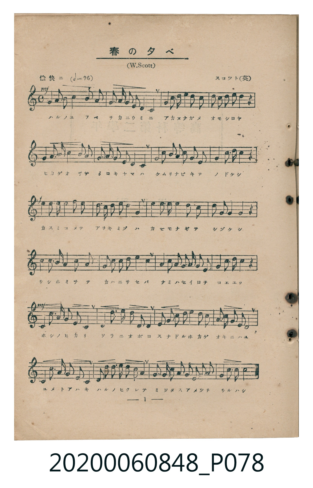
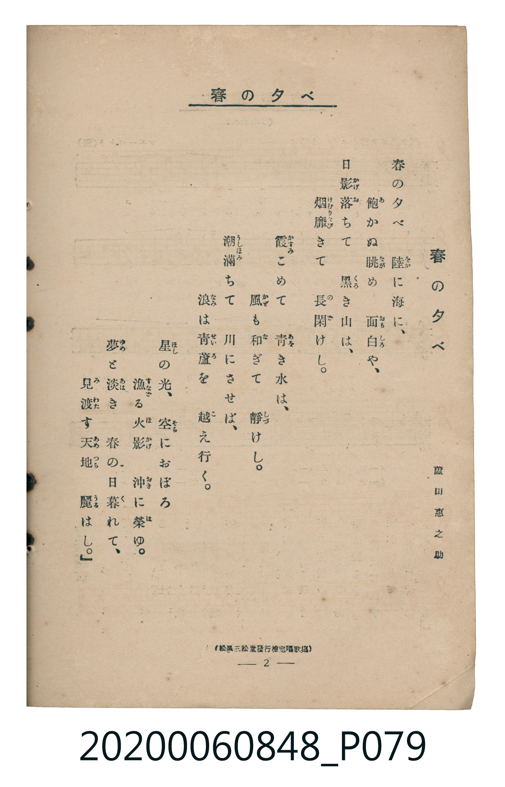

# 春の夕べ

> Re:Shōka 使用 AI 協助辨識與重建樂譜，可能會有錯誤。歡迎回報。

- **鋼琴伴奏版**：<br><audio controls src="haru_no_yube.mp3"></audio>
- **NEUTRINO 歌聲合成版**：<br><audio controls src="haru_no_yube_neutrino.mp3"></audio>

- 詞：蘆田惠之助
- 曲：スコツト（W. Scott，英國）
- 臺灣教育會公認《新定兒童唱歌》高等科男子用（2020.006.0848）

## 說明

原書資訊與歌詞全文（對應 P078.jpg – P079.jpg，書頁 pp. 1–2，高二第一學期第 1 首）：
調性與拍號：ハ長調（無升降記號）、4/4 拍（愉快ニ ♩=96）
出處註記：（松邑三松堂發行檢定唱歌集）


## 歌詞

```text
春の夕べ　陸（をか）に海（うみ）に、
飽（あ）かぬ眺（なが）め　面白（おもしろ）や、
日影（ひかげ）落（お）ちて　黒（くろ）き山（やま）は、
烟（けむり）靡（なび）きて　長閑（のど）けし。
霞（かすみ）こめて　青（あを）き水（みづ）は、
風（かぜ）も和（な）ぎて　靜（しづ）けし。
潮滿（うしほみ）ちて　川（かは）にさせば、
浪（なみ）は青蘆（せいろ）を　越（こ）え行（ゆ）く。
星（ほし）の光（ひかり）、　空（そら）におぼろ
漁（すなど）る火影（ほかげ）　沖（おき）に榮（は）ゆ。
夢（ゆめ）と淡（あは）き　春（はる）の日暮（ひく）れて、
見渡（みわた）す天地（あめつち）　麗（うる）はし。
```

## ABC

<div class="abc-score" data-abc-src="haru_no_yube.abc" aria-label="五線譜載入中"></div>

[下載 ABC 原始檔](haru_no_yube.abc)

## TMD 檔案連結

- [主旋律 TMD 檔案](haru_no_yube.tmd) [[在 TMD Studio 編輯](https://tmdlang.github.io/Tmd-TS/#tmd=s7IKdvYPcrWy4qpTUCpJTLdSSM7PyUlNLsnMz7MqzsjMK0nNjM_KTMmPL87Iz05Ugisry88pzU21ys4vyY9Pyq8sjjcyMDKINzAwizewMLFAqCvOLy1KTrUqTs7Iz8-JL0mtKEnKz89Gl48vSExPtQowMMfQCZexRMgUFOWXpeYl5gHNLSgCOTEFbDBCQWpZZkoqSLo4OTEvviy1KDMtMzUFyfGpRcVgD0KsKClKzCtOLsosAPkaoSq_qCQjP70osSCj0iojs7gkvygzOTEnPjsxDykcSjJSgcFQkpmbGp-fFp-SWIkuVZyaWJyfV4xsbGZ6Zp5VbmpmViaWAIFKl6cWl6QW5cXnpubkpwAN1dJSeDZj6ePGdU-XTH3cuFNBS4tL0VbB0ozL3lbBmcvGRN_EDmTEi5Xz3u-Z9WJG2_MpG541L3iys_tp10qw4c9mbwLKPG7a-bhp8-PmlsfNHe_3dITrKQQn55eUvN_T86J749M53e_3dIJVv2jf9bxx8bOpM180bXo2p_lp65oXq3ofN3Q9m7bh6bpZT1snPV-99OmUjc_W9jxu6H65esbztZ3Pl098PmX707UTnk9ZATQalB70gOlBD5QewMZy6Wsp2FILcCkoKDztm_9s9o4Xm9tfrOh60dEOdAzQ-09bVzyb1g50wNMNvc_aOxVAiUovqyBd4VHDZBDHEsQB-heo8-WCRoWCAj0FQ6CUEVAI6I8nu3qer1nzZEfD07U7ns2ZD2QrGCq8XDYN6AFg6IEsfbFq_7OG5SDruntfzJwPCtPm_pdTtwPFgZY-b1n4tLf95czeFytmgGU7Hzc0AiNHAagaKP2spfPp_tWPm7sVHs1caWtpBpQHe6R914uZU1-s2A3UBTQQpHDuvpdNE5_s6AQyni5oej5zz4uFPc9WLQIFPjjYX85uA2kG6UZOF48bGl7O3AE04HHTpMeNoOh83Lj62dbtIJHGtseNQDeCRICOAul8uXgvWKIJLNr9uHHN8zm7wCKrHjf2gASbGkEmzl30fCZEZdfjpqbHjdMfNwF9A5RtgRr0bPrSp3s3glVsAhs0CSj9YgJUD9j0hY8bl4HM2g2UAgr2Q41o7H26EawRaFbjPrDIeqihz5uB4QdUOvFxU8PjJpApL-cuhLluM0Qz1NCp219OmwiWWve4cSVYaiLImQ1NYG_OAWYKoBzQXTNhQTAZ5DWI5rkQFzUBgwxi6LMNW8Ai-x83LkVx0ctFoJQNNmgO2P9NTycBgwnkIrC6PpiJQFmg4HSYfiS3PNu77tluUEoBRwdQxW6Yi6AB9HT7XJgd66GR1QiM2dmPGzfAAnsr0DZIKEB0rgd6AZjlwYJAdS2w2JkENO7FNmDAAcUng1V2AFMROLBBiQcUCVBHzYCENNAt08ES6562AtM7LDbBYQ-0HGjc85WQ9DH3cRNQAcR1XY8b9wCtBBu0pxEsDQxmoOvAEdHU_bxxNSxxAC2AJg6gWc82AbMVOE01QpLC6mfL1oFFwB5vaoO67umSRRA3A6MMrG7Fs-2QdABMipAwAhZNDcBsANEMtBLiCWCqfDYLYiLQH_1gQ3vAoQwOxxfLup_tgBi0_3FT_-NGcHZtnPl0ycqnczbA0gQwlSwBRg7EyS93AcMHHHVQO9YjYpbyMg0KFLT0ubh8E4GVQEBmYl6-Q41BTTXIAgUbQzMtOzALWJJCiilgfIKUg8RqFKpz02oVTBV0wdAMiM2B2DAOKgDigARroErMwLQxEBtBVRhC6RqweT6GNQrAog0q9rh5NZjsA5PL4KJTweRMsLmPmzdBRJtWA9ndYBZI5ePm-XD1IFGIHVBHw9wLdqcRiDCGuRjMA4vXILERasAsEDTAdHjTIpiVQMeALO4Bk11w0TVg_kKIw5tWgXkgPY-btoPZa8HkEqj6eFRnQ8N_Vw9K-CMHPSi8KQz6SSg-ANGboC6FBGUjmGyD-mA9VHQtkI1w--PmeXD1sKjEHvQwN4I5MOehqQEHOdxX2EJ9I9y2BWASEq6gUH_cPBnsB4jboK4GJyeI-k6oHzdCYwB3qO_oRE31wEQPTzJgBoIAQRM4D5qKwJ7BkopgXkX2DyTkQe7aCXYlKCEDG1BwV4PSDyIOIGkOlA1g_gSrb26Fq8eIA1SXgync6R_kQpgrYTS2WEC4eg_U3kUoaX8diqsh6R3kRqT4wx8HT2fPRokDeJqAMsyheQAqgEj7YC6WrA43ANkb8FIG6pjHzbNRyhLUDADJ5qAAhpU9W8Hkbrj6CaheqcF0JHr2JDX9I8IYGvNg50Cd8LhpCbxcARWUIEfDU1LTCqi-ZfC8jLPUmYJZ6sPKD6jjED6AFyzwogaa3oFBD2aBhGFSyD6ZDXcZLPD7oGUSLKhhJRHIH3vh_l4JpbvhpeocMAnyN0rgg1wHTxK4C36MMgnmWBhETjGQTAopbkAFCqzWQngGzAcWpEjFPjSrgtMMNP3AUh7CDuTE37oWNfFDFREIe0hooxY78JIXPfQRFSyohAHRHdDyBZam4OEJdzRyBQ2JJ1A6etwMqelA2QQl_FECFeRUlBYDcnWFHEfw1I8l-KFpHmxr034wCY4QqLshZWULmARlXZQsDnU9xG-wsgdhRy0Xl66dAqhRpACklbkA)]
- [鋼琴伴奏 TMD 檔案](haru_no_yube_piano.tmd) [[在 TMD Studio 編輯](https://tmdlang.github.io/Tmd-TS/#tmd=s7IKdvYPcrWy4qpTUCpJTLdSSM7PyUlNLsnMz7MqzsjMK0nNjM_KTMmPL87Iz05Ugisry88pzU21ys4vyY9Pyq8sjjcyMDKINzAwizewMLFAqCvOLy1KTrUqTs7Iz8-JL0mtKEnKz89Gl48vSExPtQowMMfQCZexRMgUFOWXpeYl5gHNLSgCOTEFbDBCQWpZZkoqSLo4OTEvviy1KDMtMzUFyfGpRcVgD0KsKClKzCtOLsosAPkaoSq_qCQjP70osSCj0iojs7gkvygzOTEnPjsxDykcEouAmtNTc1PzSqwKMhPz8uMTk5PzcwsS8zJBYgiFJRlARVYlQNH4_LT4lMRKdKni1MTi_LxiZPsz0zPzrHJTM7MysYQcVLo8tbgktSgvPjc1Jz8FaKiWlsKzGUsfN657umTq48ad7_d0vOze83zClid7tjxd2v-8s-P9nk4FLS0uRVsFSzMue1sFZy4bE30TO5C5L1bOe79n1osZbc-nbHjWvODJzu6nXSvBNj6bvQko87hp5-OmzY-bWx43A43pCNdTCE7OLyl5v6fnRffGp3O6gUaDVb9o3_W8cfGzqTNfNG16Nqf5aeuaF6t6Hzd0PZu24em6WU9bJz1fvfTplI3P1vY8buh-uXrG87Wdz5dPfD5l-9O1E55PWQE0GpSa9ICpSQ-UmsDGcvkmAn0bAAriIA-HGoOaai4FILAxNNOyA7P0tRSer1nzZEfDi4U9Clr6YLEaherctFoFUwVdMDQDYnMgNoyDCoA4IMEaqBIzMG0MxEZQFYZQugZsno9hjcLj5n6o2OPm1WCyD0wug4tOBZMzweY-bt4EEW1aDWR3g1kglY-b58PVg0QhdkAdDXMv2J1GIMIY5mIwDyxeg8RGqAGzQNAA0-FNi2BWAh0DsrgHTHbBRdeA-QshDm9aBeaB9Dxu2g5mrwWTS6Dq41GdDQ3_XT0o4Y8c9KDwpjDoJ6H4AERvgroUEpSNYLIN6oP1UNG1QDbC7Y-b58HVw6ISe9DD3AjmwJyHpgYc5HBfYQv1jXDbFoBJSLiCQv1x82SwHyBug7oanJwg6juhftwIjQHcob6jEzXVAxM9PMmAGQgCBE3gPGgqAnsGSyqCeRXZP5CQB7lrJ9iVoIQMLBbgrgalH0QcQNIcKBvA_AlW39wKV48RB6guB1O40z_IhTBXwmhssYBw9R6ovYtQ0v46FFdD0jvIjUjxhz8Ons6ejRIH8DQBZZhD8wBUAJH2wVwsWR1uALI34KUM1DGPm2ejlCWoGQCSzUEBDCt7toLJ3XD1E1C9UoPpSPTsSWr6R4QxNObBzoE64XHTEni5AiooQY6Gp6SmFVB9y-B5GWepMwWz1IeVH1DHIXwAL1jgRQ00vQODHswCCcOkkH0yG-4yWOD3QcskWFDDSiKQP_bC_b0SSnfDS9U5YBLkb5TAB7kOniRwF_wYZRLMsTCInGIgmRRS3IAKFFithfAMmA8sSJGKfWhWBacZaPqBpTyEHciJv3UtauKHKiIQ9pDQRi124CUveugjKlhQCQOiO6DlCyxNwcMT7mjkChoST6B09LgZUtOBsglK-KMEKsipKC0G5OoKOY7gqR9L8EPTPNjWpv1gEhwhUHdDysoWMAnKuihZHOp6iN9gZQ_CjlrkNpEPcpvIBG-TyDBeIdowFkyZxMciBEzjITTE9UCPQvlQaYQAiDbAX-2TaocJih2mQC1ADeh2oFVySHagaoUzYLYgqTSLz8VQi2YPRkGOcCKKX2AWQ5XB5DHdg8UraOUVWV4Bq4QGHJI6fLmSVGsQfkb2DDTx6dopgNKfApBW5gIA)]

## 分析

```text
================================================================================
📊 TMD Song Profile: [ 春の夕べ ]
================================================================================
⏱  Duration:       1:00 (60.0s), 24 measures total
🎼 Key & Tempo:    首調基準 C, != 96.0 BPM, <4/4>
   - 分析範圍：      由實際發聲的音符與和弦推測調性；播放脈絡另行呈現
🎤 人聲音域:    C4 (MIDI 60) – F5 (MIDI 77) [跨度: 17 個半音 / 1.4 個八度, 難度: challenging]
   - 最低音:  C4 in [Main #1 @ m.2, 0:04]
   - 最高音: F5 in [Main #1 @ m.9, 0:21]
   - 適合: soprano, mezzo-soprano, contralto, tenor, baritone, bass
🏛  結構:      Main (60.0s)
⚡ 編曲密度:        Peak 1 軌道同時演奏
🗝  調性診斷：       C 大調（純淨自然大調，未偵測到可信轉調）
   - 風格氣質:    純淨自然大調（陽光明朗、易唱易記，無明顯調外色彩）
   - 轉調歷程:    全曲維持單一推測調性（未偵測到可信轉調）
   - 核心骨幹音:  C, D, G, E, A
   - 調性數值:    C 大調 [相關度: 0.87, 穩定度: Moderate, 自然音純度: 100.0%]
   - 候選調性 (K-S): C 大調 (0.87), G 大調 (0.75), E 小調 (0.58)
   - 五度圈歷程:   +0
   - 各段落調性細節:
     • [Main #1]: C 大調 (r: 0.87, 自然音純度: 100.0%)

  [ 五度圈游移軌跡 ]
              [C ]*
         F            G  
      Bb               D  
      Eb               A  
         Ab           E  
            Db       B  
               F# 
     (* = active key center)

  [ 十二半音累積音高分佈 ]
     C  : ████████████████████████  29.3%
     C# :                            0.0%
     D  : ████████████████          20.1%
     D# :                            0.0%
     E  : ██████████████            17.1%
     F  :                            0.5%
     F# :                            0.0%
     G  : ████████████████          19.3%
     G# :                            0.0%
     A  : ████████                   9.2%
     A# :                            0.0%
     B  : ████                       4.3%
--------------------------------------------------------------------------------
Assignment 軌道音域：
  - Piano         : C4 – F5 (17 個半音 / 1.4 個八度, 140 個音符)
================================================================================
```


## 原書掃描頁






