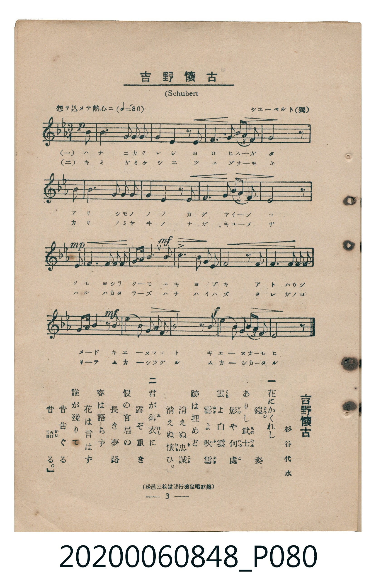

# 吉野懷古

<audio controls src="yoshino_kaiko.mp3"></audio>

- 詞：杉谷代水
- 曲：シユーベルト（F. Schubert，獨國）
- 臺灣教育會公認《新定兒童唱歌》高等科男子用（2020.006.0848）

## 說明

原書資訊與歌詞全文（對應 P080.jpg，書頁 p. 3，高二第一學期第 2 首）：
調性與拍號：變ホ長調（3 降記號）、3/4 拍（想ヲ込メテ熱心ニ ♩=80，弱起第 3 拍進入）
原曲：舒伯特《冬之旅》〈菩提樹〉（Der Lindenbaum）
出處註記：（松邑三松堂發行檢定唱歌集）

## 歌詞

```text
一　花（はな）にかくれし　鎧（よろひ）姿（すがた）
ありし武士（もののふ）　影（かげ）や何處（いづこ）
雲（くも）よ白雲（しらくも）　雪（ゆき）よ吹雪（ふぶき）
跡（あと）は埋（うづ）めど　消（き）えぬ誠（まこと）
消（き）えぬ懷（おも）ひ。

二　君（きみ）が御衣（みけし）に　露（つゆ）ぞ重（おも）き
假（かり）の宮居（みやゐ）の　長（なが）き夢路（ゆめぢ）
春（はる）は語（かた）らず　花（はな）は言（い）はず
誰（たれ）が殘（のこ）りて　昔（むかし）つぐる
昔（むかし）語（かた）る。
```

## ABC

```abc
X:1
T:吉野懷古
C:曲：シユーベルト（F. Schubert，獨國）
M:3/4
L:1/16
Q:1/4=80
K:Eb
V:V1 name="Piano" snm="Pia"
[V:V1]
!p! z4 z4 B2 G2 | G8 E2 E2 | E4 G4 z2 B B | B3 G A3 G F4/3 A4/3 F4/3 |
G6 z2 B2 G2 | G2 G2 E2 E2 E4 | E4 G4 z2 B2 | B3 G A3 G F4/3 A4/3 F4/3 |
!mp! E6 z2 B2 B2 | A2 G2 F2 E2 D3 F | !mf! B2 B2 c4 A3 F | G6 z2 F2 F2 |
G4 F2 E2 D2 E2 | !mf! A3 F D2 z2 z2 B B | G4 A4 F2 B2 | !f! G6 z2 z2 B B |
B3 G A3 G F4/3 A4/3 F4/3 | E6 z2 z4 |
```

## TMD 檔案連結

- [主旋律 TMD 檔案](yoshino_kaiko.tmd) [[在 TMD Studio 編輯](https://tmdlang.github.io/Tmd-TS/#tmd=s7IKdvYPcrWy4tLSUng6ofNle9-z9u1P-5coaGlxKdoqWBhw2dsquOpw2Rjrm9hx1SkovVg57_2eWc_mdr7YsP3J7sXPNmxRAgk_m70JKPy4afvj5mWPm_c8bp75uHn14-aO93s63PQUgpMzSpNSi0re7-l53rvi6Zzu93s6wdpetO963rj42dSZL5o2PZvT_LR1zYtVvY8bup5N2_B03aynrZOer176dMrGZ2t7Hjd0v1w94_nazufLJz6fsv3p2gnPp6wAmm5kYGSgZ2BgpmdgYWIBNpZLX0vBllqAS0FB4Wnf_Gezd7zY3P5iRdeLjnagY4CB8LR1xbNp7UAHPN3Q-6y9UyHAwMJAL6sgHehFoOKXCxoVCvQUjIE8oKuf7Op5vmbNkx0NT9fueDZnPpCtYKTwctk0oHOBgQay4sWq_c8aloMM7-59MXM-UPTFuq7HzbNfTt0OlALaYqzwcmbvixUzwJKdjxsagfGhAFQMlHrWvPlx86YX-4CBvvBxc9vzto1P9zc_bu5WeDRzpa2FAdAJT_dsfLF1O8haY5Celw2bnrYuBRoD9xwo7l50THqyZ_3zzp3A4H_atubJzu5n01uBof64oeNF_8pn_ROerQBKAR3c4ZJapOCTmZeSmpeUWJoLM6d914uZU1-s2A10JNA0kLvm7nvZNPHJjk4g4-mCpucz97xY2PNs1SJQxIKj9OXsNpBmkG5g2DxuaHjRtRGo73Hj-seNq0C-bFz9uLH7cWP_46aex43TgQpe9i0HKWgCot7HjUBXdz5dDgqdx40zHzcC1YDCBmTc48amx01dQD3P1i57ung1WE_T48Z1YLQVHIANT_dCLANaMAkk0tTyZO9UoBfAgi2PG5c-bpwMNe4lKICAokCHNIGVdjyfuRcmOP1xE9ClMCmgG2cD3Q60r-1xIzB2QIqfTtgJFWzc-rhxG0QcHOvbF4JFgU4DJmWgKeufzgdmDaAIUDMogh43NT5uXAk09Nk2UE6CmtgIZADzyQKwyD6gMyHaQSZiqgNmZ7BIF9SBjZseNzRBwnwXMFM1PJ0wG6LjcSMwJIHyPU_3LXyxcDFYcP_jxolAH0LjAui3ORA_LwF6Dyw472U7KAkiGd8LTgyNoJwBCtumLrDouqfr1j3d2Ao1tKnlcdMEiDjI0KkQF64C2g0x4umSRS-2r4eGIigIFsG8NwMYKuAE0gQqQoCMF6uAxREkFsEZAxQXs7AlpfUvVjRAohbCBSqDZLwNYNH5wDQG8f6zdcD0CxQBphRQ_IPT0TJQFMyYAnZRA9gySJgsedw4AegUiNPQpTGcBsxKTSCllJdKUKCgpc_F5ZuYmWcVkJmYl-9QY1CjUA2yQcHG0EzLDswCFoaQ7P90Q__z9aAgwCgHZj1u7n_cDIwoYCJe-7gZ5FiQySDdNQoGCrpgCKOrC2oVTIG0MRDXgNMRyApI8QbM32DTgNG--nHT-sfNa0AVQkPD4-YVj5uBJk963LTzcRNQcD_CfJA5yNAQimvAJAjCVIBcYAqENVCdIFeAZE2gtIYRkGmkqaqhCwSaaEZDNGNz9q4eqLObFj1uXgWuwYCMPjCaCnI8yC-bHjcD0_ySx82tj5s2ozoehGGOhjkZl-NBdhPpeJgBMM3VudCAh5iCEvCdMB8Agxzo9hVgT6yEckHBvwwcscBImPq4eRqIDfIWUGUHKOabgBV2K8JPIBeBXG0E9Y95PNgNRkCp6tw0hBvMoI6D-AAojSVCQQ4HmQPCCBkUk8Fxjeydp7Nnw9IRsDoDVmqgQhXk5iag-3seN88DxgDI5ciCTavAHp-E6guQTWA7IOEHdDs8CcHdAlEHcRNy_KD7ohpFN6HYgxqCHoewPFTDVcvFpWunAMq6CkBamYsLAA)]
- [鋼琴伴奏 TMD 檔案](yoshino_kaiko_piano.tmd) [[在 TMD Studio 編輯](https://tmdlang.github.io/Tmd-TS/#tmd=s7IKdvYPcrWy4tLSUng6ofNle9-z9u1P-5e839PxsnvP8wlbnuzZ8nRp__POjvd7OhW0tLgUbRUsDLjsbRVcdbhsjPVN7LjqFJRerJz3fs-sZ3M7X2zY_mT34mcbtiiBhJ_N3gQUfty0_XHzssfNex43z3zcvPpxM9CoDjc9heDkjNKk1KKS93t6nveueDqnG2gDWNuL9l3PGxc_mzrzRdOmZ3Oan7auebGq93FD17NpG56um_W0ddLz1UufTtn4bG3P44bul6tnPF_b-Xz5xOdTtj9dO-H5lBVA040MjAz0DAzM9AwsTCzAxnL5JmbmWQVkJublB3k41BjUKFRzKQCBjaGZlh2YpQ8MgD0bX2zd_nRD__P1DQpa-mDhGgUDBV0whNHVBbUKpkDaGIhruGB6n69Z82RHw4uFPQiNIAXI0BCKa8AkCMJUgIw2BcIaqE6Q8SBZEyitYQRkGmmqaugCgSaa0RDN2NyzqwfDPSAMcwfMFbjcAzKOSPfADIBprs6FBhLEFJRA6kRxFMhIkLVGUAeZx4MNMQJKVeemIQwxg5oOcQJQGksgg2wGmQPCCBkUk8Hhj-yep7NnY7gHpAesGuIVoCvgEQQ3FaIOYjpyUKG7pxpFN6GAhBqCHpywpFfDVYuckn1QUrIJ4YQMgniTrGG8QrRhLBijcmAJIR4oZhoPFAQRcCXopqIlPCqZipZysOkygXPRrEYxGKoCTyowghoNdAJec0HyYHfgUQCKM107BVC0KQBpZS4uAA)]

## 分析

```text
================================================================================
📊 TMD Song Profile: [ 吉野懷古 ]
================================================================================
⏱  Duration:       0:40 (40.5s), 18 measures total
🎼 Key & Tempo:    首調基準 E,, != 80.0 BPM, <3/4>
   - 分析範圍：      由實際發聲的音符與和弦推測調性；播放脈絡另行呈現
🎤 人聲音域:    D4 (MIDI 62) – C5 (MIDI 72) [跨度: 10 個半音 / 0.8 個八度, 難度: easy]
   - 最低音:  D4 in [Main #1 @ m.10, 0:21]
   - 最高音: C5 in [Main #1 @ m.11, 0:23]
   - 適合: soprano, mezzo-soprano, contralto, tenor, baritone, bass
🏛  結構:      Main (40.5s)
⚡ 編曲密度:        Peak 1 軌道同時演奏
🗝  調性診斷：       D# 大調（純淨自然大調，未偵測到可信轉調）
   - 風格氣質:    純淨自然大調（陽光明朗、易唱易記，無明顯調外色彩）
   - 轉調歷程:    全曲維持單一推測調性（未偵測到可信轉調）
   - 核心骨幹音:  G, D#, A#, G#, F
   - 調性數值:    D# 大調 [相關度: 0.81, 穩定度: Moderate, 自然音純度: 100.0%]
   - 候選調性 (K-S): D# 大調 (0.81), G 小調 (0.73), C 小調 (0.49)
   - 五度圈歷程:   -3
   - 各段落調性細節:
     • [Main #1]: D# 大調 (r: 0.81, 自然音純度: 100.0%)

  [ 五度圈游移軌跡 ]
               C  
         F            G  
      Bb               D  
     [Eb]*              A  
         Ab           E  
            Db       B  
               F# 
     (* = active key center)

  [ 十二半音累積音高分佈 ]
     C  : ██                         2.2%
     C# :                            0.0%
     D  : ███                        3.8%
     D# : ████████████████          20.7%
     E  :                            0.0%
     F  : █████████                 11.4%
     F# :                            0.0%
     G  : ████████████████████████  31.5%
     G# : ██████████                13.6%
     A  :                            0.0%
     A# : █████████████             16.8%
     B  :                            0.0%
--------------------------------------------------------------------------------
Assignment 軌道音域：
  - Piano         : D4 – C5 (10 個半音 / 0.8 個八度, 76 個音符)
================================================================================
```


## 原書掃描頁




