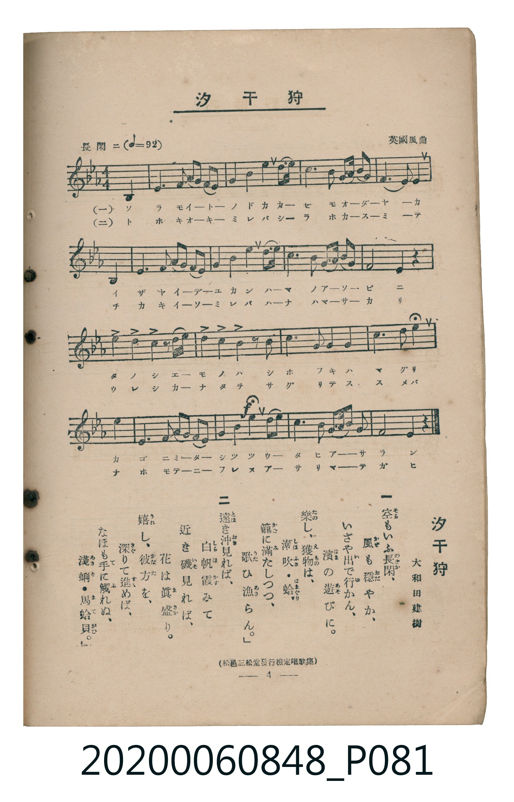

# 汐干狩

<audio controls src="shiohigari.mp3"></audio>

- 詞：大和田建樹
- 曲：英國風曲
- 臺灣教育會公認《新定兒童唱歌》高等科男子用（2020.006.0848）

## 說明

原書資訊與歌詞全文（對應 P081.jpg，書頁 p. 4，高二第一學期第 3 首）：
調性與拍號：變ホ長調（3 降記號）、4/4 拍（長閑ニ ♩=92，弱起第 4 拍進入）
出處註記：（松邑三松堂發行檢定唱歌集）

## 歌詞

```text
一　空（そら）もいふ長閑（のどか）、　風（かぜ）も穩（おだ）やか、
いざや出（い）で行（ゆ）かん、　濱（はま）の遊（あそ）びに。
樂（たの）し、獲物（えもの）は、　潮吹（しほふき）・蛤（はまぐり）
籠（かご）に滿（み）たしつつ、　歌（うた）ひ漁（あさ）らん。

二　遠（とほ）き沖（おき）見（み）れば、　白帆（しらほ）霞（かす）みて
近（ちか）き磯（いそ）見（み）れば、　花（はな）は眞盛（まさか）り。
嬉（うれ）し、彼方（かなた）を、　深（さぐ）りて進（すす）めば、
なほも手（て）に觸（ふ）れぬ、　淺蜊（あさり）・馬蛤貝（まてがひ）。
```

## ABC

```abc
X:1
T:汐干狩
C:曲：英國風曲
M:4/4
L:1/16
Q:1/4=92
K:Eb
V:V1 name="Piano" snm="Pia"
[V:V1]
!mf! z4 z4 z4 B,4 | E4 E3 F G3 A B2 G2 | F4 B3 c B8 | G4 F3 G A3 F G4 |
G4 F8 B,4 | E4 E3 F G3 A B2 G2 | F8 B3 A G4 | F4 G3 A G3 F E4 |
E8 z4 F2 F2 | F2 z2 G3 A B2 G2 E2 z2 | B6 G2 e3 d c3 B | c8 B4 B,4 |
E4 E3 F G3 A B2 c2 | !f! G4 e6 B2 G4 | F4 E3 F G3 A G4 | F4 E4 z4 z4 |
```

## TMD 檔案連結

- [主旋律 TMD 檔案](shiohigari.tmd) [[在 TMD Studio 編輯](https://tmdlang.github.io/Tmd-TS/#tmd=s7IKdvYPcrWy4tLSUni2ccLTnZued69U0NLiUrRVsDTisrdVcNXhsjHRN7HjqlNQerFy3vs9s54uWf50Us_zKRue7t71bMVOJZDMs9mbgDIvujc-ndP9ctEKIBcs_KJ91_PGxc-mznzRtOnZnOanrWterOp93ND1bNqGp-tmPW2d9Hz10qdTNj5b2_O4ofvl6hnP13Y-Xz7x-ZTtT9dOeD5lxfs9HUYGRgZ6BgZmegYWJhbv93QqcXHpaynYUgtwKSgoPO2b_2z2jheb21-s6HrR0Q50DNCfT1tXPJvWDnTA0w29z9o7FQIMLAz1sgrS3-_pASp-uaBRoUBPwQTIA7r6ya6e52vWPNnR8HTtjmdz5gPZCsYKL5dNAzoXGCggK16s2v-sYTnI8O7eFzPng4JqXdfj5tkvp24HSgFtAaqf2ftixQywZOfjhkZgkCsAFQOlgGpeTpv4uLlb4dHMlbaWRkA7n-7Z-GLrdpA9YEUvGzY9bV0K1Af2TfuuFzOnvlixG2ga0B6gAc_m7nvZNPHJjk4g4-mCpucz97xY2PNs1SJQDIDD_uXsNpBmkG6gJx43NDxfuQuo73Hj3MdNQB90Pm5qetzY8rhxK8QpYKl1jxtXPm7shjgWqAUY6WDx7seNcyBanq9cCRbpety4ACwCNKEbqBhkDdi4aUAhoGvBilpAKhqXAx0G4jaB3ANS3TQZYvqz_RvBytY_btwHllr3srELLAJ02VywyObHjasfNzSBTH-2ogksNx-oDiw3HWjK895NzzshLgJaANQGkVoPtWDvuqcTdoJlpz9u3A306-NGYOB3Pm7e_WL2ErjdjxsnPG4CWgwO6ecbgf6CeHkK2KzVz3aD4vJxI5AEcoHWA81aAkIQO9aCPdfYBpQCK9j0bE8jzBNTwUEEREAfN0GiYhcwUzS8BAUeUMkKoKvAmnqfbQImLEi4glz4YhkwEmB2NvU8btwAse35zL1PdwDDEewjoMFg7S_nADMwxMkzwabtf9y4DJxA90OidSE0Tht7ny9eD4kZSADjsuZFFzxmVkEC9Pmcec9nzwYLAsNrKtTApi5o5DxdA0xS4FBoAgYHNHKe7t3zbBok-IFOWwUNoKZJ0IDbDrEDaNYEqFmNy4CJHiw4E-qVpkaImyDJC2jEbmAsP-uEuHoZJH5eLN8B5m6FeWINzIJdL-bA09NUSBQDo_7lsjXA2H-xCRgAEN8se9wI1AW0GJjqwb6hvASCAgUtfS4u38TMPKuAzMS8fIcagxqFapANCjaGZlp2YBaw4IPk_Kcb-p-vbwA6CqMImPW4ae_7Pf2PmzuAbgSZCdJXo2CgoAuG6HR1blqtgmk8lFcDTncgayDFGTg3znrcvPJx86LHTUseN-8Bmgsm-x43AwMQmN8aQCRQpAkoCFSzCizbACbB6ptWIxxhCLUGQhsBy0gQbaJgCiRB7BqgGEQFSERXwQxKI2AN1CSITpAZINIYaAayiSCTUFUgIA6_7uqB-hXoy6ZtILdDvdsOJpeBfbkZ5N1mYNgCReaBwqBpEdiLe8Eik0ElNBl-hbsMqgLuB6hJMHUwEyC0EdwGhF0wCItckE4QRovWTphX94P9sP1x0wqwB4CeAUZrPzhOtwPrpsfNwIywFuzheY-bNjxuXoXwHshYkDXo3gI5BSRegxJ1YJk4MNMcGKsQ38L8B-GjhwOumHo6ezbM-asfN20Bhvnj5vngWAD6BkgCHd4CQiBPLIOJT4LF1FZgWlYARiRx8QRyGSIlVQNzCtQTCIfiiix04xAJE1UFZo6s4arl4tK1UwAVBQpAWpmLCwA)]
- [鋼琴伴奏 TMD 檔案](shiohigari_piano.tmd) [[在 TMD Studio 編輯](https://tmdlang.github.io/Tmd-TS/#tmd=s7IKdvYPcrWy4tLSUni2ccLTnZued698v6fjZfee5xO2PNmz5enS_uedHe_3dCpoaXEp2ipYGnHZ2yq46nDZmOib2HHVKSi9WDnv_Z5ZT5csfzqp5_mUDU9373q2YqcSSObZ7E1AmRfdG5_O6X65aAWQCxZ-0b7reePiZ1Nnvmja9GxO89PWNS9W9T5u6Ho2bcPTdbOetk56vnrp0ykbn63tedzQ_XL1jOdrO58vn_h8yvanayc8n7IC6DojAyMDPQMDMz0DCxMLoNuUuLh8EzPzrAIyE_PygzwcagxqFKq5FIDAxtBMyw7M0tdSeLpn44ut259u6H--vkFBSx8sXKNgoKALhuh0dW5arYJpPJRXwwUz5fmaNU92NLxY2IMwwhCqCEIbKRiDaRMFUyAJYtcAxSAqQCK6CmZQGgFroCZBdILMAJHGQDOQTQSZhKoCAXG4dFcPmS6FmwtVAXcB1CSYOpgJENoIbgPCLhiEBSxIJwijBWknikNBCkAa0B0IMhQkXoMShGCZODDTHBi6EHfDXArho_sIV4g9nT2b6BADmYyIkWpgeoE6AmERrmBDNw4RwagqMNNlDVctcnL3QUnuJoRTOwTiT8_xCtGGsTAKGNTxQJZpfCyCAfMOSAmIb4KhFEyg24OeGnHZAxOBqkO1H6wUqgKLV1DTEYaRyJaaIPkE5AMQH6QBzUyMJIFmAro_kK3G8B7c0cBY1LVTAEWkApBW5uICAA)]

## 分析

```text
================================================================================
📊 TMD Song Profile: [ 汐干狩 ]
================================================================================
⏱  Duration:       0:41 (41.7s), 16 measures total
🎼 Key & Tempo:    首調基準 E,, != 92.0 BPM, <4/4>
   - 分析範圍：      由實際發聲的音符與和弦推測調性；播放脈絡另行呈現
🎤 人聲音域:    A#3 (MIDI 58) – D#5 (MIDI 75) [跨度: 17 個半音 / 1.4 個八度, 難度: challenging]
   - 最低音:  A#3 in [Main #1 @ m.1, 0:01]
   - 最高音: D#5 in [Main #1 @ m.11, 0:27]
   - 適合: soprano, mezzo-soprano, contralto, tenor, baritone, bass
🏛  結構:      Main (41.7s)
⚡ 編曲密度:        Peak 1 軌道同時演奏
🗝  調性診斷：       D# 大調（純淨自然大調，未偵測到可信轉調）
   - 風格氣質:    純淨自然大調（陽光明朗、易唱易記，無明顯調外色彩）
   - 轉調歷程:    全曲維持單一推測調性（未偵測到可信轉調）
   - 核心骨幹音:  G, D#, F, A#, C
   - 調性數值:    D# 大調 [相關度: 0.82, 穩定度: Moderate, 自然音純度: 100.0%]
   - 候選調性 (K-S): D# 大調 (0.82), A# 大調 (0.70), G 小調 (0.68)
   - 五度圈歷程:   -3
   - 各段落調性細節:
     • [Main #1]: D# 大調 (r: 0.82, 自然音純度: 100.0%)

  [ 五度圈游移軌跡 ]
               C  
         F            G  
      Bb               D  
     [Eb]*              A  
         Ab           E  
            Db       B  
               F# 
     (* = active key center)

  [ 十二半音累積音高分佈 ]
     C  : ██████                     6.1%
     C# :                            0.0%
     D  :                            0.4%
     D# : █████████████████████     22.4%
     E  :                            0.0%
     F  : ███████████████████       20.6%
     F# :                            0.0%
     G  : ████████████████████████  25.4%
     G# : ████                       4.4%
     A  :                            0.0%
     A# : ███████████████████       20.6%
     B  :                            0.0%
--------------------------------------------------------------------------------
Assignment 軌道音域：
  - Piano         : A#3 – D#5 (17 個半音 / 1.4 個八度, 75 個音符)
================================================================================
```


## 原書掃描頁




