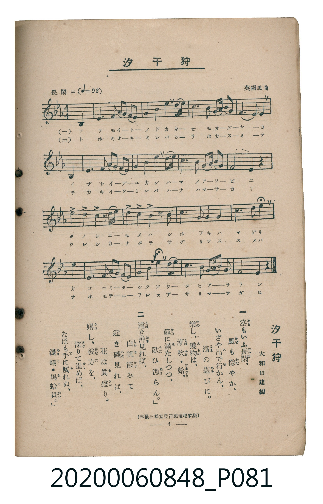

# 汐干狩

> Re:Shōka 使用 AI 協助辨識與重建樂譜，可能會有錯誤。歡迎回報。

- **鋼琴伴奏版**：<br><audio controls src="shiohigari.mp3"></audio>
- **NEUTRINO 歌聲合成版**：<br><audio controls src="shiohigari_neutrino.mp3"></audio>

- 詞：大和田建樹
- 曲：英國風曲
- 臺灣教育會公認《新定兒童唱歌》高等科男子用（2020.006.0848）

## 說明

原書資訊與歌詞全文（對應 P081.jpg，書頁 p. 4，高二第一學期第 3 首）：
調性與拍號：變ホ長調（3 降記號）、4/4 拍（長閑ニ ♩=92，弱起第 4 拍進入）
出處註記：（松邑三松堂發行檢定唱歌集）


## 歌詞

```text
一
空（そら）もいと長閑（のどか）、　風（かぜ）も穩（おだ）やか、
いざや出（い）で行（ゆ）かん、　濱（はま）の遊（あそ）びに。
樂（たの）し、獲物（えもの）は、　潮吹（しほふき）・蛤（はまぐり）
籠（かご）に滿（み）たしつつ、　歌（うた）ひ漁（あさ）らん。」

二
遠（とほ）き沖（おき）見（み）れば、　白帆（しらほ）霞（かす）みて
近（ちか）き磯（いそ）見（み）れば、　花（はな）は眞盛（まさか）り。
嬉（うれ）し、彼方（かなた）を、　探（さぐ）りて進（すす）めば、
なほも手（て）に觸（ふ）れぬ、　淺蜊（あさり）・馬蛤貝（まてがひ）。」
```

## ABC

<div class="abc-score" data-abc-src="shiohigari.abc" aria-label="五線譜載入中"></div>

[下載 ABC 原始檔](shiohigari.abc)

## TMD 檔案連結

- [主旋律 TMD 檔案](shiohigari.tmd) [[在 TMD Studio 編輯](https://tmdlang.github.io/Tmd-TS/#tmd=s7IKdvYPcrWy4qpTUCpJTLdSSM7PyUlNLsnMz7MqzsjMK0nNjM_KTMmPL87Iz05Ugisry88pzU21ys4vyY9Pyq8sjjcyMDKINzAwizewMLFAqCvOLy1KTrUqTs7Iz8-JL0mtKEnKz89Gl48vSExPtQowsDBEyBQU5Zel5iXmAXUXFIEckgLWjlCQWpaZkgqSLk5OzIsvSy3KTMtMTUFyYmpRMdgbECtKihLzipOLMgtAfkOoyi8qychPL0osyKi0ysgsLskvykxOzInPTsxD8m1JRirQs-X5RUguh4ollqQWoQsCrSpLzUEXLS4A2oVscWZ6Zp5VbmpmViaWgIFKl6cWAy3Ii89NzclPqVTi0tJSeLZxwtOdm553r1TQ0uJStFWwNOKyt1Vw1eGyMdE3sQMZ8GLlvPd7Zj1dsvzppJ7nUzY83b3r2YqdYKOfzd4ElHnRvfHpnO6Xi1YAuWDhF-27njcufjZ15oumTc_mND9tXfNiVe_jhq5n0zY8XTfraeuk56uXPp2y8dnanscN3S9Xz3i-tvP58onPp2x_unbC8ykr3u_pAEW_HjD69UDR_35PpxIXl76Wgi21AJeCgsLTvvnPZu94sbn9xYquFx3tQMcA_fm0dcWzae1ABzzd0PusvVMBlIb0sgrS3-_pASp-uaBRoUBPwQTIA7r6ya6e52vWPNnR8HTtjmdz5gPZCsYKL5dNAzoXGCggK16s2v-sYTnI8O7eFzPng4JqXdfj5tkvp24HSgFtAaqf2ftixQywZOfjhkZgkCsAFQOlgGpeTpv4uLlb4dHMlbaWRkA7n-7Z-GLrdpA9YEUvGzY9bV0K1Af2TfuuFzOnvlixG2ga0B6gAc_m7nvZNPHJjk4g4-mCpucz97xY2PNs1SJQDIDD_uXsNpBmkG6gJ0DU85W7gBofN8593AT0QufjpqbHjS2PG1dA3AKWWve4ceXjxm6Iax83NABjHSze_bhxDkTL85UrwSJdjxsXgEWAJnQDFYMsABs3DSgEdC5YUQtIReNyoMtA3CaQg0CqmyZDTH-2fyNY2frHjfvAUuteNnaBRYAumwsW2fy4cfXjhiaQ6c9WNIHl5gPVgeWmA0153rvpeSfERUALgNogUuuhFuxd93TCTrDs9MeNux83bn3cCAz9zsfNu1_MXgK3-3HjhMdNQIvBQf18I9BfEC9PAZu1-tluUGQ-bgSSQC7QeqBZS0AIYsdasOca24BSYAWbnu1phHliKjiIgAjo46bHDb2Q6NjVA6JeggIQqGwF0GVgjb3PNgFTFyRsQa58sQwYETB7m3oeN26A2Ph85t6nO4BhCfYV0HCw9pdzgLkY4uyZYNP2P25cBk6l-yFRuxAar429zxevh8QOJJBxWfOiCx47qyCB-nzOvOezZ4MFgWE2FWpgUxc0gp6uASYrcEg0AYMEGkFP9-55Ng0SBUCnrYIGUtMkaOD1LQJLAc2aADWrcRkw5YMFZ0K90tQIcRMkiQGN2A2M6WedEFcvg8TRi-U7wNytME-sgVqwfdeLOfA0NRUSzcDof7lsDTAFvNgEDACIb5Y9bgTqAloMTPngmAJaRnlJBAUKWvpcXMEZmfkZmemJRZlWAZmJefkONbqGNdUgexRsDM207MAsbMWgAqQcAuYiBQ1IIaFgCCohFLSBJcXTDf3P1zfowIsyTSz6gbaDzK5RMFDQBUN02jQeyqgBmgxhgaAREJsAsTGUDZKrAbPAmqA0SBYEzcCkOciMOCRDzOFSpnDDEIaAIEgUZhjCJWAn-xjWKMBE0OnHTXvhrn7cvBLJwMfNi8DyS8DsPWCyA84Gqe6Dq-yEm7YajQVSDVTbBNKDbvIquIrHzQ0oJoPsRKgG241kMkwW6jsjPL4Duxjmu9nIpjathbsBZgNYBO6G-XAz1sBZE-C6tyP7Di3cQPYg-_9x006sJiP5rrkNzm-E-w5_Wt7VA07LJCZewikTlhJhiQmeDkFpEMytgSZFhDqIHhM4GzVpgrVBaVhmQaTMx03bUMIDnN5QUl07nA0KvWUwlYgU0bwZzuqH0pB4mYdiMii9Pm4CpT1YvIDSPsLkyWhuBjUsICy0_ARMcQjbIW5Zi-5qNLPxpiY0V3ehuAEkB_MJxNVbkU1GcQdEDSRfIbuaQKnYSVZKQk0XsPIJEsXmkHSCLgVLUyAlIDZqSgKlHFjqg9GoKkDmwe3FUso9btoPDwV46QTNq5DweNy0Ah7OkJSAohYaEzC1IJ0YJUfzVLDcWgw9GCmuaQNYHhYfiLhCTkfw9IxIGWguXo2RMpD9uQlFLShtgEwF2YxwMaSUg5cx4PII6mI4G6JyIZhEpEyYjQTS0NPZs-lcGlWn1ZJfWYJNgtLYSqQtKGECKgUgORiWt0Ghj8iBsNh63NyCyYLGL6wehMUbRGwSWAVSiQQ1HxqLKPUKRA2spMNSIqGlUnAdC45zWDkK8QesRAKlYohKRInUA3c1wk0gV4PcgzAZkpqQSiSkOgykGmYeqj9RXV3LxaVrp4BozSkAecpcAA)]
- [鋼琴伴奏 TMD 檔案](shiohigari_piano.tmd) [[在 TMD Studio 編輯](https://tmdlang.github.io/Tmd-TS/#tmd=s7IKdvYPcrWy4qpTUCpJTLdSSM7PyUlNLsnMz7MqzsjMK0nNjM_KTMmPL87Iz05Ugisry88pzU21ys4vyY9Pyq8sjjcyMDKINzAwizewMLFAqCvOLy1KTrUqTs7Iz8-JL0mtKEnKz89Gl48vSExPtQowsDBEyBQU5Zel5iXmAXUXFIEckgLWjlCQWpaZkgqSLk5OzIsvSy3KTMtMTUFyYmpRMdgbECtKihLzipOLMgtAfkOoyi8qychPL0osyKi0ysgsLskvykxOzInPTsxD8m1iEVBzempual6JVUFmYl5-fGJycn5uQWJeJkgMobAkA6jIqjy_CMmLULHEktQidEGgm8pSc9BFiwuAjkJ2YWZ6Zp5VbmpmViaWEIRKl6cWAy3Ii89NzclPqVTi0tJSeLZxwtOdm553r3y_p-Nl957nE7Y82bPl6dL-550d7_d0KmhpcSnaKlgacdnbKrjqcNmY6JvYgUx9sXLe-z2zni5Z_nRSz_MpG57u3vVsxU6wfc9mbwLKvOje-HRO98tFK4BcsPCL9l3PGxc_mzrzRdOmZ3Oan7auebGq93FD17NpG56um_W0ddLz1UufTtn4bG3P44bul6tnPF_b-Xz5xOdTtj9dO-H5lBVA14ESjx4w8eiBEg_QbUpcXMEZmfkZmemJRZlWAaAQD_JwqNE1rKnmUgACG0MzLTswS19LwRYdKDxfs-bJjoYXC3sUNJ7u2fhi63YFQ4Vn3b0K2gomCk839D9f36CjAEpselkF6ZpY9Gvpg82uUTBQ0AVDdNo0HsqoAZoMYYGgERCbALExlA2SqwGzwJqgNEgWBM3ApDnIjDgkQ8zhUqZwwxCGgCBIFGYYwiVgJ_sY1ijARNDpx0174a5-3LwSycDHzYvA8kvA7D1gsgPOBqnug6vshJu2Go0FUg1U2wTSg27yKriKx80NKCaD7ESoBtuNZDJMFuo7Izy-A7sY5rvZyKY2rYW7AWYDWATuhvlwM9bAWRPgurcj-w4t3ED2IPv_cdNOrCYj-a65Dc5vhPsOf1re1QNOyyQmXsIpE5YSYYkJng5BaRDMrYEmRYQ6iB4TOBs1aYK1QWlYZkGkzMdN21DCA5zeUFJdO5wNCr1lMJWIFNG8Gc7qh9KQeJmHYjIovT5uAqU9WLyA0j7C5Mlobn7c3A1loeUnYIpD2A5xy1p0V6OZjTc1obm6C8UNIDmYTyCu3opsMoo7IGog-QrZ1QRKxU6yUhJquoCVT5AoNoekE3QpWJoCKQGxUVMSKOXAUh-MRlUBMg9uL5ZS7nHTfngowEsnaF6FhMfjphXwcIakBBS10JiAqQXpxCg5mqeC5dZi6MFIcU0bwPKw-EDEFXI6gqdnRMpAc_FqjJSB7M9NKGpBaQNkKshmhIshpRy8jAGXR1AXw9kQlQvBJCJlwmwkkIaezp5N59KoOq2W_MoSbBKUxlYibUEJE1ApAMnBsLwNCn1EDoTF1uPmFkwWNH5h9SAs3iBik8AqkEokqPnQWESpVyBqYCUdlhIJLZWC61hwnMPKUYg_YCUSKBVDVCJKpB64qxFuArka5B6EyZDUhFQiIdVhINUw81D9ierqWszGnA9KY84E2pYDtbcgEBjL8QrRhrEwqgZYAgBZpvEQERMgDVdiAheAqwExgIbAUh6aUeh8kAG4rEI1BSQIVA1yH1gRyFqIIgxDQHysZuBzCW4fQY0BBqWunQIiNKN9gMrRRIzAIspcAA)]

## 分析

```text
================================================================================
📊 TMD Song Profile: [ 汐干狩 ]
================================================================================
⏱  Duration:       0:41 (41.7s), 16 measures total
🎼 Key & Tempo:    首調基準 E,, != 92.0 BPM, <4/4>
   - 分析範圍：      由實際發聲的音符與和弦推測調性；播放脈絡另行呈現
🎤 人聲音域:    A#3 (MIDI 58) – D#5 (MIDI 75) [跨度: 17 個半音 / 1.4 個八度, 難度: challenging]
   - 最低音:  A#3 in [Shiohigari #1 @ m.1, 0:01]
   - 最高音: D#5 in [Shiohigari #1 @ m.4, 0:07]
   - 適合: soprano, mezzo-soprano, contralto, tenor, baritone, bass
🏛  結構:      Shiohigari (41.7s)
⚡ 編曲密度:        Peak 1 軌道同時演奏
🗝  調性診斷：       D# 大調（純淨自然大調，未偵測到可信轉調）
   - 風格氣質:    純淨自然大調（陽光明朗、易唱易記，無明顯調外色彩）
   - 轉調歷程:    全曲維持單一推測調性（未偵測到可信轉調）
   - 核心骨幹音:  D#, A#, C, F, G
   - 調性數值:    D# 大調 [相關度: 0.90, 穩定度: High, 自然音純度: 100.0%]
   - 候選調性 (K-S): D# 大調 (0.90), C 小調 (0.77), A# 大調 (0.72)
   - 五度圈歷程:   -3
   - 各段落調性細節:
     • [Shiohigari #1]: D# 大調 (r: 0.91, 自然音純度: 100.0%)

  [ 五度圈游移軌跡 ]
               C  
         F            G  
      Bb               D  
     [Eb]*              A  
         Ab           E  
            Db       B  
               F# 
     (* = active key center)

  [ 十二半音累積音高分佈 ]
     C  : ███████████████           15.3%
     C# :                            0.0%
     D  : ████████                   8.1%
     D# : ████████████████████████  25.0%
     E  :                            0.0%
     F  : ███████████████           15.3%
     F# :                            0.0%
     G  : ██████████████            14.9%
     G# : █████                      5.2%
     A  :                            0.0%
     A# : ███████████████           16.1%
     B  :                            0.0%
--------------------------------------------------------------------------------
Assignment 軌道音域：
  - Piano         : A#3 – D#5 (17 個半音 / 1.4 個八度, 77 個音符)
================================================================================
```


## 原書掃描頁




