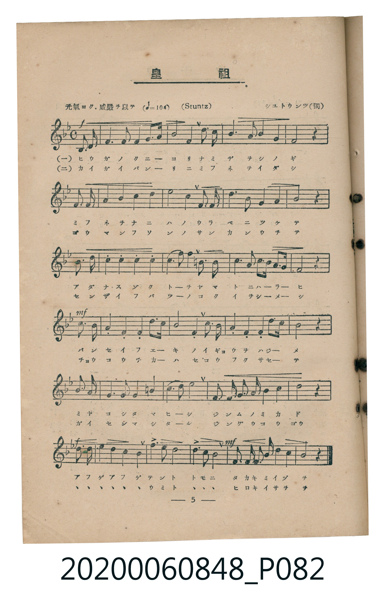
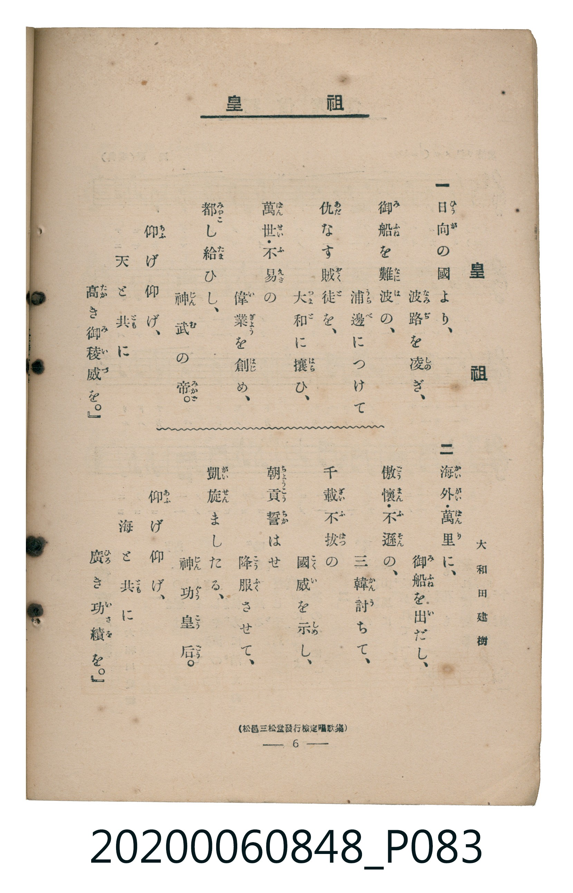

# 皇祖

<audio controls src="koso.mp3"></audio>

- 詞：大和田建樹
- 曲：シユトウンツ（J. H. Stuntz，獨國）
- 臺灣教育會公認《新定兒童唱歌》高等科男子用（2020.006.0848）

## 說明

原書資訊與歌詞全文（對應 P082.jpg – P083.jpg，書頁 pp. 5–6，高二第一學期第 4 首）：
調性與拍號：ヘ長調（1 降記號）、4/4 拍（元氣ヨク. 威嚴ヲ以テ ♩=104，弱起第 4 拍進入）
出處註記：（松邑三松堂發行檢定唱歌集）

## 歌詞

```text
一　日向（ひうが）の國（くに）より、　波路（なみぢ）を凌（しの）ぎ、
御船（みふね）を難波（なには）の、　浦邊（うらべ）につけて
仇（あだ）なす賊徒（ぞくと）を、　大和（やまと）に攘（はら）ひ、
萬世（ばんせい）・不易（ふえき）の　偉業（いぎよう）を創（はじ）め、
都（みやこ）し給（たま）ひし、　神武（じんむ）の帝（みかど）。
仰（あふ）げ仰げ、　天（てん）と共（とも）に
高（たか）き御稜威（みいづ）を。

二　海外（かいがい）・萬里（ばんり）に、　御船（みふね）を出（い）だし、
傲慢（ごうまん）・不遜（ふそん）の、　三韓（さんかん）討（う）ちて、
千載（せんざい）不拔（ふばつ）の　國威（こくい）を示（しめ）し、
朝貢（ちようこう）誓（ちか）はせ　降服（こうふく）させて、
凱旋（がいせん）ましたる、　神功皇后（じんぐうこうごう）。
仰（あふ）げ仰げ、　海（うみ）と共（とも）に
廣（ひろ）き功績（いさを）を。
```

## 原書掃描頁





## 分析

```text
================================================================================
📊 TMD Song Profile: [ 皇祖 ]
================================================================================
⏱  Duration:       1:00 (60.0s), 26 measures total
🎼 Key & Tempo:    首調基準 F, != 104.0 BPM, <4/4>
   - 分析範圍：      由實際發聲的音符與和弦推測調性；播放脈絡另行呈現
🎤 人聲音域:    C4 (MIDI 60) – D5 (MIDI 74) [跨度: 14 個半音 / 1.2 個八度, 難度: moderate]
   - 最低音:  C4 in [Main #1 @ m.1, 0:01]
   - 最高音: D5 in [Main #1 @ m.7, 0:13]
   - 適合: soprano, mezzo-soprano, contralto, tenor, baritone, bass
🏛  結構:      Main (60.0s)
⚡ 編曲密度:        Peak 1 軌道同時演奏
🗝  調性診斷：       C 大調（流行色彩大調，未偵測到可信轉調）
   - 風格氣質:    流行大調（略帶和弦色彩音與裝飾副屬和弦）
   - 轉調歷程:    全曲維持單一推測調性（未偵測到可信轉調）
   - 核心骨幹音:  G, C, F, A, D
   - 調性數值:    C 大調 [相關度: 0.87, 穩定度: Moderate, 自然音純度: 91.9%]
   - 候選調性 (K-S): C 大調 (0.87), F 大調 (0.80), A 小調 (0.65)
   - 五度圈歷程:   +0
   - 各段落調性細節:
     • [Main #1]: C 大調 (r: 0.87, 自然音純度: 91.9%, 調外音: F#, A#)

  [ 五度圈游移軌跡 ]
              [C ]*
         F            G  
      Bb               D  
      Eb               A  
         Ab           E  
            Db       B  
               F# 
     (* = active key center)

  [ 十二半音累積音高分佈 ]
     C  : ███████████████████████   20.4%
     C# :                            0.0%
     D  : ██████████                 8.6%
     D# :                            0.0%
     E  : ████████                   7.0%
     F  : ███████████████████       16.7%
     F# : ██                         1.6%
     G  : ████████████████████████  21.0%
     G# :                            0.0%
     A  : ██████████████████        16.1%
     A# : ███████                    6.5%
     B  : ██                         2.2%
--------------------------------------------------------------------------------
Assignment 軌道音域：
  - Piano         : C4 – D5 (14 個半音 / 1.2 個八度, 100 個音符)
================================================================================
```

## ABC

```abc
X:1
T:皇祖
C:曲：シユトウンツ（J. H. Stuntz，獨國）
M:4/4
L:1/16
Q:1/4=104
K:F
V:V1 name="Piano" snm="Pia"
[V:V1]
!f! z4 z4 z4 c2 c2 | c4 f4 a4 c3 a | f8 f4 e2 f2 | g6 e2 f4 a4 |
g8 z4 c2 c2 | c4 f4 a4 c4 | d12 c2 c2 | d6 d2 =b4 c4 |
c8 z4 c3 c | a4 f4 b4 g4 | e4 f4 g4 a2 g2 | f3 f e2 d2 g6 e2 |
!mf! c8 z4 c3 a | f4 g4 a4 b3 g | a8 g4 c3 a | f4 g4 a4 b3 g |
a8 z4 f2 f2 | e6 e2 e4 ^f4 | g6 ^f2 g8 | d2 e2 f2 g2 a4 =b4 |
c8 z4 z4 | !f! b3 a g4 c3 b a4 | d6 d2 b8 | g8 c4 c4 |
!mf! f2 g2 a2 b2 a4 g4 | f8 z4 z4 |
```

- [主旋律 TMD 檔案](koso.tmd)
- [鋼琴伴奏 TMD 檔案](koso_piano.tmd)
