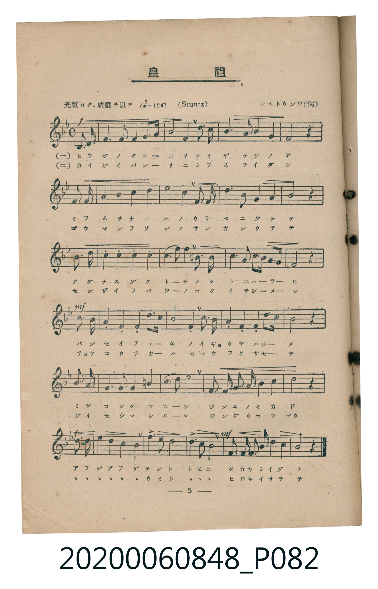
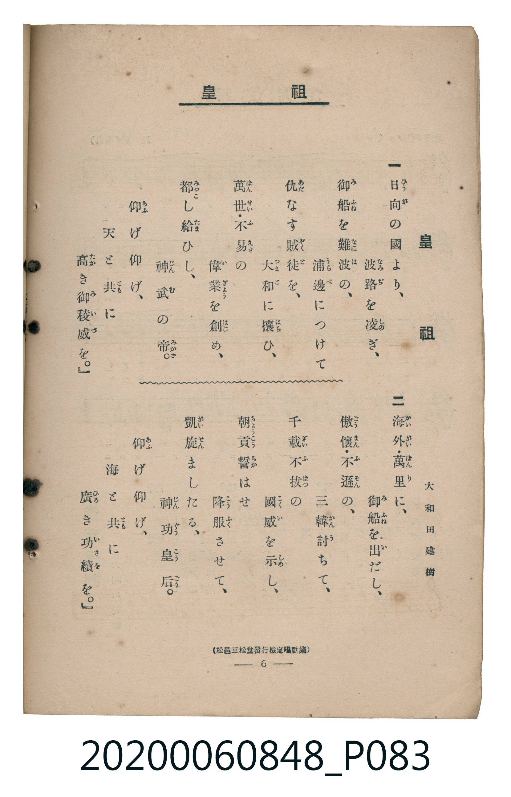

# 皇祖

> Re:Shōka 使用 AI 協助辨識與重建樂譜，可能會有錯誤。歡迎回報。

<audio controls src="koso.mp3"></audio>

- 詞：大和田建樹
- 曲：シユトウンツ（J. H. Stuntz，獨國）
- 臺灣教育會公認《新定兒童唱歌》高等科男子用（2020.006.0848）

## 說明

原書資訊與歌詞全文（對應 P082.jpg – P083.jpg，書頁 pp. 5–6，高二第一學期第 4 首）：
調性與拍號：ヘ長調（1 降記號）、4/4 拍（元氣ヨク. 威嚴ヲ以テ ♩=104，弱起第 4 拍進入）
出處註記：（松邑三松堂發行檢定唱歌集）


## 歌詞

```text
一　日向（ひうが）の國（くに）より、　波路（なみぢ）を凌（しの）ぎ、
御船（みふね）を難波（なには）の、　浦邊（うらべ）につけて
仇（あだ）なす賊徒（ぞくと）を、　大和（やまと）に攘（はら）ひ、
萬世（ばんせい）・不易（ふえき）の　偉業（いぎよう）を創（はじ）め、
都（みやこ）し給（たま）ひし、　神武（じんむ）の帝（みかど）。
仰（あふ）げ仰げ、　天（てん）と共（とも）に
高（たか）き御稜威（みいづ）を。

二　海外（かいがい）・萬里（ばんり）に、　御船（みふね）を出（い）だし、
傲慢（ごうまん）・不遜（ふそん）の、　三韓（さんかん）討（う）ちて、
千載（せんざい）不拔（ふばつ）の　國威（こくい）を示（しめ）し、
朝貢（ちようこう）誓（ちか）はせ　降服（こうふく）させて、
凱旋（がいせん）ましたる、　神功皇后（じんぐうこうごう）。
仰（あふ）げ仰げ、　海（うみ）と共（とも）に
廣（ひろ）き功績（いさを）を。
```

## ABC

```abc
X:1
T:皇祖
C:曲：シユトウンツ（J. H. Stuntz，獨國）
M:4/4
L:1/16
Q:1/4=104
K:F
V:V1 name="Piano" snm="Pia"
[V:V1]
!f! z4 z4 z4 C2 C2 | C4 F4 A4 c3 A | F8 F4 E2 F2 | G6 E2 F4 A4 |
G8 z4 C2 C2 | C4 F4 A4 c4 | d12 c2 c2 | d6 d2 =B4 c4 |
c8 z4 c3 c | A4 F4 B4 G4 | E4 F4 G4 A2 G2 | F3 F E2 D2 G6 E2 |
!mf! C8 z4 c3 A | F4 G4 A4 B3 G | A8 G4 c3 A | F4 G4 A4 B3 G |
A8 z4 F2 F2 | E6 E2 E4 ^F4 | G6 ^F2 G8 | D2 E2 F2 G2 A4 =B4 |
c8 z4 z4 | !f! B3 A G4 c3 B A4 | d6 d2 B8 | G8 C4 C4 |
!mf! F2 G2 A2 B2 A4 G4 | F8 z4 z4 |
```

## TMD 檔案連結

- [主旋律 TMD 檔案](koso.tmd) [[在 TMD Studio 編輯](https://tmdlang.github.io/Tmd-TS/#tmd=s7IKdvYPcrWy4qpTUCpJTLdSSM7PyUlNLsnMz7MqzsjMK0nNjM_KTMmPL87Iz05Ugisry88pzU21ys4vyY9Pyq8sjjcyMDKINzAwizewMLFAqCvOLy1KTrUqTs7Iz8-JL0mtKEnKz89GyBcU5Zel5iXmAdUUFIGsSwErQihILctMSQVJp6ZkluQXZSbmIDkitagY7FCwJfElRYl5xclFmQUg1yNUlWSkAl2amVuQiqobIl6UmpOZjqIeaEl6Zp5VbmpmViYWF0Oly1OLS1KL8uJzU3PyUyqVuLS0FJ7Pan--dJqClhaXoq2CoYEJl72tghuXjYm-iR1I94uV897vmfV0yfKnk3qeT9nwdPeuZyt2gs19NnsTUOZx0_bHzcseN3c8bgKSmx83t7zf0-Glp-ChpxBcUppXUvV-T8_z3hVP53S_39MJ1veifdfzxsXPps580bTp2Zzmp61rXqzqfdzQ9WzahqfrZj1tnfR89dKnUzY-W9vzuKH75eoZz9d2Pl8-8fmU7U_XTng-ZQXQeFCs6QFjTQ8Ua2BjufS1FGypBbgUFBSe9s1_NnvHi83tL1Z0vehoBzoGGBBPW1c8m9YOdMDTDb3P2jsVAgwsjPSyCtIVHjVMBnGMQRygf4E6Xy5oVCgo0FMwBUqZAYWA_niyq-f5mjVPdjQ8Xbvj2Zz5QLaCicLLZdOAHgCGI8jSF6v2P2tYDrKuu_fFzPmg0G2e8XLqdqA40FJDhZcze1-smAGW6Xzc0AiMIgWgSpB7WpufbVj8uHnF46b1egpPVzQ-nbXlcfOmJ7uXPm5uU3g0c6UtMGKBrni6Z-OLrdshNgN1vmzY9LR1KdAwsI_bd72YOfXFit1AK4A2A019Nnffy6aJT3Z0AhlPFzQ9n7nnxcKeZ6sWgWIJHD8vZ7eBNIN0A731uKHh2fSlTydMBGp93LjpcWPb48YekEsb14FjHyjY_7hxNUikCZhauoA-AGnZvOjF9vVg2VWPG_c_blwEVjDpaTtQL1BwOlA72JA-oHqwO_ctfNGxEywHVL31ceNaiIaXsxcDzYIZtPpxI9BQkN1Qa7Yue9nUBZZte9wEFAeaACSBypY8bpz4uHEZ2BO7QZH7uLHpceMCsDTQoJkvNnc93TcJLD4P7ANgCgTZBzEXkjFAsk0tjxv3QWUbVz-bAgxEoJb1QMvAIpugzn8xAZgEgHEOlNvwuGny48bZjxuBWabzcfPuJzt6n82YDJYCegtIAqMW4oOGp42dz5YCPQoUBFrTBwrARlDYgwKqcyvUpkaglUARoLPANr1s3gsNJZDTgOYCzZr-fOsysOB8oGOh7gIGMdgrz5fOe7YWIjsD5LKmBmjk7ZgLC-3ux40rwWmvCRJcG2DBBXQCUOkkoAiQhIUMUClQdhnQLLDsiqetG8EiwFTaBAklsDNXQ0IK6CJQEQH0NTCGn6-YA0zFMGuBzgelUnCgN0GS2y5g4QCM1O1Pl0DCEugyoKoeeFgCg_klNAWBgxkU9-D4hrgNRxoC5gFIGIMVL4AEDTjRAYuqVkjimgJO2PugvgLH2svGObBYmwvzLTTdAXPPy_mQOJ0Kju5uiIIXK_ogiRGseCEomKA29Ta_ABUIQLnZYA3TIM4BJY7uKTBrgMG8BJE45nTDAguoHphCwc5vmvR8CcQ304FpAhL7UDuezZn7YhPENwshSQmsE-SWF6sgjgW6CBIbwGQ1G2gHsOh5NgdU1EBUgh3RD1YwFZyE4c5v3_hsOiSzgyID4gmwOmDeAObl-Y-buuHJ7WnXfGDt83QCJCjAia5xAtw1kKAmNrkB0wI0dzcCC0vcye3p7sXQ8qkJkr16Qa7YAcwMkLwFjCVgZoelNaAGyusTKFDQ0ufi8k0E1sIBmYl5-Q41BjUK1SAbFGwMzbTswCxgNQYpo59u6H--HpgBOzAKa2CdMAlY177f0_-4afXjJlAyAJkM0l2jYKCgC4bodHVarYJpPJABJmrAeQhkGaRCAhbr4Jp8zeNmYNGy_nFz9-PmPaDapHkVMGQfN3c9bp7_uLkJWKOAa3ugmnUIK8EmgqAhlDaG0qZQXg1cBgZhfHOQVhCnBmqWEZIiuCSymahKkH2Iy3e7eqC-A3lh6uPmXpAvQD4C-rEf5BegB0Etl5WPm2eCBVseN20E1ZrEehDkKDM0R8EgSAUIw_yHrA7ENlHHMArGwvAflESLu05Y3C163AyOqaadj5uAhRMwEjvAkQisd4DiSx43zwOLQHwNFAf6F0hOQngT5iuYL02gNCzAayAxgqwEJgXSCmLDvAmRN4RoMAMRGBGLFKzoPq3OBSVWqMEo3n06ezYsMieA2ppNu4HpHxSrTcCkuudx01pYfC4BplBwawgYscDYBuaUHWDvLkR4F5sfEN42QgoQGISpRDiNXJNgPgXphCR_lBQ7BSnFAn0C9Of2x037wTE4CezP7WBPAr0EbG4vAPkZqBJYFjQjFQTwuIKHOCL2YIkONTOBhdFzFzzhwk0AuRekCu5LhGm4ki6MRo3L1rVISRcYhcCyBcYApdg2sO-AKRaIgOLASgPoZWBTBljkAaMZ6F9gxLcCYxfhZVAZBwlzY7S4MkEqPzCyIA4fo4cEPLnCGUAbQSkVOUBAhsGsgucbtGSCO3Rqubh07RRANYQCkFbm4gIA)]
- [鋼琴伴奏 TMD 檔案](koso_piano.tmd) [[在 TMD Studio 編輯](https://tmdlang.github.io/Tmd-TS/#tmd=s7IKdvYPcrWy4tLSUng-q_350mnv93S87N7zfMKWJ3u2PF3a_7yz4_2eTgUtLS5FWwVDAxMue1sFNy4bE30TO646BaUXK-e93zPr6ZLlTyf1PJ-y4enuXc9W7FQCyTybvQko87hp--PmZY-bOx43AcnNj5tbgOZ76Sl46CkEl5TmlVS939PzvHfF0zndQFvA-l6073reuPjZ1JkvmjY9m9P8tHXNi1W9jxu6nk3b8HTdrKetk56vXvp0ysZna3seN3S_XD3j-drO58snPp-y_enaCc-nrAAab2RgZKBnYGCmZ2BhYgE2lss3MTPPKiAzMS8_yMOhxqBGoZpLAQhsDM207MAsfS2Fp3s2vti6_emG_ufrGxS09MHCNQoGCrpgiE5Xp9UqmMYDGWCihgtmyvM1a57saHixsAdhBFgFCBpCaWMobQrl1cBlYBDGNwdpBXFqoGYZISmCSyKbiaoE2cW4XLurhxTXgmwwQ7MBBkEqQBjmWGR1ILaJOoZRMBaGY6EkWsB2ojgV5jKYS02gNCwEaiBBhKwEJgXSCmLDnAqRN4RoMAMRGCGNFDTorq3OBaUGqMEoTn46ezaKk7G5A-F0IyRPwSBMJcJ4ck2CuRakE5KmUJLBFBSHwkMO7n9EWMKiETWtgYXREx88KcBNANkMUgV3L8I0XIkBRqOGbOtaFAeDMiTE78ZoYWaClDkwkiQO96L7Ax71cAbQRlCsI3sHZBjMKngaRIsu3H6rRS6mfFCKKRPCpRQE4i2HDOMVog1jYVSNggkqH57_gXzTeCR1cBFMG9DKDnQbjIAMo_jcWBiJZA1cCmw6WDVUGxZ_oGZ7qDqQCSBXwQXg7oTZAfKgCZCPkMBpB0Y-RQoEDEtAegkowxJUqPnLGKjOGKgDRBuBdcJdieEP1LAi4BG0bAELJcw4gYUORsSj2YIagqhxALEemHJ17RRAiVcBSCtzcQEA)]

## 分析

```text
================================================================================
📊 TMD Song Profile: [ 皇祖 ]
================================================================================
⏱  Duration:       1:00 (60.0s), 26 measures total
🎼 Key & Tempo:    首調基準 F, != 104.0 BPM, <4/4>
   - 分析範圍：      由實際發聲的音符與和弦推測調性；播放脈絡另行呈現
🎤 人聲音域:    C4 (MIDI 60) – D5 (MIDI 74) [跨度: 14 個半音 / 1.2 個八度, 難度: moderate]
   - 最低音:  C4 in [Main #1 @ m.1, 0:01]
   - 最高音: D5 in [Main #1 @ m.7, 0:13]
   - 適合: soprano, mezzo-soprano, contralto, tenor, baritone, bass
🏛  結構:      Main (60.0s)
⚡ 編曲密度:        Peak 1 軌道同時演奏
🗝  調性診斷：       C 大調（流行色彩大調，未偵測到可信轉調）
   - 風格氣質:    流行大調（略帶和弦色彩音與裝飾副屬和弦）
   - 轉調歷程:    全曲維持單一推測調性（未偵測到可信轉調）
   - 核心骨幹音:  G, C, F, A, D
   - 調性數值:    C 大調 [相關度: 0.87, 穩定度: Moderate, 自然音純度: 91.9%]
   - 候選調性 (K-S): C 大調 (0.87), F 大調 (0.80), A 小調 (0.65)
   - 五度圈歷程:   +0
   - 各段落調性細節:
     • [Main #1]: C 大調 (r: 0.87, 自然音純度: 91.9%, 調外音: F#, A#)

  [ 五度圈游移軌跡 ]
              [C ]*
         F            G  
      Bb               D  
      Eb               A  
         Ab           E  
            Db       B  
               F# 
     (* = active key center)

  [ 十二半音累積音高分佈 ]
     C  : ███████████████████████   20.4%
     C# :                            0.0%
     D  : ██████████                 8.6%
     D# :                            0.0%
     E  : ████████                   7.0%
     F  : ███████████████████       16.7%
     F# : ██                         1.6%
     G  : ████████████████████████  21.0%
     G# :                            0.0%
     A  : ██████████████████        16.1%
     A# : ███████                    6.5%
     B  : ██                         2.2%
--------------------------------------------------------------------------------
Assignment 軌道音域：
  - Piano         : C4 – D5 (14 個半音 / 1.2 個八度, 100 個音符)
================================================================================
```


## 原書掃描頁






