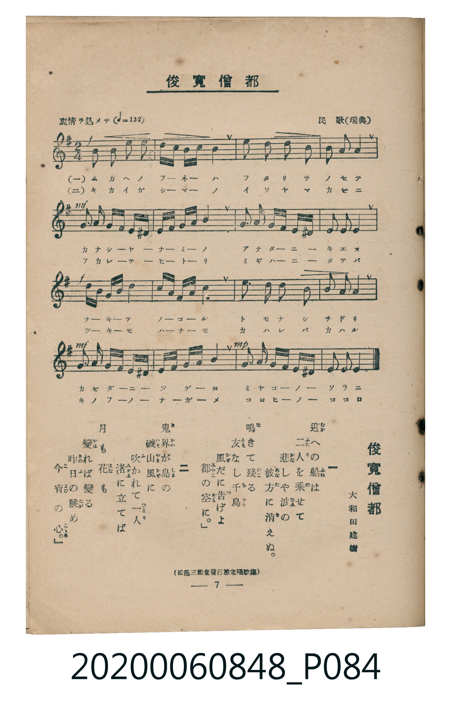

# 俊寛僧都

> Re:Shōka 使用 AI 協助辨識與重建樂譜，可能會有錯誤。歡迎回報。

- **鋼琴伴奏版**：<br><audio controls src="shunkan_sozu.mp3"></audio>

- 詞：大和田建樹
- 曲：民歌（瑞典）
- 臺灣教育會公認《新定兒童唱歌》高等科男子用（2020.006.0848）

## 說明

原書資訊與歌詞全文（對應 P084.jpg，書頁 p. 7，高二第一學期第 5 首）：
調性與拍號：ホ短調（1 升記號）、2/4 拍（哀情ヲ込メテ ♩=132）
出處註記：（松邑三松堂發行檢定唱歌集）


## 歌詞

```text
一
迎（むか）への船（ふね）は　二人（ふたり）を乘（の）せて
悲（かな）しや波（なみ）の　彼方（あなた）に消（き）えぬ。
鳴（な）きて殘（のこ）る　友（とも）なし千鳥（ちどり）
風（かぜ）だに告（つ）げよ　都（みやこ）の空（そら）に。」

二
鬼界（きかい）が島（しま）の　磯山風（いそやまかぜ）に
吹（ふ）かれて一人（ひとり）　渚（みぎは）に立（た）てば
月（つき）も花（はな）も　變（かは）れば變（かは）る
昨日（きのふ）の眺（なが）め　今宵（こよひ）の心（こころ）。」
```

## ABC

<div class="abc-score" data-abc-src="shunkan_sozu.abc" aria-label="五線譜載入中"></div>

[下載 ABC 原始檔](shunkan_sozu.abc)

## TMD 檔案連結

- [主旋律 TMD 檔案](shunkan_sozu.tmd) [[在 TMD Studio 編輯](https://tmdlang.github.io/Tmd-TS/#tmd=s7IKdvYPcrWy4qpTUCpJTLdSSM7PyUlNLsnMz7MqzsjMK0nNjM_KTMmPL87Iz05Ugisry88pzU21ys4vyY9Pyq8sjjcyMDKINzAwizewMLFAqCvOLy1KTrUqTs7Iz8-JL0mtKEnKz89Gl48vSExPtQoAakXIFBTll6XmJeYBdRcUgRySAtaOUJBalpmSCpIuTk7Miy9LLcpMy0xNQXJialEx2BsQK0qKEvOKk4syC0B-Q6jKLyrJyE8vSizIqLTKyCwuyS_KTE7Mic9OzEPybUlGKtCzafk52Tn5Rano4hBtlchmZqZn5lnlpmZmZWLxM1S6PLW4JLUoLz43NSc_BahbS0vhyf6up-tnP21e_rJ5r4KWFpeirYKhsRGXva2CO1d2aqWtgmsul42RvokdyKwXK-e93zPr6ZLlTyf1PJ-y4enuXc9W7ATb8mz2JqDMsw0Tn63teb-n4_nEeU9bd7zf0wmWfNG-63nj4mdTZ75o2vRsTvPT1jUvVvU-buh6Nm3D03WznrZOer566dMpG4FaHzd0v1w94_nazufLJz6fsv3p2gnPp6wAmgeKaj1gVOuBohpsLJe-loIttQCXgoLC0775z2bveLG5_cWKrhcd7UDHAH37tHXFs2ntQAc83dD7rL1TAZRe9LIK0t_v6QEqfrmgUaFAT8EcyAO6-smunudr1jzZ0fB07Y5nc-YD2QqmCi-XTQM6Fxg0ICterNr_rGE5yPDu3hcz5wNFHzfPfj5_LVAcaIWhwtNeoOUzwDKdjxsagaGuAFQJsn1yw7Pm1sfNm17s2_O4eeHj5jaFRzNX2gIjCqgS7Pj2XS9mTn2xYjdQP9BYoJZnc_e9bJr4ZEcnkPF0QdPzmXteLOx5tmoRKMDBQf1ydhtIM0g30M1g5-3vA2p83NTwuLEb5ILGHY8b173o2AkSbNz6uHEtWHD944YGoFef7NoFE5__uKkLJNU06clOoO1AwXVglbMfNy4DmfusCZg2gKLdjxtXgSWmP25qebZ5EVhw1eNGoOeBguuA5j7du-fZNIh9TWApcEg0rn62rQMsCAwLIBfIWPO4oQlk9MvNWyCmgCV6gRY-Wwd1wuPGyWBHdYPM7Qd6CCi44nFTE1gl0OjpT3ubX25eChZf-LhxJcQTYEMXgZIc2L1zwKoXAJ3wdCJQGii4BCwy6XFTB9BcYJ4BC-4HeghqX-O65yshITP3cRMw4kHOBzr2cUMvJKh39YCtWLPn-VRQRgE7GmhRC1hlz9PN28CC0x837oOHyvPF659u3AhzFdAioMlAch-SC1eDE8EEaFSBhbofN_UAwwMYt7Co2gQOAHBUNTQ82wFKJSCnN_YBIxViyvPVkHCCBPuyx40bwPE3BxL6S6AR0NT0omsjWGQ9NOSbgP5reLEOEkJAR4GNA1m_AUOwG2zijBXPpkOCHuh9YFRBnLzu-RyIS4HRAwwcoOpGUGLb3fV0HVABUHwyKNgbgakJpPjp_maoIEgc7DJIOAMtoLxIgAIFLX0uruCM0jxg6RycX1VqFZCZmJfvUGNQUw2yR8HG0EzLDszCVh4pQAoEYM5T0DBReLqh__n6Bh14IaKJRQPQOpBhNQrVabUKxgq6YGwGxTXAAsUEKALCumBYAxY3hWKQaA2YNIJisBqwiT6GNQqPmxcA-Y-bVoPI5hlgsg-s53HzVDCvF0z2w02HijftB4uvApOboDIgnY-bdoPF2lDtMgLKN61F2NW0BEyugehs2g7WMw9uP9QuqKq9YHEwG6wGJAMxZQ9YrBtuF_5w39VDVrjnAgPeEGyBEZA2j1cwi1cwVY8HBXU8iGsIFEcEP06VwBiDE2ixAPYNyCdd8LAA-RYUpl1g3nyMkFmEpAMSF6BQQITyCrBYD2YsgOMPEg-Pm0HhD4krkMwkMK8DHrOwGAfZDtKxDpoSEHZBbAbpf9w8gchY2NFJbuo3BQazIRCDUjbEbSbAgAYGsxGQgZz8QYmfuOQPDl5IkCGSLDwpbwaLQyIHIg4KHJDYIrheUHSBZBrB4p2ogYcU7C1INkEiD6IPEqCQaEYShyeJfng0gQIYnvSh-uBuwx_oT2fPpkPSr84twKOciPQPzM-PmxvAHoOmMGiwgUqYx82gNI2WJoH5BBZN0HILWlqshJuCrRSCqIeVcbASDxKhkMBeiBQVIPMh9sPyCMwusM1Q-yHmguyq5eLStVNAqiMUgFxlLgA)]
- [鋼琴伴奏 TMD 檔案](shunkan_sozu_piano.tmd) [[在 TMD Studio 編輯](https://tmdlang.github.io/Tmd-TS/#tmd=s7IKdvYPcrWy4qpTUCpJTLdSSM7PyUlNLsnMz7MqzsjMK0nNjM_KTMmPL87Iz05Ugisry88pzU21ys4vyY9Pyq8sjjcyMDKINzAwizewMLFAqCvOLy1KTrUqTs7Iz8-JL0mtKEnKz89Gl48vSExPtQoAakXIFBTll6XmJeYBdRcUgRySAtaOUJBalpmSCpIuTk7Miy9LLcpMy0xNQXJialEx2BsQK0qKEvOKk4syC0B-Q6jKLyrJyE8vSizIqLTKyCwuyS_KTE7Mic9OzEPybWIRUHN6am5qXolVQWZiXn58YnJyfm5BYl4mSAyhsCQDqMgqLT8nOye_KBVdHGJ-JbLlmemZeVa5qZlZmVgCBypdnlpcklqUF5-bmpOfAtStpaXwZH_X0_WznzYvf9m89_2ejpfde55P2PJkz5anS_ufd3a839OpoKXFpWirYGhsxGVvq-DOlZ1aaavgmstlY6RvYgey4MXKee_3zHq6ZPnTST3Pp2x4unvXsxU7wVY_m70JKPNsw8Rna3uAZj-fOO9p6w6gkWDJF-27njcufjZ15oumTc_mND9tXfNiVe_jhq5n0zY8XTfraeuk56uXPp2yEaj1cUP3y9Uznq_tfL584vMp25-unfB8ygqgeaCEogdMKHqghAI2lis4ozQPGODB-VWlVgGg4A3ycKgxqKnmUgACG0MzLTswS19LwRYdKDxfs-bJjoYXC3sUNEwUnm7of76-QUcBlJL0sgrSNbFo0NIHG1ajUJ1Wq2CsoAvGZlBco2CqYAIUAWFdMKwBi5tCMUi0BkwaQTFYDdhEH8MahcfNC4D8x02rQWTzDDDZB9bzuHkqmNcLJvvhpkPFm_aDxVeByU1QGZDOx027wWJtqHYZAeWb1iLsaloCJtdAdDZtB-uZB7cfahdU1V6wOJgNVgOSgZiyByzWDbcLf7jv6iEr3HOBAW8ItsAISJvHK5jFK5iqx4OCOh7ENQSKI4Ifp0pgjMEJtFgA-wbkky54WIB8CwrTLjBvPkbILELSAYkLUCggQnkFWKwHMxbA8QeJh8fNoPCHxBVIZhKY1wGPWViMg2wH6VgHTQkIuyA2g_Q_bp5AZCzs6CQ39ZsCg9kQiEEpG-I2E2BAA4PZCMhATv6gxE9c8gcHLyTIEEkWnpQ3g8UhkQMRBwUOSGwRXC8oukAyjWDxTtTAQwr2FiSbIJEH0QcJUEg0I4nDk0Q_PJpAAQxP-lB9cLfhD_Sns2fTIelX5xbgUU5E-gfm58fNDWCPQVMYNNhAJczjZlCaRkuTwHwCiyZouQUtLVbCTcFWCkHUw8o4WIkHiVBIYC9EigqQ-RD7YXkEZhfYZqj9EHNBdtViqSJ8kKsIE2gNAQqXeIVos_jcWDS2IZBpCGIYARlG8UAWAQ042FBdmMahaKDUEqCHde0UkPwc7QO0DV3ICCykzAUA)]

## 分析

```text
================================================================================
📊 TMD Song Profile: [ 俊寛僧都 ]
================================================================================
⏱  Duration:       0:14 (14.5s), 16 measures total
🎼 Key & Tempo:    首調基準 G, != 132.0 BPM, <2/4>
   - 分析範圍：      由實際發聲的音符與和弦推測調性；播放脈絡另行呈現
🎤 人聲音域:    D#4 (MIDI 63) – E5 (MIDI 76) [跨度: 13 個半音 / 1.1 個八度, 難度: moderate]
   - 最低音:  D#4 in [ShunkanSozu #1 @ m.5, 0:04]
   - 最高音: E5 in [ShunkanSozu #1 @ m.1, 0:00]
   - 適合: soprano, mezzo-soprano, contralto, tenor, baritone, bass
🏛  結構:      ShunkanSozu (14.5s)
⚡ 編曲密度:        Peak 1 軌道同時演奏
🗝  調性診斷：       E 小調（純淨自然小調，未偵測到可信轉調）
   - 風格氣質:    純淨自然小調（陰鬱抒情、旋律集中，無明顯調外色彩）
   - 轉調歷程:    全曲維持單一推測調性（未偵測到可信轉調）
   - 核心骨幹音:  E, B, A, G, D
   - 調性數值:    E 小調 [相關度: 0.89, 穩定度: High, 自然音純度: 96.9%]
   - 候選調性 (K-S): E 小調 (0.89), G 大調 (0.63), E 大調 (0.62)
   - 五度圈歷程:   +4
   - 各段落調性細節:
     • [ShunkanSozu #1]: E 小調 (r: 0.89, 自然音純度: 96.9%, 調外音: D#)

  [ 五度圈游移軌跡 ]
               C  
         F            G  
      Bb               D  
      Eb               A  
         Ab          [E ]*
            Db       B  
               F# 
     (* = active key center)

  [ 十二半音累積音高分佈 ]
     C  : █████                      5.5%
     C# :                            0.0%
     D  : ██████████                10.2%
     D# : ███                        3.1%
     E  : ████████████████████████  24.2%
     F  :                            0.0%
     F# : █████                      5.5%
     G  : ███████████████           14.8%
     G# :                            0.0%
     A  : ███████████████           15.6%
     A# :                            0.0%
     B  : █████████████████████     21.1%
--------------------------------------------------------------------------------
Assignment 軌道音域：
  - Piano         : D#4 – E5 (13 個半音 / 1.1 個八度, 73 個音符)
================================================================================
```


## 原書掃描頁




