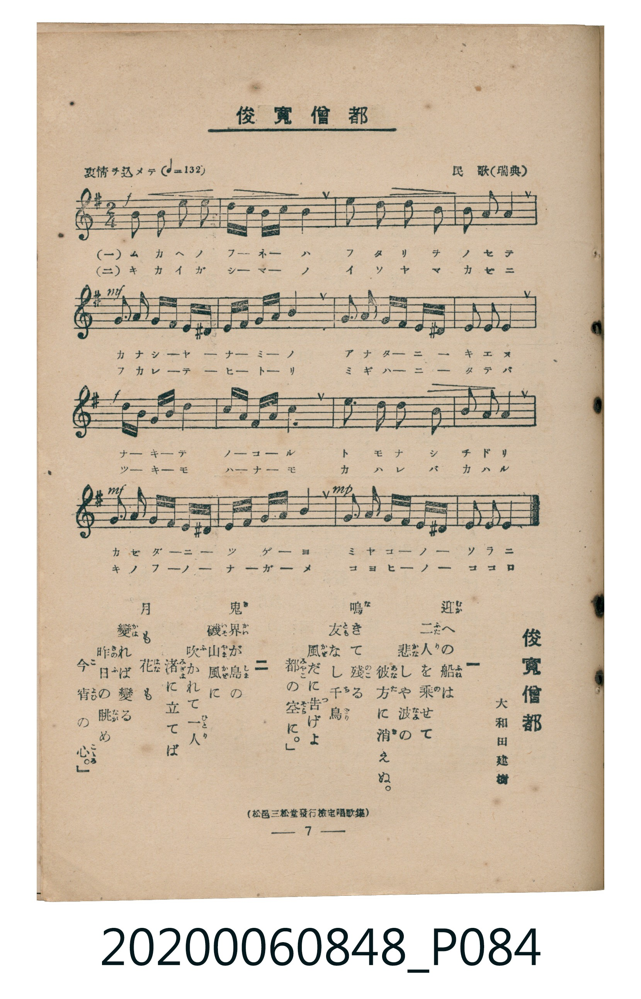

# 俊寛僧都

<audio controls src="shunkan_sozu.mp3"></audio>

- 詞：大和田建樹
- 曲：民歌（瑞典）
- 臺灣教育會公認《新定兒童唱歌》高等科男子用（2020.006.0848）

## 說明

原書資訊與歌詞全文（對應 P084.jpg，書頁 p. 7，高二第一學期第 5 首）：
調性與拍號：ホ短調（1 升記號）、2/4 拍（哀情ヲ込メテ ♩=132）
出處註記：（松邑三松堂發行檢定唱歌集）

## 歌詞

```text
一　迎（むか）への船（ふね）は　二人（ふたり）を乘（の）せて
悲（かな）しや波（なみ）の　彼方（あなた）に消（き）えぬ。
鳴（な）きて殘（のこ）る　友（とも）なし千鳥（ちどり）
風（かぜ）だに告（つ）げよ　都（みやこ）の空（そら）に。

二　鬼界（きかい）が島（しま）の　磯山風（いそやまかぜ）に
吹（ふ）かれて一人（ひとり）　渚（みぎは）に立（た）てば
月（つき）も花（はな）も　變（かは）れば變（かは）る
昨日（きのふ）の眺（なが）め　今宵（こよひ）の心（こころ）。
```

## ABC

```abc
X:1
T:俊寛僧都
C:曲：民歌（瑞典）
M:2/4
L:1/16
Q:1/4=132
K:Em
V:V1 name="Piano" snm="Pia"
[V:V1]
!f! E2 E2 E2 B2 | G3 F E4 | A2 A2 A2 c2 | B3 A B4 |
!mf! c2 A2 B3 G | F2 ^D2 E3 F | G2 B2 A3 G | F2 ^D2 E4 |
!f! B3 c d2 B2 | e3 d c4 | A3 B c2 A2 | B3 A B4 |
!mf! c2 A2 B3 G | F2 ^D2 E3 F | !mp! G2 B2 A3 G | F2 ^D2 E4 |
```

## TMD 檔案連結

- [主旋律 TMD 檔案](shunkan_sozu.tmd) [[在 TMD Studio 編輯](https://tmdlang.github.io/Tmd-TS/#tmd=s7IKdvYPcrWy4tLSUniyv-vp-tlPm5e_bN6roKXFpWirYGhsxGVvq-DOlZ1aaavgmstlY6RvYsdVp6D0YuW893tmPV2y_OmknudTNjzdvevZip1KIJlnszcBZZ5tmPhsbc_7PR3PJ8572rrj_Z5OsOSL9l3PGxc_mzrzRdOmZ3Oan7auebGq93FD17NpG56um_W0ddLz1UufTtkI1Pq4ofvl6hnP13Y-Xz7x-ZTtT9dOeD5lBdA8IwMjAz0DAzM9AwsTC7CxXPpaCrbUAlwKCgpP--Y_m73jxeb2Fyu6XnS0Ax0D9O3T1hXPprUDHfB0Q--z9k6FAKD9elkF6e_39AAVv1zQqFCgp2AO5AFd_WRXz_M1a57saHi6dsezOfOBbAVThZfLpgGdCwwakBUvVu1_1rAcZHh374uZ84Gij5tnP5-_FigOtMJQ4Wkv0PIZYJnOxw2NwFBXAKoE2T654Vlz6-PmTS_27XncvPBxc5vCo5krbYERBVQJdnz7rhczp75YsRuoH2gsUMuzufteNk18sqMTyHi6oOn5zD0vFvY8W7UIFODgoH45uw2kGaQb6ObHDQ0v9vcB9T1uanjc2A1yQOOOx43rXnTsBAk2bn3cuBYsuB6oEujTJ7t2wcTnP27qAkk1TXqyE2g5UHAdWOXsx43LQKY_awImDaBo9-PGVWCJ6Y-bWp5tXgQWXPW4Eeh3oOA6oLlP9-55Ng1iXxNYChwQjaufbesACwKDAsgFMtY8bmgCGf1y8xaIKWCJXqCFz9ZBnfC4cTLYUd0gc_uBHgIKrnjc1ARWCTR6-tPe5pebl4LFFz5uXAnxBNjQRaAUB3bvHLDqBUAnPJ0IlAYKLgGLTHrc1AE0F5hlwIL7gR6C2te47vlKSMjMfdwEjHeQ80GOBQfzLmD6bni5Zs_zqaA8AnYw0JIWsKqep5u3gQWnP27cBw-R54vXP924EeYioCVAU4HkPiTXrQbH_wRoNIGFuh839QDDAhitsGjaBPY8OJoaGp7tACUQkLMb-4ARCjHl-WpIGEGCfNnjxg3guJsDCfkl0MBvanrRtREssh4a6k1NoKSzDhI6QEeBjQNZvwFDsBts4owVz6ZDgh3ofWA0QZy87vkciEuBUQMMHKDqRlBC2931dB1QAVB8MijIG4EpCaT46f5mqCBIHOwySIKgvCiAAgUtfS4u38TMPKuAzMS8fIcagxqFapANCjaGZlp2YBawBIJkeGDOAuflBY-bVj9unvG4ue9x89THzb2Pm_uBngCxm_Y_bl4FzL8gqabdoPwLNB9kBtDUtFoFs3gFXSTCGIhrFAyBpK6CeTxEDARrFIyAJAybgEVAakF8CA0UASc1mNt29UDdBnJY1-Om7Y-bl4AYzfNBLgG6rWkRWBzoPGCiWfu4acXj5h4kt-UCHQeyB2QfxAZDoDDQTboKpupw94JdCXEwSBFIMS6F6A7c0QkLPKAr1gIDBhxCmx83A3MNMOQ6HjdDHAh0eOPj5k5gKKKGHMRRJsCSFhZsZmARU7CzEYEGkoV5hECgPZ09GxFoTcDyFuiO7sfNLY-bgNG3AuwsYOgtAbsS6Na9j5tXAhWQG2jVuQW1RIdcLReXrp0CKFkqAGllLi4A)]
- [鋼琴伴奏 TMD 檔案](shunkan_sozu_piano.tmd) [[在 TMD Studio 編輯](https://tmdlang.github.io/Tmd-TS/#tmd=s7IKdvYPcrWy4tLSUniyv-vp-tlPm5e_bN77fk_Hy-49zydsebJny9Ol_c87O97v6VTQ0uJStFUwNDbisrdVcOfKTq20VXDN5bIx0jex46pTUHqxct77PbOeLln-dFLP8ykbnu7e9WzFTiWQzLPZm4AyzzZMfLa2B2j284nznrbuABoJlnzRvut54-JnU2e-aNr0bE7z09Y1L1b1Pm7oejZtw9N1s562Tnq-eunTKRuBWh83dL9cPeP52s7nyyc-n7L96doJz6esAJpnZGBkoGdgYKZnYGFiATaWyzcxM88qIDMxLz_Iw6HGoEahmksBCGwMzbTswCx9LYXna9Y82dHwYmGPgpY-WAyoKq1WwSxeQReJMAbiGgVDIKmrYB4PEQPBGgUjIAnDJmARkFoQH0IDRbiQ7drVg2pXLtAykD6QfogOQ6Aw0A5dBVN1uP1gWyEOACkCKcalEN3CHZ0YnoPYY6JgCveZGVjEFOwShL9AsjC3EfDX09mzKfBXdW5BLdGeq0WOWB-UiDXBG69m8fEK0WbxubFobCMg0wjCNAYyjeOBLHxxBlIP1QpSD2UaopoCEcUXExC7EK6BaibkGvSQJsU1wKDTtVMAhZ4CkFbm4gIA)]

## 分析

```text
================================================================================
📊 TMD Song Profile: [ 俊寛僧都 ]
================================================================================
⏱  Duration:       0:14 (14.5s), 16 measures total
🎼 Key & Tempo:    首調基準 G, != 132.0 BPM, <2/4>
   - 分析範圍：      由實際發聲的音符與和弦推測調性；播放脈絡另行呈現
🎤 人聲音域:    D#4 (MIDI 63) – E5 (MIDI 76) [跨度: 13 個半音 / 1.1 個八度, 難度: moderate]
   - 最低音:  D#4 in [Main #1 @ m.6, 0:04]
   - 最高音: E5 in [Main #1 @ m.10, 0:08]
   - 適合: soprano, mezzo-soprano, contralto, tenor, baritone, bass
🏛  結構:      Main (14.5s)
⚡ 編曲密度:        Peak 1 軌道同時演奏
🗝  調性診斷：       E 小調（流行色彩小調，未偵測到可信轉調）
   - 風格氣質:    流行小調（略帶和弦色彩音與裝飾副屬和弦）
   - 轉調歷程:    全曲維持單一推測調性（未偵測到可信轉調）
   - 核心骨幹音:  B, E, A, C, F#
   - 調性數值:    E 小調 [相關度: 0.76, 穩定度: Moderate, 自然音純度: 93.8%]
   - 候選調性 (K-S): E 小調 (0.76), E 大調 (0.68), A 小調 (0.53)
   - 五度圈歷程:   +4
   - 各段落調性細節:
     • [Main #1]: E 小調 (r: 0.76, 自然音純度: 93.8%, 調外音: D#)

  [ 五度圈游移軌跡 ]
               C  
         F            G  
      Bb               D  
      Eb               A  
         Ab          [E ]*
            Db       B  
               F# 
     (* = active key center)

  [ 十二半音累積音高分佈 ]
     C  : ██████████                10.2%
     C# :                            0.0%
     D  : ██                         2.3%
     D# : ██████                     6.2%
     E  : ████████████████████      21.1%
     F  :                            0.0%
     F# : ████████                   8.6%
     G  : ████████                   8.6%
     G# :                            0.0%
     A  : █████████████████         18.0%
     A# :                            0.0%
     B  : ████████████████████████  25.0%
--------------------------------------------------------------------------------
Assignment 軌道音域：
  - Piano         : D#4 – E5 (13 個半音 / 1.1 個八度, 58 個音符)
================================================================================
```


## 原書掃描頁




