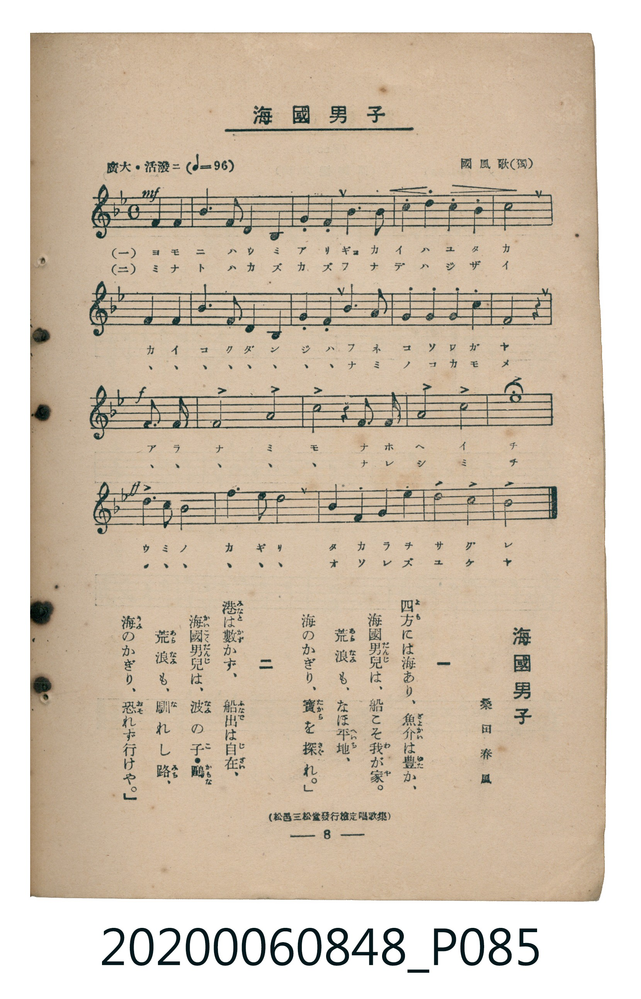

# 海國男子

> Re:Shōka 使用 AI 協助辨識與重建樂譜，可能會有錯誤。歡迎回報。

- **鋼琴伴奏版**：<br><audio controls src="kaikoku_danshi.mp3"></audio>

- 詞：桑田春風
- 曲：國風歌（獨）
- 臺灣教育會公認《新定兒童唱歌》高等科男子用（2020.006.0848）

## 說明

原書資訊與歌詞全文（對應 P085.jpg，書頁 p. 8，高二第一學期第 6 首）：
調性與拍號：變ロ長調（2 降記號）、4/4 拍（廣大・活潑ニ ♩=96，弱起 2 拍進入）
出處註記：（松邑三松堂發行檢定唱歌集）


## 歌詞

```text
一
四方（よも）には海（うみ）あり、魚介（ぎよかい）は豐（ゆた）か、
海國男兒（かいこくだんじ）は、船（ふね）こそ我（わ）が家（や）。
荒浪（あらなみ）も、なほ平地（へいち）、
海（うみ）のかぎり、寶（たから）を探（さぐ）れ。」

二
港（みなと）は數（かず）かず、船出（ふなで）は自在（じざい）、
海國男兒（かいこくだんじ）は、波（なみ）の子（こ）・鷗（かもめ）
荒浪（あらなみ）も、馴（な）れし路（みち）、
海（うみ）のかぎり、恐（おそ）れず行（ゆ）けや。」
```

## ABC

<div class="abc-score" data-abc-src="kaikoku_danshi.abc" aria-label="五線譜載入中"></div>

[下載 ABC 原始檔](kaikoku_danshi.abc)

## TMD 檔案連結

- [主旋律 TMD 檔案](kaikoku_danshi.tmd) [[在 TMD Studio 編輯](https://tmdlang.github.io/Tmd-TS/#tmd=s7IKdvYPcrWy4qpTUCpJTLdSSM7PyUlNLsnMz7MqzsjMK0nNjM_KTMmPL87Iz05Ugisry88pzU21ys4vyY9Pyq8sjjcyMDKINzAwizewMLFAqCvOLy1KTrUqTs7Iz8-JL0mtKEnKz89Gl48vSExPtQowsDBFyBQU5Zel5iXmAXUXFIEckgLWjlCQWpaZkgqSLk5OzIsvSy3KTMtMTUFyYmpRMdgbECtKihLzipOLMgtAfkOoyi8qychPL0osyKi0ysgsLskvykxOzInPTsxD8m1JRirQs-X5RUguh4gBTS1LzUE2LjM9M88qNzUzKxOLd6HS5anFJalFefG5qTn5KZUY0iWJmcDgBgV5eWJ8bmJmXk5iHtBjWloKz7Zufzqn-_mU7U_XTlDQ0uJStFWwNOOyt1Vw0uGyMdE3sQMZ9WLlvPd7Zj1bOPH5lA3PZix9uWgF2IZnszcBhYHagQLP1va839PxvHfF-z2dYMkX7bueNy5-NnXmi6ZNz-Y0P21d82JV7-OGrmfTNjxdN-tp66Tnq5c-nbIRqO9xQ_fL1TOer-18vhxoAcghz6cAjekAJQA9YALQAyUAsLFc-loKttQCXAoKCk_75j-bvePF5vYXK7pedLQDHQP06tPWFc-mtQMd8HRD77P2TgVQKtLLKkh_v6cHqPjlgkaFAj0FoIN6gK5-sqvn-Zo1T3Y0PF2749mc-UC2gpnCy2XTgM4FBg3Iiher9j9rWA4yvLv3xcz5QNEX67oeN699OXU7UArkTYWXM3tfrJgBlux83NAIDHUFoGKQA3Yvfrpk-ePm3c-27H62d-Lj5m6FRzNX2lqaAS1_umfji63bFYxASl82bHrauhSoG-yn9l0vZk59sWI30EygbUBjns3d97Jp4pMdnUDG0wVNz2fuebGw59mqRaB4AMfAy9ltIM0g3UCvgA2ZPfvZtJ1AvY-bgKgJ5LDG1Y8b1wOTC0iwse1xI9DtQMGmx01dQDe_XDvrye5usFQfSEtj9-PGFrCC9S82TgCbA9QC9iBQqqERZAci6bVOAusE6XncOPlxY__jxgWPm4AMoAdARgA1vOgAu6Zx6-PGtWBBoOzcZx0TwUb3g0V6nq7bBuaCLW5oAod-76RnW1eBdQJdClS0CurwpiagoWDu7qc7Nz-dswGsZgfYBQsh8QB1I6p_14GdCfQjyNdP14MtbJwPEmwCxjjQ3EnP-haBBac-bgR6HCgCTOBAy3ohwburB2zsjvVgNfvBLgDlGVDYTt0BCwZgrIEDqnEWxOvAOIX5Hqh-OTRg21c9nQPKKMBwetw4DRrgZITts80QF8PCpnEdMA-CRSaDuM27X26fDjUEGGxNjdCEhj9sXy7bAjEUGgaN019sh3ua6BB-BgpDoGwXMLZhBs0Cpl5IigKrnwiMcGgIA42jvFyAAgUtfS4u78TM7PzsUhdgQZ-RaRWQmZiX71Cja1hTDbJKwcbQTMsOzMJWLilACgagYxU0kDOrgraCicLTDf3P1zfowMsWTSz6gQ4AmV2jYKCgC4Ywujo3rVbBNB7KgzNqFAyhLLiwMUzOEKHIDEMjsjYQuwboUAjPGErD-DCVCBUo1qE6B-x6H8MaBZgIjH7cvALOWgQ3EVS6Icx73NwPIpuWwfnzESqbYLoeN6-CsZrWPW5ejmxA02qo4iUoRkJYcGOb9iMZC9KBDBEiCFOg3jLC5i2YEx83dyF5qwOLtxDm7sJiP0L0cfNUFN0gc0FmtmP6qWkHnLUNyUyYu_H7CX8q3tUDTsUkJlsqpEZzkCCSIkwGLB3WIAyAQXh2QeQWIIVIlo-bNqOEy3oQ2dwA4zfDZEEq4WGLlIZQY6YXqhKm63HTXrgcyGSI2BqEmc3oMQNPR9Dk_bh5JVJqo9S1sBQJ4YFSKsgNfXDzEO6Gpw-UzLmQKNcSKA07yUlHGBELThXIELM4gsU9UrxjakPXVAMsmFFF0CFS4kEJUEgAwLI_wjxEEMIgorCA6H_cPBusbga6aRgZF6SqkTj3gZIL1dy3BpykthNlGmH34U0gwFYnOIGYkpZAqtOAORxWVYEgKGKRixGI80yReKCIRtYBUQHTA09x8GIGljBqMHRhJiJ0m9Grb-QSCFYPgSAkSBF5EmEias0ErOrA6mBVH7I6WG2GnItXwlmbkFRuRdP9uGkDpnnAyEcVQ6_zkMsnavsFUbUjSlKYe1DqTXhtjjB1I6Z5OMtbhF9qubh07RRQGn0KQAFlLgA)]
- [鋼琴伴奏 TMD 檔案](kaikoku_danshi_piano.tmd) [[在 TMD Studio 編輯](https://tmdlang.github.io/Tmd-TS/#tmd=s7IKdvYPcrWy4qpTUCpJTLdSSM7PyUlNLsnMz7MqzsjMK0nNjM_KTMmPL87Iz05Ugisry88pzU21ys4vyY9Pyq8sjjcyMDKINzAwizewMLFAqCvOLy1KTrUqTs7Iz8-JL0mtKEnKz89Gl48vSExPtQowsDBFyBQU5Zel5iXmAXUXFIEckgLWjlCQWpaZkgqSLk5OzIsvSy3KTMtMTUFyYmpRMdgbECtKihLzipOLMgtAfkOoyi8qychPL0osyKi0ysgsLskvykxOzInPTsxD8m1iEVBzempual6JVUFmYl5-fGJycn5uQWJeJkgMobAkA6jIqjy_CMmLEDGg9WWpOcj2ZqZn5lnlpmZmZWIJF6h0eWpxSWpRXnxuak5-SiWGdEliJjBeQHFTnhifm5iZl5OYBwwBLS2FZ1u3P53T_XzK9qdrJ7zf0_Gye8_zCVue7NnydGn_886O93s6FbS0uBRtFSzNuOxtFZx0uGxM9E3sQOa_WDnv_Z5ZzxZOfD5lw7MZS18uWgG29tnsTUBhoJlAgWdre4BmPu9dATQHLPmifdfzxsXPps580bTp2Zzmp61rXqzqfdzQ9WzahqfrZj1tnfR89dKnUzYC9T1u6H65esbztZ3PlwMtALnu-RSgMR2g5KMHTD56oOQDNpbLOzEzOz-71AUYbRmZVgGgYA_ycKjRNayp5lIAAhtDMy07MEtfS8EWHSg8X7PmyY6GFwt7FDSe7tn4Yut2BSOFZ929CtoKJgpPN_Q_X9-gowBKcXpZBemaWPRr6YPNrlEwUNAFQxhdnZtWq2AaD-XBGTUKhlAWXNgYJmeIUGSGoRFZG4hdA3QohGcMpWF8mEqEChTrUJ0Ddr2PYY0CTARGP25eAWctgpv4uLkbybzHzf0gsmkZnD8fobIJputx8yoYq2nd4-blyAY0rYYqXoJiJIQFN7ZpP5KxIB3IECGCMAXqLSNs3oI58XFzF5K3OrB4C2HuLiz2I0QfN09F0Q0yF2RmO6afmnbAWduQzIS5G7-f8KfiXT3gVExisqVCajQHCSIpwmTA0mENwgAYhGcXRG4BUohk-bhpM0q4rAeRzQ0wfjNMFqQSHrZIaQg1ZnqhKmG6HjfthcuBTIaIrUGY2YweM_B0BE3ej5tXIqU2Sl0LS5EQHiilgtzQBzcP4W54-kDJnAuJci2B0rCTnHSEEbHgVIEMMYsjWNwjxTumNnRNNcCCGVUEHSIlHpQAhQQALPsjzEMEIQwiCguI_sfNs8HqZqCbhpFxQaoaiXMfKLlQzX1rwElqO1GmEXYf3gTydPZscAIxJS2BVKcBczisqgJBUMQiFyMQ55ki8UARjawDogKmB57i4MUMLGHUYOjCTEToNqNX38glEKweAkFIkCLyJMJE1JoJWNWB1cGqPmR1sNoMORevhLM2Ianciqb7cdMGTPOAkY8qhl7nIZdP1PYLompHlKQw96DUm_DaHGHqRkzzcJa3CL_UYm3z-aC0-UygTT5QswwCgTEerxBtGAujgMUIGt80HsKC0VAR0_hYiAGwChO7MXC1wGIOyDICsmA0DoPggkhaURXiV4IgcDkNrhQuAmWA3GyCMA3V-VA1EKcCA1vXTgElvKN9gLKYgkZgQWUuAA)]

## 分析

```text
================================================================================
📊 TMD Song Profile: [ 海國男子 ]
================================================================================
⏱  Duration:       0:42 (42.5s), 17 measures total
🎼 Key & Tempo:    首調基準 B,, != 96.0 BPM, <4/4>
   - 分析範圍：      由實際發聲的音符與和弦推測調性；播放脈絡另行呈現
🎤 人聲音域:    A#3 (MIDI 58) – F5 (MIDI 77) [跨度: 19 個半音 / 1.6 個八度, 難度: challenging]
   - 最低音:  A#3 in [KaikokuDanshi #1 @ m.2, 0:04]
   - 最高音: F5 in [KaikokuDanshi #1 @ m.15, 0:35]
   - 適合: soprano, mezzo-soprano, contralto, tenor, baritone, bass
🏛  結構:      KaikokuDanshi (42.5s)
⚡ 編曲密度:        Peak 1 軌道同時演奏
🗝  調性診斷：       A# 大調（純淨自然大調，未偵測到可信轉調）
   - 風格氣質:    純淨自然大調（陽光明朗、易唱易記，無明顯調外色彩）
   - 轉調歷程:    全曲維持單一推測調性（未偵測到可信轉調）
   - 核心骨幹音:  F, A#, C, D, G
   - 調性數值:    A# 大調 [相關度: 0.91, 穩定度: Moderate, 自然音純度: 100.0%]
   - 候選調性 (K-S): A# 大調 (0.91), F 大調 (0.84), D 小調 (0.59)
   - 五度圈歷程:   -2
   - 各段落調性細節:
     • [KaikokuDanshi #1]: A# 調性不明確 (r: 0.88, 自然音純度: 100.0%)

  [ 五度圈游移軌跡 ]
               C  
         F            G  
     [Bb]*              D  
      Eb               A  
         Ab           E  
            Db       B  
               F# 
     (* = active key center)

  [ 十二半音累積音高分佈 ]
     C  : ██████████████████        17.4%
     C# :                            0.0%
     D  : █████████████             12.9%
     D# : █████████                  8.3%
     E  :                            0.0%
     F  : ████████████████████████  23.5%
     F# :                            0.0%
     G  : █████████                  9.1%
     G# :                            0.0%
     A  : ███████                    6.8%
     A# : ██████████████████████    22.0%
     B  :                            0.0%
--------------------------------------------------------------------------------
Assignment 軌道音域：
  - Piano         : A#3 – F5 (19 個半音 / 1.6 個八度, 53 個音符)
================================================================================
```


## 原書掃描頁




