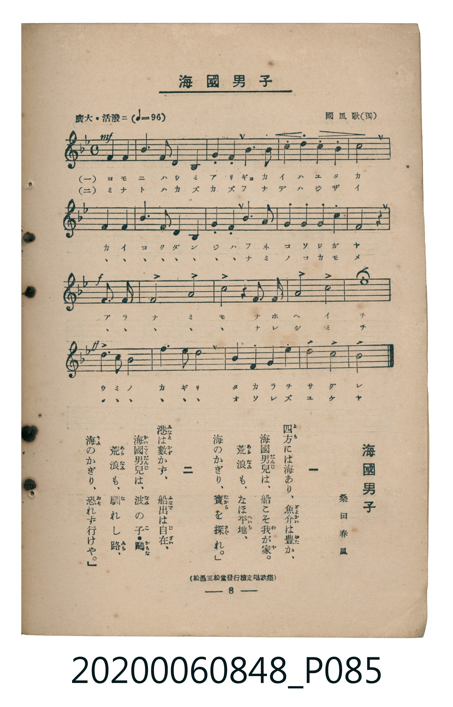

# 海國男子

<audio controls src="kaikoku_danshi.mp3"></audio>

- 詞：桑田春風
- 曲：國風歌（獨）
- 臺灣教育會公認《新定兒童唱歌》高等科男子用（2020.006.0848）

## 說明

原書資訊與歌詞全文（對應 P085.jpg，書頁 p. 8，高二第一學期第 6 首）：
調性與拍號：ヘ長調（1 降記號）、4/4 拍（廣大・活潑ニ ♩=96，弱起第 4 拍進入）
出處註記：（松邑三松堂發行檢定唱歌集）

## 歌詞

```text
一　四方（よも）には海（うみ）あり、魚介（ぎよかい）は豐（ゆた）か、
海國男兒（かいこくだんじ）は、船（ふね）こそ我（わ）が家（や）。
荒浪（あらなみ）も、なほ平地（へいち）、
海（うみ）のかぎり、寶（たから）を探（さぐ）れ。

二　港（みなと）は數（かず）かず、船出（ふなで）は自在（じざい）、
海國男兒（かいこくだんじ）は、波（なみ）の子（こ）・鷗（かもめ）
荒浪（あらなみ）も、馴（な）れし路（みち）、
海（うみ）のかぎり、恐（おそ）れず行（ゆ）けや。
```

## ABC

```abc
X:1
T:海國男子
C:曲：國風歌（獨）
M:4/4
L:1/16
Q:1/4=96
K:F
V:V1 name="Piano" snm="Pia"
[V:V1]
!mf! z4 z4 z4 c2 f2 | a6 f2 f4 d4 | c12 f2 g2 | a4 b4 c4 d4 |
c12 c2 f2 | a6 f2 f4 d4 | c12 a2 f2 | g4 c4 a4 g4 |
f8 z4 z4 | !f! d6 e2 f8 | g8 a4 a2 b2 | c8 d8 |
e16 | !ff! f6 c2 a8 | d6 c2 b8 | g4 c4 a4 d4 |
c8 e8 | f8 z4 z4 |
```

## TMD 檔案連結

- [主旋律 TMD 檔案](kaikoku_danshi.tmd)
- [鋼琴伴奏 TMD 檔案](kaikoku_danshi_piano.tmd)

## 分析

```text
================================================================================
📊 TMD Song Profile: [ 海國男子 ]
================================================================================
⏱  Duration:       0:45 (45.0s), 18 measures total
🎼 Key & Tempo:    首調基準 F, != 96.0 BPM, <4/4>
   - 分析範圍：      由實際發聲的音符與和弦推測調性；播放脈絡另行呈現
🎤 人聲音域:    C4 (MIDI 60) – F5 (MIDI 77) [跨度: 17 個半音 / 1.4 個八度, 難度: challenging]
   - 最低音:  C4 in [Main #1 @ m.1, 0:01]
   - 最高音: F5 in [Main #1 @ m.14, 0:32]
   - 適合: soprano, mezzo-soprano, contralto, tenor, baritone, bass
🏛  結構:      Main (45.0s)
⚡ 編曲密度:        Peak 1 軌道同時演奏
🗝  調性診斷：       F 大調（純淨自然大調，未偵測到可信轉調）
   - 風格氣質:    純淨自然大調（陽光明朗、易唱易記，無明顯調外色彩）
   - 轉調歷程:    全曲維持單一推測調性（未偵測到可信轉調）
   - 核心骨幹音:  C, F, A, D, E
   - 調性數值:    F 大調 [相關度: 0.87, 穩定度: Moderate, 自然音純度: 100.0%]
   - 候選調性 (K-S): F 大調 (0.87), C 大調 (0.83), A 小調 (0.75)
   - 五度圈歷程:   -1
   - 各段落調性細節:
     • [Main #1]: F 大調 (r: 0.87, 自然音純度: 100.0%)

  [ 五度圈游移軌跡 ]
               C  
        [F ]*          G  
      Bb               D  
      Eb               A  
         Ab           E  
            Db       B  
               F# 
     (* = active key center)

  [ 十二半音累積音高分佈 ]
     C  : ████████████████████████  27.7%
     C# :                            0.0%
     D  : ████████████              13.8%
     D# :                            0.0%
     E  : █████████                 10.0%
     F  : █████████████████         19.2%
     F# :                            0.0%
     G  : ███████                    8.5%
     G# :                            0.0%
     A  : █████████████             15.4%
     A# : █████                      5.4%
     B  :                            0.0%
--------------------------------------------------------------------------------
Assignment 軌道音域：
  - Piano         : C4 – F5 (17 個半音 / 1.4 個八度, 51 個音符)
================================================================================
```


## 原書掃描頁




