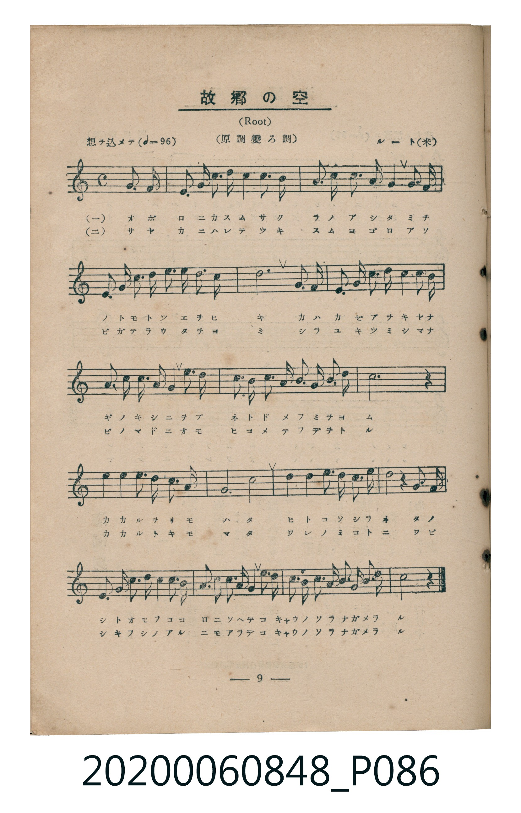
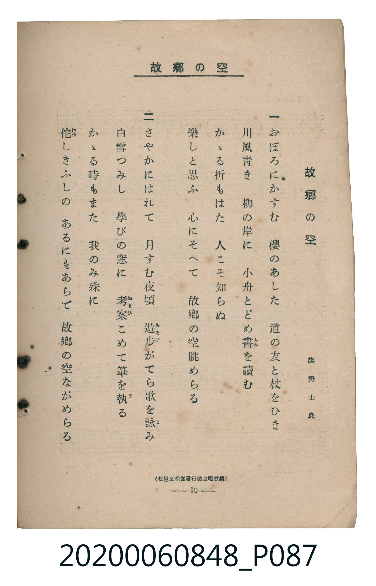

# 故郷の空

> Re:Shoka 使用 AI 協助辨識與重建樂譜，可能會有錯誤。歡迎回報。

<audio controls src="kokyo_no_sora.mp3"></audio>

- 詞：旗野士良
- 曲：ルート（G. F. Root，米國）
- 臺灣教育會公認《新定兒童唱歌》高等科男子用（2020.006.0848）

## 說明

原書資訊與歌詞全文（對應 P086.jpg – P087.jpg，書頁 pp. 9–10，高二第一學期第 7 首）：
調性與拍號：ハ長調（原調變ロ調，無升降記號）、4/4 拍（想ヲ込メテ ♩=96，弱起第 4 拍進入）
出處註記：（松邑三松堂發行檢定唱歌集）

## 跨冊／重複收錄參照

> 同曲異詞＋同名異曲（《新定兒童唱歌》六年級〈故郷の空〉與《唱歌帖》P043〈行けども〉同採蘇格蘭民謠 *Comin' Thro' the Rye* 旋律；高等科男子用〈故郷の空〉為同名異曲）

- **[同名異曲]** 《新定兒童唱歌》尋常科第六學年用（2020.006.0847.0006）：[**〈故郷の空〉**](../../grade_6_2020.006.0847.0006/2_01_kokyo_no_sora/index.md)（`G` / `2/4` — [原始 TMD](../../grade_6_2020.006.0847.0006/2_01_kokyo_no_sora/kokyo_no_sora.tmd)）
- **[同名異曲]** 楊金土手抄《唱歌帖》第 3 冊・I（2020.006.0843）：[**〈行けども〉**](../../../shokacho/vol_03/p043_yukedomo/index.md)（`C` / `4/4` — [原始 TMD](../../../shokacho/vol_03/p043_yukedomo/yukedomo.tmd)）
- 總表：[跨冊重複與同名歌曲總索引](../../../duplicate_songs.md)

## 歌詞

```text
一　おぼろにかすむ　櫻（さくら）のあした　道（みち）の友（とも）と杖（つえ）をひき
川風（かはかぜ）青（あを）き　柳（やなぎ）の岸（きし）に　小舟（をぶね）とどめ書（ふみ）を讀（よ）む
かかる折（をり）もはた　人（ひと）こそ知（し）らぬ
樂（たの）しと思（おも）ふ　心（こころ）にそへて　故郷（こきやう）の空（そら）眺（なが）めらる

二　さやかにはれて　月（つき）すむ夜頃（よごろ）　遊歩（あそび）がてら歌（うた）を詠（よ）み
白雪（しらゆき）つみし　學（まな）びの窓（まど）に　考案（おもひ）こめて筆（ふで）を執（と）る
かかる時（とき）もまた　我（われ）のみ殊（こと）に
侘（わび）しきふしの　あるにもあらで　故郷（こきやう）の空（そら）ながめらる
```

## ABC

```abc
X:1
T:故郷の空
C:曲：ルート（G. F. Root，米國）
M:4/4
L:1/16
Q:1/4=96
K:C
V:V1 name="Piano" snm="Pia"
[V:V1]
!mf! z4 z4 z4 G3 G | G3 e d3 c c4 B3 A | G3 A G3 E G4 G3 G | G3 e d3 c c3 B A3 B |
c12 d3 d | d3 G B3 d d4 c3 B | c3 G e3 d c4 B3 c | d3 d d3 G B3 c d3 B |
c12 z4 | c4 c4 c3 B A3 G | A12 c4 | B4 B4 B3 A B3 c |
d8 z4 G3 G | G3 e d3 c c4 B3 A | G6 E2 G3 A G3 G | G3 e d3 c B3 c d3 B |
c8 z4 z4 |
```

## TMD 檔案連結

- [主旋律 TMD 檔案](kokyo_no_sora.tmd) [[在 TMD Studio 編輯](https://tmdlang.github.io/Tmd-TS/#tmd=s7IKdvYPcrWy4qpTUCpJTLdSSM7PyUlNLsnMz7MqzsjMK0nNjM_KTMmPL87Iz05Ugisry88pzU21ys4vyY9Pyq8sjjcyMDKINzAwizewMLFAqCvOLy1KTrUqTs7Iz8-JL0mtKEnKz89GyBcU5Zel5iXmAdUUFIGsSwErQihILctMSQVJp6ZkluQXZSbmIDkitagY7FCwJfElRYl5xclFmQUg1yNUlWSkAl2al1hSWpSKLgrUUpYKNFFLS-HZ1NaXzdsfN657vnKXgpYWl6KtgqUZl72tgjOXjYm-iR1I54uV897vmfVs-vSX7X1PF69-0bkebOCz2ZuAwo-bVz9u3vO4ueP9ng53PQU3PYWg_PyS93t6nm_c_HRO9_s9nWDFL9p3PW9c_GzqzBdNm57NaX7auubFqt7HDV3Ppm14um7W09ZJz1cvfTpl47O1PY8bul-unvF8befz5ROfT9n-dO2E51NWAA0HBbUeMKj1QEENNpZLX0vBllqAS0FB4Wnf_Gezd7zY3P5iRdeLjnagY4Bef9q64tm0dqADnm7ofdbeqRBgYGGml1WQrvCoYTKIYw7iAP0L1PlyQaNCQYGegiVQytAAKAb0yJNdPc_XrHmyo-Hp2h3P5swHshXMFV4umwb0ATD0QLa-WLX_WcNykH3dvS9mzgeHaf_LqduB4iBb--YDGS_WdT1uXgsW6XnesvBpb_vLmb0vVswAq-983NAIjCsFoH6ghmfNmx83b3qxDxgnCx83tyk8mrnS1tIMqO_pno0vtm4HOQCs9GXDpqetS4G6wT5v3_Vi5tQXK3YDzQQ6AGTM3H0vmyY-2dEJZDxd0PR85p4XC3uerVoEii1wPL2c3QbSDNIN9N3jhobHjV2PG_c8bup93Lj6cWP348aZj5tA4s9W7waa97hx6uPG_sdNQF93ApPb48amx43THzfOByp42TgZrGD_48aFENmn_cCEAxRZ8bipCSyy4tlcYIgBRZY8bgSmtM7HTZMeN2563NgLdvz2uS8XgZII2Nb1YHIOUNHLuZPAgk1A1WBTgAmu4dn8zSDBppbHjaseN_ZB7du0A6wS6PTpYJHVQJVPN_S_6AAGL1Ax0LJtjxvXQpzyuHHl46ZGYHSDtWwFuhvioBfrGsCKIe5rALkM7JTux03dz7qAwQo2qKkLLA30PdChIN8_2bULbBDQN0A_AC2Y_Lhx7vP5wJgBCoJd0wQUXAMy7tkKYGgARecDnQxWCgzAFc8a5oIFu2BhtRXk9v3NYEGgWZOBMQL1U-Pcx407HjcuAwUDON_D1PSCwwMUn5CSACw-FxJZz-dAuMDQ6gG7phHkoKZuSMzvAuZXYMxPBRsA9CzQkvWPm3qglswBlQrgSIM4AZQini6Z83IB2HVNQKkpUNeBUkHXs7UroREGcikwnoBawEY1dQITHFiqDeh7aHCvXIAI7sb9INc8n7n35exVkIADOxKoGmIx0AXA1DUdFDJrIfG2D-gjsNRmkJdXQVIgUBDoAmj8v2hofrYQ4gFQ2AJjCBo9wBBoXPZ8LTC4IPG_HOKgp_Mh4QmORWD4oMT_TEjMARMP2EEg44CWgeL_WcdEsD-AeQMcvqC8sf_ZOmAygcQNJFGsBof2Pkgq6ocFDjD-gUkW6AQgYx04IoBpHRwLIAuAbKCa5STFNiSeEZEMtJXyshUKFLT0ubh8EzPzrAIyE_PyHWoMahSqQTYo2BiaadmBWcAiHVJOAXPf8_WgDIVRYM163LTqcTMwgwNDbOvj5iVAV4NMBumuUTBQ0AVDdLo6N61WwRTMNFWoAaddkF2QohlYsoFL3bWPm4GRBQy8nY-bF4CCE2h-0_rHzSsfN_c9blr0uGn746b9IPHm-Y-bGxGWQsw1jlMwigOzDONACGKxOZg0g6syg6mG0iD3YHPVrh6Yq_qAlevj5kVgsuVx0wpg6f64GViQrAW7EFj7AsMB6GZgyQtUswkk3rzkcXMXMc4zBzoHQtcgXIwOobqAVA3UQKiIKdRzQC5UBGw21EDUMO6E-qZpHTgs14LCEhjYoLAE-mba4-ZesP86wZXWVHAAA8WBfl2A8AfUbFOQV6D2ogUzkAt3HcJVMHcCZaEiIOehmIkJYQkHxR9PZ8-G-QMY4sCgByKgM4HJERj0wGiAJI5JIK80bX7ctBfsS2DqAVU8INnmPgzfwIMMKewgkQJMEVAWJoTrgfkD4kNYOCCSHWa4YHoRRwKcAvMq0A9A_0A8CSzogR4DtjAgeWXv4-YZwEYG2HtAcXDSa1oGjmKgFNDnwJJzDThOgezV5OUYCDSGOxSWg0AOxmkalhjHjGv0QqKGq5aLS9dOAVRGKQBpZS4uAA)]
- [鋼琴伴奏 TMD 檔案](kokyo_no_sora_piano.tmd) [[在 TMD Studio 編輯](https://tmdlang.github.io/Tmd-TS/#tmd=s7IKdvYPcrWy4tLSUng2tfVl8_bHjeuer9z1fk_Hy-49zydsebJny9Ol_c87O97v6VTQ0uJStFWwNOOyt1Vw5rIx0Tex46pTUHqxct77PbOeTZ_-sr3v6eLVLzrXK4GEn83eBBR-3Lz6cfOex81AAzrc9RTc9BSC8vNL3u_peb5x89M53UBjwYpftO963rj42dSZL5o2PZvT_LR1zYtVvY8bup5N2_B03aynrZOer176dMrGZ2t7Hjd0v1w94_nazufLJz6fsv3p2gnPp6wAGm5kYGSgZ2BgpmdgYWIBNpbLNzEzzyogMzEvP8jDocagRqGaSwEIbAzNtOzALH0thad7Nr7Yuv3phv7n6xsUtPTBwjUKBgq6YIhOV-em1SqYgpmmCjVcMEOer1nzZEfDi4U9CBMgiozjFIziwCzDOBCCmGIOJs3gqsxgqqE0yHBsVuzqIdIKc6CRELoGYSs6hOoCUjVQA6EiplAHArlQEbDZUANRPd2J4iKoKlOQo6AmoHkayIXbgzAfZiNQFioCsgjFTEwIixMUFz2dPRubi-AeQPIJJIiAYQxlYUK4HphbIK6E-QURkZh-w3QmjiidQnaqgUBjuNGwVASyAqdpWMIZM4TRU30NVy1yZvJByUwmhPMSBOLNLoYK0YaxCiYK0aaxcJ4hhia0DIBNEwiDtEFDIB4sCaXwp12onSASUyOyGpgVeJKdGVCfWW4smDYG0jUKJkCWCVAvFONwIIyBGV5oCQV3eCHLw42FcCGmAuNS104BFJ0KQFqZiwsA)]

## 分析

```text
================================================================================
📊 TMD Song Profile: [ 故郷の空 ]
================================================================================
⏱  Duration:       0:42 (42.5s), 17 measures total
🎼 Key & Tempo:    首調基準 C, != 96.0 BPM, <4/4>
   - 分析範圍：      由實際發聲的音符與和弦推測調性；播放脈絡另行呈現
🎤 人聲音域:    E4 (MIDI 64) – E5 (MIDI 76) [跨度: 12 個半音 / 1.0 個八度, 難度: easy]
   - 最低音:  E4 in [Main #1 @ m.3, 0:06]
   - 最高音: E5 in [Main #1 @ m.2, 0:02]
   - 適合: soprano, mezzo-soprano, contralto, tenor, baritone, bass
🏛  結構:      Main (42.5s)
⚡ 編曲密度:        Peak 1 軌道同時演奏
🗝  調性診斷：       G 大調（純淨自然大調，未偵測到可信轉調）
   - 風格氣質:    純淨自然大調（陽光明朗、易唱易記，無明顯調外色彩）
   - 轉調歷程:    全曲維持單一推測調性（未偵測到可信轉調）
   - 核心骨幹音:  C, G, D, B, A
   - 調性數值:    G 大調 [相關度: 0.80, 穩定度: Moderate, 自然音純度: 100.0%]
   - 候選調性 (K-S): G 大調 (0.80), C 大調 (0.77), C 小調 (0.54)
   - 五度圈歷程:   +1
   - 各段落調性細節:
     • [Main #1]: G 大調 (r: 0.80, 自然音純度: 100.0%)

  [ 五度圈游移軌跡 ]
               C  
         F           [G ]*
      Bb               D  
      Eb               A  
         Ab           E  
            Db       B  
               F# 
     (* = active key center)

  [ 十二半音累積音高分佈 ]
     C  : ████████████████████████  31.1%
     C# :                            0.0%
     D  : ███████████████           18.9%
     D# :                            0.0%
     E  : ███                        4.1%
     F  :                            0.0%
     F# :                            0.0%
     G  : ████████████████          20.9%
     G# :                            0.0%
     A  : ███████                    9.4%
     A# :                            0.0%
     B  : ████████████              15.6%
--------------------------------------------------------------------------------
Assignment 軌道音域：
  - Piano         : E4 – E5 (12 個半音 / 1.0 個八度, 89 個音符)
================================================================================
```


## 原書掃描頁






