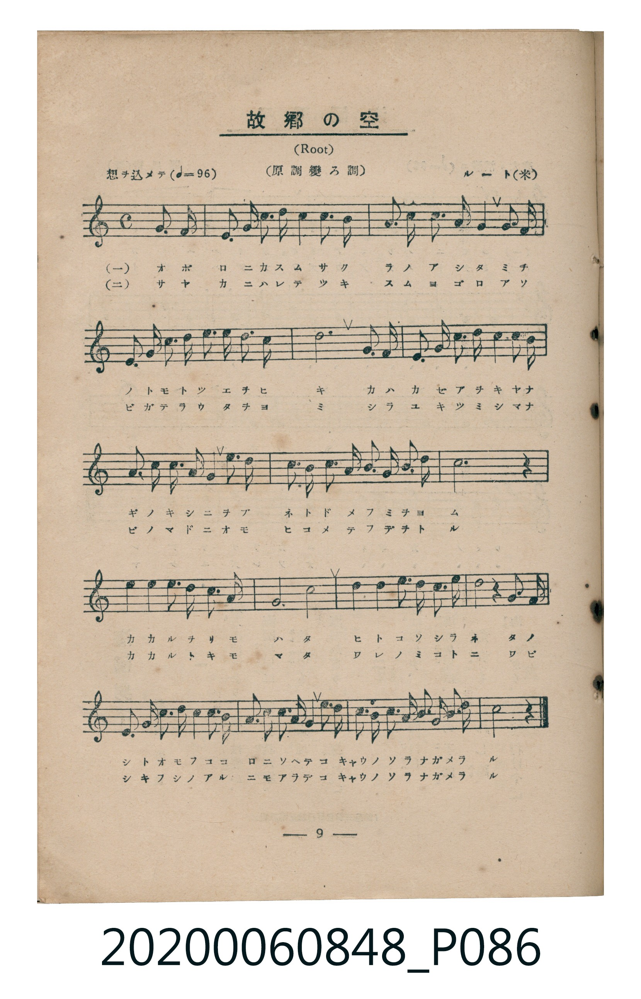
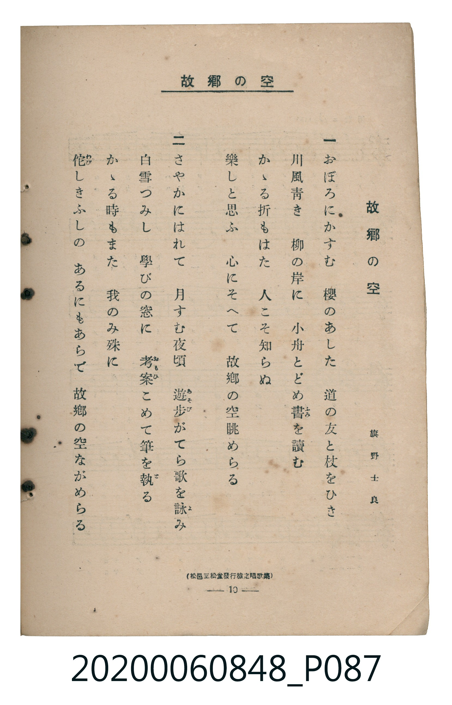

# 故郷の空

> Re:Shōka 使用 AI 協助辨識與重建樂譜，可能會有錯誤。歡迎回報。

- **鋼琴伴奏版**：<br><audio controls src="kokyo_no_sora.mp3"></audio>

- 詞：旗野士良
- 曲：ルート（G. F. Root，米國）
- 臺灣教育會公認《新定兒童唱歌》高等科男子用（2020.006.0848）

## 說明

原書資訊與歌詞全文（對應 P086.jpg – P087.jpg，書頁 pp. 9–10，高二第一學期第 7 首）：
調性與拍號：ハ長調（原調變ロ調，無升降記號）、4/4 拍（想ヲ込メテ ♩=96，弱起第 4 拍進入）
出處註記：（松邑三松堂發行檢定唱歌集）


## 歌詞

```text
一　おぼろにかすむ　櫻（さくら）のあした　道（みち）の友（とも）と杖（つえ）をひき
川風（かはかぜ）青（あを）き　柳（やなぎ）の岸（きし）に　小舟（をぶね）とどめ書（ふみ）を讀（よ）む
かかる折（をり）もはた　人（ひと）こそ知（し）らぬ
樂（たの）しと思（おも）ふ　心（こころ）にそへて　故郷（こきやう）の空（そら）眺（なが）めらる

二　さやかにはれて　月（つき）すむ夜頃（よごろ）　遊歩（あそび）がてら歌（うた）を詠（よ）み
白雪（しらゆき）つみし　學（まな）びの窓（まど）に　考案（おもひ）こめて筆（ふで）を執（と）る
かかる時（とき）もまた　我（われ）のみ殊（こと）に
侘（わび）しきふしの　あるにもあらで　故郷（こきやう）の空（そら）ながめらる
```

## ABC

```abc
X:1
T:故郷の空
C:曲：ルート（G. F. Root，米國）
M:4/4
L:1/16
Q:1/4=96
K:C
V:V1 name="Piano" snm="Pia"
[V:V1]
!mf! z4 z4 z4 G3 G | G3 e d3 c c4 B3 A | G3 A G3 E G4 G3 G | G3 e d3 c c3 B A3 B |
c12 d3 d | d3 G B3 d d4 c3 B | c3 G e3 d c4 B3 c | d3 d d3 G B3 c d3 B |
c12 z4 | c4 c4 c3 B A3 G | A12 c4 | B4 B4 B3 A B3 c |
d8 z4 G3 G | G3 e d3 c c4 B3 A | G6 E2 G3 A G3 G | G3 e d3 c B3 c d3 B |
c8 z4 z4 |
```

## TMD 檔案連結

- [主旋律 TMD 檔案](kokyo_no_sora.tmd) [[在 TMD Studio 編輯](https://tmdlang.github.io/Tmd-TS/#tmd=s7IKdvYPcrWy4qpTUCpJTLdSSM7PyUlNLsnMz7MqzsjMK0nNjM_KTMmPL87Iz05Ugisry88pzU21ys4vyY9Pyq8sjjcyMDKINzAwizewMLFAqCvOLy1KTrUqTs7Iz8-JL0mtKEnKz89GyBcU5Zel5iXmAdUUFIGsSwErQihILctMSQVJp6ZkluQXZSbmIDkitagY7FCwJfElRYl5xclFmQUg1yNUlWSkAl2al1hSWpSKLgrUUpaKZCLQgvTMPKvc1MysTCyuhUqXpxaXpBblxeem5uSnVCpxaWkpPJva-rJ5--PGdc9X7lLQ0uJStFWwNOOyt1Vw5rIx0TexAxnxYuW893tmPZs-_WV739PFq190rgeb_Gz2JqDw4-bVj5v3PG7ueL-nw11PwU1PISg_v-T9np7nGzc_ndP9fk8nWPGL9l3PGxc_mzrzRdOmZ3Oan7auebGq93FD17NpG56um_W0ddLz1UufTtn4bG3P44bul6tnPF_b-Xz5xOdTtj9dO-H5lBVAw0ERpQeMKD1QRIGN5dLXUrClFuBSUFB42jf_2ewdLza3v1jR9aKjHegYoNeftq54Nq0d6ICnG3qftXcqBBhYmOllFaQrPGqYDOKYgzhA_wJ1vlzQqFBQoKdgCZQyNACKAT3yZFfP8zVrnuxoeLp2x7M584FsBXOFl8umAX0ADD2QrS9W7X_WsBxkX3fvi5nzwWHa_3LqdqA4yNa--UDGi3Vdj5vXgkV6nrcsfNrb_nJm74sVM8DqOx83NALjSgGoH6jhWfPmx82bXuwDxsnCx81tCo9mrrS1NAPqe7pn44ut20EOACt92bDpaetSoG6wz9t3vZg59cWK3UAzgQ4AGTN338umiU92dAIZTxc0PZ-558XCnmerFoFiCxxPL2e3gTSDdAN997ih4XFj1-PGPY-beh83rn7c2P24cebjJpD4s9W7geY9bpz6uLH_cRPQ153A5Pa4selx4_THjfOBCl42TgYr2P-4cSFE9mk_MOEARVY8bmoCi6x4NhcYYkCRJY8bgSmt83HTpMeNmx439oIdv33uy0WgJAK2dT2YnANU9HLuJLBgE1A12BRggmt4Nn8zSLCp5XHjqseNfVD7Nu0AqwQ6fTpYZDVQ5dMN_S86gMELVAy0bNvjxrUQpzxuXPm4qREY3WAtW4HuhjjoxboGsGKI-xpALgM7pftxU_ezLmCwgg1q6gJLA30PdCjI90927QIbBPQN0A9ACyY_bpz7fD4wZoCCYNc0AQXXgIx7tgIYGkDR-UAng5UCA3DFs4a5YMEuWFhtBbl9fzNYEGjWZGCMQP3UOPdx447HjctAwQDO9zA1veDwAMUnpCQAi8-FRNbzORAuMLR6wK5pBDmoqRsS87uA-RUY81PBBgA9C7Rk_eOmHqglc0ClAjjSIE4ApYinS-a8XAB2XRNQagrUdaBU0PVs7UpohIFcCownoBawUU2dwAQHlmoD-h4a3CsXIIK7cT_INc9n7n05exUk4MCOBKqGWAx0ATB1TQeFzFpIvO0D-ggstRnk5VWQFAgUBLoAGv8vGpqfLYR4ABS2wBiCRg8wBBqXPV8LDC5I_C-HOOjpfEh4gmMRGD4o8T8TEnPAxAN2EMg4oGWg-H_WMRHsD2DeAIcvKG_sf7YOmEwgcQNJFKvBob0Pkor6YYEDjH9gkgU6AchYB44IYFoHxwLIAiAbqGY5SbENiWdEJANtpbxshQIFLX0uLt9EYEUUkJmYl-9QY1CjUA2yQcHG0EzLDswCFumQcgqY-56vB2UojAJr1uOmVY-bgRkcGGJbHzcvAboaZDJId42CgYIuGKLT1blptQqmYKapQg047YLsghTNwJINXOqufdwMjCxg4O183LwAFJxA85vWP25e-bi573HTosdN2x837QeJN89_3NyIsBRirnGcglEcmGUYB0IQi83BpBlclRlMNZQGuQebq3b1wFzVB6xcHzcvApMtj5tWAEv3x83AgmQt2IXA2hcYDkA3A0teoJpNIPHmJY-bu4hxnjnQORC6BuFidAjVBaRqoAZCRUyhngNyoSJgs6EGooZxJ9Q3TevAYbkWFJbAwAaFJdA30x4394L91wmutKaCAxgoDvTrAoQ_oGabgrwCtRctmIFcuOsQroK5EygLFQE5D8VMTAhLOCj-eDp7NswfwBAHBj0QAZ0JTI7AoAdGAyRxTAJ5pWnz46a9YF8CUw-o4gHJNvdh-AYeZEhhB4kUYIqAsjAhXA_MHxAfwsIBkewwwwXTizgS4BSYV4F-APoH4klgQQ_0GLCFAckrex83zwA2MsDeA4qDk17TMnAUA6WAPgeWnGvAcQpkryYvx0CgMdyhsBwEcjBO07DEOGZcoxcSNVy1XFy6dgqgMkoBSCtzcQEA)]
- [鋼琴伴奏 TMD 檔案](kokyo_no_sora_piano.tmd) [[在 TMD Studio 編輯](https://tmdlang.github.io/Tmd-TS/#tmd=s7IKdvYPcrWy4tLSUng2tfVl8_bHjeuer9z1fk_Hy-49zydsebJny9Ol_c87O97v6VTQ0uJStFWwNOOyt1Vw5rIx0Tex46pTUHqxct77PbOeTZ_-sr3v6eLVLzrXK4GEn83eBBR-3Lz6cfOex81AAzrc9RTc9BSC8vNL3u_peb5x89M53UBjwYpftO963rj42dSZL5o2PZvT_LR1zYtVvY8bup5N2_B03aynrZOer176dMrGZ2t7Hjd0v1w94_nazufLJz6fsv3p2gnPp6wAGm5kYGSgZ2BgpmdgYWIBNpbLNzEzzyogMzEvP8jDocagRqGaSwEIbAzNtOzALH0thad7Nr7Yuv3phv7n6xsUtPTBwjUKBgq6YIhOV-em1SqYgpmmCjVcMEOer1nzZEfDi4U9CBMgiozjFIziwCzDOBCCmGIOJs3gqsxgqqE0yHBsVuzqIdIKc6CRELoGYSs6hOoCUjVQA6EiplAHArlQEbDZUANRPd2J4iKoKlOQo6AmoHkayIXbgzAfZiNQFioCsgjFTEwIixMUFz2dPRubi-AeQPIJJIiAYQxlYUK4HphbIK6E-QURkZh-w3QmjiidQnaqgUBjuNGwVASyAqdpWMIZM4TRU30NVy1yZvJByUwmhPMSBOLNLoYK0YaxCiYK0aaxcJ4hhia0DIBNEwiDtEFDIB4sCaXwp12onSASUyOyGpgVeJKdGVCfWW4smDYG0jUKJkCWCVAvFONwIIyBGV5oCQV3eCHLw42FcCGmAuNS104BFJ0KQFqZiwsA)]

## 分析

```text
================================================================================
📊 TMD Song Profile: [ 故郷の空 ]
================================================================================
⏱  Duration:       0:42 (42.5s), 17 measures total
🎼 Key & Tempo:    首調基準 C, != 96.0 BPM, <4/4>
   - 分析範圍：      由實際發聲的音符與和弦推測調性；播放脈絡另行呈現
🎤 人聲音域:    E4 (MIDI 64) – E5 (MIDI 76) [跨度: 12 個半音 / 1.0 個八度, 難度: easy]
   - 最低音:  E4 in [Main #1 @ m.3, 0:06]
   - 最高音: E5 in [Main #1 @ m.2, 0:02]
   - 適合: soprano, mezzo-soprano, contralto, tenor, baritone, bass
🏛  結構:      Main (42.5s)
⚡ 編曲密度:        Peak 1 軌道同時演奏
🗝  調性診斷：       G 大調（純淨自然大調，未偵測到可信轉調）
   - 風格氣質:    純淨自然大調（陽光明朗、易唱易記，無明顯調外色彩）
   - 轉調歷程:    全曲維持單一推測調性（未偵測到可信轉調）
   - 核心骨幹音:  C, G, D, B, A
   - 調性數值:    G 大調 [相關度: 0.80, 穩定度: Moderate, 自然音純度: 100.0%]
   - 候選調性 (K-S): G 大調 (0.80), C 大調 (0.77), C 小調 (0.54)
   - 五度圈歷程:   +1
   - 各段落調性細節:
     • [Main #1]: G 大調 (r: 0.80, 自然音純度: 100.0%)

  [ 五度圈游移軌跡 ]
               C  
         F           [G ]*
      Bb               D  
      Eb               A  
         Ab           E  
            Db       B  
               F# 
     (* = active key center)

  [ 十二半音累積音高分佈 ]
     C  : ████████████████████████  31.1%
     C# :                            0.0%
     D  : ███████████████           18.9%
     D# :                            0.0%
     E  : ███                        4.1%
     F  :                            0.0%
     F# :                            0.0%
     G  : ████████████████          20.9%
     G# :                            0.0%
     A  : ███████                    9.4%
     A# :                            0.0%
     B  : ████████████              15.6%
--------------------------------------------------------------------------------
Assignment 軌道音域：
  - Piano         : E4 – E5 (12 個半音 / 1.0 個八度, 89 個音符)
================================================================================
```


## 原書掃描頁






