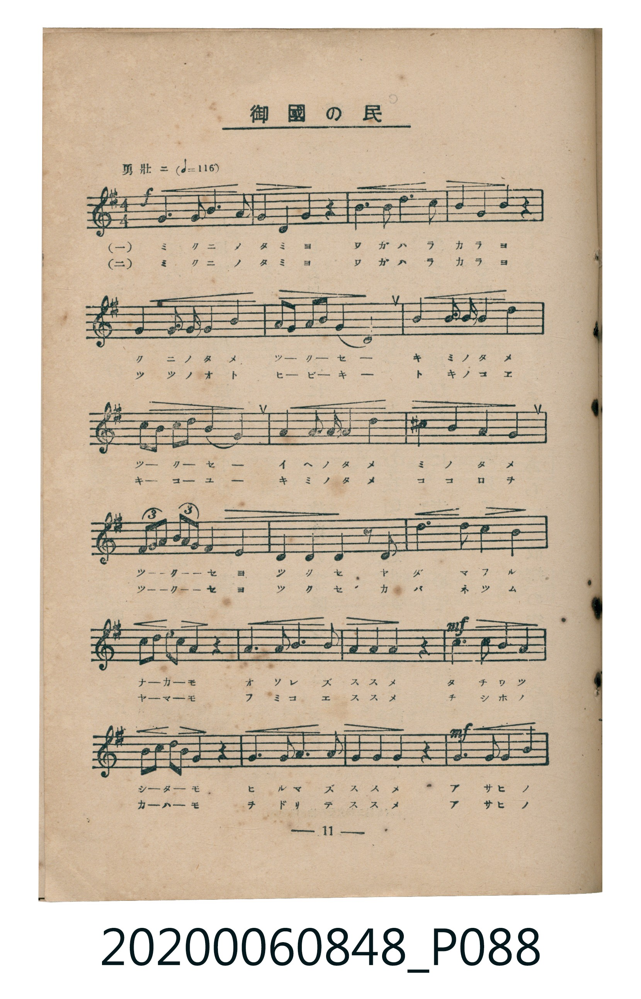
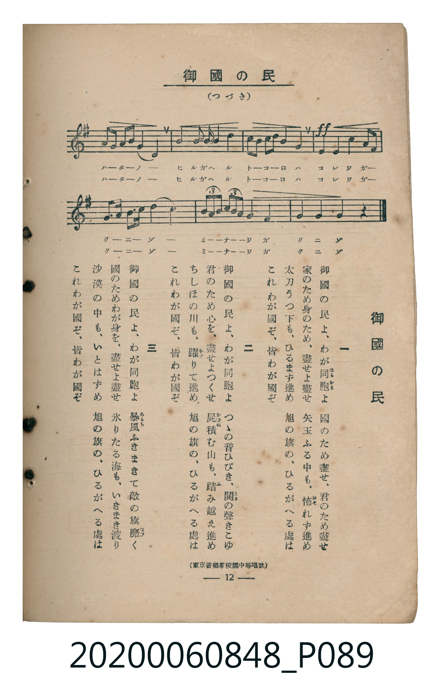

# 御國の民

<audio controls src="mikuni_no_tami.mp3"></audio>

- 詞：東京音樂學校編《中等唱歌》
- 曲：東京音樂學校編《中等唱歌》
- 臺灣教育會公認《新定兒童唱歌》高等科男子用（2020.006.0848）

## 說明

原書資訊與歌詞全文（對應 P088.jpg – P089.jpg，書頁 pp. 11–12，高二第一學期第 8 首）：
調性與拍號：ト長調（1 升記號）、4/4 拍（勇壯ニ ♩=116，弱起第 4 拍進入）
出處註記：（東京音樂學校編中等唱歌）

## 歌詞

```text
一　御國（みくに）の民（たみ）よ、わが同胞（はらから）よ　國（くに）のため盡（つく）せ、君（きみ）のため盡（つく）せ
家（いへ）のため身（み）のため、盡（つく）せよ盡（つく）せ　矢玉（やだま）ふる中（なか）も、怖（おそ）れず進（すす）め
太刀（たち）うつ下（した）も、ひるまず進（すす）め　旭（あさひ）の旗（はた）の、ひるがへる處（ところ）は
これわが國（くに）ぞ、皆（みな）わが國（くに）ぞ

二　御國（みくに）の民（たみ）よ、わが同胞（はらから）よ　つつ音（おと）ひびき、鬨（とき）の聲（こえ）きこゆ
君（きみ）のため心（こころ）を、盡（つく）せよつくせ　屍（かばね）積（つ）む山（やま）も、踏（ふ）み越（こ）え進（すす）め
ちしほの川（かは）も、躍（をど）りて進（すす）め　旭（あさひ）の旗（はた）の、ひるがへる處（ところ）は
これわが國（くに）ぞ、皆（みな）わが國（くに）ぞ

三　御國（みくに）の民（たみ）よ、わが同胞（はらから）よ　暴風（あらし）ふきまきて敵（てき）の旗（はた）靡（なび）く
國（くに）のためわが身（み）を、盡（つく）せよ盡（つく）せ　氷（こほ）りたる海（うみ）も、いきまき渡（わた）り
沙漠（さばく）の中（なか）も、いとはず進（すす）め　旭（あさひ）の旗（はた）の、ひるがへる處（ところ）は
これわが國（くに）ぞ、皆（みな）わが國（くに）ぞ
```

## ABC

```abc
X:1
T:御國の民
C:曲：東京音樂學校編《中等唱歌》
M:4/4
L:1/16
Q:1/4=116
K:G
V:V1 name="Piano" snm="Pia"
[V:V1]
!f! z4 z4 z4 d4 | g4 a3 b c4 b4 | a4 z4 b3 c d3 d | d4 b4 d4 z4 |
d4 b3 g e4 d4 | c2 a2 b2 g2 a4 d4 | g4 a3 b c8 | b2 g2 a2 f2 g8 |
b4 b3 b b4 g4 | e4 d4 ^c4 d4 | d ^c d e d c d4 a4 | b4 g4 a4 z2 d2 |
g4 b4 d4 b4 | a2 b2 c4 b4 z4 | a3 b c2 a2 b2 g2 a2 z2 | !mf! d4 b4 g4 b4 |
a2 b2 c4 b4 z4 | a3 b c2 a2 b2 g2 a2 z2 | !mf! d8 b3 g g4 | e2 f2 g2 e2 d8 |
g3 a b3 c d8 | e2 d2 c2 b2 a4 d4 | !ff! g4 d4 b4 g3 b | a3 g e2 g2 d8 |
e d c b a g d4 f4 | g4 g4 g4 z4 |
```

## TMD 檔案連結

- [主旋律 TMD 檔案](mikuni_no_tami.tmd)
- [鋼琴伴奏 TMD 檔案](mikuni_no_tami_piano.tmd)

## 分析

```text
================================================================================
📊 TMD Song Profile: [ 御國の民 ]
================================================================================
⏱  Duration:       0:53 (53.8s), 26 measures total
🎼 Key & Tempo:    首調基準 G, != 116.0 BPM, <4/4>
   - 分析範圍：      由實際發聲的音符與和弦推測調性；播放脈絡另行呈現
🎤 人聲音域:    D4 (MIDI 62) – G5 (MIDI 79) [跨度: 17 個半音 / 1.4 個八度, 難度: challenging]
   - 最低音:  D4 in [Main #1 @ m.1, 0:01]
   - 最高音: G5 in [Main #1 @ m.23, 0:45]
   - 適合: soprano, mezzo-soprano, tenor, baritone
🏛  結構:      Main (53.8s)
⚡ 編曲密度:        Peak 1 軌道同時演奏
🗝  調性診斷：       G 大調（純淨自然大調，未偵測到可信轉調）
   - 風格氣質:    純淨自然大調（陽光明朗、易唱易記，無明顯調外色彩）
   - 轉調歷程:    全曲維持單一推測調性（未偵測到可信轉調）
   - 核心骨幹音:  D, B, G, A, C
   - 調性數值:    G 大調 [相關度: 0.87, 穩定度: High, 自然音純度: 98.2%]
   - 候選調性 (K-S): G 大調 (0.87), D 大調 (0.75), B 小調 (0.73)
   - 五度圈歷程:   +1
   - 各段落調性細節:
     • [Main #1]: G 大調 (r: 0.87, 自然音純度: 98.2%, 調外音: C#)

  [ 五度圈游移軌跡 ]
               C  
         F           [G ]*
      Bb               D  
      Eb               A  
         Ab           E  
            Db       B  
               F# 
     (* = active key center)

  [ 十二半音累積音高分佈 ]
     C  : ███████                    8.3%
     C# : ██                         1.8%
     D  : ████████████████████████  26.8%
     D# :                            0.0%
     E  : ████                       4.9%
     F  :                            0.0%
     F# : ██                         2.1%
     G  : ██████████████████        19.7%
     G# :                            0.0%
     A  : █████████████             14.1%
     A# :                            0.0%
     B  : ████████████████████      22.3%
--------------------------------------------------------------------------------
Assignment 軌道音域：
  - Piano         : D4 – G5 (17 個半音 / 1.4 個八度, 126 個音符)
================================================================================
```


## 原書掃描頁






