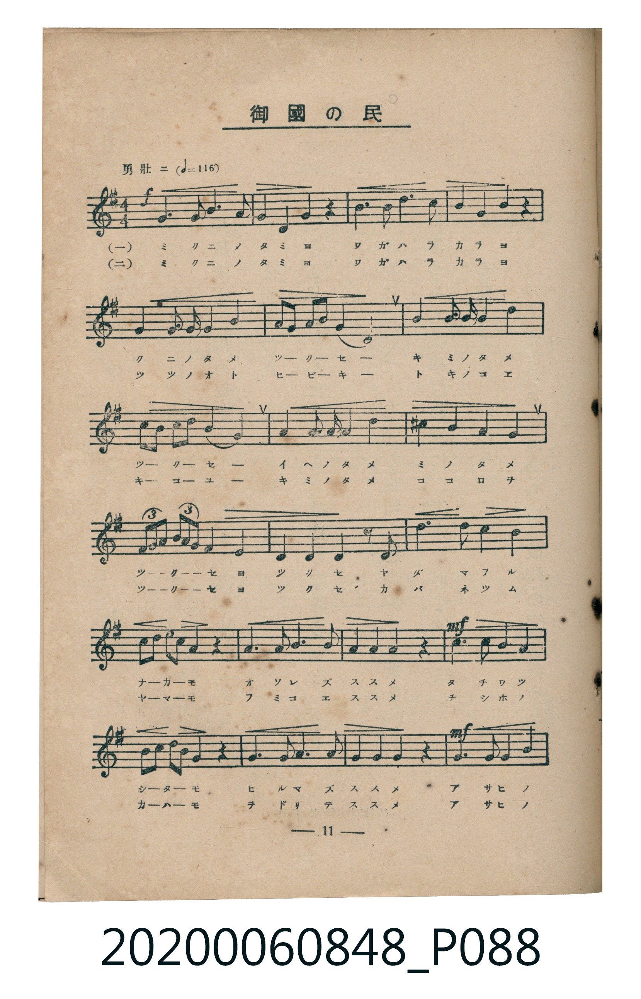
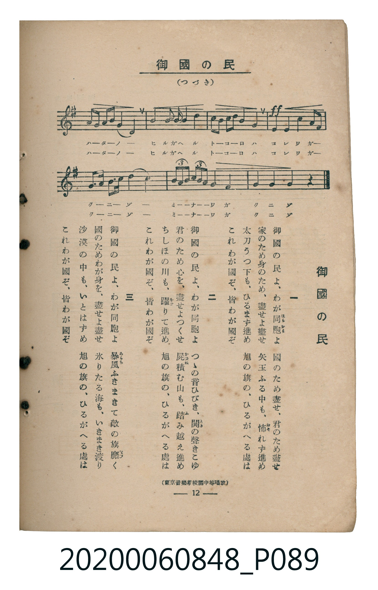

# 御國の民

> Re:Shōka 使用 AI 協助辨識與重建樂譜，可能會有錯誤。歡迎回報。

- **鋼琴伴奏版**：<br><audio controls src="mikuni_no_tami.mp3"></audio>

- 詞：東京音樂學校編《中等唱歌》
- 曲：東京音樂學校編《中等唱歌》
- 臺灣教育會公認《新定兒童唱歌》高等科男子用（2020.006.0848）

## 說明

原書資訊與歌詞全文（對應 P088.jpg – P089.jpg，書頁 pp. 11–12，高二第一學期第 8 首）：
調性與拍號：ト長調（1 升記號）、4/4 拍（勇壯ニ ♩=116）
出處註記：（東京音樂學校編中等唱歌）


## 歌詞

```text
一
御國（みくに）の民（たみ）よ、わが同胞（はらから）よ　國（くに）のため盡（つく）せ、君（きみ）のため盡（つく）せ
家（いへ）のため身（み）のため、盡（つく）せよ盡（つく）せ　矢玉（やだま）ふる中（なか）も、怖（おそ）れず進（すす）め
太刀（たち）うつ下（した）も、ひるまず進（すす）め　旭（あさひ）の旗（はた）の、ひるがへる處（ところ）は
これわが國（くに）ぞ、皆（みな）わが國（くに）ぞ

二
御國（みくに）の民（たみ）よ、わが同胞（はらから）よ　つゝの音（おと）ひびき、鬨（とき）の聲（こえ）きこゆ
君（きみ）のため心（こころ）を、盡（つく）せよつくせ　屍（かばね）積（つ）む山（やま）も、踏（ふ）み越（こ）え進（すす）め
ちしほの川（かは）も、躍（をど）りて進（すす）め　旭（あさひ）の旗（はた）の、ひるがへる處（ところ）は
これわが國（くに）ぞ、皆（みな）わが國（くに）ぞ

三
御國（みくに）の民（たみ）よ、わが同胞（はらから）よ　暴風（あらし）ふきまきて敵（てき）の旗（はた）靡（なび）く
國（くに）のためわが身（み）を、盡（つく）せよ盡（つく）せ　氷（こほ）りたる海（うみ）も、いきまき渡（わた）り
沙漠（さばく）の中（なか）も、いとはず進（すす）め　旭（あさひ）の旗（はた）の、ひるがへる處（ところ）は
これわが國（くに）ぞ、皆（みな）わが國（くに）ぞ
```

## ABC

<div class="abc-score" data-abc-src="mikuni_no_tami.abc" aria-label="五線譜載入中"></div>

[下載 ABC 原始檔](mikuni_no_tami.abc)

## TMD 檔案連結

- [主旋律 TMD 檔案](mikuni_no_tami.tmd) [[在 TMD Studio 編輯](https://tmdlang.github.io/Tmd-TS/#tmd=s7IKdvYPcrWy4qpTUCpJTLdSSM7PyUlNLsnMz7MqzsjMK0nNjM_KTMmPL87Iz05Ugisry88pzU21ys4vyY9Pyq8sjjcyMDKINzAwizewMLFAqCvOLy1KTrUqTs7Iz8-JL0mtKEnKz89Gl48vSExPtQowsMDQCZexRMgUFOWXpeYl5gHNLSgCOTEFbDBCQWpZZkoqSLo4OTEvviy1KDMtMzUFyfGpRcVgD0KsKClKzCtOLsosAPkaoSq_qCQjP70osSCj0iojs7gkvygzOTEnPjsxDykcSjJSgcGQmVsAtCQxB1lzZnpmnlVuamZWJpK3tbQUnu5b-HRO9-PGdc82TFTQ0uJStFUwNDTjsrdVcOeyMdE3sQOZ8WLlvPd7Zj2bu_HJrjUv529-tqLp6dodzxYsfL59xeOGric71j5f2_l0ysZna3seN3SDbX02exOJOl6073reuPjZ1JkvmjY9m9P8tHXNi1W9QLXPpm14um7W09ZJz1cvhet4uXoG0IDnyyc-n7L96doJz6eseL-nAxTnesA41wPF-fs9nUpcXPpaCrbUAlwKCgpP--Y_m73jxeb2Fyu6XnS0Ax0DDJqnrSueTWsHOuDpht5n7Z0KoISjl1WQrvCoYTKIYwnivN_TA9T5ckGjQkGBHjCIgXKGRkBBoE-e7Op5vmbNkx0NoCCaMx_IVrBQeLlsGtALwDAEWfti1f5nDctBFnb3vpg5Hyj6uLnj5dTtQHGgtYYKT3uBDpoBlul83NAIjDYFoEqQi7rbny5e_7i5W-HRzJW2wIgFKgD7o33Xi5lTX6zYDdQGNA2oEmtUIccTSCdIK9CdYBPA6Qao8XHj_seN_Y8bV4PsBicjsOB8oDhIpKkD6KDHTUAFPU8n9LxoBiYkoOz6x01Axd1AEqamAWYawiiQIU2Nz2cvBIsvAUqBxWcDDXw6YTZYsBdqC27FYLeu2wYWbXncuANZ9YtdQJtAHkAWBJqOxcqmDmzuaHg-f9HzPqAfOh43AQ1f8LhxH1hq6-OmbmDYgdWvAvoT7MkmoMnPGoCxChTsetw4FyzY87hx1ssGYF4BCs4EIrBgI9jRS1Y97WiAhSXQbqC5bUDrn-yAhNN0oDjc3MeNm4BWAq3HahzQoc-mQ1zT9LhxKlAxNK6mT4fGBsQoYBAgjAK6bAeQAUwmYDUrHjdOftwETFNAZetB7gPze6Axix5380ChOKsNljxWgd2BXSUkUe3qoUmiAkVX01ygCcCEDQt4YFEBVLbpceNmUPppaHy5BlR4gH0I8d66F6AAAopMftzYARYBJjOgZ9vATsSR8p7ub4bpgYVT0yRcaQnChSShpxtBGRXk7sYNjxuBsdT5fCVEZAnYEKCCjbAEBk5d4Ah_sQNoGlDNVrCZ-19s64LYDuZ2YE9RwFQETja7gY5-uh2Y_iC2rkcYugtsMdDdjSvBgsDQWjYkk9MOSClH7eT0bNaWl4sgqaUJLAv0MDi7g5IDMO8ByWXPpgLjBKhgGTw5oYXLy7mQFAEsGIBpEqigH-xWHMUfxFkoJRXudIW1jHq2YTssZe6GxSrQ5O5nWyHiwEIFYiykIAEmM6hnnu0AmwZyAKSk6QI59Nmmmc_2LADrBEY9MMlCbFqHtbwDGweMa6DXh1y5BDSL8kYDFCho6XNx-WZml-Zl-uWHJOZmWgVkJublO9QY1FSDLFKwMTTTsgOzsDVZFCDtgxcLexQ0TBSebuh_vr5BB97O0MSiAWgfyLAaheq0WgVDBV04BLGNkfhGQFwDV2Eaj6QMBA2gdA2KJhDbFIlvgqICphfGh5sBdpKPYY3C4-b5SLofN60HkcBGCpJYcx_YzMdN--EiMD2Pm1dAWTDXgkwEmYEwcQ1YXT-KiSuhJq5GEcFhIsStRkPIrcZDw634E_muHnAiNyYtkcNSHIQ2xEiBNeBkDhIF0SBRjASPSL4Q2hjOhyV0pOQLDliIByGBCwpW5CBdCDf1cXMLWGQPOPggEQJh74arBvGhqpvWwkUh0YLTZKQECrIBIgthQfSsgot2ILlmEsIFzZORXIOwF8k1cJ0weYjJm-GisOhFSoJNi-AmQZLB46btQPZUNJMg5s9DcwHMZW1YXQMXRXYNPDEiQolQItvRSU4iAxVyoDQBokFpAr24gyQyEITQRnA-PAUpmKhDmTDNMCVwQ5DKSNISzhK46AxE4OBIkogcDyoNUAMPaxJDjhxw9MMiahlWt8CimGAiRklMcFYzQv8mVLeAy7guJPuRkzAiUyK7hZSsClcLLueQfYDqFrzJ6-ns2eQkLw3zeGAqMNJU1dAFAk2QfiMFQzgXKAux3QxRYsELL0wGqM4Fc4CqoEJgeSAGpV8QhBeO8CSnAUpzoNADYqADQGEH5yEnO3iuRy57EAENVwmy_3EzKGGCVDYguQOW8-GlQjOs8kAkOpq4BlxJgVROQHFNL5hElKMLUF0DTHa0cQ0oyYNUzkZxDajkRk6iiLAhUHlOIaeFCCvPzIAYxIYVSYimH0wEBGEVKAyC2OglHzYzqnOBDVFY0gNBWHGKrBy59EPK5eBIg-V4WPWC1EaBV3WQIN4LVgfLwRCxXVCVO-EicBa8BEA2ERb4EBWNYB2Isg4WsciVMCiZw9yIVK1hcy882UNMA5UwiNIP4jpQMiLBvWAXInRvB6uDJSpEKY9cTYN8A3Mj2AV4whdWt0BMXwv3I6oYagmKSL6w2EE2cSuybnBmRC6pEe7FX9K2riUnwaNX4ph9HfQOE3oGQG9xYjMDnODRDcJomCK1KSGRBknwoMDDl4BArThE8EGyB2qEkJrgYbZA1IKiB2ELRgICNwmQMyWoDYbPvbCqE2JaJ5hEybTgth3N3IvebCBYoKAkeHArGK3TQ7PwJdBybcZM8ODpBbwJnhqdHyKav9VpwBQPb57AGbBCH5KJgO0Y5FIeKeGgJHp4uxSlA4AIMEiVCGqnwdq7CFGIWkikYbZY18JVwyIUpRUKrzcwW4MgE5BL_CHqdnBmGHpuJ1ATrMZscxPOGJC0awRNyybw1A5LssBmH6gVboxolJsA1SLa6LC0D2-cE1ExYIwiQJqRsM4JkN20Dx4UiEgAtj_nQ5WC25_A4gzR_sTSccHW9QHJw8zGMtA1mNwDbqIMDvfUcnHp2ikgD94qAPnKXAA)]
- [鋼琴伴奏 TMD 檔案](mikuni_no_tami_piano.tmd) [[在 TMD Studio 編輯](https://tmdlang.github.io/Tmd-TS/#tmd=s7IKdvYPcrWy4qpTUCpJTLdSSM7PyUlNLsnMz7MqzsjMK0nNjM_KTMmPL87Iz05Ugisry88pzU21ys4vyY9Pyq8sjjcyMDKINzAwizewMLFAqCvOLy1KTrUqTs7Iz8-JL0mtKEnKz89Gl48vSExPtQowsMDQCZexRMgUFOWXpeYl5gHNLSgCOTEFbDBCQWpZZkoqSLo4OTEvviy1KDMtMzUFyfGpRcVgD0KsKClKzCtOLsosAPkaoSq_qCQjP70osSCj0iojs7gkvygzOTEnPjsxDykcEouAmtNTc1PzSqwKMhPz8uMTk5PzcwsS8zJBYgiFJRlARVaZuQVA1yTmINuSmZ6ZZ5WbmpmViRQ-WloKT_ctfDqn-3HjumcbJr7f0_Gye8_zCVue7NnydGn_886O93s6FbS0uBRtFQwNzbjsbRXcuWxM9E3sQAa_WDnv_Z5Zz-ZufLJrzcv5m5-taHq6dsezBQufb1_xuKHryY61z9d2Pp2y8dnanscN3WCnPJu9iUQdL9p3PW9c_GzqzBdNm57NaX7auubFql6g2mfTNjxdN-tp66Tnq5fCdbxcPQNowPPlE59P2f507YTnU1YAPQRKMXrAFKMHSjFA7yhxcflmZpfmZfrlhyTmZloFgIIzyMOhxqCmmksBCGwMzbTswCx9LQVbdKDwfM2aJzsaXizsUdAwUXi6of_5-gYdBVCa0ssqSNfEokFLH2xYjUJ1Wq2CoYIuHILYxkh8IyCugaswjUdSBoIGULoGRROIbYrEN0FRAdML48PNADvJx7BG4XHzfCTdj5vWg8jmbmSx5j6wmY-b9sNFYHoeN6-AsmCuBZkIMgNh4hqwun4UE1dCTVyNIoLDRIhbjYaQW42HhlvxJ_JdPeBEbkxaIoelOAhtiJECa8DJHCQKokGiGAkekXwhtDGcD0voSMkXHLAQD0ICFxSsyEG6EG7q4-YWsMgecPBBIgTC3g1XDeJDVTethYtCogWnyUgJFGQDRBbCguhZBRftQHLNJIQLmicjuQZhL5Jr4Dph8hCTN8NFYdGLlASbFsFNgiSDx03bgeypaCZBzJ-H5gKYy9qwugYuiuwaeGJEhBKhRLajk5xEBirkQGkCRIPSBHpxB0lkIAihjeB8eApSMFGHMmGaYUrghiCVkaQlnCVw0RmIwMGRJBE5HlQaoAYe1iSGHDng6IdF1DKsboFFMcFEjJKY4KxmhP5NqG4Bl3FdSPYjJ2FEpkR2CylZFa4WXM4h-wDVLXiT19PZs8lJXhrm8cBUYKSpqqELBJog_UYKhnAuUBZiuxmixIIXXpgMUJ0L5gBVQYXA8kAMSr8gCC8c4UlOA5TmQKEHxEAHgMIOzkNOdvBcj1z2IAIarhJk_-NmUMIEqWxAcgcs58NLhWZY5YFIdDRxDbiSAqmcgOKaXjCJKEcXoLoGmOxo4xpQkgepnI3iGlDJjZxEEWFDoPKcQk4LEVaemQExiA0rkhBNP5gICMIqUBgEsdFLPmxmVOcCG6KwpAeCsOIUWTly6YeUy8GRBsvxsOoFqY0Cr-ogQbwXrA6WgyFiu6Aqd8JF4Cx4CYBsIizwISoawToQZR0sYpErYVAyh7kRqVrD5l54soeYBiphEKUfxHWgZESCe8EuROjeDlYHS1SIUh65mgb5BuZGsAvwhC-sboGYvhbuR1Qx1BIUkXxhsYNs4lZk3eDMiFxSI9yLv6RtXUtOgkevxDH7OugdJvQMgN7ixGYGOMGjG4TRMEVqU0IiDZLgQYGHLwGBWnGI4INkD9QIITXBw2yBqAVFD8IWjAQEbhIgZ0pQGwyfe2FVJ8S0TjCJkmnBbTuauRe92UCwQEFJ8OBWMFqnh2bhS6Dl2oyZ4C0JJnhqdH6IaP5WpwFTPLx5AmfACn1IJgK2Y5BLeaSEg5Lo4e1SlA4AIsAgVSKonQZr7yJEIWohkYbZYl0LVw2LUJRWKLzewGwNgkxALvGHqNvBmWHouZ1ATbAas81NOGNA0q4RNC2bwFM7LMkCm32gVrgxolFuAlSLaKPD0j68cU5ExYAxigBpRsI6J0B20z54UCAiAdj-nA9VCm5_AoszRPsTS8cFW9cHJA8zG8tA12ByD7iJMjjcU4tt7NYHeezWBDp0C4z9eIVow1gwZRofCxUAsYC0AULeNB5FAUQHUB7TFCAF6uchTMHQBlYC1YiiEFUrkpVGQJYRkAWisWkGiZvF52JoB3kALmCCqhnENcGmDrtLQEpgWuCeQvI98UFGTEhgDTIsTjQDiYB9DnIbuptgjgC5GSKC4nq0mASmGl07BeSEE-0DlMUQM8IiZgwWU-YCAA)]

## 分析

```text
================================================================================
📊 TMD Song Profile: [ 御國の民 ]
================================================================================
⏱  Duration:       0:57 (57.9s), 28 measures total
🎼 Key & Tempo:    首調基準 G, != 116.0 BPM, <4/4>
   - 分析範圍：      由實際發聲的音符與和弦推測調性；播放脈絡另行呈現
🎤 人聲音域:    D4 (MIDI 62) – E5 (MIDI 76) [跨度: 14 個半音 / 1.2 個八度, 難度: moderate]
   - 最低音:  D4 in [MikuniNoTami #1 @ m.2, 0:02]
   - 最高音: E5 in [MikuniNoTami #1 @ m.14, 0:27]
   - 適合: soprano, mezzo-soprano, contralto, tenor, baritone, bass
🏛  結構:      MikuniNoTami (57.9s)
⚡ 編曲密度:        Peak 1 軌道同時演奏
🗝  調性診斷：       G 大調（純淨自然大調，未偵測到可信轉調）
   - 風格氣質:    純淨自然大調（陽光明朗、易唱易記，無明顯調外色彩）
   - 轉調歷程:    全曲維持單一推測調性（未偵測到可信轉調）
   - 核心骨幹音:  G, B, A, D, C
   - 調性數值:    G 大調 [相關度: 0.88, 穩定度: High, 自然音純度: 99.0%]
   - 候選調性 (K-S): G 大調 (0.88), B 小調 (0.62), D 大調 (0.57)
   - 五度圈歷程:   +1
   - 各段落調性細節:
     • [MikuniNoTami #1]: G 大調 (r: 0.88, 自然音純度: 99.0%, 調外音: C#)

  [ 五度圈游移軌跡 ]
               C  
         F           [G ]*
      Bb               D  
      Eb               A  
         Ab           E  
            Db       B  
               F# 
     (* = active key center)

  [ 十二半音累積音高分佈 ]
     C  : ████████                   9.2%
     C# : █                          1.0%
     D  : ██████████████            15.3%
     D# :                            0.0%
     E  : ███                        3.3%
     F  :                            0.0%
     F# : ██                         2.5%
     G  : ████████████████████████  27.2%
     G# :                            0.0%
     A  : ███████████████           17.1%
     A# :                            0.0%
     B  : ██████████████████████    24.5%
--------------------------------------------------------------------------------
Assignment 軌道音域：
  - Piano         : D4 – E5 (14 個半音 / 1.2 個八度, 132 個音符)
================================================================================
```


## 原書掃描頁






