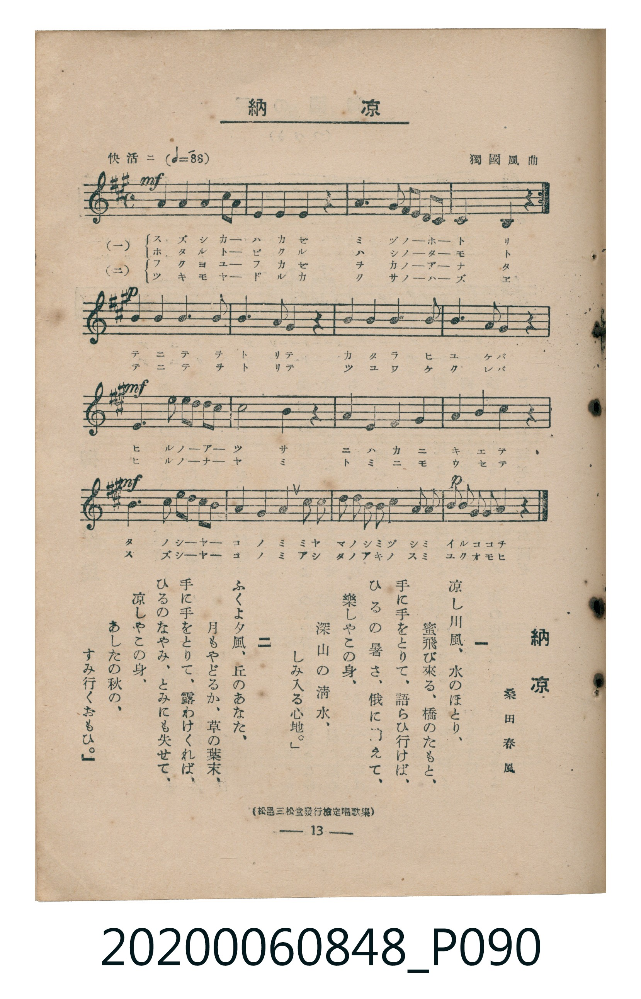

# 納涼

<audio controls src="noryo.mp3"></audio>

- 詞：桑田春風
- 曲：獨國風曲
- 臺灣教育會公認《新定兒童唱歌》高等科男子用（2020.006.0848）

- note

原書資訊與歌詞全文（對應 P090.jpg，書頁 p. 13，高二第二學期第 1 首）：
調性與拍號：イ長調（A Major，3 升記號）、4/4 拍（快活ニ ♩=88）
出處註記：（松邑三松堂發行檢定唱歌集）

## 歌詞

```text
一
涼し川風、水のほとり、
螢飛び來る、橋のたもと、
手に手をとりて、語らひ行けば、
ひるの暑さ、俄に消えて、
樂しやこの身、
深山の清水、しみ入る心地。

二
ふくよ夕風、丘のあなた、
月もやどるか、草の葉末、
手に手をとりて、露わけくれば、
ひるのなやみ、とみにも失せて、
涼しやこの身、
あしたの秋の、すみ行くおもひ。
```

## 原書掃描頁



## 調性分析

```text
================================================================================
📊 TMD Song Profile: [ 納涼 ]
================================================================================
⏱  Duration:       0:54 (54.5s), 20 measures total
🎼 Key & Tempo:    首調基準 A, != 88.0 BPM, <4/4>
   - 分析範圍：      由實際發聲的音符與和弦推測調性；播放脈絡另行呈現
🎤 人聲音域:    E4 (MIDI 64) – E5 (MIDI 76) [跨度: 12 個半音 / 1.0 個八度, 難度: easy]
   - 最低音:  E4 in [Verse #1 @ m.4, 0:09]
   - 最高音: E5 in [Verse #1 @ m.3, 0:06]
   - 適合: soprano, mezzo-soprano, contralto, tenor, baritone, bass
🏛  結構:      Verse (54.5s)
⚡ 編曲密度:        Peak 1 軌道同時演奏
🗝  調性診斷：       A 大調（純淨自然大調，未偵測到可信轉調）
   - 風格氣質:    純淨自然大調（陽光明朗、易唱易記，無明顯調外色彩）
   - 轉調歷程:    全曲維持單一推測調性（未偵測到可信轉調）
   - 核心骨幹音:  A, G#, B, C#, F#
   - 調性數值:    A 大調 [相關度: 0.73, 穩定度: Moderate, 自然音純度: 100.0%]
   - 候選調性 (K-S): A 大調 (0.73), F# 小調 (0.70), E 大調 (0.65)
   - 五度圈歷程:   +3
   - 各段落調性細節:
     • [Verse #1]: A 大調 (r: 0.73, 自然音純度: 100.0%)

  [ 五度圈游移軌跡 ]
               C  
         F            G  
      Bb               D  
      Eb              [A ]*
         Ab           E  
            Db       B  
               F# 
     (* = active key center)

  [ 十二半音累積音高分佈 ]
     C  :                            0.0%
     C# : █████████████             13.2%
     D  : █████                      4.9%
     D# :                            0.0%
     E  : █████████                  9.0%
     F  :                            0.0%
     F# : █████████████             13.2%
     G  :                            0.0%
     G# : █████████████████         18.1%
     A  : ████████████████████████  25.0%
     A# :                            0.0%
     B  : ████████████████          16.7%
--------------------------------------------------------------------------------
Assignment 軌道音域：
  - Piano         : E4 – E5 (12 個半音 / 1.0 個八度, 84 個音符)
================================================================================
```

## ABC

```abc
X:1
T:納涼
C:曲：獨國風曲
M:4/4
L:1/16
Q:1/4=88
K:A

V:V1 name="Piano" snm="Pia"

[V:V1]
!mf! c4 c4 b4 a2 g2 | f4 g4 a4 z4 | b4 b4 e2 d2 c2 b2 | a8 e4 z4 |
c4 c4 b4 a2 g2 | f4 g4 a4 z4 | b4 b4 e2 d2 c2 b2 | a8 e4 z4 |
!p! g4 g4 a4 b4 | c8 a4 f4 | g4 g4 a4 b4 | g4 f4 e4 z4 |
!mf! a4 d4 c2 b2 a2 g2 | f8 f4 z4 | g4 a4 b4 g4 | a4 f4 e4 z4 |
!mf! a4 d4 c2 b2 a2 g2 | f4 g4 a4 c2 c2 | b2 a2 g2 f2 e4 e2 d2 | !p! c2 b2 a2 g2 a4 z4 |
```

- [主旋律 TMD 檔案](noryo.tmd)
- [鋼琴伴奏 TMD 檔案](noryo_piano.tmd)
