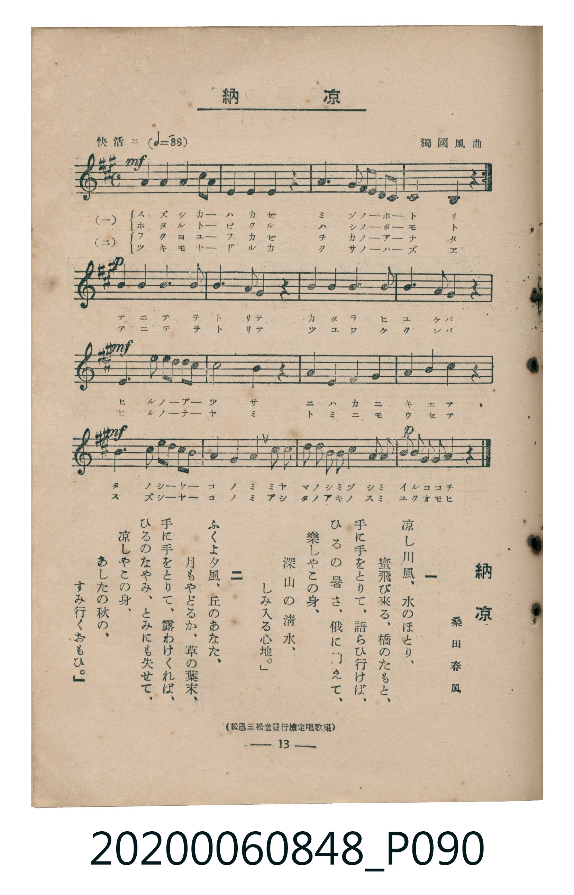

# 納涼

> Re:Shōka 使用 AI 協助辨識與重建樂譜，可能會有錯誤。歡迎回報。

<audio controls src="noryo.mp3"></audio>

- 詞：桑田春風
- 曲：獨國風曲
- 臺灣教育會公認《新定兒童唱歌》高等科男子用（2020.006.0848）

## 說明

原書資訊與歌詞全文（對應 P090.jpg，書頁 p. 13，高二第二學期第 1 首）：
調性與拍號：イ長調（A Major，3 升記號）、4/4 拍（快活ニ ♩=88）
出處註記：（松邑三松堂發行檢定唱歌集）


## 歌詞

```text
一
涼し川風、水のほとり、
螢飛び來る、橋のたもと、
手に手をとりて、語らひ行けば、
ひるの暑さ、俄に消えて、
樂しやこの身、
深山の清水、しみ入る心地。

二
ふくよ夕風、丘のあなた、
月もやどるか、草の葉末、
手に手をとりて、露わけくれば、
ひるのなやみ、とみにも失せて、
涼しやこの身、
あしたの秋の、すみ行くおもひ。
```

## ABC

```abc
X:1
T:納涼
C:曲：獨國風曲
M:4/4
L:1/16
Q:1/4=88
K:A
V:V1 name="Piano" snm="Pia"
[V:V1]
!mf! c4 c4 B4 A2 G2 | F4 G4 A4 z4 | B4 B4 e2 d2 c2 B2 | A8 E4 z4 |
c4 c4 B4 A2 G2 | F4 G4 A4 z4 | B4 B4 e2 d2 c2 B2 | A8 E4 z4 |
!p! G4 G4 A4 B4 | c8 A4 F4 | G4 G4 A4 B4 | G4 F4 E4 z4 |
!mf! A4 d4 c2 B2 A2 G2 | F8 F4 z4 | G4 A4 B4 G4 | A4 F4 E4 z4 |
!mf! A4 d4 c2 B2 A2 G2 | F4 G4 A4 c2 c2 | B2 A2 G2 F2 E4 e2 d2 | !p! c2 B2 A2 G2 A4 z4 |
```

## TMD 檔案連結

- [主旋律 TMD 檔案](noryo.tmd) [[在 TMD Studio 編輯](https://tmdlang.github.io/Tmd-TS/#tmd=s7IKdvYPcrWy4qpTUCpJTLdSSM7PyUlNLsnMz7MqzsjMK0nNjM_KTMmPL87Iz05Ugisry88pzU21ys4vyY9Pyq8sjjcyMDKINzAwizewMLFAqCvOLy1KTrUqTs7Iz8-JL0mtKEnKz89GyBcU5Zel5iXmAdUUFIGsSwErQihILctMSQVJp6ZkluQXZSbmIDkitagY7FCwJfElRYl5xclFmQUg1yNUlWSkAl1anJpYnJ9XTFAYaEV6Zp5VbmpmViYW90Kly1OLS1KL8uJzU3PyUyoxpEsSM4HhBQqz8sT43MTMvJzEvBQlLi0thedbep9t26OgpcWlaKtgYcFlb6vgyGVjom9iBzLjxcp57_fMerZw4vMpG57NWPpy0Qqw0c9mbwIKP-9d8XRON1AMyAULv2jf9bxx8bOpM180bXo2p_lp65oXq3ofN3Q9m7bh6bpZT1snPV-99OmUjc_W9jxu6H65esbztZ3PlwON3v507YTnU1a839MBijQ9YKTpgSLt_Z5OJS4ufS0FW2oBLgUFhad985_N3vFic_uLFV0vOtqBjgF68mnrimfT2oEOeLqh91l7p0KAgaWBXlZB-vs9PUDFLxc0KhToKRgaA7lAZz_Z1fN8zRog-XTtjmdz5gPZCoYKL5dNA7oXGCogO16s2v-sYTnI9O7eFzPnA0UfNy15OXU7UBxoh6OCb2JWfhHQMGOFp71Ad8wAq-l83NAIDHcFoB6QQ_avfrZl9-PmboVHM1faWoACA-z69l0vZk59sWI3UBfQWKDCZ3P3vWya-GRHJ5DxdEHT85l7XizsebZqESjEwWH9cnYbSDNI95MdDSAKGOGPG6c_3T4XGHdAS59t2PK4cd3jxt2PG1c8buoCioD9MG_Ry8WzHzdufrKv7XFTN0jdym6wuvmPm5pASiHqnnUCRVeDyKZJUAMalwHlXqya97ip83HjJqBzHjdOfNy4AaoBKAQyr3Hds1lA0alA0Sf7W0BGbOt43AhEIM1gg1cAbZn-uAkoNxmo-sWu1TCJ7RufbtwIMmBHK8jtDY0gdY37n7YuBRr8dH_z0zlAu5ogPt7VA7Fz6-PG_sdNHU-XTIV4-smOGWDPAO1YBfIS1Og5HSDPgexcCXYkyN8veoHeWPdiYuezOXAn4PD0yzlAv_WDvQu0DehvDE-DrAMZvx_s7BUgRuNqoJ1PlwB9BAxuuO_BcYTF92AnA707Hyj6fDnYSJBJM4EmgUMaaHsXOII2gcIAqIHybAMFClr6XFxhwCIu1SogMzEv36HGoEahGmSFgo2Flh2YAcytoLyxowHoFlAq7u99sawNyH22ZiEwvT9t3ahgofB0Q__z9Q3ANAkyEKrpcdNOIN4FxNuBeLXC4-Y9CjVAsh_Ca4Lw5gNxCxD3geUfN8-Gq-sA4lUw84Cuyk2rVTBW0AVjIyA2VDCPB4qbxQPZQBZIQFfBAIhrwNIgbKpgAlRuBBQByYGgKUghWBHcmSArm_YDaZATQZZCrJ8MdfRUuKOB3oA5E6weom4RWBfcmdR0IXLw7-qBBL8J9rBubgPibii9CSn8QCJAHjjEQY5eCcSTwPLLgCIbgfQEpDAuqIU4FO5akBshngJBkAjYNzVYlYG5YHkcntjRid8Tk6CxAAtlUNhCQhmYRJq2glkgT0KTEJAN8tpaIF4B9ihqYgE5zAQcHUYoUQGCYAYkKlA8AeZAIgOPR57Ono3XI-CQBnoCnGRAqXoJzCNNm6HeA6V7EF4C9tQ8JPUg0VY4G6QHpBsUf0C9YP2NRHoU7jNjIASlObAkUArsK1DSg0Q5XB88fXLVcnHp2imASwYFIEOZiwsA)]
- [鋼琴伴奏 TMD 檔案](noryo_piano.tmd) [[在 TMD Studio 編輯](https://tmdlang.github.io/Tmd-TS/#tmd=s7IKdvYPcrWy4tLSUni-pffZtj3v93S87N7zfMKWJ3u2PF3a_7yz4_2eTgUtLS5FWwULCy57WwVHLhsTfRM7rjoFpRcr573fM-vZwonPp2x4NmPpy0UrlEDCz2ZvAgo_713xdE43UAzIBQu_aN_1vHHxs6kzXzRtejan-Wnrmhereh83dD2btuHpullPWyc9X7306ZSNz9b2PG7ofrl6xvO1nc-XA43e_nTthOdTVgBdZmRgZKBnYGCmZ2BhYgF0lxIXV1hqUXGqVUBmYl5-kIdDjUGNQjWXAhDYWGjZgRn6QJ-tWfNkR8OLhT1AI572975Y1gbkPluz8P2enqetGxUsFJ5u6H--vgHsUX2wJqApuWm1CsYKumBsBMSGCubxQHGzeCAbyAIJ6CoYAHENWBqETRVMgMqNgCIgORA0BSkEK4IaS00Tkb23qwfoPSTXF9RCjISbCzINYj0IgkTA9tZgVQbmguVxWLejE9U6UGCBtJuAvWeE4jUQBDMgXkOxCsyBeA6PdU9nzybeOrj5xkAICkmwJFAKbDYoQCHBA9cHD3WuWpTk5IOSnEywJCd0F8UrRBvGAu0B0qbxsUBhExDTBMiEStUgJJFUIekzgCcUKhlGII3gMcEMJGIWn4vLIhQxdKuwpg-o87F5CcQAmoHTPTB9aPZgTxg47AEx4UFnBGQYgTyHpAoUICAFUIUgu4ApQtdOAZwoFIAMZS4uAA)]

## 分析

```text
================================================================================
📊 TMD Song Profile: [ 納涼 ]
================================================================================
⏱  Duration:       0:54 (54.5s), 20 measures total
🎼 Key & Tempo:    首調基準 A, != 88.0 BPM, <4/4>
   - 分析範圍：      由實際發聲的音符與和弦推測調性；播放脈絡另行呈現
🎤 人聲音域:    E4 (MIDI 64) – E5 (MIDI 76) [跨度: 12 個半音 / 1.0 個八度, 難度: easy]
   - 最低音:  E4 in [Verse #1 @ m.4, 0:09]
   - 最高音: E5 in [Verse #1 @ m.3, 0:06]
   - 適合: soprano, mezzo-soprano, contralto, tenor, baritone, bass
🏛  結構:      Verse (54.5s)
⚡ 編曲密度:        Peak 1 軌道同時演奏
🗝  調性診斷：       A 大調（純淨自然大調，未偵測到可信轉調）
   - 風格氣質:    純淨自然大調（陽光明朗、易唱易記，無明顯調外色彩）
   - 轉調歷程:    全曲維持單一推測調性（未偵測到可信轉調）
   - 核心骨幹音:  A, G#, B, C#, F#
   - 調性數值:    A 大調 [相關度: 0.73, 穩定度: Moderate, 自然音純度: 100.0%]
   - 候選調性 (K-S): A 大調 (0.73), F# 小調 (0.70), E 大調 (0.65)
   - 五度圈歷程:   +3
   - 各段落調性細節:
     • [Verse #1]: A 大調 (r: 0.73, 自然音純度: 100.0%)

  [ 五度圈游移軌跡 ]
               C  
         F            G  
      Bb               D  
      Eb              [A ]*
         Ab           E  
            Db       B  
               F# 
     (* = active key center)

  [ 十二半音累積音高分佈 ]
     C  :                            0.0%
     C# : █████████████             13.2%
     D  : █████                      4.9%
     D# :                            0.0%
     E  : █████████                  9.0%
     F  :                            0.0%
     F# : █████████████             13.2%
     G  :                            0.0%
     G# : █████████████████         18.1%
     A  : ████████████████████████  25.0%
     A# :                            0.0%
     B  : ████████████████          16.7%
--------------------------------------------------------------------------------
Assignment 軌道音域：
  - Piano         : E4 – E5 (12 個半音 / 1.0 個八度, 84 個音符)
================================================================================
```


## 原書掃描頁




