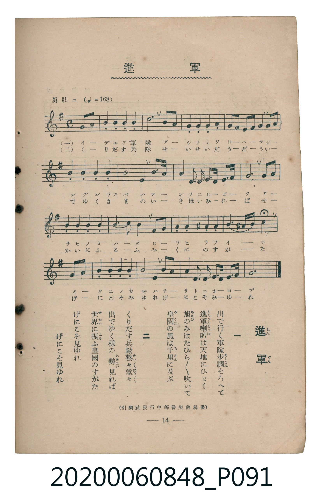

# 進軍

<audio controls src="shingun.mp3"></audio>

- 臺灣教育會公認《新定兒童唱歌》高等科男子用（2020.006.0848）

## 說明

原書資訊與歌詞全文（對應 P091.jpg，書頁 p. 14，高二第二學期第 2 首）：
調性與拍號：ト長調（G Major，1 升記號）、4/4 拍（勇壯ニ ♩=168，弱起第 4 拍進入）
出處註記：（引樂社發行中等音樂教科書）

## 跨冊／重複收錄參照

> 同名異曲（各冊收錄之不同詞曲版本）

- **[同名異曲]** 《新定兒童唱歌》尋常科第三學年用（2020.006.0847.0003）：[**〈進軍〉**](../../grade_3_2020.006.0847.0003/4_17_shingun/index.md)（`F` / `2/4` — [原始 TMD](../../grade_3_2020.006.0847.0003/4_17_shingun/shingun.tmd)）
- **[同名異曲]** 楊金土手抄《唱歌帖》第 10 冊・X（2020.006.0843）：[**〈進軍 (進軍)〉**](../../../shokacho/vol_10/p195b_shingun/index.md)（`G` / `4/4` — [原始 TMD](../../../shokacho/vol_10/p195b_shingun/shingun.tmd)）
- 總表：[跨冊重複與同名歌曲總索引](../../../duplicate_songs.md)

## 歌詞

```text
一
出で行く軍隊步調そろへて
進軍喇叭は天地にひびく
旭のみはたひら／＼吹いて
皇國の風は千里に及ぶ

二
くりだす兵隊整々堂々
出でゆく樣の勢見れば
世界に振ふ皇國のすがた
げにこそ見ゆれ　げにこそ見ゆれ
```

## ABC

```abc
X:1
T:進軍
M:4/4
L:1/16
Q:1/4=168
K:G
V:V1 name="Piano" snm="Pia"
[V:V1]
!f! z4 z4 z4 D3 G | B4 B4 B4 B4 | d12 B3 G | F4 G4 A4 B4 |
A8 F2 G2 A3 D | G4 G4 G4 G4 | B8 G4 d3 B | E4 E4 E4 E2 F2 |
G8 E4 A3 A | A4 A4 A4 B2 ^c2 | d8 A4 d3 c | B4 A4 ^G4 A4 |
F4 ^G4 A4 D3 =G | B4 B4 B4 B4 | B8 G4 e3 c | B4 E2 G2 B2 A2 A3 F |
G12 z4 |
```

## TMD 檔案連結

- [主旋律 TMD 檔案](shingun.tmd) [[在 TMD Studio 編輯](https://tmdlang.github.io/Tmd-TS/#tmd=s7IKdvYPcrWy4tLSUnjZsOnF7l4FLS0uRVsFQzMLLntbBXcuGxN9EzuuOgWlF-27njcufjZ15oumTc_mND9tXfNiVe_jhq5n0zY8XTfraeuk56uXPp2y8dnanscN3S9Xz3i-tvP58onPp2x_unbC8ykr3u_pMDIwMtAzMDDTM7AwsXi_p1OJi0tfS8GWWoBLQUHhad_8Z7N3vNjc_mJF14uOdqBjXqyc97R1xbNp7UAHPN3Q-6y9UyHAwNJQL6sg_f2eHqDilwsaFQr0FAxNgFygs5_s6nm-Zg2QfLp2x7M584FsBSOFl8umAd37fs8skB0vVu1_1rAcZHp374uZ84Gij5s7Xk7dDhQH2uGu4JuYlV8ENMxQ4Wkv0B0zwGo6Hzc0AkNSAagH5JDu9qeL1z9u7lZ4NHOlLTCsgcqf7tn4Yut2kH1gVcDYeNq6FKgR7K32XS9mTn2xYjfQOKB9IBP2TH22oun5kn3PZ-55sbDnyY61wPB-OX8zUBAYRcCAB_oMpBmk-8mOBqghjxuXAxU_buwHRvTLWV3P1i4FOvpx49zHTb2PG3c8blwGUgdJB0-ntT_tX_u4cf3TJSufztnwuHH148ZNjxs3AzWDFD2bDpRb97gRqHv948b5ILkmYAD1v9-z5-mEnY8bW6CGPZ_V_nRON1Dpy0UrQIb1Nr9sBzpg9dP-rseN2yDO29UDooAGP24CCi543DjzaetWkPOmbnnc0Pp0QROQRHjgcVMbUOmzFYuBhj7tXvRiWffjJqCJGyA-nfZ8Ksj4Zz1AV22FWw408nEjUHw-xKJJYN9MBnocrLsNZEBDA1ZxkAbKkyYUKGjpc3GFpRYVp1oFZCbm5TvUGNQoVIOsULAxNNOyA7OAWQKSFJ5u6H--vgEU1529CsagNPFkz8RnaxcB0wpmKgEZDdJdo2CgoAuG6HR1Wq2CaTyYaahQAw55kF2gxL6jAZgqgBaZKMDshJsHVPG4uV3hcdMKIF6vACogahSAcQPkLQLK7AHyHjdtB7KAIs3zgey9IJHmtWC5x80zoHQbVNUehDuNoe7CRdcomEJZ6BCiAugJBXOIf0AcCG2EYQhMBAbBWkDKIRLAEEENi109-MNiM9AnGyB080ogbgH7dyIQ90P8CQkTsHwjEHcD8SS46GRIeABDEhZ-8PCAeQEXjQgxGITJQMLJGKjCDBYeOBhgzyOsgkG4IkiYGKEnj070IAEnQEMjKB-eGl9sXwFU-bR3w7Npe4CCT2fPBnJfTut-uWAtWjA2bYUGSx842YCCBhR8oKDZjxJgoCAG8UD0VHBiW4JIUqAEhxyEsLhGp0EBZ6IO9jp6moIpgYibIIUyTMYQpBFZADnZocthz2CQgEALwa0Tnm7YB8nXwLoEkuVBeXzXpBeL56AHFzC9gFMSMLiaVoODARQEoCADpTFILgQFaQdEXdMqaCABcy00IKeRkvNwpTQzjFACJx2QNEgAFAqQkACGEGYyg0FYiVTDVcvFpWunAC4RFYAMZS4uAA)]
- [鋼琴伴奏 TMD 檔案](shingun_piano.tmd) [[在 TMD Studio 編輯](https://tmdlang.github.io/Tmd-TS/#tmd=s7IKdvYPcrWy4tLSUnjZsOnF7t73ezpedu95PmHLkz1bni7tf97Z8X5Pp4KWFpeirYKhmQWXva2CO5eNib6JHVedgtKL9l3PGxc_mzrzRdOmZ3Oan7auebGq93FD17NpG56um_W0ddLz1UufTtn4bG3P44bul6tnPF_b-Xz5xOdTtj9dO-H5lBVAy4wMjAz0DAzM9AwsTCyAVilxcYWlFhWnWgVkJublB3k41BjUKFRzKQCBjaGZlh2Ypa-l8HTPxhdbtz_d0P98fYOClj5YuEbBQEEXDNHp6rRaBdN4MNNQoYYLZsjzNWue7Gh4sbAHYYIxVAcuukbBFMpChxAVQOMVzCE2gTgQ2gjDEJgIDIK1gJRDJIBuRXXlrh4UV8IMxkUj_AGDMBmI642BKsxgrsTBADsJYRUMwhVBXGqEHpydKA6F-ROdBjnPRB1sAXp4wpRAxE2Q_AKTMQRpRBZADnJ0OezR_nT2bBKjHVeAmmE4ExxCIGmQAMgZEKcAnYgZmjAIS6g1XLUoGcAHJQOYEE7_EIg3iYMyg2G8QrRhLDBwIDTQYegCYJZpPFQIxADGJpIQuiXoKZSgBWYglll8bqyCMYwBVwWSw_AFWsoCqjSCqATRWARAxhpDBaDGg9QAhYAUmuno6QGX802AlAk8eGAqIKEDVKILFgOZDYxGXTsFcEwqABnKXFwA)]

## 分析

```text
================================================================================
📊 TMD Song Profile: [ 進軍 ]
================================================================================
⏱  Duration:       0:24 (24.3s), 17 measures total
🎼 Key & Tempo:    首調基準 G, != 168.0 BPM, <4/4>
   - 分析範圍：      由實際發聲的音符與和弦推測調性；播放脈絡另行呈現
🎤 人聲音域:    D4 (MIDI 62) – E5 (MIDI 76) [跨度: 14 個半音 / 1.2 個八度, 難度: moderate]
   - 最低音:  D4 in [Verse #1 @ m.1, 0:01]
   - 最高音: E5 in [Verse #1 @ m.15, 0:21]
   - 適合: soprano, mezzo-soprano, contralto, tenor, baritone, bass
🏛  結構:      Verse (24.3s)
⚡ 編曲密度:        Peak 1 軌道同時演奏
🗝  調性診斷：       G 調性不明確（純淨自然大調，未偵測到可信轉調）
   - 風格氣質:    純淨自然大調（陽光明朗、易唱易記，無明顯調外色彩）
   - 轉調歷程:    全曲維持單一推測調性（未偵測到可信轉調）
   - 核心骨幹音:  B, G, A, D, E
   - 調性數值:    G 調性不明確 [相關度: 0.72, 穩定度: Ambiguous, 自然音純度: 96.1%]
   - 候選調性 (K-S): G 大調 (0.72), B 小調 (0.69), D 大調 (0.64)
   - 五度圈歷程:   +1
   - 各段落調性細節:
     • [Verse #1]: G 調性不明確 (r: 0.72, 自然音純度: 96.1%, 調外音: C#, G#)

  [ 五度圈游移軌跡 ]
               C  
         F           [G ]*
      Bb               D  
      Eb               A  
         Ab           E  
            Db       B  
               F# 
     (* = active key center)

  [ 十二半音累積音高分佈 ]
     C  : █                          0.8%
     C# : █                          0.8%
     D  : ████████████              12.9%
     D# :                            0.0%
     E  : ████████                   9.0%
     F  :                            0.0%
     F# : █████                      5.1%
     G  : ███████████████████       21.5%
     G# : ███                        3.1%
     A  : ██████████████████        20.3%
     A# :                            0.0%
     B  : ████████████████████████  26.6%
--------------------------------------------------------------------------------
Assignment 軌道音域：
  - Piano         : D4 – E5 (14 個半音 / 1.2 個八度, 69 個音符)
================================================================================
```


## 原書掃描頁




