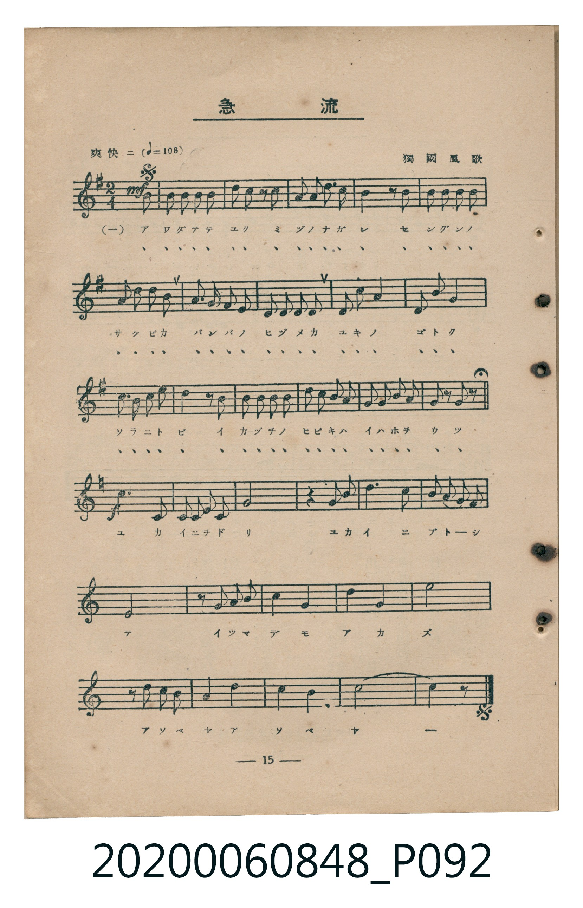
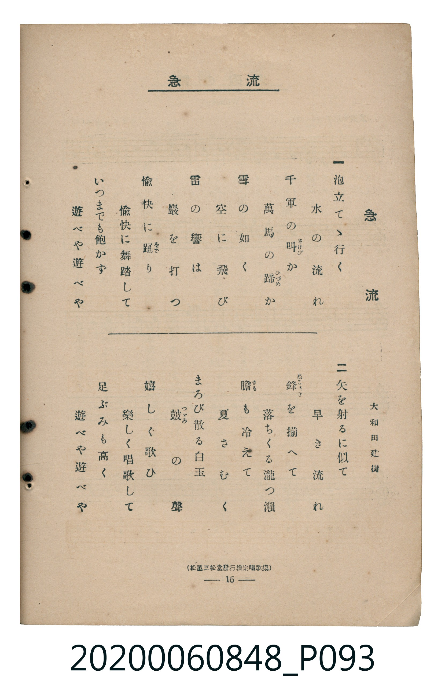

# 急流

> Re:Shoka 使用 AI 協助辨識與重建樂譜，可能會有錯誤。歡迎回報。

<audio controls src="kyuryu.mp3"></audio>

- 詞：大和田建樹
- 曲：獨國風歌
- 臺灣教育會公認《新定兒童唱歌》高等科男子用（2020.006.0848）

## 說明

原書資訊與歌詞全文（對應 P092.jpg – P093.jpg，書頁 pp. 15–16，高二第二學期第 3 首）：
調性與拍號：ト長調（G Major，1 升記號）轉ハ長調（C Major，無升降記號）、2/4 拍（爽快ニ ♩=108）
出處註記：（松邑三松堂發行檢定唱歌集）

## 跨冊／重複收錄參照

> 同曲（《新定兒童唱歌》高等科男、女共用教材）

- **[同曲]** 《新定兒童唱歌》高等科女子用（2020.006.0849）：[**〈急流〉**](../../koto_girls_2020.006.0849/2_2_02_kyuryu/index.md)（`G` / `2/4` — [原始 TMD](../../koto_girls_2020.006.0849/2_2_02_kyuryu/kyuryu.tmd)）
- 總表：[跨冊重複與同名歌曲總索引](../../../duplicate_songs.md)

## 歌詞

```text
一
泡立てゝ行く　水の流れ
千軍の叫か　萬馬の蹄か
雪の如く　空に飛び
雷の響は　巖を打つ
愉快に踊り　愉快に舞踏して
いつまでも飽かず　遊べや遊べや

二
矢を射るに似て　早き流れ
鋒を揃へて　落ちくる瀧つ瀨
膽も冷えて　夏さむく
まろび散る白玉　皷の聲
嬉しく歌ひ　楽しく唱歌して
足ぶみも高く　遊べや遊べや
```

## ABC

```abc
X:1
T:急流
C:曲：獨國風歌
M:2/4
L:1/16
Q:1/4=108
K:G
V:V1 name="Piano" snm="Pia"
[V:V1]
!mf! z4 z2 d2 | B2 B2 B2 B2 | d2 B2 z2 d2 | A3 B c2 A2 |
B4 z2 B2 | B2 B2 B2 B2 | G2 B2 d2 B2 | A3 B A2 G2 |
F2 E2 F2 G2 | D2 d4 c2 | D2 d4 c2 | B2 A2 B2 c2 |
d4 z2 d2 | d2 c2 B2 d2 | e2 d2 c2 B2 | A2 G2 A2 B2 |
G2 z2 G2 z2 | [K:C] !f! E,2 E,2 F, E, F, G, | A,8 | z4 G,2 G,2 |
C6 B,2 | A,2 G,2 F,2 E,2 | D,8 | z2 G,2 G,2 G,2 |
C4 G,4 | D4 G,4 | E8 | z2 G,2 G,2 G,2 |
A,4 D4 | C4 B,4 | C8 | C4 z4 |
```

## TMD 檔案連結

- [主旋律 TMD 檔案](kyuryu.tmd) [[在 TMD Studio 編輯](https://tmdlang.github.io/Tmd-TS/#tmd=s7IKdvYPcrWy4qpTUCpJTLdSSM7PyUlNLsnMz7MqzsjMK0nNjM_KTMmPL87Iz05Ugisry88pzU21ys4vyY9Pyq8sjjcyMDKINzAwizewMLFAqCvOLy1KTrUqTs7Iz8-JL0mtKEnKz89GyBcU5Zel5iXmAdUUFIGsSwErQihILctMSQVJp6ZkluQXZSbmIDkitagY7FCwJfElRYl5xclFmQUg1yNUlWSkAl1anliSWqTEpaWl8Kxh6bOtjQpaWlyKtgqGBhZc9rYK7lw2RvomdiA9L1bOe79n1tMly59O6nk-ZcPT3buerdgJNu3Z7E1Amee9K57O6X65aMWztT1g4Rftu543Ln42deaLpk3P5jQ_bV3zYlXv44auZ9M2PF0362nrpOerlz6dshGo_HFD98vVM56v7Xy-fOLzKdufrp3wfMqK93s6QGGnBww7PVDYvd_TqcTFpa-lYEstwKWgoPC0b_6z2TtebG5_saLrRUc70DFAfz5tXfFsWjvQAU839D5r71QIMLA00ssqSFd41DAZxDEGcd7v6QHqfLmgUaGgQE_B0BQoZ2gGFAT65Mmunudr1gDJp2t3PJszH8hWMFZ4uWwa0AvAgAJZ-2LV_mcNy0EWdve-mDkfKPq4uePl1O1AcaC17gq-iVn5RUDDDBWe9gKdNgOspvPF3s7Hzf1wZc5wZc9bFgLVvZzZC1f6uKERGHEKQOOBCp937H26f_Xj5m6FRzNX2gKjFqgA7Pn2XS9mTn2xYjdQG9AJQJXP5u572TTxyY5OIOPpgqbnM_e8WNjzbNUiUISBo-rl7DaQZpDuJzsaQNSzzQufr-5-3LjscdNcoOLHjf2PGxqebdjyuHEdMDk9buoB29Tb_GJ3L1Doaf_qx43dQBUvJqx5uWwNUOTFzhagCEjRy9mrQCqWNUHMeL5y1-PG1S8Xz37cuBkivR0o_XL-_seN64HST7dPe9w06Vnn5MeNS8DuaOkEebJx9YsdXY-bukCOgIt0zHuxo_9x43SgK0FKHzcCrVzyuHHf48blj5uaXi7eC3JT4yygnpeNXY8bdz5uaoEzIH7dBfbG8_mLgHY-3dDyuAmofvWTPXtA_gbaNH3l48ZehHdfdk8Cua2_-XHjDoiKFxOAdiwEeayp-3nDcqD1zxtWgFNC216gE562Af3WAVH6dAnQqVMfNzUAVUNcu-9xEzDsNj-buhike-be533A-G14PgsUHi8aN4EDeE0n2H_9oOzUuAnkpqVAG0Ei0DwG9_2LbZsfN2573Lgf5PXVMyCBjcXfQKWU5zEoUNDS5-IKSCwqcbQKyEzMy3eoMahRqAZZoWBjaKZlB2YB8_bTPRtfbN3-dEP_8_UNoPy3r-dpbxcwEb9s2PS0dSkw5YEMAqmtUTBQ0AVDEF2dm1arYApk1IBjC2QSKAPuaAAmSKAxpgowE-H6gSoeN68H4gYgbgPjGiC5TOFxE0h0PpjXCsR9QNwFFF0DFlkDZO0GszYDWRsgNFAN3FXGQEcg4xqws0AskDvBTlQwArvbWMEESILYEF0wv0B0YZiD4rFdPXg91rQViDcCHTYZSK8GO3cC1Kkgug8sMgnqwYVwNSDPr4XJN20BsjrAwQH3nCHUMTAvIbwCokGyNQrm8UDKDESAWRBBUxATpAsEQd7GJoQadZ0QH5rh8OFeoOtWAnE32JUg14P8ugTs8tVQnzWi-BUkD_JdP1jNEjDrcfNsIN4EFgH6vrkFNSJBvgLRUBcjRRIkIkEkSA4WJjUKZlAWTBQSQqBAgJkFCUWQGTC6hqsWkjec8OSNamBl7FyLFEJPZ89GTwM9qPUDaloHRS4wYMAeBwXaJiDuBAfOKnjkg5MBVAVIbBokCTTvAYpuRwRNNTCzGYOiD0yYxINoIAmMUWAAgISQISKjQmIcREDCAAbB6QSqEywNNAtqNlqqn4I_O4OzMNj5LUA8D-yFdiBeBBZfBPfgLoRXjLA7F-FUNPeCuRB1kKSPIgTLxnDDkJ3_tHUt_kwLciAoWc8EOxzoDaAIyLnIYiByD2oZiOFWeBTAXIhwPjioUYUQHoeJwOILnC517RTAxbYClOEEYihzcQEA)]
- [鋼琴伴奏 TMD 檔案](kyuryu_piano.tmd) [[在 TMD Studio 編輯](https://tmdlang.github.io/Tmd-TS/#tmd=s7IKdvYPcrWy4tLSUnjWsPTZ1sb3ezpedu95PmHLkz1bni7tf97Z8X5Pp4KWFpeirYKhgQWXva2CO5eNkb6JHVedgtKLlfPe75n1dMnyp5N6nk_Z8HT3rmcrdiqBZJ7N3gSUed674umc7peLVjxb2wMWftG-63nj4mdTZ75o2vRsTvPT1jUvVvU-buh6Nm3D03WznrZOer566dMpG4HKHzd0v1w94_nazufLJz6fsv3p2gnPp6wAus7IwMhAz8DATM_AwsQC6DYlLq6AxKISR6uAzMS8_CAPhxqDGoVqLgUgsDE007IDs_S1FJ7u2fhi6_anG_qfr29Q0NIHC9coGCjogiGIrs5Nq1UwBTJquGCanq9Z82RHw4uFPQgdxkAFyLgGrAXEApkB1q5gBDbTWMEESILYEF0weyC6MMxBsXRXD4qlhlBFMKsQVoBokGyNgnk8kDIDEWAWRNAUxATpAkGQc7AJoXq3E8O7IDtANFQ_klcg3gWRIDmYC2sUzKAsmCjEvSAnwcyC-AlkBoyu4apFiUoflKi0IByTEIg38sBRbBivEG0YCwwHCA10CUIAqB8iYRoPVQFiYChBNwJv3KFbZ4RpPEjICEUEzoSpxiaEL-KI9iVUvEbBBMgwQeLjCAcDCAGPLie8Oa8aWGA41yK58-ns2ahRAowRY1CSBBNANwBpIAlMpcBkBBJChogMC0nFIAKSkmAQnPahOsHSQLOgZqPF0hQUZwDDFJtVCGvQ7AJzIeogWRFFCJbd4YYhW_20dS2K1VjtgXsdZjrCarAXUYUQjoaJwMIJPZqw5yqiYgkjRZmAWCbQJASi8eYdY-z6MLMPasRgMxGShvFZAZczx5qHMWxFjxMMG-BuNgIxjOJz4bbAjMRuCUgAqXzTtVMAF3EKUIYTiKHMxQUA)]

## 分析

```text
================================================================================
📊 TMD Song Profile: [ 急流 ]
================================================================================
⏱  Duration:       0:35 (35.6s), 32 measures total
🎼 Key & Tempo:    首調基準 G, != 108.0 BPM, <2/4>
   - 分析範圍：      由實際發聲的音符與和弦推測調性；播放脈絡另行呈現
🎤 人聲音域:    D3 (MIDI 50) – E5 (MIDI 76) [跨度: 26 個半音 / 2.2 個八度, 難度: difficult]
   - 最低音:  D3 in [PartB #1 @ m.23, 0:24]
   - 最高音: E5 in [PartA #1 @ m.15, 0:15]
   - 適合: contralto, bass
🏛  結構:      PartA (18.9s) -> PartB (16.7s)
⚡ 編曲密度:        Peak 1 軌道同時演奏
🗝  調性診斷：       G 大調（推測轉調經歷 1 次）
   - 風格氣質:    純淨自然大調（陽光明朗、易唱易記，無明顯調外色彩）
   - 轉調歷程:    G 大調起奏 ➔ [PartB] 轉至 C 大調 (-11 半音 / 五度圈 -5 步)
   - 核心骨幹音:  D, B, G, C, A
   - 調性數值:    G 大調 [相關度: 0.88, 穩定度: High, 自然音純度: 98.2%]
   - 候選調性 (K-S): G 大調 (0.88), D 大調 (0.60), B 小調 (0.60)
   - 五度圈歷程:   +5 -> +0
   - 各段落調性細節:
     • [PartA #1]: B 小調 (r: 0.82, 自然音純度: 90.0%, 調外音: C)
     • [PartB #1]: C 大調 (r: 0.91, 自然音純度: 100.0%)

  [ 五度圈游移軌跡 ]
              [C ]*
         F            G  
      Bb               D  
      Eb               A  
         Ab           E  
            Db      [B ]*
               F# 
     (* = active key center)

  [ 十二半音累積音高分佈 ]
     C  : ███████████████████       16.7%
     C# :                            0.0%
     D  : ████████████████████████  21.1%
     D# :                            0.0%
     E  : ██████████                 8.3%
     F  : ██                         1.8%
     F# : ██                         1.8%
     G  : ████████████████████      17.1%
     G# :                            0.0%
     A  : ███████████████           13.2%
     A# :                            0.0%
     B  : ███████████████████████   20.2%
--------------------------------------------------------------------------------
Assignment 軌道音域：
  - Piano         : D3 – E5 (26 個半音 / 2.2 個八度, 89 個音符)
================================================================================
```


## 原書掃描頁






