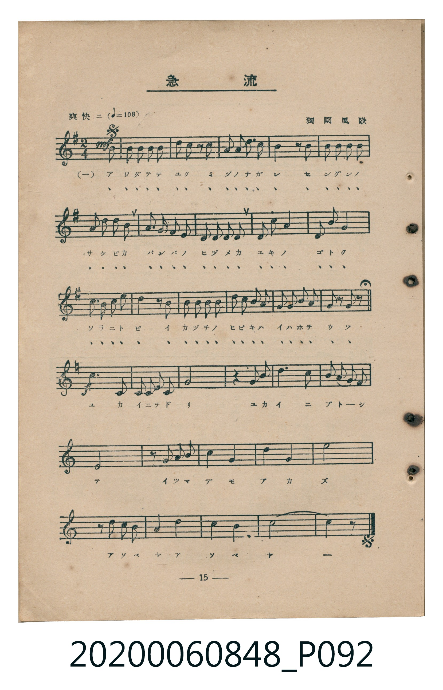
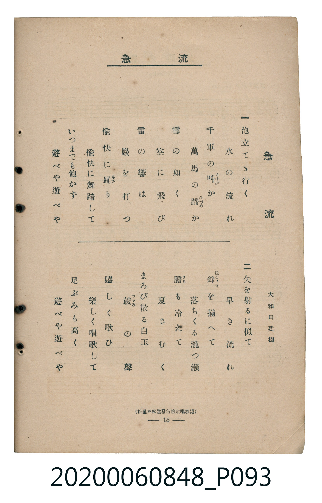

# 急流

> Re:Shōka 使用 AI 協助辨識與重建樂譜，可能會有錯誤。歡迎回報。

- **鋼琴伴奏版**：<br><audio controls src="kyuryu.mp3"></audio>

- 詞：大和田建樹
- 曲：獨國風歌
- 臺灣教育會公認《新定兒童唱歌》高等科男子用（2020.006.0848）

## 說明

原書資訊與歌詞全文（對應 P092.jpg – P093.jpg，書頁 pp. 15–16，高二第二學期第 3 首）：
調性與拍號：ト長調（G Major，1 升記號）轉ハ長調（C Major，無升降記號）、2/4 拍（爽快ニ ♩=108）
出處註記：（松邑三松堂發行檢定唱歌集）


## 歌詞

```text
一
泡立てゝ行く　水の流れ
千軍の叫か　萬馬の蹄か
雪の如く　空に飛び
雷の響は　巖を打つ
愉快に踊り　愉快に舞踏して
いつまでも飽かず　遊べや遊べや

二
矢を射るに似て　早き流れ
鋒を揃へて　落ちくる瀧つ瀨
膽も冷えて　夏さむく
まろび散る白玉　皷の聲
嬉しく歌ひ　楽しく唱歌して
足ぶみも高く　遊べや遊べや
```

## ABC

<div class="abc-score" data-abc-src="kyuryu.abc" aria-label="五線譜載入中"></div>

[下載 ABC 原始檔](kyuryu.abc)

## TMD 檔案連結

- [主旋律 TMD 檔案](kyuryu.tmd) [[在 TMD Studio 編輯](https://tmdlang.github.io/Tmd-TS/#tmd=s7IKdvYPcrWy4qpTUCpJTLdSSM7PyUlNLsnMz7MqzsjMK0nNjM_KTMmPL87Iz05Ugisry88pzU21ys4vyY9Pyq8sjjcyMDKINzAwizewMLFAqCvOLy1KTrUqTs7Iz8-JL0mtKEnKz89GyBcU5Zel5iXmAdUUFIGsSwErQihILctMSQVJp6ZkluQXZSbmIDkitagY7FCwJfElRYl5xclFmQUg1yNUlWSkAl1anliSWoQQBJqUnplnlZuamZWJxVlQ6fLUYqCuvPjc1Jz8lEolLi0thWcNS59tbVTQ0uJStFUwNLDgsrdVcOeyMdI3sQPpfrFy3vs9s54uWf50Us_zKRue7t71bMVOsLnPZm8CyjzvXfF0TvfLRSuere0BC79o3_W8cfGzqTNfNG16Nqf5aeuaF6t6Hzd0PZu24em6WU9bJz1fvfTplI1A5Y8bul-unvF8befz5ROfT9n-dO2E51NWvN_TAQp5PWDI64FC_v2eTiUuLn0tBVtqAS4FBYWnffOfzd7xYnP7ixVdLzragY4B-vNp64pn09qBDni6ofdZe6dCgIGlkV5WQbrCo4bJII4xiPN-Tw9Q58sFjQoFBXoKhqZAOUMzoCDQJ0929TxfswZIPl2749mc-UC2grHCy2XTgF4ABhTI2her9j9rWA6ysLv3xcz5QNHHzR0vp24HigOtdVfwTczKLwIaZqjwtBfotBlgNZ0v9nY-bu6HK3OGK3veshCo7uXMXrjSxw2NwIhTABoPVPi8Y-_T_asfN3crPJq50hYYtUAFYM-373oxc-qLFbuB2oBOAKp8Nnffy6aJT3Z0AhlPFzQ9n7nnxcKeZ6sWgSIMHFUvZ7eBNIN0P9nRAKKebV74fHX348Zlj5vmAhU_bux_3NDwbMOWx43rgMnpcVMP2Kbe5he7e4FCT_tXP27sBqp4MWHNy2VrgCIvdrYARUCKXs5eBVKxrAlixvOVux43rn65ePbjxs0Q6e1A6Zfz9z9uXA-Ufrp92uOmSc86Jz9uXAJ2R0snyJONq1_s6Hrc1AVyBFykY96LHf2PG6cDXQlS-rgRaOWSx437Hjcuf9zU9HLxXpCbGmcB9bxs7HrcuPNxUwucAfHrLrA3ns9fBLTz6YaWx01A9auf7NkD8jfQpukrHzf2Irz7snsSyG39zY8bd0BUvJgAtGMhyGNN3c8blgOtf96wApwS2vYCnfC0Dei3DojSp0uATp36uKkBqBri2n2Pm4Bht_nZ1MUg3TP3Pu8Dxm_D81mg8HjRuAkcwGs6wf7rB2Wnxk0gNy0F2ggSgeYxuO9fbNv8uHHb48b9IK-vngEJbCz-BiqlPI9BgYKWPhdXQGJRiaNVQGZiXr5DjUFNNcgGBRtDMy07MAuYtZ_u2fhi6_anG_qfr28AZb99PU97u4Bp-GXDpqetS4EJD2QOSG2NgoGCLhiC6OrctFoFUyCjBhxZIJNA-W9HAzA9Ao0xVYCZCNcPVPG4eT0QNwBxGxjXAMllCo-bQKLzwbxWIO4D4i6g6BqwyBogazeYtRnI2gChgWrgrjIGOgIZ14CdBWKB3Al2ooIR2N3GCiZAEsSG6IL5BaILwxwUj-3qweuxpq1AvBHosMlAejXYuROgTgXRfWCRSVAPLoSrAXl-LUy-aQuQ1QEODrjnDKGOgXkJ4RUQDZKtUTCPB1JmIALMggiagpggXSAI8jY2IdSo64T40AyHD_cCXbcSiLvBrgS5HuTXJWCXr4b6rBHFryB5kO_6wWqWgFmPm2cD8SawCND3zS2oEQnyFYiGuhgpkiARCSJBcrAwqVEwg7JgopAQAgUCzCxIKILMgNE1XLWQrOGEO2tU29s61yKFz9PZs9FTQA9q5YCa0kFRCwwWsLdBQbYJiDvBQbMKHvXgRABVARKbBkkAzXuAotsRAVMNzGrGoMgDEybxIBpIAuMT6H2QEDJEZFNIfIMISAjAIDiVQHWCpYFmQc1GS_NT8GdmcAYGO78FiOeBvdAOxIvA4ovgHtyF8IoRducinIrmXjAXog6S8FGEYJkYbhiy85-2rsWfZUEOBCXqmWCHA70BFAE5F1kMRO5BLQEx3AqPApgLEc4HBzWqEMLjMBFYfIFTpa6dArjMVoAynEAMZS4A)]
- [鋼琴伴奏 TMD 檔案](kyuryu_piano.tmd) [[在 TMD Studio 編輯](https://tmdlang.github.io/Tmd-TS/#tmd=s7IKdvYPcrWy4tLSUnjWsPTZ1sb3ezpedu95PmHLkz1bni7tf97Z8X5Pp4KWFpeirYKhgQWXva2CO5eNkb6JHVedgtKLlfPe75n1dMnyp5N6nk_Z8HT3rmcrdiqBZJ7N3gSUed674umc7peLVjxb2wMWftG-63nj4mdTZ75o2vRsTvPT1jUvVvU-buh6Nm3D03WznrZOer566dMpG4HKHzd0v1w94_nazufLJz6fsv3p2gnPp6wAus7IwMhAz8DATM_AwsQC6DYlLq6AxKISR6uAzMS8_CAPhxpdw5pqLgUgsDE007IDs_S1FJ7u2fhi6_anG_qfr29Q0NIHC9coGCjogiGIrs5Nq1UwBTJquGCanq9Z82RHw4uFPQgdxkAFyLgGrAXEApkB1q5gBDbTWMEESILYEF0weyC6MMxBsXRXD4qlhlBFMKsQVoBokGyNgnk8kDIDEWAWRNAUxATpAkGQc7AJoXq3E8O7IDtANFQ_klcg3gWRIDmYC2sUzKAsmCjEvSAnwcyC-AlkBoyu4apFiUoflKi0IByTEIg38sBRbBivEG0YCwwHCA10CUIAqB8iYRoPVQFiYChBNwJv3KFbZ4RpPEjICEUEzoSpxiaEL-KI9iVUvEbBBMgwQeLjCAcDCAGPLidEzjPAyHjV9rbOtUiufDp7NmqEAOPDGJQgwQTQBUAaSALTKDARgYSQISK7QtIwiICkIxgEp3yoTrA00Cyo2WhxNAXFGcAQxWYVwho0u8BciDpIRkQRgmV2uGHIVj9tXYtiNVZ74F6HmY6wGuxFVCGEo2EisHBCjyRQnoJHEixLERNHGKnJBMQygSYfEI033xhj14eZdVCjBZuJkPSLzwq4nDnW_IthK3qMYNgAd7MRiGEUnwu3BWYkdktAAkhlm66dArh4U4AynEAMZS4A)]

## 分析

```text
================================================================================
📊 TMD Song Profile: [ 急流 ]
================================================================================
⏱  Duration:       0:35 (35.6s), 32 measures total
🎼 Key & Tempo:    首調基準 G, != 108.0 BPM, <2/4>
   - 分析範圍：      由實際發聲的音符與和弦推測調性；播放脈絡另行呈現
🎤 人聲音域:    D3 (MIDI 50) – E5 (MIDI 76) [跨度: 26 個半音 / 2.2 個八度, 難度: difficult]
   - 最低音:  D3 in [PartB #1 @ m.23, 0:24]
   - 最高音: E5 in [PartA #1 @ m.15, 0:15]
   - 適合: contralto, bass
🏛  結構:      PartA (18.9s) -> PartB (16.7s)
⚡ 編曲密度:        Peak 1 軌道同時演奏
🗝  調性診斷：       G 大調（推測轉調經歷 1 次）
   - 風格氣質:    純淨自然大調（陽光明朗、易唱易記，無明顯調外色彩）
   - 轉調歷程:    G 大調起奏 ➔ [PartB] 轉至 C 大調 (-11 半音 / 五度圈 -5 步)
   - 核心骨幹音:  D, B, G, C, A
   - 調性數值:    G 大調 [相關度: 0.88, 穩定度: High, 自然音純度: 98.2%]
   - 候選調性 (K-S): G 大調 (0.88), D 大調 (0.60), B 小調 (0.60)
   - 五度圈歷程:   +5 -> +0
   - 各段落調性細節:
     • [PartA #1]: B 小調 (r: 0.82, 自然音純度: 90.0%, 調外音: C)
     • [PartB #1]: C 大調 (r: 0.91, 自然音純度: 100.0%)

  [ 五度圈游移軌跡 ]
              [C ]*
         F            G  
      Bb               D  
      Eb               A  
         Ab           E  
            Db      [B ]*
               F# 
     (* = active key center)

  [ 十二半音累積音高分佈 ]
     C  : ███████████████████       16.7%
     C# :                            0.0%
     D  : ████████████████████████  21.1%
     D# :                            0.0%
     E  : ██████████                 8.3%
     F  : ██                         1.8%
     F# : ██                         1.8%
     G  : ████████████████████      17.1%
     G# :                            0.0%
     A  : ███████████████           13.2%
     A# :                            0.0%
     B  : ███████████████████████   20.2%
--------------------------------------------------------------------------------
Assignment 軌道音域：
  - Piano         : D3 – E5 (26 個半音 / 2.2 個八度, 89 個音符)
================================================================================
```


## 原書掃描頁






