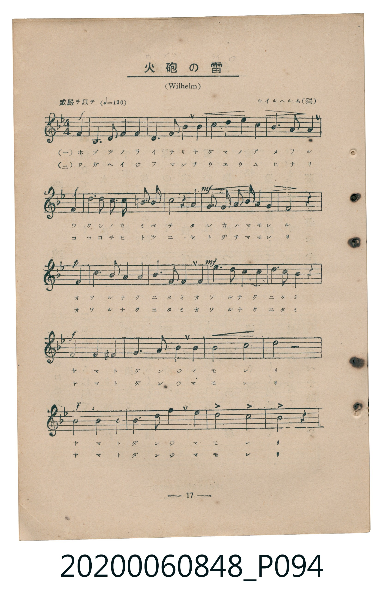
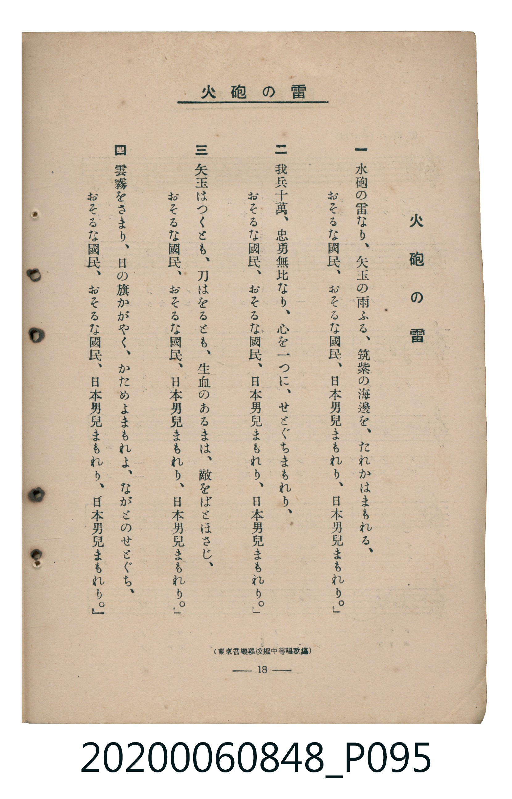

# 火砲の雷

<audio controls src="taiho_no_ikazuchi.mp3"></audio>

- 曲：ウイルヘルム（獨）（Carl Wilhelm）
- 臺灣教育會公認《新定兒童唱歌》高等科男子用（2020.006.0848）

## 說明

原書資訊與歌詞全文（對應 P094.jpg – P095.jpg，書頁 pp. 17–18，高二第二學期第 4 首）：
標題：火砲の雷（ホヅツ ノ ライ / 大砲の雷）
調性與拍號：ヘ長調（F Major，1 降記號）、4/4 拍（威嚴ヲ以テ ♩=120，弱起第 4 拍進入）
原曲：Carl Wilhelm《Die Wacht am Rhein》（ラインの守り）
出處註記：（東京音樂學校編中等唱歌集）

## 歌詞

```text
一
火砲の雷なり、矢玉の雨ふる、筑紫の海邊を、たれかはまもれる、
おそるな國民、おそるな國民、日本男兒まもれり、日本男兒まもれり。

二
我兵十萬、忠勇無比なり、心を一つに、せとぐちまもれり、
おそるな國民、おそるな國民、日本男兒まもれり、日本男兒まもれり。

三
矢玉はつくとも、刀はをるとも、生血のあるまは、敵をばとほさじ、
おそるな國民、おそるな國民、日本男兒まもれり、日本男兒まもれり。

四
雲霧をさまり、日の旗かがやく、かためよまもれよ、ながこのせとぐち、
おそるな國民、おそるな國民、日本男兒まもれり、日本男兒まもれり。
```

## 原書掃描頁





## 分析

```text
================================================================================
📊 TMD Song Profile: [ 火砲の雷 ]
================================================================================
⏱  Duration:       0:42 (42.0s), 21 measures total
🎼 Key & Tempo:    首調基準 F, != 120.0 BPM, <4/4>
   - 分析範圍：      由實際發聲的音符與和弦推測調性；播放脈絡另行呈現
🎤 人聲音域:    E3 (MIDI 52) – F5 (MIDI 77) [跨度: 25 個半音 / 2.1 個八度, 難度: difficult]
   - 最低音:  E3 in [Verse #1 @ m.3, 0:04]
   - 最高音: F5 in [Verse #1 @ m.19, 0:37]
   - 適合: contralto, bass
🏛  結構:      Verse (42.0s)
⚡ 編曲密度:        Peak 1 軌道同時演奏
🗝  調性診斷：       F 大調（純淨自然大調，未偵測到可信轉調）
   - 風格氣質:    純淨自然大調（陽光明朗、易唱易記，無明顯調外色彩）
   - 轉調歷程:    全曲維持單一推測調性（未偵測到可信轉調）
   - 核心骨幹音:  C, F, G, D, A#
   - 調性數值:    F 大調 [相關度: 0.86, 穩定度: Moderate, 自然音純度: 96.7%]
   - 候選調性 (K-S): F 大調 (0.86), C 大調 (0.78), D 小調 (0.58)
   - 五度圈歷程:   -1
   - 各段落調性細節:
     • [Verse #1]: F 大調 (r: 0.86, 自然音純度: 96.7%, 調外音: F#, B)

  [ 五度圈游移軌跡 ]
               C  
        [F ]*          G  
      Bb               D  
      Eb               A  
         Ab           E  
            Db       B  
               F# 
     (* = active key center)

  [ 十二半音累積音高分佈 ]
     C  : ████████████████████████  23.3%
     C# :                            0.0%
     D  : ██████████████            14.0%
     D# :                            0.0%
     E  : █████                      4.7%
     F  : █████████████████         16.7%
     F# : █                          1.3%
     G  : ████████████████          15.3%
     G# :                            0.0%
     A  : ██████████                 9.3%
     A# : ██████████████            13.3%
     B  : ██                         2.0%
--------------------------------------------------------------------------------
Assignment 軌道音域：
  - Piano         : E3 – F5 (25 個半音 / 2.1 個八度, 68 個音符)
================================================================================
```

## ABC

```abc
X:1
T:火砲の雷
C:曲：ウイルヘルム（獨）（Carl Wilhelm）
M:4/4
L:1/16
Q:1/4=120
K:F
V:V1 name="Piano" snm="Pia"
[V:V1]
!f! z4 z4 z4 c4 | f6 g2 a4 g4 | f6 E2 d4 a4 | c4 d4 c4 b4 |
!f! a6 b2 g4 c4 | d4 c2 c2 c4 =b2 b2 | !mf! c8 z4 g4 | e2 d2 c4 =b2 a2 g4 |
!p! c8 z4 g4 | b6 a2 g4 f4 | !mf! E6 f2 g4 g4 | d6 c2 b4 a4 |
g6 a2 b8 | !f! f8 f4 ^f4 | g6 b2 d4 c4 | b8 c8 |
d8 z4 z4 | !f! f8 a4 c4 | b6 d2 f4 e4 | d8 c8 |
f8 z4 z4 |
```

- [主旋律 TMD 檔案](taiho_no_ikazuchi.tmd)
- [鋼琴伴奏 TMD 檔案](taiho_no_ikazuchi_piano.tmd)
