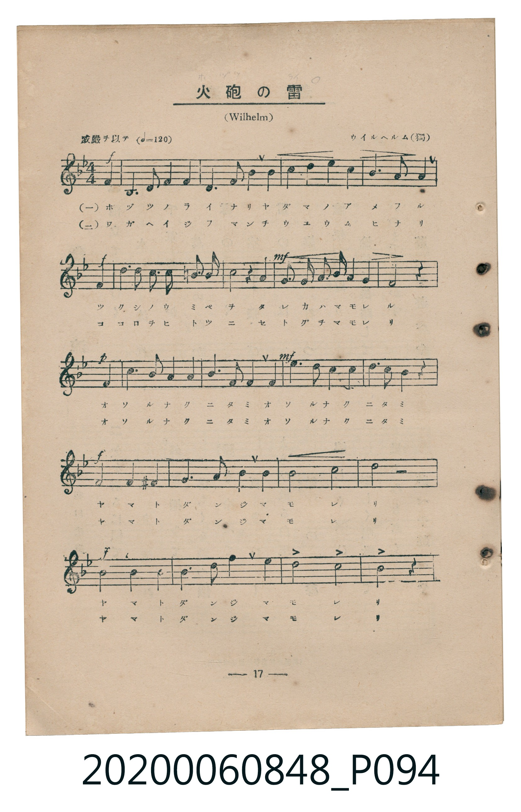
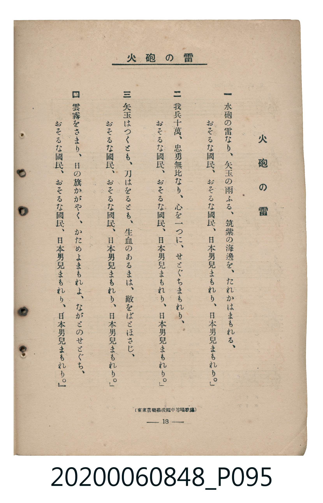

# 火砲の雷

> Re:Shōka 使用 AI 協助辨識與重建樂譜，可能會有錯誤。歡迎回報。

- **鋼琴伴奏版**：<br><audio controls src="taiho_no_ikazuchi.mp3"></audio>
- **NEUTRINO 歌聲合成版**：<br><audio controls src="taiho_no_ikazuchi_neutrino.mp3"></audio>

- 曲：ウイルヘルム（Carl Wilhelm，獨）
- 臺灣教育會公認《新定兒童唱歌》高等科男子用（2020.006.0848）

## 說明

原書資訊與歌詞全文（對應 P094.jpg – P095.jpg，書頁 pp. 17–18，高二第二學期第 4 首）：
標題：火砲の雷（ホヅツ ノ ライ，歌詞頁第一段首字誤植為「水砲の雷なり」）
調性與拍號：變ロ長調（2 降記號）、4/4 拍（威嚴ヲ以テ ♩=120，弱起第 4 拍進入）
原曲：Carl Wilhelm《Die Wacht am Rhein》
出處註記：（東京音樂學校編中等唱歌集）


## 歌詞

```text
一
火砲（ほづつ）の雷（らい）なり、矢玉（やだま）の雨（あめ）ふる、筑紫（つくし）の海邊（うみべ）を、たれかはまもれる、
おそるな國民（くにたみ）、おそるな國民、日本男兒（やまとだんじ）まもれり、日本男兒まもれり。」

二
我兵（わがへい）十萬（じふまん）、忠勇（ちういう）無比（むひ）なり、心（こころ）を一（ひと）つに、せとぐちまもれり、
おそるな國民、おそるな國民、日本男兒まもれり、日本男兒まもれり。」

三
矢玉はつくとも、刀（かたな）はをるとも、生血（いきぢ）のあるまは、敵（てき）をばとほさじ、
おそるな國民、おそるな國民、日本男兒まもれり、日本男兒まもれり。」

四
雲霧（くもぎり）をさまり、日（ひ）の旗（はた）かがやく、かためよまもれよ、ながこのせとぐち、
おそるな國民、おそるな國民、日本男兒まもれり、日本男兒まもれり。」
```

## ABC

<div class="abc-score" data-abc-src="taiho_no_ikazuchi.abc" aria-label="五線譜載入中"></div>

[下載 ABC 原始檔](taiho_no_ikazuchi.abc)

## TMD 檔案連結

- [主旋律 TMD 檔案](taiho_no_ikazuchi.tmd) [[在 TMD Studio 編輯](https://tmdlang.github.io/Tmd-TS/#tmd=s7IKdvYPcrWy4qpTUCpJTLdSSM7PyUlNLsnMz7MqzsjMK0nNjM_KTMmPL87Iz05Ugisry88pzU21ys4vyY9Pyq8sjjcyMDKINzAwizewMLFAqCvOLy1KTrUqTs7Iz8-JL0mtKEnKz89Gl48vSExPtQowsDTBKWOKkCkoyi9LzUvMA5pbUARyYgrYYISC1LLMlFSQdHFyYl58WWpRZlpmagqS41OLisEehFhRUpSYV5xclFkA8jVCVX5RSUZ-elFiQUalVUZmcUl-UWZyYk58dmIeUjiUZKQCgyE3MyezJLGoEllzZnpmnlVuamZWJhZvQ6XLU4tLUovy4nNTc_JTgLq1tBSeN65-vmDT48Z1L2dvV9DS4lK0VTA0MuCyt1Vw0uGyMdE3sQMZ8mz2pvd7Zj1uWva4acnj5tWPm2eAyQXv93Q4JxblKIRn5mSk5uS-39PzvHfF-z2dYJtftO963rj42dSZL5o2PZvT_LR1zYtVvY8bup5N2_B03aynrZOer176dMrGZ2t7Hjd0v1w94_nazufLJz6fsv3p2gnPpwCN6QBFsh4wkvVAkQw2lktfS8GWWoBLQUHhad_8Z7N3vNjc_mJF14uOdqBjXqyc97R1xbNp7UAHPN3Q-6y9UwGUUvSyCtIVHjVMBnFMQRygZ4E6Xy5oVCgo0FMwNAfKGQId2QP0yZNdPc_XrAGST9fueDZnPpCtYKLwctk0oBeAwQiy9tmKmS8X9gA5yOEPtPBx8-zHza2Pm1sUHjf3AfFKYICDLAI7C2gXyNgdDc_WbQWa9nTt9Berljxb0vu8adfjhp5nG7bATXrcuOpxU9fjhl6gjSDrXqza_6xhOch_3b0vZs4H2vtiXdfj5rUvp24HSoFCWuHlzN4XK2aAJTsfNzQCY14BqBgUBisan87a8rh505PdSx83tyk8mrnSFphEgK56umfji63bIb4Dqn3ZsOlp61KojeBwBSUa5PQBjHyXzFSF8MTkjBKFxFyFoIzUzDxg5IM1tO96MXPqixW7ga4AagNa_Gzuxie71rycv_nZiiZQQC5Y-Hz7iic71gLTCSTZvJzdBrINpBsYKCAKEpqgcGzc_bhx6eNGYOB1IgK3CchuAYtAgqfx-fxFz_uAcQKUanncuOBx4z6YelDye9zY9LipESyy9XFTN0j92onPt6wGSy153Nj_uHE6RP2zrdtfNnWBxdseN-5_3LgTJN40CajlceP8x009jxu7HzeuB5r_uAloZg_ENJCLHzd2PW6cC-I3rno6p_vZholgU4BGrwbpbARGDig6MJUBBZ9NX_pszhpQhmmdBPPDvseNK0A-aZr8uBEYjkDHwa0EeRhZC6pUEzC1QIJyVw84hXZMfNq6FWws0DFAD-yAhN3T3sYXE9aAHTkDFC4gQyZDHPl0_4Kn3aBs87hxITgggO4BxdDzloXP1k8BG9XwuBEYPYgIeLq_Gawe6NrJj5tAyRUYasDIBAsCEzOoMAGH9WpwIMwG-24C2HwUf2EPSmICjowA2gFO4ZC0A45VSFpYAVIM9FIHxPVAG4HxtwrsgfWgtAByA1TN8ynzXyyEKAOGUe_jxkWQdAROcUBlwFhcD3LMVHAENC4DqoEmqMYN4CAApu6poAigr8-fzp4Nol7O3vRyznJoOgUqa-wDKoO5D-gsoF6ogZBohOaR6cDMAuQCwwtcxoACCGg-0P_9YNeCw6up8XETUA3c9g6w1CpwAgSmEWAAISUB-nkeaA3l1Q0UKGjpc3GFJGZm5Pvle2YnVpUmZ2RaBWQm5uU71Oga1lSDLFOwMTTTsgOzsFV4CpBq4MXCHgUNSCGsYAgqgRW0gSXx0w39z9c36MArLU0s-oFOAJldo2CgoAuG6HR1Wq2CaTyUU6NgCGOCoDGIA5dEUgWWgEGwuCGUA6NrFIxghkBpEygNEwfahWSIOcgQMIHpKLAPfAxrFGAi6DSwLoUbCqxUkYwF1a8gsg_OX4lQ2bQERWUXmFwF58NkQWY2wEXnwVlwM5sWIalciGLmVDC5GsU1SH4ywuen9UguXYNi6gywrTD3PW7agWQ_yEaESpBrHzdvhvMbkcxcBtePMAku1rwAycxJKGaihVMTzHSon4zx-QlbmCK7tB_Oh4cU0AZYSEBkOsAkLMwfN8FCF6RyP4orISyEmZuQbIfpwm4m3J0QP5ng8RPcdSBTYSZAZNaBTUWkKCT7m7ai2A_xPUIlLMRBZiLSLtwnCH-i-B41lYD8gHAdkkpwCY-7uNnVAy5uSCxfYNkcBEFsSDY3UjBUBzOAFKJIgEFYGQTP9zUK1bnArG8G4QNLAKiMIUIJVA6kFl5CoJtXXYC1-EBLSE3bwcEECV5Q0n_cPB8adDPBAQ-LLhhERDks-EGqIIEOCl5YBIGiEykxQVVgJjtUM2GRjygaEFkLYs5aMAlxFSiJQJItJLOAzO7GafZuJBdA9TRtgBcH-NwLcxVB9wKz_eMmkAsR7m0Ck7DwXQT3Pcg-kNmw5IxhNrDvAXcB1EyQvx83T4CyO4AYVuQjshJINawoJOheYJZGxCPEVFDR_bh5BdyNsDABhQjIvRAZbO6FFTaITAiKO4Tfd8PDHRLycNXwAhmfewm0DjrJya7IWRFUD8PzF1JeRK6fwdkJW1MAnGFhdTsIIjI_cl2PXDyARGFmw7Isci7di6QWkmaQinOU4hY5xUNiE5aHUUKQamailSngPDpkXAvOoUPGteD8ORRcizd3AvtR5OROlPYvDCJynzoi-8GrQxAE513MljhyPgZB9GoYNXeCIHonASl3wptwiDBENIlhZRxm8w5UkyFKZ4Qe9EYTRBa5IQNThasmwpInB7sbQTlxsLsRlP8GsRsJNGGnkJvr0PMK_twEyjemUDasDsTMTZj5Dd2W0fw2mt8Gtxtrubh07RTQBrMUgELKXAA)]
- [鋼琴伴奏 TMD 檔案](taiho_no_ikazuchi_piano.tmd) [[在 TMD Studio 編輯](https://tmdlang.github.io/Tmd-TS/#tmd=s7IKdvYPcrWy4qpTUCpJTLdSSM7PyUlNLsnMz7MqzsjMK0nNjM_KTMmPL87Iz05Ugisry88pzU21ys4vyY9Pyq8sjjcyMDKINzAwizewMLFAqCvOLy1KTrUqTs7Iz8-JL0mtKEnKz89Gl48vSExPtQowsDTBKWOKkCkoyi9LzUvMA5pbUARyYgrYYISC1LLMlFSQdHFyYl58WWpRZlpmagqS41OLisEehFhRUpSYV5xclFkA8jVCVX5RSUZ-elFiQUalVUZmcUl-UWZyYk58dmIeUjgkFgE1p6fmpuaVWBVkJublxycmJ-fnFiTmZYLEEApLMoCKrHIzczJLEosqkW3JTM_Ms8pNzczKxBI-UOny1OKS1KK8-NzUnPwUoG4tLYXnjaufL9j0uHHdy9nb3-_peNm95_mELU_2bHm6tP95Z8f7PZ0KWlpcirYKhkYGXPa2Ck46XDYm-iZ2IJOfzd70fs-sx03LHjctedy8-nHzDDC5AGiMc2JRjkJ4Zk5Gak7u-z09z3tXAE0CO-dF-67njYufTZ35omnTsznNT1vXvFjV-7ih69m0DU_XzXraOun56qVPp2x8trbncUP3y9Uznq_tfL584vMp25-unfB8CtCYDlAS0QMmET1QEgEbyxWSmJmR75fvmZ1YVZqckWkVAArCIA-HGl3DmmouBSCwMTTTsgOz9LUUbNGBwvM1a57saHixsEdB4-mejS-2blcwVHjW3augrWCi8HRD__P1DToKoHSll1WQrolFv5Y-2OwaBQMFXTBEp6vTahVM46GcGgVDGBMEjUEcuCSSKrAEDILFDaEcGF2jYAQzBEqbQGmYONAuJEPMQYaACUxHgX3gY1ijABNBpx83z4Yb-ri5FcnYx80tYLIPzl-JUNm0BEVlF5hcBefDZEFmNsBF58FZcDObFiGpXIhi5lQwuRrFNUh-MsLnp_VILl2DYuoMsK0w9z1u2oFkP8hGhEqQax83b4bzG5HMXAbXjzAJLta8AMnMSShmooVTE8x0qJ-M8fkJW5giu7QfzoeHFNAGWEhAZDrAJCzMHzfBQhekcj-KKyEshJmbkGyH6cJuJtydED-Z4PET3HUgU2EmQGTWgU1FpCgk-5u2otgP8T1CJSzEQWYi0i7cJwh_ovgeNZWA_IBwHZJKLvzFza4ecHFDYvkCy-YgCGJDsrmRgqE6mAGkEEUCDMLKIHi-r1GozgVmfTMIH1gCQGUMEUqgciC18BIC3bzqAqzFB1pCatoODiZI8IKS_uPm-dCgmwkOeFh0wSAiymHBD1IFCXRQ8MIiCBSdSIkJqgIz2aGaCYt8RNGAyFoQc9aCSYirQEkEkmwhmQVkdjdOs3cjuQCqp2kDvDjA516Yqwi6F5jtHzeBXIhwbxOYhIXvIrjvQfaBzIYlZwyzm9sQLoCaCfL34-YJUHYHEMOKfERWAqmGFYUE3QvM0oh4hJgKKrofN6-AuxEWJqAQAbkXIoPNvbDCBpEJQXGH8PtueLhDQh6uGl4g43MvgdZBJznZFTkrgupheP5CyovI9TM4O2FrCoAzLKxuB0FE5keu65GLB5AozGxYlkXOpXuR1ELSDFJxjlLcIqd4SGzC8jBKCFLNTLQyBZxHh4xrwTl0yLgWnD-Hgmvx5s6ns2eTkztR2r8wiMh96ojsB68OQRCcdzFb4sj5GATRq2HU3AmC6J0EpNwJb8IhwhDRJIaVcZjNO1BNhiidEXrQG00QWeSGDEwVrpoIS54c7G4E5cTB7kZQ_hvEbiTQhJ1Cbq5Dzyv4cxMo35hC2bA6EDM3YeY3dFtG89tofhvcbqzFMZblgzKWZQIdygINN0EgeEQp2jAWRmHyTeMhLBMgZRoPUwFigWSAJkBNhGqACioYAblGQEUQS2A8sGEgBtRckDFgFVBD4IJwBobBIHdAuWjuAdI4TALpMwMJmMXnInkNZJQJUAnMdeCBs2hjNDfhCCCwBSDdiCDCdDTEHGDk6NopoMVPtA9QHpuwEXZhY-zCJmBhZS4A)]

## 分析

```text
================================================================================
📊 TMD Song Profile: [ 火砲の雷 ]
================================================================================
⏱  Duration:       0:40 (40.0s), 20 measures total
🎼 Key & Tempo:    首調基準 B,, != 120.0 BPM, <4/4>
   - 分析範圍：      由實際發聲的音符與和弦推測調性；播放脈絡另行呈現
🎤 人聲音域:    A#3 (MIDI 58) – F5 (MIDI 77) [跨度: 19 個半音 / 1.6 個八度, 難度: challenging]
   - 最低音:  A#3 in [TaihoNoIkazuchi #1 @ m.2, 0:02]
   - 最高音: F5 in [TaihoNoIkazuchi #1 @ m.19, 0:37]
   - 適合: soprano, mezzo-soprano, contralto, tenor, baritone, bass
🏛  結構:      TaihoNoIkazuchi (40.0s)
⚡ 編曲密度:        Peak 1 軌道同時演奏
🗝  調性診斷：       A# 大調（純淨自然大調，未偵測到可信轉調）
   - 風格氣質:    純淨自然大調（陽光明朗、易唱易記，無明顯調外色彩）
   - 轉調歷程:    全曲維持單一推測調性（未偵測到可信轉調）
   - 核心骨幹音:  A#, F, C, D, A
   - 調性數值:    A# 大調 [相關度: 0.89, 穩定度: Moderate, 自然音純度: 97.3%]
   - 候選調性 (K-S): A# 大調 (0.89), F 大調 (0.78), D 小調 (0.61)
   - 五度圈歷程:   -2
   - 各段落調性細節:
     • [TaihoNoIkazuchi #1]: A# 大調 (r: 0.87, 自然音純度: 97.2%, 調外音: F#, B)

  [ 五度圈游移軌跡 ]
               C  
         F            G  
     [Bb]*              D  
      Eb               A  
         Ab           E  
            Db       B  
               F# 
     (* = active key center)

  [ 十二半音累積音高分佈 ]
     C  : ████████████████          17.6%
     C# :                            0.0%
     D  : ██████████████            15.5%
     D# : ████                       4.7%
     E  :                            0.0%
     F  : █████████████████         19.3%
     F# : █                          1.4%
     G  : ████                       4.4%
     G# :                            0.0%
     A  : ████████                   9.1%
     A# : ████████████████████████  26.7%
     B  : █                          1.4%
--------------------------------------------------------------------------------
Assignment 軌道音域：
  - Piano         : A#3 – F5 (19 個半音 / 1.6 個八度, 68 個音符)
================================================================================
```


## 原書掃描頁






