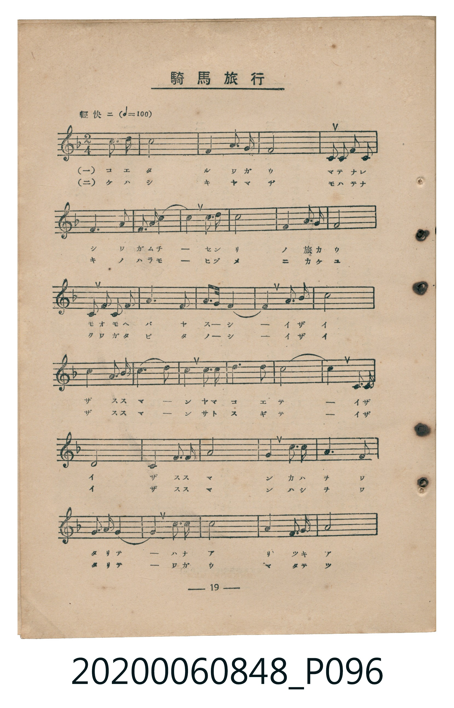
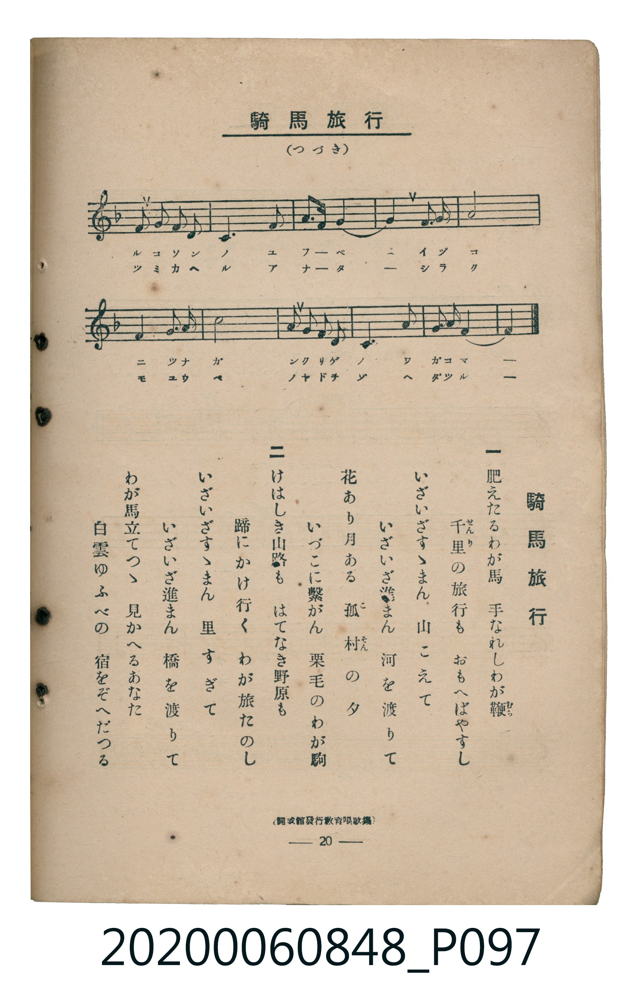

# 騎馬旅行

> Re:Shōka 使用 AI 協助辨識與重建樂譜，可能會有錯誤。歡迎回報。

- **鋼琴伴奏版**：<br><audio controls src="kiba_ryoko.mp3"></audio>

- 臺灣教育會公認《新定兒童唱歌》高等科男子用（2020.006.0848）

## 說明

原書資訊與歌詞全文（對應 P096.jpg – P097.jpg，書頁 pp. 19–20，高二第二學期第 5 首）：
調性與拍號：ヘ長調（1 降記號）、2/4 拍（輕快ニ ♩=100，弱起第 2 拍進入）
出處註記：（開成館發行教育唱歌集）


## 歌詞

```text
一
肥えたるわが馬　手なれしわが鞭（むち）
千里（せんり）の旅行も　おもへばやすし
いざいざすゝまん　山こえて
いざいざ進まん　河を渡りて
花あり月ある　孤村（こそん）の夕
いづこに繋がん　栗毛のわが駒

二
けはしき山路も　はてなき野原も
蹄にかけ行く　わが旅たのし
いざいざすゝまん　里すぎて
いざいざ進まん　橋を渡りて
わが馬立てつゝ　見かへるあなた
白雲ゆふべの　宿をぞへだつる
```

## ABC

<div class="abc-score" data-abc-src="kiba_ryoko.abc" aria-label="五線譜載入中"></div>

[下載 ABC 原始檔](kiba_ryoko.abc)

## TMD 檔案連結

- [主旋律 TMD 檔案](kiba_ryoko.tmd) [[在 TMD Studio 編輯](https://tmdlang.github.io/Tmd-TS/#tmd=s7IKdvYPcrWy4qpTUCpJTLdSSM7PyUlNLsnMz7MqzsjMK0nNjM_KTMmPL87Iz05Ugisry88pzU21ys4vyY9Pyq8sjjcyMDKINzAwizewMLFAqCvOLy1KTrUqTs7Iz8-JL0mtKEnKz89Gl48vSExPtQowsDTDKWOOkCkoyi9LzUvMA5pbUARyYgrYYISC1LLMlFSQdHFyYl58WWpRZlpmagqS41OLisEehFhRUpSYV5xclFkA8jVCVX5RSUZ-elFiQUalVUZmcUl-UWZyYk58dmIeUjiUZKQCgwFsQgFQAxaJstQcZDMz0zPzrHJTM7MykUJDS0vh5Yq-l8vWPJve-mJhj4KWFpeirYKhgQGXva2CG5eNkb6JHciMF-27njcufjZ15oumTc_mND9tXfNiVe_jhq5n0zY8XTfraeuk56uXPp2y8dnanscN3S9Xz3i-tvP58onPp2x_unbC8ykr3u_pAEWTHjCa9EDR9H5PpxIXl76Wgi21AJeCgsLTvvnPZu94sbn9xYquFx3tQMe8WDnvaeuKZ9PagQ54uqH3WXunAiiu9bIK0hUeNUwGccxBnPd7eoA6Xy5oVCgo0FMwtATKGRkABYE-ebKr5_maNUDy6dodz-bMB7IVTBVeLpsG9ML7PbNA1r5Ytf9Zw3KQhd29L2bOB4o-bp7xcup2oDjQWkOFlzN7X6yYAZbpfNzQCAxSBaBKoNSLPVOf7l_9uLlb4dHMlbbAQAfa-HTPxhdbt4NsMQKpetmw6WnrUqBGsP_ad72YOfXFit1A44C2AE14Oa37WceEl0tWPJ-5Bxh9kPiBxMPL2W0gbSB9T3Y0gN3ZtPRxY8fjxvmPm7ofN_U_buwBxvvjhoZnnd2PG1c9bup53DgdKj5vLdDwx00NjxsXwuzubX7Z3gMSbZz9uGny46YukG8a10HSzeOmJqBBjxu7QIzGHY8bNzxuanncOBNoIkjz40YgZxqMnPm4ae7jxn0gUxoanm7c-LhxMthdy9CVAj0PV_ds0-bHTZOe7VgItBmq9EUXUGsTkP9sDlA3kNENMm_tkmdzJ4LdCTR1LlAzxJ1Pl0yFGw8MBqDc6uc7gf4GOh1s_ILpz9bPBqqDBsDySZCQ29UD0TXxceN6UPA09gId_GL7epiHgYLLQIHX2PuyvQ-Y_oDiYKftBFqz-nEj0IKJoOBp7AepBhsNDDBQFABtIhg2wAAHh2EfobBZCYxP1LCBx-_z1UA3AJ24BGRwQ8OLZUAuEO0AhRYwzEBOnw_S8Hzm3pezNz1uanvcuPVx406Q-4CBuW4_0ODHjfPAcboAbEo3SDXl-RUKFLT0ubi8M5MSgyrzs_OtAjIT8_IdanQNa6pB1ijYGJpp2YFZ2MoKBVDG3NEAKrc0IPlGwRCUaRS0FUwUnm7of76-QQee3zWx6AdaDjK7RsFAQRcMTcGkGVAEwkLAGqDREJYxmDRCEkGoMY0HGQIiQHJgRg3YCh_DGgUQDwQfN22G0iuAWh437ccw5nHzapja5vVQtWvAapdhUTsPrK4NTHaByTUIe42Q7d0INbMfbNZ2TLOa1sLtXQKl54HtaMJi7yKoWai214AzDu742tUDji8z0iIIOahBEQATMYZHVA1cnsJIhMcXaghBYgIkCgpdEH8BEDdi2P64aTdUfjM4lFZhCbk-uJmrHjcvh2pbjT2C4dGIiByIVpAhIMNAEQDir4RGCZpzmidB6Vaw6oVYnNMNdzok2YESCkgc0y0EsmInOGpNSYta1OwCYtRAowcCkUWM4NGF8CFExgRbdCOiEpJYm0CRAUu4M6C-n4CkA5LsQWG9E8rfg5QMkCMZmj2atoFVQ3jYYw2UbCCJB5J0IBkeZPNkZJvhopDEQb7NeOPo6ezZ5GQ_WMhiD2szsAthIhDaFCgCEseuBu5aOAsc-WAKOQNug_saGh9AGlbkIeJsDzTkIMUqRuEFLW5hJq2AqgYVWdjdghLGSDFJpmuatkJlOpBSFkxuHYmuIVC4TiEnB5rBagiE5dDogOQ-EImaJyGKjKAsRIxj5FukuMRIqUSGKFQtUnhCSylINda8CUkdtJBGijOq2QorZ4F5Epet-HNe61py4gYSxsbwsEav5kChjpmrYPEAiT1QNYcRe0gxA2mAgKoqRDpErkFgNUwXOPRgdQxyKMEqucfNLdBQWotdLVLMELKVuIYPRA3MrDawOMQNyLYSqLeaMWMG3C0k2CQBxQqIBucgpFwDC3tYuBtiiT-i4gbcEISUYI-b9oL9CGIjNyIgPgeFD0h0KpQPrD2aZ2LYCS9LIK0BlJIRLX7Aofi4eT5YF9gV8BoT1jiFmAiKY5AoqPEHq7dgTVpkmyF1GaidAqsVSYijp62rMest4uIIEsog0hhnXsEXj5DmJswEzPYHrO-AHGvwFhUsP0DzDqTpiGw7JD5hrQRw-6QJVLZgxjBa8xMYd4gcgHANzOXIMQnLhbAWHSg3gcRh6QPZNSA7IfXn4-ZOMAl1TdM-FNfA0kID3J-IdIHNNbVcXLp2CvCengKQo8wFAA)]
- [鋼琴伴奏 TMD 檔案](kiba_ryoko_piano.tmd) [[在 TMD Studio 編輯](https://tmdlang.github.io/Tmd-TS/#tmd=s7IKdvYPcrWy4qpTUCpJTLdSSM7PyUlNLsnMz7MqzsjMK0nNjM_KTMmPL87Iz05Ugisry88pzU21ys4vyY9Pyq8sjjcyMDKINzAwizewMLFAqCvOLy1KTrUqTs7Iz8-JL0mtKEnKz89Gl48vSExPtQowsDTDKWOOkCkoyi9LzUvMA5pbUARyYgrYYISC1LLMlFSQdHFyYl58WWpRZlpmagqS41OLisEehFhRUpSYV5xclFkA8jVCVX5RSUZ-elFiQUalVUZmcUl-UWZyYk58dmIeUjgkFgE1p6fmpuaVWBVkJublxycmJ-fnFiTmZYLEEApLMoCKrMBWFQBNxiJRlpqDbHlmemaeVW5qZlYmUrBpaSm8XNH3ctmaZ9NbXyzseb-n42X3nucTtjzZs-Xp0v7nnR3v93QqaGlxKdoqGBoYcNnbKrhx2Rjpm9iBDH7Rvut54-JnU2e-aNr0bE7z09Y1L1b1Pm7oejZtw9N1s562Tnq-eunTKRufre153ND9cvWM52s7ny-f-HzK9qdrJzyfsgJoGSiS9YCRrAeKZKBVSlxc3plJiUGV-dn5VgEg7wd5ONToGtZUcykAgY2hmZYdmKWvpWCLDhSer1nzZEcD0BsKGk_3bHyxdbuCocKz7l4FbQUThacb-p-vb9BRAKUJvayCdE0s-rX0wWbXKBgo6IKhKZg0A4pAWAhYAzQawjIGk0ZIIgg1pvEgQ0AESA7MqAFb4WNYowDigeDjps1QegVQy-Om_RjGPG5eDVPbvB6qdg1Y7TIsaueB1bWByS4wuQZhrxGyvRuhZvaDzdqOaVbTWri9S6D0PLAdTVjsXQQ1C9X2Gi788bWrBxxfZqRFEHJQgyIAJmIMj6gauDyFkQiPL9QQgsQESBQUuiD-AiBuxLD9cdNuqPxmcCitwhJyfXAzVz1uXg7Vthp7BMOjERE5EK0gQ0CGgSIAxF8JjRI05zRPgtKtYNULsTinG-50SLIDJRSQOKZbCGTFTnDUmpIWtajZBcSogUYPBCKLGMGjC-FDiIwJtuhGRCUksTaBIgOWcGdAfT8BSQck2YPCeieUvwcpGSBHMjR7NG0Dq4bwsMcaKNlAEg8k6UAyPMjmycg2w0UhiYN8m_HG0dPZs8nJfrCQxR7WZmAXwkQgtClQBCSOXQ3ctXAWOPLBFHIG3Ab3NTQ-gDSsyEPE2R5oyEGKVYzCC1rcwkxaAVUNKrKwuwUljJFikkzXNG2FynQgpSyY3DoSXUOgcJ1CTg40g9UQCMuh0QHJfSASNU9CFBlBWYgYx8i3SHGJkVKJDFGoWqTwhJZSkGqseROSOmghjRRnVLMVVs4C8yQuW_HnvNa15MQNJIyN4WGNXs2BQh0zV8HiARJ7oGoOI_aQYgbSAAFVVYh0iFyDwGqYLnDoweoY5FCCVXKPm1ugobQWu1qkmCFkK3ENH4gamFltYHGIG5BtJVBvNWPGjDlRTRJQrIBocA5CyjWwsIeFuyGW-CMqbsANQUgJ9rhpL9iPIDZyIwLic1D4gESnQvnA2qN5Joad8LIE0hpAKRnR4gccio-b54N1gV0BrzFhjVOIiaA4BomCGn-wegvWpEW2GVKXgdopsFqRhDh62roas94iLo4goQwijXHmFXzxCGluwkzAbH_A-g7IsQZvUcHyAzTvQJqOyLZD4hPWSgC3T5pAZQtmDKM1P4Fxh8gBCNfAXI4ck7BcCGvRgXITSByWPpBdA7ITUn8-bu4Ek1DXNO1DcQ0sLTTA_YlIF9hcU4vR0fNB6eiZQPt5oL6YASjm4hWiDWPxMmBxjE0BfiNw6jSNx2EGIbtMgHyTeCwysGIcKGoUn4vdQyBbsVgGdowp2FB0FTi9hN0dOExB8hREAVwPFmPQgwYUo7p2CvBIjfYBSqIKGIEFlLkA)]

## 分析

```text
================================================================================
📊 TMD Song Profile: [ 騎馬旅行 ]
================================================================================
⏱  Duration:       0:50 (50.4s), 42 measures total
🎼 Key & Tempo:    首調基準 F, != 100.0 BPM, <2/4>
   - 分析範圍：      由實際發聲的音符與和弦推測調性；播放脈絡另行呈現
🎤 人聲音域:    C4 (MIDI 60) – D5 (MIDI 74) [跨度: 14 個半音 / 1.2 個八度, 難度: moderate]
   - 最低音:  C4 in [KibaRyoko #1 @ m.5, 0:04]
   - 最高音: D5 in [KibaRyoko #1 @ m.1, 0:01]
   - 適合: soprano, mezzo-soprano, contralto, tenor, baritone, bass
🏛  結構:      KibaRyoko (50.4s)
⚡ 編曲密度:        Peak 1 軌道同時演奏
🗝  調性診斷：       F 大調（純淨自然大調，未偵測到可信轉調）
   - 風格氣質:    純淨自然大調（陽光明朗、易唱易記，無明顯調外色彩）
   - 轉調歷程:    全曲維持單一推測調性（未偵測到可信轉調）
   - 核心骨幹音:  C, F, A, G, D
   - 調性數值:    F 大調 [相關度: 0.85, 穩定度: Moderate, 自然音純度: 100.0%]
   - 候選調性 (K-S): F 大調 (0.85), C 大調 (0.79), A 小調 (0.70)
   - 五度圈歷程:   -1
   - 各段落調性細節:
     • [KibaRyoko #1]: F 大調 (r: 0.84, 自然音純度: 100.0%)

  [ 五度圈游移軌跡 ]
               C  
        [F ]*          G  
      Bb               D  
      Eb               A  
         Ab           E  
            Db       B  
               F# 
     (* = active key center)

  [ 十二半音累積音高分佈 ]
     C  : ████████████████████████  36.3%
     C# :                            0.0%
     D  : █████                      7.1%
     D# :                            0.0%
     E  :                            0.0%
     F  : ████████████████          24.4%
     F# :                            0.0%
     G  : ███████                   11.3%
     G# :                            0.0%
     A  : █████████████             20.2%
     A# :                            0.6%
     B  :                            0.0%
--------------------------------------------------------------------------------
Assignment 軌道音域：
  - Piano         : C4 – D5 (14 個半音 / 1.2 個八度, 93 個音符)
================================================================================
```


## 原書掃描頁






