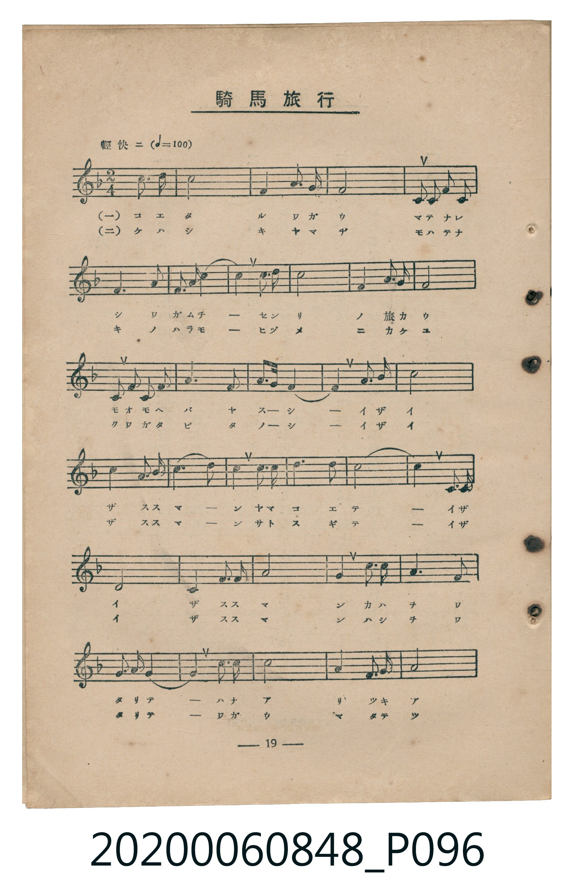
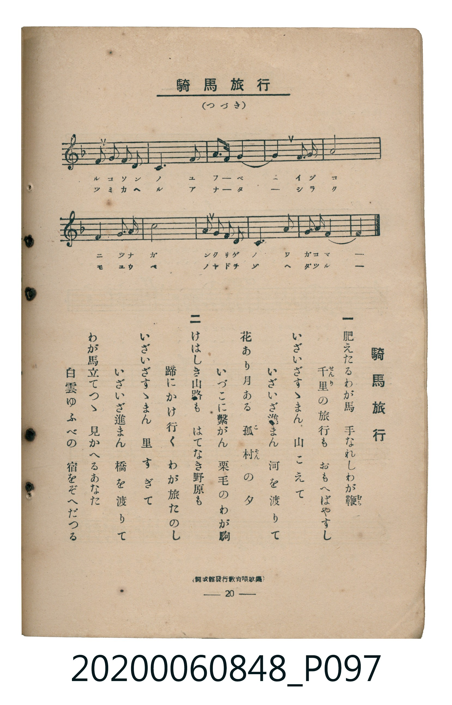

# 騎馬旅行

<audio controls src="kiba_ryoko.mp3"></audio>

- 臺灣教育會公認《新定兒童唱歌》高等科男子用（2020.006.0848）

## 說明

原書資訊與歌詞全文（對應 P096.jpg – P097.jpg，書頁 pp. 19–20，高二第二學期第 5 首）：
調性與拍號：ヘ長調（F Major，1 降記號）、2/4 拍（輕快ニ ♩=100）
出處註記：（開成館發行教育唱歌集）

## 歌詞

```text
一
肥えたるわが馬　手なれしわが鞭
千里の旅行も　おもへばやすし
いざいざすゝまん　山こえて
いざいざ進まん　河を渡りて
花あり月ある　孤村の夕
いづこに繋がん　栗毛のわが駒

二
けはしき山路も　はてなき野原も
蹄にかけ行く　わが旅たのし
いざいざすゝまん　里すぎて
いざいざ進まん　橋を渡りて
わが馬立てつゝ　見かへるあなた
白雲ゆふべの　宿をぞへだつる
```

## 原書掃描頁





## 分析

```text
================================================================================
📊 TMD Song Profile: [ 騎馬旅行 ]
================================================================================
⏱  Duration:       0:52 (52.8s), 44 measures total
🎼 Key & Tempo:    首調基準 F, != 100.0 BPM, <2/4>
   - 分析範圍：      由實際發聲的音符與和弦推測調性；播放脈絡另行呈現
🎤 人聲音域:    E3 (MIDI 52) – F5 (MIDI 77) [跨度: 25 個半音 / 2.1 個八度, 難度: difficult]
   - 最低音:  E3 in [Verse #1 @ m.7, 0:07]
   - 最高音: F5 in [Verse #1 @ m.21, 0:24]
   - 適合: contralto, bass
🏛  結構:      Verse (52.8s)
⚡ 編曲密度:        Peak 1 軌道同時演奏
🗝  調性診斷：       F 大調（純淨自然大調，未偵測到可信轉調）
   - 風格氣質:    純淨自然大調（陽光明朗、易唱易記，無明顯調外色彩）
   - 轉調歷程:    全曲維持單一推測調性（未偵測到可信轉調）
   - 核心骨幹音:  C, F, A, G, D
   - 調性數值:    F 大調 [相關度: 0.90, 穩定度: Moderate, 自然音純度: 100.0%]
   - 候選調性 (K-S): F 大調 (0.90), C 大調 (0.81), A 小調 (0.74)
   - 五度圈歷程:   -1
   - 各段落調性細節:
     • [Verse #1]: F 大調 (r: 0.90, 自然音純度: 100.0%)

  [ 五度圈游移軌跡 ]
               C  
        [F ]*          G  
      Bb               D  
      Eb               A  
         Ab           E  
            Db       B  
               F# 
     (* = active key center)

  [ 十二半音累積音高分佈 ]
     C  : ████████████████████████  28.7%
     C# :                            0.0%
     D  : ██████                     6.9%
     D# :                            0.0%
     E  : █████                      5.7%
     F  : ████████████████████      24.1%
     F# :                            0.0%
     G  : ██████████                11.8%
     G# :                            0.0%
     A  : ████████████████          19.3%
     A# : ███                        3.4%
     B  :                            0.0%
--------------------------------------------------------------------------------
Assignment 軌道音域：
  - Piano         : E3 – F5 (25 個半音 / 2.1 個八度, 91 個音符)
================================================================================
```

## ABC

```abc
X:1
T:騎馬旅行
C:TMD (Chen, Chih-Han / aguai)
M:2/4
L:1/16
Q:1/4=100
K:F

V:V1 name="Piano" snm="Pia"

[V:V1]
!mf! c4 c3 d | c8 | f4 a3 g | f8 |
f2 c2 f2 a2 | g6 f2 | E2 f2 g4- | g4 c3 d |
c8 | a4 f3 g | f8 | f2 c2 f2 a2 |
g6 a2 | b4 E4 | f8- | !f! f4 c3 d |
c8 | a4 f3 g | c8- | c4 d3 e |
f6 d2 | c8- | c4 c3 d | c8 |
c4 f3 g | a8- | a4 d3 d | c6 a2 |
f3 g a4- | !mf! a4 c3 d | c8 | a4 f3 g |
a8 | f2 f2 E2 f2 | g6 a2 | b3 g E4- |
E4 f3 g | a8 | a4 b3 c | d8 |
d2 c2 b2 a2 | g6 f2 | E3 g f4- | f4 z4 |
```

- [主旋律 TMD 檔案](kiba_ryoko.tmd)
- [鋼琴伴奏 TMD 檔案](kiba_ryoko_piano.tmd)
