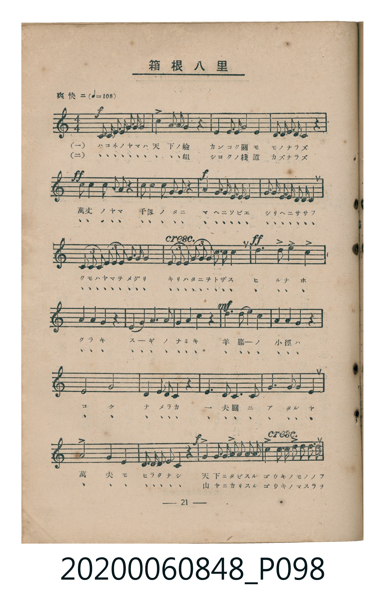
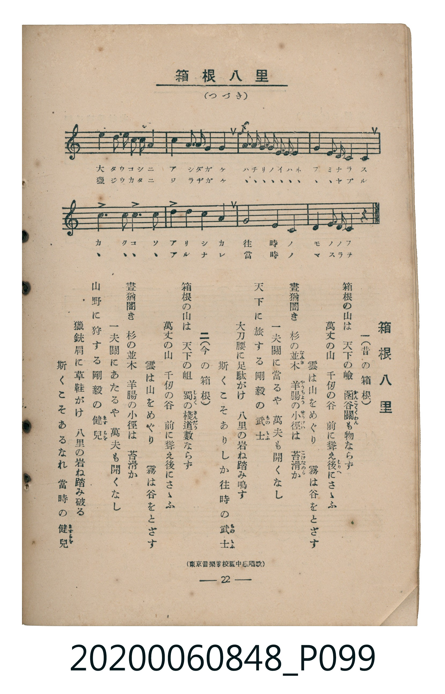

# 箱根八里

> Re:Shōka 使用 AI 協助辨識與重建樂譜，可能會有錯誤。歡迎回報。

- **鋼琴伴奏版**：<br><audio controls src="hakone_hachiri.mp3"></audio>

- 詞：土井晩翠
- 曲：瀧廉太郎
- 臺灣教育會公認《新定兒童唱歌》高等科男子用（2020.006.0848）

## 說明

原書資訊與歌詞全文（對應 P098.jpg – P099.jpg，書頁 pp. 21–22，高二第二學期第 6 首）：
調性與拍號：ハ長調（C Major，無升降記號）、4/4 拍（爽快ニ ♩=108）
出處註記：（東京音樂學校編中等唱歌）


## 歌詞

```text
一（昔の箱根）
箱根の山は天下の嶮　函谷關も物ならず
萬丈の山　千伋の谷　前に聳え後にさゝふ
雲は山をめぐり　霧は谷をとざす
晝猶闇き　杉の並木　羊腸の小徑は　苔滑か
一夫關に當るや　萬夫も開くなし
天下に旅する　剛毅の武士
大刀腰に足駄がけ　八里の岩ね踏み鳴す
斯くこそありしか往時の武士

二（今の箱根）
箱根の山は天下の岨　蜀の棧道數ならず
萬丈の山　千伋の谷　前に聳え後にさゝふ
雲は山をめぐり　霧は谷をとざす
晝猶闇き　杉の並木　羊腸の小徑は　苔滑か
一夫關にあたるや　萬夫も開くなし
山野に狩する　剛毅の健兒
獵銃肩に草鞋がけ　八里の岩ね踏み破る
斯くこそあるなれ當時の健兒
```

## ABC

<div class="abc-score" data-abc-src="hakone_hachiri.abc" aria-label="五線譜載入中"></div>

[下載 ABC 原始檔](hakone_hachiri.abc)

## TMD 檔案連結

- [主旋律 TMD 檔案](hakone_hachiri.tmd) [[在 TMD Studio 編輯](https://tmdlang.github.io/Tmd-TS/#tmd=s7IKdvYPcrWy4qpTUCpJTLdSSM7PyUlNLsnMz7MqzsjMK0nNjM_KTMmPL87Iz05Ugisry88pzU21ys4vyY9Pyq8sjjcyMDKINzAwizewMLFAqCvOLy1KTrUqTs7Iz8-JL0mtKEnKz89GyBcU5Zel5iXmAdUUFIGsSwErQihILctMSQVJp6ZkluQXZSbmIDkitagY7FCwJfElRYl5xclFmQUg1yNUlWSkAl2al1hSWpSKLgrUUpaKZCJEtCAnMRlJKdDW9Mw8q9zUzKxMJC9oaSk8X7fx2YKdT1tXv2zvUdDS4lK0VTA0sOCyt1Vw5rIx0TexA5nxYuW893tmPZ0z_8muqc9mrny-fwHY6GezNwGFnzcsf7q78-mSVS-b-8DCL9p3PW9c_GzqzBdNm57NaX7auubFqt7HDV3Ppm14um7W09ZJz1cvfTpl47O1PY8bul-unvF8befz5ROfT9n-dO2E51NWvN_TAYoJPWBM6IFi4v2eTiUuLn0tBVtqAS4FBYWnffOfzd7xYnP7ixVdLzragY4BevJp64pn09qBDni6ofdZe6dCgIGlhV5WQbrCo4bJII4liPN-Tw9Q58sFjQoFBXoKRoZAOSMjoCDQJ0929TxfswZIPl2749mc-UC2gpnCy2XTgF4ABhTI2her9j9rWA6ysLv3xcz5QNHHzf0vp24HigOtdVbwTczKLwIa9rxl4dPe9pcze1-smAFW1_m4oREYHQpAfUCFzzv2Pt2_-nFzt8KjmSttgREGVAD2VfuuFzOnvlixG6gNaDZQ5bO5G5_sWvNy_uZnK5pArlqw8Pn2FU92rAUGOiQOQDpBWp_saAApnzHlceM6SKKAmgnhAEWfbtz4uHH90yUrn-zoBnG3rXvc0PC0fe-LDdtfTp_zuKnpeefKx42rHjd1Pm6EeHbCmic7OqA6gUp7m5_sAekEagBxO3sfN65-0bj5cWPH0309QPbjxqmPm-Y-btwK0vxy9iaQbUCdTZMeNzU-bpzwuKkLqO3lnOVAcZARQPHGFY8bpz1unAnS8Gzm3Oc9215Ob3_cCExtDc_mAp2x7smOZc_mrAByn-_retG6A-SWDf1P900EGgEUfNE95dluILsbGgBPl6wG-aRx9fOp2x43dT9uagEpmrAGKA703stpQMf3g3zYOB0c2NCQWP1seivQDSANIF_NfrYeyF33bO2yp4tXQ9Qtf9rR8KJ1A8i72za_XN7yuBHo3Ykg1eB8B3LVJmDQrX2xA2j8_pebt8C8NG092MbJjxuBwdIECoDG6UDnPt3X8GxmE8ISsPN3AaOy48luoBIi428TKFxezGkAmbN4-cvGyc-mAgNoWMQfKLAa5xMRhRs3vmzvA0V4NzD80aPwaeNSYGkFDsPerS-7ml80ARWtftHb-XIe0Bh8Ufh8wRagWVijEKgTGMQ9wBQGiUKEJZQXbFCgoKXPxRUGrFlSrQIyE_PyHWoMaqpBNijYGJpp2YFZwPIUVFTtaHixEJRuTBSA4fp8PbAI6IEVesDkAzIIqhhYTCk8btoMpHuBuA-IlwDxPLB4DSgrAMO_GywDLBeAIo-bVgN5QPUgPU3rFYDxAuQvAskASYgJXUC8Eii7C2ZPjUJ1Wq2CYbyCLhAaxSsYQ1gm8QqmEJYZnKULVGwIpoECQGEwrQvToatgAFcFNAfVOJgGKBumDiEL1QEUgDoFyThwXoOF3q4eIkMPmACB4dOBEnLAUOttVgDmKIho034g3Q0OH1CozgDzHjftBdKTgfQKcJhuB_JWIcluheDmqcghCApCqHNhtDEkCMB8kFdqECEAZ0DUwkIYogoUHVAFiKAHhguUBQtJkNYazDgCKoQGJTAcoSz0INzRCQlCY4IJEJiIIEkHmBDhiW8TEC8Eym0ABwwoiNZCgwiUXCFBClEFDPymbUC8ExzEk4AYlEBBSXA2IvA0IA41jtdU1dAFAk0FDYgfTREi0HQCVAZPHUCNkEAxQ9JoCApvOBcaishpDy2uIDEEiytE3KGE19PZs4nNsODwAmWvteBw2Qnk7QHS65Ay33yoLLBwVQCWrhAVQFlg0tzQrwAsZsHhCA8dzFwDF0FkN4xMZog982Lk1OpcYGCAAgAUBBAakcmRrIKbgSNPTiE6gEAl00ZwcgAFBjAZgYNrNVAEWC4Cy7TV0FILnCubgEkPnKBAyWYJIlDg_oBBuPtgEEkNRsZADjkUjWAt2HIPqjJEyQfXhJlmWteSUEyBvA0rqEG5BBQkoJQEDCJg8YNc1IMKIFCAgIonUOoCBdzjpi1AvAyaD0HpDFbYgzBSMQWLYIxQw0wiiJyGKMORww1cZ8D0IpIfqhDYWHgSBlJQljlMoSGUNkIvoJqxBR60J4AceMBmHiRAwN4HpS1QaY1IOyBeA5BeA091oIKsEVpcgWoAUKEGEusFy06FZFB4LbkTKc1B_Q4JRFBBA6GRiha0bAMLBnA6Qiq3QGEH0Q2pHJBzKZAFL4Mwsh9yEkZEGWqyW01kyIHbCqBEBg61vbAQA4ULKNTAORLY5AW2EJugxRPOZAULGRjEGTJGaIGIgIiwg0EiWgtgLpbWQi0Xl66dArgtpgBkKHMBAA)]
- [鋼琴伴奏 TMD 檔案](hakone_hachiri_piano.tmd) [[在 TMD Studio 編輯](https://tmdlang.github.io/Tmd-TS/#tmd=s7IKdvYPcrWy4tLSUni-buOzBTuftq5-2d7zfk_Hy-49zydsebJny9Ol_c87O97v6VTQ0uJStFUwNLDgsrdVcOayMdE3seOqU1B6sXLe-z2zns6Z_2TX1GczVz7fv0AJJPxs9iag8POG5U93dz5dsuplcx9Y-EX7rueNi59NnfmiadOzOc1PW9e8WNX7uKHr2bQNT9fNeto66fnqpU-nbHy2tudxQ_fL1TOer-18vnzi8ynbn66d8HzKCqDTjAyMDPQMDMz0DCxMLIAOU-LiCkstKk61CshMzMsP8nCoMaip5lIAAhtDMy07MEsf6ME1a57saHixsEdBSx8sVqNQnVarYBivoAuERvEKxhCWSbyCKYRlBmfpAhUbgmmgAFAYTOvCdOgqGMBVAc1BNQ6mAcqGqUPIQnUABaBOQTKOC9nxu3rQHA9yPVQljDaG2A7mg0ypQVgOZ0DUwjwHUQUKCagChK-BToKyYJ4Aaa3BDB6gQqgvgF6AstBdv6MTxfUaEJXG8ZqqGrpAoKmgAbHEFCECDSOgMnjIADVCXGWGpNEQ5GE4F-oN5HBHCyxIEMECCxF4KA5-Ons2ioMxIxEugoh9jDg3xJ6WMBJOdS7QfSA3gVwFoRFpDskquBk4ksgUFDfDrYFBuHYYRFKDEZfIHkPRCNaCLcJRlSHyCVwTZii3rkVxMczrGA7GDDxEskBkNmQngzM3TC8iYlCFwMbCIxdIQVnmMIWGUNoIPTk3o4Y01FqI-0EJEkIjJUG0uIS5ABx6SOkb5GyIbkguRk46QBY8rWKkCeSIQ4QWamCvxupoGMTpaCM0_yEgwlswSERhB-ZiKexqUQpyH-SC3ISYcjzaMBZkNogCugvCAFIG4IQJ5JrGxwKdB1MAF4IoIVzUollgAtJvAtEPEQE5A1MUbA-QBbcPb7mIbgvYvWbxubEQk8Es7A7CV3jBXQVigMIDqhfmNrCAAaQUQrgTrAqkCySEEUSoRQ04OkHqwGkCYTpK4KMZjcvxaGUCxFRMvdCoxRb5cP8igg9v9oXqh2vDEkAga5CTDJJFOCMXPcPhtwbFczCDMdMpMJfo2imAM4oCkKHMBQA)]

## 分析

```text
================================================================================
📊 TMD Song Profile: [ 箱根八里 ]
================================================================================
⏱  Duration:       1:08 (68.9s), 31 measures total
🎼 Key & Tempo:    首調基準 C, != 108.0 BPM, <4/4>
   - 分析範圍：      由實際發聲的音符與和弦推測調性；播放脈絡另行呈現
🎤 人聲音域:    C3 (MIDI 48) – E4 (MIDI 64) [跨度: 16 個半音 / 1.3 個八度, 難度: moderate]
   - 最低音:  C3 in [Verse #1 @ m.1, 0:00]
   - 最高音: E4 in [Verse #1 @ m.5, 0:10]
   - 適合: tenor, baritone, bass
🏛  結構:      Verse (68.9s)
⚡ 編曲密度:        Peak 1 軌道同時演奏
🗝  調性診斷：       C 大調（純淨自然大調，未偵測到可信轉調）
   - 風格氣質:    純淨自然大調（陽光明朗、易唱易記，無明顯調外色彩）
   - 轉調歷程:    全曲維持單一推測調性（未偵測到可信轉調）
   - 核心骨幹音:  G, C, E, D, A
   - 調性數值:    C 大調 [相關度: 0.82, 穩定度: Moderate, 自然音純度: 100.0%]
   - 候選調性 (K-S): C 大調 (0.82), G 大調 (0.76), A 小調 (0.65)
   - 五度圈歷程:   +0
   - 各段落調性細節:
     • [Verse #1]: C 大調 (r: 0.82, 自然音純度: 100.0%)

  [ 五度圈游移軌跡 ]
              [C ]*
         F            G  
      Bb               D  
      Eb               A  
         Ab           E  
            Db       B  
               F# 
     (* = active key center)

  [ 十二半音累積音高分佈 ]
     C  : ██████████████████████    21.5%
     C# :                            0.0%
     D  : ██████████████████        17.5%
     D# :                            0.0%
     E  : ████████████████████      19.9%
     F  :                            0.2%
     F# :                            0.0%
     G  : ████████████████████████  23.5%
     G# :                            0.0%
     A  : █████████████████         17.1%
     A# :                            0.0%
     B  :                            0.2%
--------------------------------------------------------------------------------
Assignment 軌道音域：
  - Piano         : C3 – E4 (16 個半音 / 1.3 個八度, 166 個音符)
================================================================================
```


## 原書掃描頁






