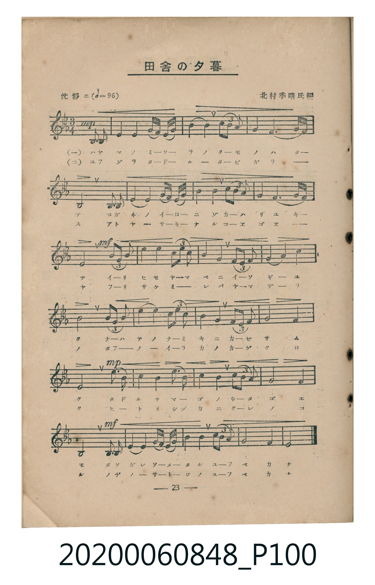
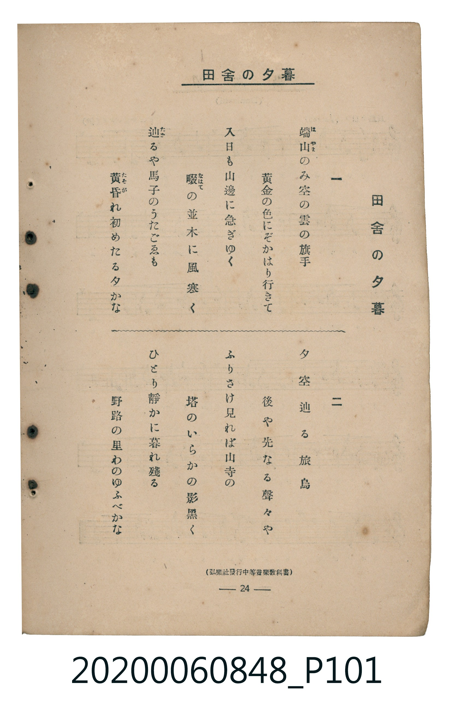

# 田舍の夕暮

<audio controls src="inaka_no_yugure.mp3"></audio>

- 曲：北村季晴
- 臺灣教育會公認《新定兒童唱歌》高等科男子用（2020.006.0848）

## 說明

原書資訊與歌詞全文（對應 P100.jpg – P101.jpg，書頁 pp. 23–24，高二第二學期第 7 首）：
調性與拍號：變ホ長調（E♭ Major，3 降記號）、3/4 拍（沈靜ニ ♩=96，弱起第 3 拍進入）
出處註記：（弘樂社發行中等音樂教科書）

## 歌詞

```text
一
端山のみ空の雲の旗手
黃金の色にぞかはり行きて
入日も山邊に急ぎゆく
畷の並木に風寒く
辿るや馬子のうたごゑも
黃昏れ初めたる夕かな

二
夕空辿る旅鳥
後や先なる聲々や
ふりさけ見れば山寺の
塔のいらかの影黑く
ひとり靜かに暮れ殘る
野路の里わのゆふべかな
```

## ABC

```abc
X:1
T:田舍の夕暮
C:曲：北村季晴
M:3/4
L:1/16
Q:1/4=96
K:Eb
V:V1 name="Piano" snm="Pia"
[V:V1]
!mp! z4 z4 B,,3 B,, | E,4 G,4 A,3 G, | B,4 B,4 B,4/3 C4/3 B,4/3 | G,4 E,6 F,2 |
B,,8 E,3 E, | F,4 F,4 G,3 A, | B,4 G,4 C4/3 D4/3 C4/3 | B,4 G,6 F,2 |
!mf! E,8 B,4/3 A,4/3 G,4/3 | A,4 C4 C4/3 D4/3 E4/3 | B,4 G,4 B,4/3 A,4/3 G,4/3 | F,4 G,4 A,4 |
B,8 B,4/3 A,4/3 G,4/3 | A,4 C4 C4/3 D4/3 E4/3 | B,4 G,4 B,4/3 A,4/3 G,4/3 | G,8 F,4 |
!mp! E,8 E,3 E, | F,4 F,4 G,3 A, | B,4 G,4 C4/3 D4/3 C4/3 | G,8 F,4 |
!mf! B,,8 B,,3 B,, | E,4 G,4 A,3 G, | G,4 F,4 C4/3 D4/3 E4/3 | G,8 F,4 |
E,8 z4 |
```

## TMD 檔案連結

- [主旋律 TMD 檔案](inaka_no_yugure.tmd) [[在 TMD Studio 編輯](https://tmdlang.github.io/Tmd-TS/#tmd=s7IKdvYPcrWy4tLSUng-ZcOLjt7HjeueLpn6bNY6BS0tLkVbBUszLntbBVcdLhtjfRM7rjoFpWezN73fM-tpz_Rncyc-Xbv42cwtSiDhF-27njcufjZ15oumTc_mND9tXfNiVe_jhq5n0zY8XTfraeuk56uXPp2y8dnanscN3S9Xz3i-tvP58onPp2x_unbC8ykr3u_pMDIwMtAzMDDTM7AwsXi_p1OJi0tfS8GWWoBLQUHhad_8Z7N3vNjc_mJF14uOdqBjXqyc97R1xbNp7UAHPN3Q-6y9UyHA0MBAL6sgXeFRw2QQxxDEeb-nB6jz5YJGhYICPQUjY6CckQlQEOiTJ7t6nq9ZAySfrt3xbM58IFvBXOHlsmlALwADCmTti1X7nzUsB1nY3fti5nyg6It1XY-bZ7-cuh0oBbTZ9dHMtQq-iVn5RUAjjRVezux9sWIGWGXn44ZGYMgrAHUC1T3b1PFy7pzHzd0Kj2autLU0A6p-umfji63bQZYagxS9bNj0tHUpUB_Yu-27Xsyc-mLFbqBpQEtBXtwz49mKpudL9j2fuefFwp4nO9YC4-Hl_M1AQWDUASME6EmQZpDuJzsaQNTz1eufbtwITBePG_c_X7kLyHg5exOQfDZ9-rPObpCKl7ubX7ZPBAq96ARKrH7cOO9xY_fjxvWPm7qAdjxuBCaqZWDntC59Nn3p46YmoHkvm7qASp81LH3c2Pe4qe1xYz_YrqnbgcY82bHs2ZwVQOmXi1Y8XT8JKvdi3_7HTd2Pm1peLlsDTDNgBwH1zX_cOOVx00SgqVCnPJvR_7ip52nH3MdNjSDppm5gggY7aBXEW7t6wI5ZMhXoG4ihz6a3vty8FCy6rwdow9PWDqBqoMSLxk2PG1qBIiC5x41bgT563Ag0bOKLZUCXAL22AeiVp-tBgQLWvXAK2Fktj5s6wTaue7p348vdwKAB--Ax0LTGFUAzQHEIkl4NzGdAY56tmwG0C-z89r4X29eDgrgd6I5-kGGgsNn6uHEn1AdARZRnBShQ0NLn4gpLLSpOtQrITMzLd6gxqFGoBlmhYGNopmUHZgGzICSJPd3Q_3x9AygNdfYqGIHS2pM9E5-tXQRMg5ipD2Q0SHeNgoGCLhjC6OrcgloF0_h4MAdE14BjBWQPKBftaAAmGaAlxgow-3pg-RHJWKDix83zgLgPiOcD8R6Fx017wXQNkFwJkWlaD5FpXgQWBantB4ruB4vCHWgIcYqugjGMYQJhAPk1QBdCBeEMDSDLLB7I11TV0AUCTaAquFa4YSBoBOKgem9XD8R7JoS91wZ06mYgXgN2fC_US0ugXloL92w3UHQfEK-GyvSDRVcB8TKgKEQd3LOwgEdAqIuBVA3EwXCXI4UJMESQggLuWw1gOJiDQgMpKDBV4QiKHZ0kBQXM46vA3psEjtXHzTDReWDRmdDggIoCUwRQtGkdVM0yLHEOg9W5abXgmAX61BjZO9C0oAuKchRPG-L1Mzaj0AMVntDQQubp7NnEhgw4hXehRDwwrMApHSY6HxwGoGQAChloImkCJ52mrUDeAuTEgRYqNA4QlBSCkuzQMs0UUsIDnL87wWEB8i0oLYBKCoiPt0CzETBrgMNhP0y0aQXe1AEss6idUYj0_dPWtRDfmxLOJ8AcAfI9NN2vAYoAMbRcfNy8EB4KoBAChQ00FJqnwnIPMH2AWF34CgxwVkEpwAkUoXBBuAexpBg8oYEZH7C6pIarlotL104BXIcpABnKXFwA)]
- [鋼琴伴奏 TMD 檔案](inaka_no_yugure_piano.tmd) [[在 TMD Studio 編輯](https://tmdlang.github.io/Tmd-TS/#tmd=s7IKdvYPcrWy4tLSUng-ZcOLjt7HjeueLpn6bNa693s6XnbveT5hy5M9W54u7X_e2fF-T6eClhaXoq2CpRmXva2Cqw6XjbG-iR1XnYLSs9mb3u-Z9bRn-rO5E5-uXfxs5hYlkPCL9l3PGxc_mzrzRdOmZ3Oan7auebGq93FD17NpG56um_W0ddLz1UufTtn4bG3P44bul6tnPF_b-Xz5xOdTtj9dO-H5lBVANxgZGBnoGRiY6RlYmFgAXaDExRWWWlScahWQmZiXH-ThUGNQo1DNpQAENoZmWnZglr6WwtM9G19s3f50Q__z9Q0KWvpg4RoFAwVdMITR1bkFtQqm8fFgDoiu4YIZ8HzNmic7Gl4s7EHoNoSo01UwhjFMIAwgvwaoHSoIZ2gAWWbxQL6mqoYuEGgCVcG1wg0DQSMQB9XuXT0odsMciYBQA4BUDUQ_3CAkJwIdiOQyuOUaQGeZgxyH5DJMVThctqMTe6jAYHVuWi3Y70DLjZFtgIaWLihQUNxhiNcZ2IxC9yc8KtAc-3T2bLRgRHMsjd2JEpYoEYQW21MIhSkwoVI7xol03NPWtQSSIjjGUbIRgbwCF4TbiCWE8TgPM4BgObqGqxalhPBBKSFMCBcQIIi3FIBGRbxCtGF8LMi3EO9C-SaoXIg0gYwNVAskY8G6UASwGw5RgMN0jMwJVQr0FCSaQGZEAwkMp-KwHV9uQjGdKINxhQl68kdxNaSMJj9QsCRgmGHwYMFqHFgJdvNR3AhKc7p2CuBkpwBkKHNxAQA)]

## 分析

```text
================================================================================
📊 TMD Song Profile: [ 田舍の夕暮 ]
================================================================================
⏱  Duration:       0:46 (46.9s), 25 measures total
🎼 Key & Tempo:    首調基準 E,, != 96.0 BPM, <3/4>
   - 分析範圍：      由實際發聲的音符與和弦推測調性；播放脈絡另行呈現
🎤 人聲音域:    A#2 (MIDI 46) – D#4 (MIDI 63) [跨度: 17 個半音 / 1.4 個八度, 難度: challenging]
   - 最低音:  A#2 in [Verse #1 @ m.1, 0:01]
   - 最高音: D#4 in [Verse #1 @ m.10, 0:18]
   - 適合: tenor, baritone, bass
🏛  結構:      Verse (46.9s)
⚡ 編曲密度:        Peak 1 軌道同時演奏
🗝  調性診斷：       D# 大調（純淨自然大調，未偵測到可信轉調）
   - 風格氣質:    純淨自然大調（陽光明朗、易唱易記，無明顯調外色彩）
   - 轉調歷程:    全曲維持單一推測調性（未偵測到可信轉調）
   - 核心骨幹音:  G, A#, D#, F, G#
   - 調性數值:    D# 大調 [相關度: 0.83, 穩定度: Moderate, 自然音純度: 100.0%]
   - 候選調性 (K-S): D# 大調 (0.83), G 小調 (0.78), A# 大調 (0.68)
   - 五度圈歷程:   -3
   - 各段落調性細節:
     • [Verse #1]: D# 大調 (r: 0.83, 自然音純度: 100.0%)

  [ 五度圈游移軌跡 ]
               C  
         F            G  
      Bb               D  
     [Eb]*              A  
         Ab           E  
            Db       B  
               F# 
     (* = active key center)

  [ 十二半音累積音高分佈 ]
     C  : ██████                     6.5%
     C# :                            0.0%
     D  : ██                         2.3%
     D# : ███████████████           17.4%
     E  :                            0.0%
     F  : ████████████              13.9%
     F# :                            0.0%
     G  : ████████████████████████  27.5%
     G# : ████████                   8.8%
     A  :                            0.0%
     A# : █████████████████████     23.6%
     B  :                            0.0%
--------------------------------------------------------------------------------
Assignment 軌道音域：
  - Piano         : A#2 – D#4 (17 個半音 / 1.4 個八度, 91 個音符)
================================================================================
```


## 原書掃描頁






