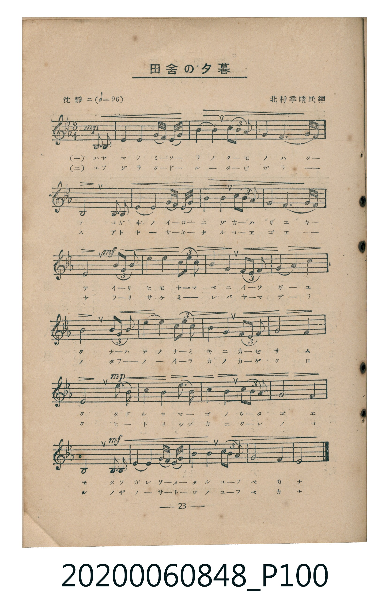
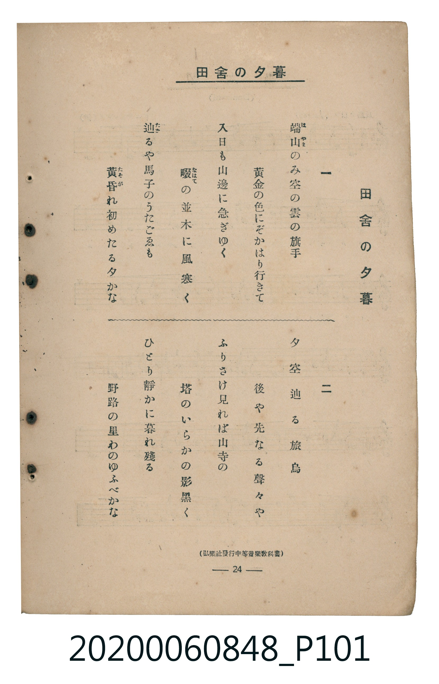

# 田舍の夕暮

> Re:Shōka 使用 AI 協助辨識與重建樂譜，可能會有錯誤。歡迎回報。

- **鋼琴伴奏版**：<br><audio controls src="inaka_no_yugure.mp3"></audio>

- 曲：北村季晴
- 臺灣教育會公認《新定兒童唱歌》高等科男子用（2020.006.0848）

## 說明

原書資訊與歌詞全文（對應 P100.jpg – P101.jpg，書頁 pp. 23–24，高二第二學期第 7 首）：
調性與拍號：變ホ長調（E♭ Major，3 降記號）、3/4 拍（沈靜ニ ♩=96，弱起第 3 拍進入）
出處註記：（弘樂社發行中等音樂教科書）


## 歌詞

```text
一
端山のみ空の雲の旗手
黃金の色にぞかはり行きて
入日も山邊に急ぎゆく
畷の並木に風寒く
辿るや馬子のうたごゑも
黃昏れ初めたる夕かな

二
夕空辿る旅鳥
後や先なる聲々や
ふりさけ見れば山寺の
塔のいらかの影黑く
ひとり靜かに暮れ殘る
野路の里わのゆふべかな
```

## ABC

```abc
X:1
T:田舍の夕暮
C:曲：北村季晴
M:3/4
L:1/16
Q:1/4=96
K:Eb
V:V1 name="Piano" snm="Pia"
[V:V1]
!mp! z4 z4 B,3 B, | E4 E4 G F E G | B4 B4 c4/3 B4/3 A4/3 | G4 F6 G E |
B,8 B,3 B, | E4 E4 G F E G | B4 B4 c4/3 B4/3 A4/3 | G4 F6 G F |
!mf! E8 B4/3 G4/3 B4/3 | e4 e4 c4/3 e4/3 c4/3 | B4 G4 F4/3 E4/3 F4/3 | G4 A4 c4 |
B8 B4/3 G4/3 B4/3 | e4 e4 c4/3 e4/3 c4/3 | B4 G4 F4/3 E4/3 F4/3 | G8 F4 |
!mp! E8 e3 B | c4 B4 e3 B | c4 B4 c4/3 B4/3 A4/3 | G8 F4 |
!mf! B,8 B,3 B, | E4 E4 G F E G | B4 B4 c4/3 B4/3 A4/3 | G8 F4 |
E8 z4 |
```

## TMD 檔案連結

- [主旋律 TMD 檔案](inaka_no_yugure.tmd) [[在 TMD Studio 編輯](https://tmdlang.github.io/Tmd-TS/#tmd=s7IKdvYPcrWy4qpTUCpJTLdSSM7PyUlNLsnMz7MqzsjMK0nNjM_KTMmPL87Iz05Ugisry88pzU21ys4vyY9Pyq8sjjcyMDKINzAwizewMLFAqCvOLy1KTrUqTs7Iz8-JL0mtKEnKz89GyBcU5Zel5iXmAdUUFIGsSwErQihILctMSQVJp6ZkluQXZSbmIDkitagY7FCwJfElRYl5xclFmQUg1yNUlWSkAl2al1hSWpSKEAUalZ6ZZ1WSmAn0Gch35YnxuYmZeTmJeSlKXFpaCs-nbHjR0fu4cd3TJVOfzVqnoKXFpWirYGnGZW-r4KrDZWOsb2IHMu3Z7E3v98x62jP92dyJT9cufjZzC9iSF-27njcufjZ15oumTc_mND9tXfNiVe_jhq5n0zY8XTfraeuk56uXPp2y8dnanscN3S9Xz3i-tvP58onPp2x_unbC8ykr3u_pAIWoHjBE9UAh-n5PpxIXl76Wgi21AJeCgsLTvvnPZu94sbn9xYquFx3tQMe8WDnvaeuKZ9PagQ54uqH3WXunQoChgYFeVkG6wqOGySCOIYjzfk8PUOfLBY0KBQV6CkbGQDkjE6Ag0CdPdvU8X7MGSD5du-PZnPlAtoK5wstl04BeAAYUyNoXq_Y_a1gOsrC798XM-UDRF-u6HjfPfjl1O1AKaLPro5lrFXwTs_KLgEYaK7yc2ftixQywys7HDY3AkFcA6gSqe7ap4-XcOY-buxUezVxpa2kGVP10z8YXW7eDLDUGKXrZsOlp61KgPrB323e9mDn1xYrdQNOAloK8uGfGsxVNz5fsez5zz4uFPU92rAXGw8v5m4GCwKgDRgjQkyDNIN1PdjSAqOer1z_duBGYLh437n--cheQ8XL2JiD5bPr0Z53dIBUvdze_bJ8IFHrRCZRY_bhx3uPG7seN6x83dQHteNwITFTLwM5pXfps-tLHTU1A8142dQGVPmtY-rix73FT2-PGfrBdU7cDjXmyY9mzOSuA0i8XrXi6fhJU7sW-_Y-buh83tbxctgaYZsAOAuqb_7hxyuOmiUBToU55NqP_cVPP0465j5saQdJN3cAEDXbQKoi3dvWAHbNkKtA3EEOfTW99uXkpWHRfD9CGp60dQNVAiReNmx43tAJFQHKPG7cCffS4EWjYxBfLgC4Bem0D0CtP14MCBax74RSws1oeN3WCbVz3dO_Gl7uBQQP2wWOgaY0rgGaA4hAkvRqYz4DGPFs3A2gX2PntfS-2rwcFcTvQHf0gw0Bhs_Vx406oD4CKKM8KUKCgpc_FFQYsU1KtAjIT8_IdanQNa6pBVijYGJpp2YFZwCwISWJPN_Q_X98ASkOdvQpGoLT2ZM_EZ2sXAdMgZuoDGQ3SXaNgoKALhjC6OregVsE0HswGUjXgOAHZAspDOxqACQZohbECzLYeWG5EMhSo-HHzPCDuA-L5QLxH4XHTXjBdAyRXQmSa1kNkmheBRUFq-4Gi-8GicOcZQp0Fo42BXjMEkjUKplARGK1hBmSaaKpq6AKBJlCBMVTCCEpDtBuieWlXD8RLJoS91AZ03mYgXgN2cC_UG0ug3lgL92A3UHQfEK-GyvSDRVcB8TKgKEQd3IPQoEZApLCnvu-N0CO0kyTfw_y6CuyjSeDIe9wME50HFp0JDQGoKDDigaJN66BqlmFGLQxW56bVKmiYAl1piuQPwzhYGMAYQK8C2WZIamCBAPOzBiiUjLAEhgmUNoPSKIHxdPZsYgMDnHa7UKIXGDzgNAwTnQ_2NiiyQYEBTQpN4ATStBXIW4CUBNACgrZhAIOwhIGWHaaQEgbg3NoJ9j_Ih6AoB-V7iC-3QDMIMNGD_b4fJtq0Al8iABY_UG-aAuVhMQXzHh4pnFkAr4-ftq6F-NiUcBYAJnaQj6FJeg1QBIihJdvj5oVwn4NCBRQeUJ83T4VlDGA6ALG68GR_cC6gchmAEQAYwQ4r_Wu4arm4dO0UwLWOApChzAUA)]
- [鋼琴伴奏 TMD 檔案](inaka_no_yugure_piano.tmd) [[在 TMD Studio 編輯](https://tmdlang.github.io/Tmd-TS/#tmd=s7IKdvYPcrWy4tLSUng-ZcOLjt7HjeueLpn6bNa693s6XnbveT5hy5M9W54u7X_e2fF-T6eClhaXoq2CpRmXva2Cqw6XjbG-iR1XnYLSs9mb3u-Z9bRn-rO5E5-uXfxs5hYlkPCL9l3PGxc_mzrzRdOmZ3Oan7auebGq93FD17NpG56um_W0ddLz1UufTtn4bG3P44bul6tnPF_b-Xz5xOdTtj9dO-H5lBVANxgZGBnoGRiY6RlYmFgAXaDExRWWWlScahWQmZiXH-ThUKNrWFPNpQAENoZmWnZglr6WwtM9G19s3f50Q__z9Q0KWvpg4RoFAwVdMITR1bkFtQqm8WA2kKrhgml_vmbNkx0NLxb2IPSaxmsbQrUhMY0VjBQMgWSNgqG2KVQMwdIwUzBVMNFU1dAFAk2wImOolHm8thGUCTHHEM36XT1o1kNVGsVrw9lITqe5-4zQg6eTiOCpzk2rVdAwBWo3RbLFWNswDmYuggl0DJBthuIahJNh7tIA-ccIq5MNtU3gLDMoC8XNT2fPRnEzyI9wK1A49HIyDCKFNloqmEJUKAOTMdRRpmDzYd5Hcg5-aTwpgZAbn7auJZxSwQmBhskVBoFmIbsTbDaGIlj2r-GqRSlOfCgsThDm4ilHqkFxBQoI03gQaYxggkUhzsauwARNAcTDIJYRQhGmAzBKEiw64E6ngtuQiieCbkMrRZDMhtsITt0Y7oOpALPQAwbJBAgTyXqEwXBdJtgdh15cEBdw5DsMrAMcpGixiyVKUYsFrMGGEmpgh4DlsKnFIY8ULsg6wE7E4zrMAgFLuGGPVbRERXKqwxl6qN7GiDxQQaBrpwAuCxSADGUuAA)]

## 分析

```text
================================================================================
📊 TMD Song Profile: [ 田舍の夕暮 ]
================================================================================
⏱  Duration:       0:45 (45.0s), 24 measures total
🎼 Key & Tempo:    首調基準 E,, != 96.0 BPM, <3/4>
   - 分析範圍：      由實際發聲的音符與和弦推測調性；播放脈絡另行呈現
🎤 人聲音域:    A#3 (MIDI 58) – D#5 (MIDI 75) [跨度: 17 個半音 / 1.4 個八度, 難度: challenging]
   - 最低音:  A#3 in [Verse #1 @ m.1, 0:01]
   - 最高音: D#5 in [Verse #1 @ m.10, 0:16]
   - 適合: soprano, mezzo-soprano, contralto, tenor, baritone, bass
🏛  結構:      Verse (45.0s)
⚡ 編曲密度:        Peak 1 軌道同時演奏
🗝  調性診斷：       D# 大調（純淨自然大調，未偵測到可信轉調）
   - 風格氣質:    純淨自然大調（陽光明朗、易唱易記，無明顯調外色彩）
   - 轉調歷程:    全曲維持單一推測調性（未偵測到可信轉調）
   - 核心骨幹音:  A#, D#, G, F, C
   - 調性數值:    D# 大調 [相關度: 0.92, 穩定度: High, 自然音純度: 100.0%]
   - 候選調性 (K-S): D# 大調 (0.92), A# 大調 (0.75), G 小調 (0.66)
   - 五度圈歷程:   -3
   - 各段落調性細節:
     • [Verse #1]: D# 大調 (r: 0.90, 自然音純度: 100.0%)

  [ 五度圈游移軌跡 ]
               C  
         F            G  
      Bb               D  
     [Eb]*              A  
         Ab           E  
            Db       B  
               F# 
     (* = active key center)

  [ 十二半音累積音高分佈 ]
     C  : ██████                     7.9%
     C# :                            0.0%
     D  :                            0.0%
     D# : █████████████████████     27.5%
     E  :                            0.0%
     F  : █████████                 11.6%
     F# :                            0.0%
     G  : ███████████████           19.0%
     G# : ███                        3.2%
     A  :                            0.0%
     A# : ████████████████████████  30.8%
     B  :                            0.0%
--------------------------------------------------------------------------------
Assignment 軌道音域：
  - Piano         : A#3 – D#5 (17 個半音 / 1.4 個八度, 99 個音符)
================================================================================
```


## 原書掃描頁






