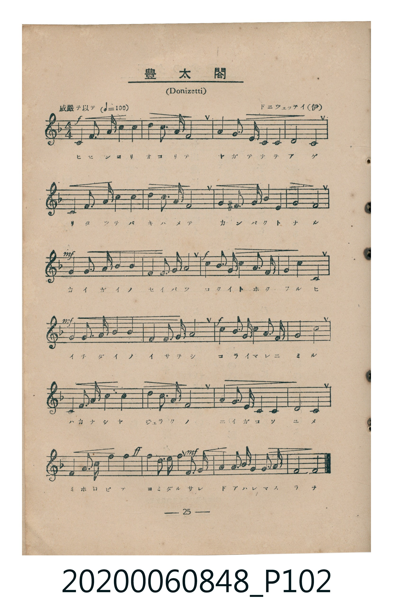
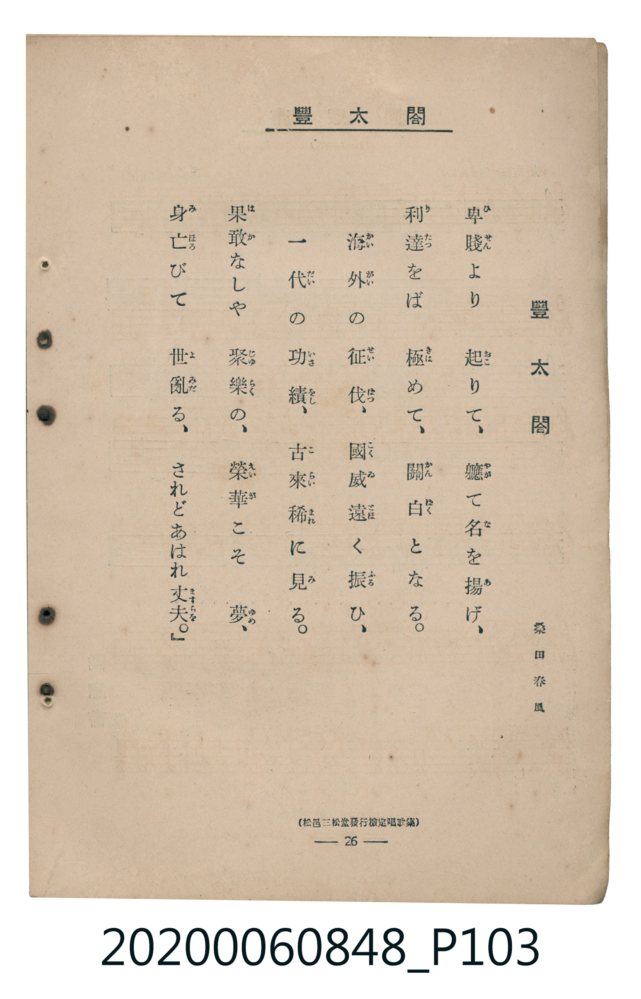

# 豐太閤

> Re:Shoka 使用 AI 協助辨識與重建樂譜，可能會有錯誤。歡迎回報。

<audio controls src="ho_taiko.mp3"></audio>

- 詞：桑田春風
- 曲：ドニツェッチイ（伊）（Gaetano Donizetti）
- 臺灣教育會公認《新定兒童唱歌》高等科男子用（2020.006.0848）

## 說明

原書資訊與歌詞全文（對應 P102.jpg – P103.jpg，書頁 pp. 25–26，高二第二學期第 8 首）：
調性與拍號：ヘ長調（F Major，1 降記號）、4/4 拍（威嚴ヲ以テ ♩=100）
出處註記：（松邑三松堂發行檢定唱歌集）

## 跨冊／重複收錄參照

> 同名異曲（各冊收錄之不同詞曲版本）

- **[同名異曲]** 《新定兒童唱歌》高等科女子用（2020.006.0849）：[**〈豐太閤〉**](../../koto_girls_2020.006.0849/2_3_03_ho_taiko/index.md)（`C` / `6/8` — [原始 TMD](../../koto_girls_2020.006.0849/2_3_03_ho_taiko/ho_taiko.tmd)）
- 總表：[跨冊重複與同名歌曲總索引](../../../duplicate_songs.md)

## 歌詞

```text
一
卑賤より起りて、軈て名を揚げ、
利達をば極めて、關白となる。
海外の征伐、國威遠く振ひ、
一代の功績、古來稀に見る。
果敢なしや聚樂の、榮華こそ夢、
身亡びて世亂る、されどあはれ丈夫。
```

## ABC

```abc
X:1
T:豐太閤
C:曲：ドニツェッチイ（伊）（Gaetano Donizetti）
M:4/4
L:1/16
Q:1/4=100
K:F
V:V1 name="Piano" snm="Pia"
[V:V1]
!f! C3 F A3 F c8 | d3 B G3 c A8 | G3 A B3 E, F4 A4 | A8 G8 |
C3 F A3 F c8 | d3 B G3 c A8 | G4 ^F3 G d3 c E,4 | G8 F8 |
!mf! G3 G c3 G B4 A4 | G6 F2 E,3 F G4 | !f! A3 A d3 c B3 A G4 | F6 A2 C8 |
!mf! G3 G c3 G B4 A4 | G6 F2 E,3 F G4 | !f! A3 d c3 B A3 G F4 | G8 c8 |
C3 F A3 F c8 | d3 B G3 c A8 | G3 A B3 E, F4 A4 | A8 G8 |
!ff! C3 F A3 F c4 f4 | !mf! e3 d c3 B A4 d3 c | B4 A3 F G3 A G4 | F8 F8 |
```

## TMD 檔案連結

- [主旋律 TMD 檔案](ho_taiko.tmd) [[在 TMD Studio 編輯](https://tmdlang.github.io/Tmd-TS/#tmd=s7IKdvYPcrWy4qpTUCpJTLdSSM7PyUlNLsnMz7MqzsjMK0nNjM_KTMmPL87Iz05Ugisry88pzU21ys4vyY9Pyq8sjjcyMDKINzAwizewMLFAqCvOLy1KTrUqTs7Iz8-JL0mtKEnKz89GyBcU5Zel5iXmAdUUFIGsSwErQihILctMSQVJp6ZkluQXZSbmIDkitagY7FCwJfElRYl5xclFmQUg1yNUlWSkAl2alp-TnZNflKrEpaWl8GLjhKdLVr2ctkRBS4tL0VbB0MCAy95WwY3LxkTfxA6k88XKee_3zHq2cOLzKRuezVj6ctEKsIHPZm8CCj9u7nzc3P24ueVx0_LHzc2PmxsfNy15v6fjyZ6u93s6gQz3xNSSxLx8BZf8vMyq1JKSTKAwWP-L9l3PGxc_mzrzRdOmZ3Oan7auebGq93FD17NpG56um_W0ddLz1UufTtn4bG3P44bul6tnPF_b-Xw50A3bn66d8HzKCqDRoHDWA4azHiicwcZy6Wsp2FILcCkoKDztm_9s9o4Xm9tfrOh60dEOdAwwNJ62rng2rR3ogKcbep-1dyoEGBoY6WUVpCs8apgM4hiDOO_39AB1vlzQqFBQoKdgZAqUMzIDCgJ98mRXz_M1a4Dk07U7ns2ZD2QrWCi8XDYNHGCzQNa-WLX_WcNykIXdvS9mzgeH84yXU7cDxYHWuin4JmblFwENM1R4ObP3xYoZYDWdjxsagXGmANQDctuKxqeztjxu3vRk99LHzW0Kj2autAXGLVAZ2F_tu17MnPpixW6gZqDpQPXP5u572TTxyY5OIOPpgqbnM_e8WNjzbNUiUFyAY-Hl7DaQZpDuJzsawIb0Tnyxecnjpo7HTV0vtm4Hko8blwEd8WJ3B5DxdELv46ZJz_pnPW6cBBQEa-hY-bJxClD0ceOGZ0u3Pm5qhGh4OX3O85l7HzeueNy46nFT9-OGJpDqZ1u3P10y7XHjuqf7Gp_smQBU93RON9BbLxsXPG7sf9az_nHjJqjBQAc92b0YpLRr_vMd-0BK-5c82df2fEXD48bVL5Z1I5k6b86zqYtAFjVOf9zU8qJx1rMVTUCdQD3Plq170Q80dfLjxrlPlyyCmv1i1-onuxY-btwMdOuTHdOe7GoCGwZ0-tTHTT2PG1c-bgTqXw9kP9nR8XTJaqg9lKc_KFDQ0ufiCgNm71SrgExgTnKoMahRqAZZoWBjaKZlB2YB0z0oSe1oAEYaMDJNFJ5u6H--vgGYRGCJExh3IJOgih83T1J43LQbSG8G4hVAvEqhBiiyCohBIkAamGaAIs1LgCJrwLzHzV1AvAmsbhEQb4KZB3ROWq2CabyCLhAaKhhDaVMwjYA1CmZg2kTBCEybQlUiq4DIGAPVgGjz-HigORA5mNoaDF0QPUimgNMoLEh29RAdJCDP7wfSLWBvPm6eAPbqWiCrH4gXwoKkaTU02CYC2euBdAc4oECBsxoRJFQMDqBudahPIVpMwSGDrggGYSGGPTx2dBIbHiB_NkGjH0Q394F9D0w0YN4EcEiBRIBhAQoHsGgHEM8G80FhMhUcJqDEhkgqucC0AnGyETRMjKDRjRzJyJ4CeQjmYUO4DCTVQXQYwwMGYpIxkirk4ACphkYMjvB5Ons20eED8m8jEDeghA8oxLZCUlDTdlj4NK-EqpkHxKDs1A0On_moaYYmYWMGNckEyjeChwhm0sFIo6hZaQrRWQmYYcDZBJgpgIEAKkVAAbHjcfNSaFiA8g0kvICFDzyVgVLSXnDILAPnOFrkJioWLk9b1xIdIqCoBmaMZlBxMhleuoJKXpAMMAmBMgo44awBy3RCSllw0QNKMMCE07QTLAMMPmDiIhw01WnANGAYB_eaOZhGTw5AdaBUB8s_NWjpDZamcOUoiBr0MKrl4tK1UwBXWgpAhjIXFwA)]
- [鋼琴伴奏 TMD 檔案](ho_taiko_piano.tmd) [[在 TMD Studio 編輯](https://tmdlang.github.io/Tmd-TS/#tmd=s7IKdvYPcrWy4tLSUnixccLTJateTlvyfk_Hy-49zydsebJny9Ol_c87O97v6VTQ0uJStFUwNDDgsrdVcOOyMdE3seOqU1B6sXLe-z2zni2c-HzKhmczlr5ctEIJJPxs9iag8OPmzsfN3Y-bWx43LX_c3Py4ufFxE8j8J3u6gGYCGe6JqSWJefkKLvl5mVWpJSWZQGGw_hftu543Ln42deaLpk3P5jQ_bV3zYlXv44auZ9M2PF0362nrpOerlz6dsvHZ2p7HDd0vV894vrbz-XKgG7Y_XTvh-ZQVQKONDIwM9AwMzPQMLEwswMZyhaUWFadaBWQCbQzycKgxqFGo5lIAAhtDMy07MEtfS-H5mjVPdjS8WNijoKUPFgOqSqtVMI1X0AVCQwVjKG0KphGwRsEMTJsoGIFpU6hKZBUQGWOgGhBtHh8PNAciB1Nbg6ELogfJFC5kl-7qQXEpFV0J1K0OdQBEiynYweiKYBDmEezO3NGJGqC5wBCFmGAEdaIRNFCQgwLZDpD5MPsN4TKQuIHoMIa7E2KSMZIqZNeBVEPDCYdzn86eTXvnmkFNMoHyjeCOxAxcjFhETQNTaJUGqJhSn7auJc6V1WnAIDKMg9tiDqbRQwuoDhQpsBivQYsOWJDjSgMQNejOrUUpInxQiggTgiWEYbxCtGGsgjGEAroIyDCJj4WJA8MUyDCKz0USMQWGK4gFpk2BavFmbuItQJiHYMJUEcyXGDoQIkjmgnxsBuKagSyE2wx3JXYvYc1Z5FgI8ztWtfhyB9VjCT1ho1sATs9wrQgfQD0Psh_FbJgBQAqaJnXtFMDJUgHIUObiAgA)]

## 分析

```text
================================================================================
📊 TMD Song Profile: [ 豐太閤 ]
================================================================================
⏱  Duration:       0:57 (57.6s), 24 measures total
🎼 Key & Tempo:    首調基準 F, != 100.0 BPM, <4/4>
   - 分析範圍：      由實際發聲的音符與和弦推測調性；播放脈絡另行呈現
🎤 人聲音域:    E3 (MIDI 52) – F5 (MIDI 77) [跨度: 25 個半音 / 2.1 個八度, 難度: difficult]
   - 最低音:  E3 in [Verse #1 @ m.3, 0:05]
   - 最高音: F5 in [Verse #1 @ m.21, 0:49]
   - 適合: contralto, bass
🏛  結構:      Verse (57.6s)
⚡ 編曲密度:        Peak 1 軌道同時演奏
🗝  調性診斷：       C 調性不明確（流行色彩大調，未偵測到可信轉調）
   - 風格氣質:    流行大調（略帶和弦色彩音與裝飾副屬和弦）
   - 轉調歷程:    全曲維持單一推測調性（未偵測到可信轉調）
   - 核心骨幹音:  G, A, C, F, A#
   - 調性數值:    C 調性不明確 [相關度: 0.75, 穩定度: Ambiguous, 自然音純度: 92.4%]
   - 候選調性 (K-S): C 大調 (0.75), F 大調 (0.72), A 小調 (0.66)
   - 五度圈歷程:   +0
   - 各段落調性細節:
     • [Verse #1]: C 調性不明確 (r: 0.75, 自然音純度: 92.4%, 調外音: F#, A#)

  [ 五度圈游移軌跡 ]
              [C ]*
         F            G  
      Bb               D  
      Eb               A  
         Ab           E  
            Db       B  
               F# 
     (* = active key center)

  [ 十二半音累積音高分佈 ]
     C  : ███████████████████       19.3%
     C# :                            0.0%
     D  : █████                      5.2%
     D# :                            0.0%
     E  : ████                       3.9%
     F  : ████████████████          15.9%
     F# : █                          0.8%
     G  : ████████████████████████  24.5%
     G# :                            0.0%
     A  : ███████████████████████   23.7%
     A# : ███████                    6.8%
     B  :                            0.0%
--------------------------------------------------------------------------------
Assignment 軌道音域：
  - Piano         : E3 – F5 (25 個半音 / 2.1 個八度, 116 個音符)
================================================================================
```


## 原書掃描頁






