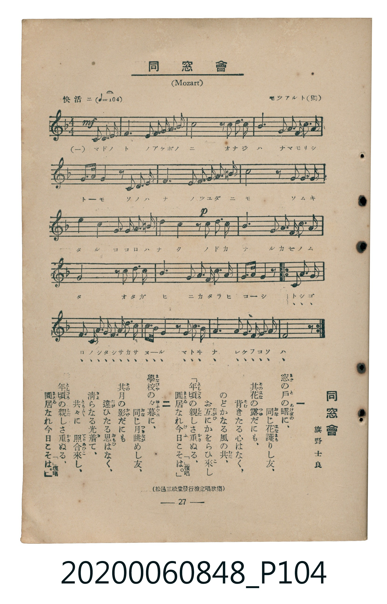

# 同窓會

> Re:Shōka 使用 AI 協助辨識與重建樂譜，可能會有錯誤。歡迎回報。

- **鋼琴伴奏版**：<br><audio controls src="dosokai.mp3"></audio>

- 詞：旗野士良
- 曲：モツアルト（獨）（Wolfgang Amadeus Mozart）
- 臺灣教育會公認《新定兒童唱歌》高等科男子用（2020.006.0848）

## 說明

原書資訊與歌詞全文（對應 P104.jpg，書頁 p. 27，高二第二學期第 9 首）：
調性與拍號：ヘ長調（F Major，1 降記號）、4/4 拍（快活ニ ♩=104，弱起 1 拍半進入）
出處註記：（松邑三松堂發行檢定唱歌集）


## 歌詞

```text
一
窓（まど）の戶（と）の曙（あけぼの）に、同（おな）じ花（はな）護（まも）りし友（とも）、
其花（そのはな）の露（つゆ）だにも、背（そむ）きたる心（こころ）はなく、
のどかなる風（かぜ）の共（むた）、お互（たがひ）にかをらひ來（こ）し
「年頃（としごろ）の親（した）しさ重（かさ）ぬる、圓居（まとゐ）なれ今日（けふ）こそは。」復唱
（註：五線譜下第一段第 11 小節印作「ニカタラヒ」，下方歌詞欄印作「にかをらひ」。）

二
學校（まなびや）の夕暮（ゆふぐれ）に、同じ月（つき）眺（なが）めし友、
其月（そのつき）の影（かげ）だにも　違（たが）ひたる思（おもひ）はなく、
清（きよ）らなる光（ひかり）着（き）て、共々（ともども）に照合（てりあひ）來（こ）し、
「年頃の親しさ重ぬる、圓居なれ今日こそは。」復唱
```

## ABC

<div class="abc-score" data-abc-src="dosokai.abc" aria-label="五線譜載入中"></div>

[下載 ABC 原始檔](dosokai.abc)

## TMD 檔案連結

- [主旋律 TMD 檔案](dosokai.tmd) [[在 TMD Studio 編輯](https://tmdlang.github.io/Tmd-TS/#tmd=s7IKdvYPcrWy4qpTUCpJTLdSSM7PyUlNLsnMz7MqzsjMK0nNjM_KTMmPL87Iz05Ugisry88pzU21ys4vyY9Pyq8sjjcyMDKINzAwizewMLFAqCvOLy1KTrUqTs7Iz8-JL0mtKEnKz89Gl48vSExPtQowNDBByBQU5Zel5iXmAXUXFIEckgLWjlCQWpaZkgqSLk5OzIsvSy3KTMtMTUFyYmpRMdgbECtKihLzipOLMgtAfkOoyi8qychPL0osyKi0ysgsLskvykxOzInPTsxD8m1JRirQs1BP5GSmpaJLpRVlpualAAOsANnkzPTMPKvc1MysTCw-h0qXpxaXpBblxeem5uSnVCpxaWkpPJ3Q83zV5GdzmhW0tLgUbRWAwcJlb6vgxmVjom9iBzLgxcp57_fMejZ9-sv2vqeLV7_oXA8299nsTUDhx82LHje3PG4CkqsfN3e839PxvHfF-z2dQEZ4fk5aemJeuoJjbmJKammxgm9-VWJRCVASrP9F-67njYufTZ35omkT0PqnrWterOp93ND1bNqGp-tmPW2d9Hz10qdTNj5b2_O4ofvl6hnP13Y-Xz7x-ZTtT9dOeD4FaEcHKBXoAVOBHigVgI3l0tdSsKUW4FJQUHjaN__Z7B0vNre_WNH1oqMd6BhgaDxtXfFsWjvQAU839D5r71QAJSW9rIL093t6gIpfLmhUKNBTMDIHcoHOfrKr5_maNUDy6dodz-bMB7IVLBVeLpsGDqNZIDterNr_rGE5yPTu3hcz54MDdcbLqduB4kA73BR8E7Pyi4CGGSq8nNn7YsUMsJrOxw2NwAhSAOoBOWT_6mdbdj9u7lZ4NHOlLdA5QOVP92x8sXW7giFIydPerpcNm562LgVqBHurfdeLmVNfrNgNNA5oH9CEZ3P3vWya-GRHJ5DxdEHT85l7XizsebZqESgqwJHwcnYbSDNI95MdDSAKmGyAGh837nvcuBLkoMZ1zzq2gUVACQDEnT0TzG163DjxceMeoAhYfDXQ6cBUB5bqety4Ciw440XXRrDIeojIi7XboYY3NYEUNAFVTn_a3w0xHyrY0Aj2TOs2mOa5QDvgRgDZL-cA0yhQfMnjJpDrHzcuAFnf1ATU-aIZ4oK5j5sawFK9jxvnP27qfrq_GSw-GYSagIELlAIZ-LixH2of2I6Vjxu7QaJN3S8XgdIimDsHYuvTVrBrmhqAJkKcCfTok12TwMrmP27sedwIdBY4JIC6miY9bgKyNz3ZB3QiyGKw1HSwTQ09T3duebkA4qIVQNHHjVNgjlr3YhnQl0BxoCDYGhBj6st2UHoAu2YqWHAN0ImgAJ8z-enGVlh8AQNwAlgW6IGeJ7u7nk0HpgygFDCatoLFgb4HhuX6xw3AoOp9um8lMA2AHARUBEw0wBTzZNeU59tnvVg758mOblDy3tHwbN1WUNo2NFR4uqH_-fqGp70bnuydA_QBMFU-bgIG-v7HzSsfN08CmgdMnEBtz6bthGSnZ2taEIpRwwSoGOgEeLrb1QOOb2BGWrAQ5hVgxGx-3NQCDfklU5_NAqYyYOC3Ab3yuHEC0H_IiQ6Y0J7NAZVSoDTRCArI53N2gblAc8Aqm4CRBUpoiMQF0wBJXFBtIMv2QhIdMKiBUYucuBpeggIfGtlgqU2QxPWsYS402QOVQRMBauJ6tgMSSb2Pm4C2Ap0DiaTup62gIhVsEDB4ukAOnwtMtyCVYFOWgfzXuvFxA0Q7KIeAEikknzSuft66_OkEiDeWgfMS1Hq0RAdL4bB0B0ll8JSFlpqQkw_OJEN5OQwFClr6XFwu-cXAlkGmVUBmYl6-Q42uYU01yBIFG0MzLTswC1sNoABJosASTUEDVizqmYIKRgVtBWNogtWBl-OaWEwAWg4yvUbBQEEXDJHp6ty0WgXTeCDLDEToKpjHA1UaQlVABXTBAkZAbAwWMgEqMUVSAjMMJGYG5pkCVZggySL0GkJ1GivUgJ3lY1ijALFZF4V-3DwPTHaCRR439wFNBNbSSGaCxIBk0yIwuREsMgdFdTeaG8HmNq0Cq-iCqGzaAVbZj2IuSA5iP4heBMQgPSDV22GuNsLvaqjpzZPBpi_BdHXzMjA5FWzqBqjMGhJd3YJsbtNaFBVrgOyFSK7Gn8J29YBTGIkJChSroJiE0NA0QFRaAqUIaFpSx5GYQIZCDDZCSiqwJPC4eQ84apCDaC88eEF0PziIIMGBGvSQYANFwePmBii7G6waZh5q0EPMXQANzLVISYB417SAzAdHEZprmlZDzd1EpGv2g8k1UJWTCEbtjk5yotYcaicsZmAxgRRpkJyOUAIuTgqApQmQJqcUgHgN4i1IoIA8uhlOP26GBB961D5uWo8cQNBIhpYbwODFTAYg0xEBD4o6WDQtQI5crO6BlgTgUmESMe6B5ssVULUrcbkHZhrQXYjyBpTY8Ebv09mzyc-5CEhG6Y0790OUouRaeFDCIFKhBpUDpWlQ0ECCARY0oMIQEVX7wQEIkQGmfETyAOU_YDGHnAxAORMm9rhpC0qubcPmGogOaK4DJSD0PAh1DVQ3KJIglQ95riFQIE8BR6sJNFqBlT2kXQKMF5IiGlTYokQKpPQ1RoppSIyaoMQjiA1JAaCYhuiFQBAbotIQngJQC3lCaQGcjWGlHyxEgDELZ29FivGt4FjoQYQrPCsiV7ewUngDlswFKikhzQMQbypSkbIXo-onLvUMTfcPfIJApodWekCmh1ZKQHV5LReXrp0CtCcS7WMYq4DMNQJzlbkA)]
- [鋼琴伴奏 TMD 檔案](dosokai_piano.tmd) [[在 TMD Studio 編輯](https://tmdlang.github.io/Tmd-TS/#tmd=s7IKdvYPcrWy4qpTUCpJTLdSSM7PyUlNLsnMz7MqzsjMK0nNjM_KTMmPL87Iz05Ugisry88pzU21ys4vyY9Pyq8sjjcyMDKINzAwizewMLFAqCvOLy1KTrUqTs7Iz8-JL0mtKEnKz89Gl48vSExPtQowNDBByBQU5Zel5iXmAXUXFIEckgLWjlCQWpaZkgqSLk5OzIsvSy3KTMtMTUFyYmpRMdgbECtKihLzipOLMgtAfkOoyi8qychPL0osyKi0ysgsLskvykxOzInPTsxD8m1iEVBzempual6JVUFmYl5-fGJycn5uQWJeJkgMobAkA6gI5tuczLRUdKm0oszUvBRgyBYgOyEzPTPPKjc1MysTSxBBpctTi0tSi_Lic1Nz8lMqlbi0tBSeTuh5vmrysznN7_d0vOze83zClid7tjxd2v-8s-P9nk4FLS0uRVsFYKBy2dsquHHZmOib2IFMfbFy3vs9s55Nn_6yve_p4tUvOteDLXs2exNQ-HHzosfNLY-bgOTqx81Aczqe964AmgZkhOfnpKUDw0HBMTcxJbW0WME3vyqxqAQoCdb_on3X88bFz6bOfNG0Ceimp61rXqzqfdzQ9WzahqfrZj1tnfR89dKnUzY-W9vzuKH75eoZz9d2Pl8-8fmU7U_XTng-BWhHBygN6QHTkB4oDYGN5XLJLwamu0yrAFCoB3k41Oga1lRzKQCBjaGZlh2Ypa-lYIsOFJ6vWfNkR8OLhT0KGk_3bHyxdbuCoZ6pwrPuXgVtBWOFpxv6n69v0FEAJTm9rIJ0TSwmaOmDTa9RMFDQBUNkujo3rVbBNB7IMgMRugrm8UCVhlAVUAFdsIAREBuDhUyASkyRlMAMA4mZgXmmQBUmSLIIvYZQncYKNWBn-RjWKEBs1kWhHzfPA5OdYJHHzX1AE4HxiGQmSAxINi0CkxvBInNQVHejuRFsbtMqsIouiMqmHWCV_SjmguQg9oPoRUAM0gNSvR3maiP8roaa3jwZbPoSTFc3LwOTU8GmboDKrCHR1S3I5jatRVGxBsheiORq_ClsVw84hZGYoECxCopJCA1NA0SlJVCKgKYldRyJCWQoxGAjpKQCSwKPm_eAowY5iPbCgxdE94ODCBIcqEEPCTZQFDxuboCyu8GqYeahBj3E3AXQwFyLlASId00LyHxwFKG5pmk11NxNRLpmP5hcA1U5iWDU7ugkJ2rNoXbCYgYWE0iRBsnpCCXg4qQAWJoAaXJKAYjXIN6CBArIo5vh9ONmSPChR-3jpvXIAQSNZGi5AQxezGQAMh0R8KCog0XTAuTIxeoeaEkALhUmEeMeaL5cAVW7Epd7YKYB3YUob0CJDW_0Pp09m_yci4BklN64cz9EKUquhQclDCIValA5UJoGBQ0kGGBBAyoMEVG1HxyAEBlgykckD1D-AxZzyMkAlDNhYo-btqDk2jZsroHogOY6UAJCz4NQ10B1gyIJUvmQ5xoCBfIUcLSaQKMVWNk_3bcS2OoAxgtJEQ0qbFEiBVL6GiPFNCRGTVDiEcSGpABQTEP0QiCIDVFpCE8BqIU8obQAzsaw0g8WIsCYhbO3IsX4VnAs9CDCFZ4VkatbWCm8AUvmApWUkOYBiDcVqUjZi1H1E5d6hqb7Bz5BINNDKz0g00MrJaC6vBatI-KD0hExgfZDQD0FCATGY7xCtGEsjELmg2SNgDyj-FyEPFS_aTyQbxofC2bgMQYqjU0XmIFuH6h5QdBOXG7DcBUsR6C5DZfjcbmKYmPAIQ2KG107BWj0RPsAxZG5RmCuMhcA)]

## 分析

```text
================================================================================
📊 TMD Song Profile: [ 同窓會 ]
================================================================================
⏱  Duration:       1:32 (92.3s), 40 measures total
🎼 Key & Tempo:    首調基準 F, != 104.0 BPM, <4/4>
   - 分析範圍：      由實際發聲的音符與和弦推測調性；播放脈絡另行呈現
🎤 人聲音域:    C4 (MIDI 60) – E5 (MIDI 76) [跨度: 16 個半音 / 1.3 個八度, 難度: moderate]
   - 最低音:  C4 in [Dosokai[L1] #1 @ m.1, 0:01]
   - 最高音: E5 in [Dosokai[L1] #1 @ m.8, 0:16]
   - 適合: soprano, mezzo-soprano, contralto, tenor, baritone, bass
🏛  結構:      Dosokai[L1] (46.2s) -> Dosokai[L2] (46.2s)
⚡ 編曲密度:        Peak 1 軌道同時演奏
🗝  調性診斷：       C 調性不明確（流行色彩大調，未偵測到可信轉調）
   - 風格氣質:    流行大調（略帶和弦色彩音與裝飾副屬和弦）
   - 轉調歷程:    全曲維持單一推測調性（未偵測到可信轉調）
   - 核心骨幹音:  G, C, A, F, A#
   - 調性數值:    C 調性不明確 [相關度: 0.79, 穩定度: Ambiguous, 自然音純度: 91.0%]
   - 候選調性 (K-S): C 大調 (0.79), F 大調 (0.78), A 小調 (0.61)
   - 五度圈歷程:   +0 -> +0
   - 各段落調性細節:
     • [Dosokai[L1] #1]: C 大調 (r: 0.79, 自然音純度: 90.8%, 調外音: A#)
     • [Dosokai[L2] #1]: C 調性不明確 (r: 0.79, 自然音純度: 91.0%, 調外音: A#)

  [ 五度圈游移軌跡 ]
              [C ]*
         F            G  
      Bb               D  
      Eb               A  
         Ab           E  
            Db       B  
               F# 
     (* = active key center)

  [ 十二半音累積音高分佈 ]
     C  : ██████████████████████    20.7%
     C# :                            0.0%
     D  : █████████                  8.3%
     D# :                            0.0%
     E  : ███                        3.3%
     F  : █████████████████         16.0%
     F# :                            0.0%
     G  : ████████████████████████  23.0%
     G# :                            0.0%
     A  : ████████████████████      19.0%
     A# : █████████                  9.0%
     B  : █                          0.7%
--------------------------------------------------------------------------------
Assignment 軌道音域：
  - Piano         : C4 – E5 (16 個半音 / 1.3 個八度, 226 個音符)
================================================================================
```


## 原書掃描頁




