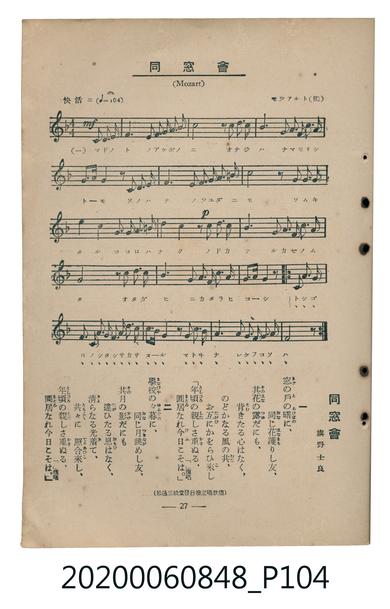

# 同窓會

<audio controls src="dosokai.mp3"></audio>

- 詞：旗野士良
- 曲：モツアルト（獨）（Wolfgang Amadeus Mozart）
- 臺灣教育會公認《新定兒童唱歌》高等科男子用（2020.006.0848）

## 說明

原書資訊與歌詞全文（對應 P104.jpg，書頁 p. 27，高二第二學期第 9 首）：
調性與拍號：ヘ長調（F Major，1 降記號）、4/4 拍（快活ニ ♩=104，弱起後半小節進入）
出處註記：（松邑三松堂發行檢定唱歌集）

## 跨冊／重複收錄參照

> 同名異曲（各冊收錄之不同詞曲版本）

- **[同名異曲]** 楊金土手抄《唱歌帖》第 2 冊・II（2020.006.0843）：[**〈同窓會（二部合唱）〉**](../../../shokacho/vol_02/p088_dosokai/index.md)（`F` / `4/4` — [原始 TMD](../../../shokacho/vol_02/p088_dosokai/dosokai.tmd)）
- 總表：[跨冊重複與同名歌曲總索引](../../../duplicate_songs.md)

## 歌詞

```text
一
窓の戶の曙に、同じ花護りし友、
其花の露だにも、背きたる心はなく、
のどかなる風の共、お互にかをらひ來し
「年頃の親しさ重ねる、圓居なれ今日こそは。」復唱

二
學校の夕暮に、同じ月眺めし友、
其月の影だにも　違ひたる思はなく、
清らなる光着て、共々に照合來し、
「年頃の親しさ重ねる、圓居なれ今日こそは。」復唱
```

## ABC

```abc
X:1
T:同窓會
C:曲：モツアルト（獨）（Wolfgang Amadeus Mozart）
M:4/4
L:1/16
Q:1/4=104
K:F
V:V1 name="Piano" snm="Pia"
[V:V1]
!mf! z4 z4 z2 C2 C2 C2 | F4 F4 G2 A2 B2 G2 | A8 z2 A2 B2 c2 | d4 f4 c2 A2 B2 G2 |
A2 F2 C4 z2 C2 D2 E,2 | F6 G2 A2 B2 c2 d2 | c4 G4 z2 G2 A2 B2 | A4 F4 B2 A2 G2 F2 |
!p! G4 F4 z2 A2 A2 A2 | c4 B4 G2 A2 B2 G2 | F8 z2 G2 G2 G2 | B4 A4 F2 G2 A2 F2 |
!f! A2 G2 G4 z2 c2 c2 c2 | D2 E,2 F2 G2 A2 B2 c2 d2 | c3 B A4 z2 d2 d2 d2 | c4 F4 B2 A2 G2 A2 |
!f! F8 z2 c2 c2 c2 | D2 E,2 F2 G2 A2 B2 c2 d2 | c3 B A4 z2 d2 d2 d2 | c4 F4 B2 A2 G2 A2 |
F8 z4 z4 |
```

## TMD 檔案連結

- [主旋律 TMD 檔案](dosokai.tmd) [[在 TMD Studio 編輯](https://tmdlang.github.io/Tmd-TS/#tmd=s7IKdvYPcrWy4tLSUng6oef5qsnP5jQraGlxKdoqGBqYcNnbKrhx2Zjom9hx1SkovVg57_2eWc-mT3_Z3vd08eoXneuVQMLPZm8CCj9uXvS4ueVxE5Bc_bi54_2ejue9K97v6QQywvNz0tIT89IVHHMTU1JLixV886sSi0qAkmD9L9p3PW9c_GzqzBdNm4DWP21d82JV7-OGrmfTNjxdN-tp66Tnq5c-nbLx2dqexw3dL1fPeL628_nyic-nbH-6dsLzKUA7OowMjAz0DAzM9AwsTCzAxnLpaynYUgtwKSgoPO2b_2z2jheb21-s6HrR0Q50DDA0nraueDatHeiApxt6n7V3KgQAw0wvqyD9_Z4eoOKXCxoVCvQUjMyBXKCzn-zqeb5mDZB8unbHsznzgWwFS4WXy6aBw2gWyI4Xq_Y_a1gOMr2798XM-eBAnfFy6nagONAONwXfxKz8IqBhhgovZ_a-WDEDrKbzcUMjMIIUgHpADtm_-tmW3Y-buxUezVxpC3QOUPnTPRtfbN3-dF_P096upxv6n69veNmw6WnrUqBesM_ad72YOfXFit1AE4FWAg15Nnffy6aJT3Z0AhlPFzQ9n7nnxcKeZ6sWgWIDHA8vZ7eBNIN0P9nRAKKAKedx47pnHdtA5OyZjxtXA50FTFGPG2e86Nr4Yu32x01djxunP-3vBoqDbW3dBpQAqn45Z9PjxgUgDU1NQLkXzUA9vY8b5z9u6n66v_lx4_rHjaseN_ZDtQE1PG5c-bixGyTa1P1y0QqgyNPWjUDpx41dT3ZNAhkElG2a9Lip83Hjpif72oDWgnU29DzdueXlAqCR614sAxo5_XHj1JftQKvWAg0CuXbO5KcbW8Hm9jzZ3fVs-tLHjUBPzQU5oQHotN6n-1YCvQ_x9a4esCeAMblgIcgFS6Y-mwV0GcLXz-Z0PJ-z63ET0FmovgZKgDTsBfod7uuGl41TgY6F-PpZA9hKZF8_29EK9g7Iy09bO5_PbXjcuAxkFcjjQCevft66_OmEDohnYSFFLf8CzaI8C0GBgpY-F1dYalFxqlVAZmJevkONQY1CNcgKBRtDMy07MAuYdaFJFpxYQam6s1fBCJTCgSn4yZ6Jz9YuAibrx83zFB43dwJxHzAVdj5tAAbN6qcdbS_nb36-Zhk8iYOsBJlao2CgoAuGyHR1blqtgmk8kIUgasBRDHIGKL_uaAAmfqAbjBVgzoEbCVQBLOnADgCWe0C8EcieA-bXAMluoMgqIN0FpHeARfohPLDDgeqbgbJN2xEONIQ6DEYbAbExEJtA2TVgHjIEeQGmwhSswgxmRhyUARJGMQTFd7t6CPtuD8S1TXshPgX6AuQXkD9AvBYgXgbEDTA_w9UuANJrEb4DOQLkM3AYwxwP5piBCPN4cNjDPY8eACB_gDxXA2bBZGHmIKtEi79OvD5s2g906WogvRmCm9ci-7BpPdSXwGTWtBrub5B6EAaFDEh2AaovkeMQ5CCQGMiBILEauLNhKsDJsKAWrAqGEZ4E6ceaFpA9-XT2bIKeBCVFML0G7I1J0AQK8gYoCFaCxYAy4EAAegyYMMHRD6KbtmAmUuQkCHIQDNfAnYwcFDDnQ4IAFiDIMVgNyohAGobR0ukUiAdN4B7seTphNaSEetrf-2JZGzCjPluzECTeulHBAkdyBkUuKLOC_AQKCxC9FRoKW8Hh0gNN8EARcDYFZYAN8IhfA83kU6EJZi88W2MJKaRkjRwE2BKzCTywQEEBkoFhRErAlqIgaQVblGAGJ6xoBYcZuG1Bq9AYHCGATNdw1XJx6dopgKseBSBDmYsLAA)]
- [鋼琴伴奏 TMD 檔案](dosokai_piano.tmd) [[在 TMD Studio 編輯](https://tmdlang.github.io/Tmd-TS/#tmd=s7IKdvYPcrWy4tLSUng6oef5qsnP5jS_39PxsnvP8wlbnuzZ8nRp__POjvd7OhW0tLgUbRUMDUy47G0V3LhsTPRN7LjqFJRerJz3fs-sZ9Onv2zve7p49YvO9Uog4WezNwGFHzcvetzc8rgJSK5-3Aw0p-N57wqgaUBGeH5OWnpiXrqCY25iSmppsYJvflViUQlQEqz_Rfuu542Ln02d-aJpE9BNT1vXvFjV-7ih69m0DU_XzXraOun56qVPp2x8trbncUP3y9Uznq_tfL584vMp25-unfB8CtCODiMDIwM9AwMzPQMLEwuwsVxhqUXFqVYBmYl5-UEeDjUGNQrVXApAYGNopmUHZukDw2HPxhdbtz_d0P98fYOClj5YuEbBQEEXDJHp6ty0WgXTeCALQdRwwcx5vmbNkx0NLxb2IAwxhGqG0UZAbAzEJlB2DZiHDEHWwFSYglWYwcyIgzJAwiiGoLhgVw-KC0AKQbaD3QqzAMwxAxHm8WA_wB2I7kiQXSAH1IBZMFmYOcgq0cKhE8MVyOEA0gASAxkAEquBGwtTAQ7uglqwKhhGOAKkH2t4Ijvi6ezZWCMDOahBmmC4Bm4ssnNhVkCcCXM0cihUgxIFkIZhtPiYAnQEMHU-nbD66b6VwBT8tL_3xbI2cA6DuQwpKpCtxBYBJnDHgawGycAwInSwhTIk_LAFAabzB4GjkOkarlqUnOyDkpNNCGdkCMSbUcE52zBeIdowFpg7gLRpfCzIaRARIAXUr2AC5JkAxUGiYHl8GQ_JMJBeKBdmBDBcQLYgFODLPdj1glwAdRgoo8DFEM7HmxlQfIZsIEgYSQSb-4hJ06BkhRxgqKZC7SUQ4lCjyDNGFywGMgWYfHTtFMApSAHIUObiAgA)]

## 分析

```text
================================================================================
📊 TMD Song Profile: [ 同窓會 ]
================================================================================
⏱  Duration:       0:48 (48.5s), 21 measures total
🎼 Key & Tempo:    首調基準 F, != 104.0 BPM, <4/4>
   - 分析範圍：      由實際發聲的音符與和弦推測調性；播放脈絡另行呈現
🎤 人聲音域:    E3 (MIDI 52) – F5 (MIDI 77) [跨度: 25 個半音 / 2.1 個八度, 難度: difficult]
   - 最低音:  E3 in [Verse #1 @ m.5, 0:11]
   - 最高音: F5 in [Verse #1 @ m.4, 0:07]
   - 適合: contralto, bass
🏛  結構:      Verse (48.5s)
⚡ 編曲密度:        Peak 1 軌道同時演奏
🗝  調性診斷：       F 大調（純淨自然大調，未偵測到可信轉調）
   - 風格氣質:    純淨自然大調（陽光明朗、易唱易記，無明顯調外色彩）
   - 轉調歷程:    全曲維持單一推測調性（未偵測到可信轉調）
   - 核心骨幹音:  F, A, C, G, A#
   - 調性數值:    F 大調 [相關度: 0.93, 穩定度: High, 自然音純度: 100.0%]
   - 候選調性 (K-S): F 大調 (0.93), C 大調 (0.65), D 小調 (0.64)
   - 五度圈歷程:   -1
   - 各段落調性細節:
     • [Verse #1]: F 大調 (r: 0.93, 自然音純度: 100.0%)

  [ 五度圈游移軌跡 ]
               C  
        [F ]*          G  
      Bb               D  
      Eb               A  
         Ab           E  
            Db       B  
               F# 
     (* = active key center)

  [ 十二半音累積音高分佈 ]
     C  : ███████████████████       18.7%
     C# :                            0.0%
     D  : ██████████                 9.3%
     D# :                            0.0%
     E  : ██                         2.0%
     F  : ████████████████████████  23.3%
     F# :                            0.0%
     G  : ████████████████          15.3%
     G# :                            0.0%
     A  : █████████████████████     20.7%
     A# : ███████████               10.7%
     B  :                            0.0%
--------------------------------------------------------------------------------
Assignment 軌道音域：
  - Piano         : E3 – F5 (25 個半音 / 2.1 個八度, 114 個音符)
================================================================================
```


## 原書掃描頁




