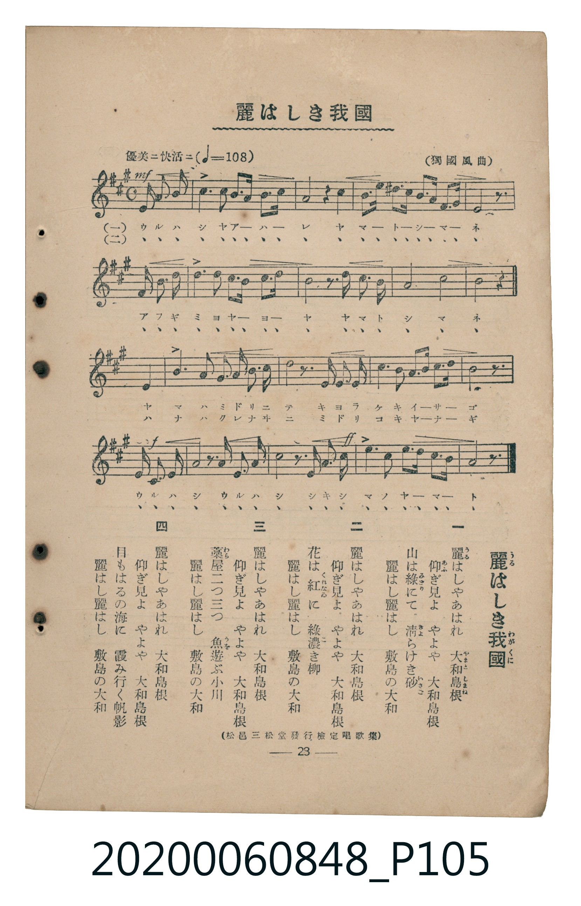

# 麗はしき我國

> Re:Shoka 使用 AI 協助辨識與重建樂譜，可能會有錯誤。歡迎回報。

<audio controls src="uruwashiki_wagakuni.mp3"></audio>

- 曲：獨國風曲
- 臺灣教育會公認《新定兒童唱歌》高等科男子用（2020.006.0848）

## 說明

原書資訊與歌詞全文（對應 P105.jpg，書頁 p. 28 [原印誤植為 23]，高二第三學期第 1 首）：
調性與拍號：イ長調（3 升記號）、4/4 拍（優美ニ快活ニ ♩=108，弱起後半拍三連八分音符進入）
出處註記：（松邑三松堂發行檢定唱歌集）

## 歌詞

```text
一　麗（うる）はしやあはれ　大和島根（やまとしまね）
仰（あふ）ぎ見よやよや　大和島根
山は綠（みどり）にて　清（きよ）らけき砂（いさご）
麗はし麗はし　敷島（しきしま）の大和（やまと）

二　麗はしやあはれ　大和島根
仰ぎ見よやよや　大和島根
花は紅（くれなゐ）に　綠濃（こ）き柳（やなぎ）
麗はし麗はし　敷島の大和

三　麗はしやあはれ　大和島根
仰ぎ見よやよや　大和島根
藁屋（わらや）二つ三つ　魚（うを）遊ぶ小川（をがは）
麗はし麗はし　敷島の大和

四　麗はしやあはれ　大和島根
仰ぎ見よやよや　大和島根
目もはるの海に　霞（かす）み行く帆影（ほかげ）
麗はし麗はし　敷島の大和
```

## ABC

```abc
X:1
T:麗はしき我國
C:曲：獨國風曲
M:4/4
L:1/16
Q:1/4=108
K:A
V:V1 name="Piano" snm="Pia"
[V:V1]
!mf! z4 z4 z2 E2 F2 G2 | A6 c2 B3 A G3 A | F8 z4 F4 | B3 c d3 ^d e3 c A3 f |
E8 z2 E2 F3 G | A6 c2 B3 A G3 A | F8 z2 F2 F3 F | B8 e8 |
c8 z4 E4 | A6 c2 B2 A2 G3 A | F8 z2 F2 F2 F2 | B2 c2 d3 ^d e3 c A3 f |
!f! E8 z2 E2 C2 E2 | A8 z2 A2 E2 A2 | c8 z2 c2 A2 c2 | !ff! e6 c2 B3 c d3 B |
A8 z4 z4 |
```

## TMD 檔案連結

- [主旋律 TMD 檔案](uruwashiki_wagakuni.tmd) [[在 TMD Studio 編輯](https://tmdlang.github.io/Tmd-TS/#tmd=s7IKdvYPcrWy4qpTUCpJTLdSSM7PyUlNLsnMz7MqzsjMK0nNjM_KTMmPL87Iz05Ugisry88pzU21ys4vyY9Pyq8sjjcyMDKINzAwizewMLFAqCvOLy1KTrUqTs7Iz8-JL0mtKEnKz89GyBcU5Zel5iXmAdUUFIGsSwErQihILctMSQVJp6ZkluQXZSbmIDkitagY7FCwJfElRYl5xclFmQUg1yNUlWSkAl2amVuQCtGtpaXwctf0x43rHzcCyd5nHROfzulW0NLiUrRVMDSw4LK3VXDksjHRN7EDGfFs9qb3e2Y9710BVPRy0QogF2zyi_ZdzxsXP5s680XTpmdzmp-2rnmxqvdxQ9ezaRuerpv1tHXS89VLn07Z-Gxtz-OG7perZzxf2_l8-cTnU7Y_XTvh-ZQV7_d0gAJMDxhgeqAAe7-nU4mLS19LwZZagEtBQeFp3_xns3e82Nz-YkXXi452oGNerJz3tHXFs2ntQAc83dD7rL1TIcDQwFQvqyD9_Z4eoOKXCxoVCvQUjCwUooG6n_ZueLFqybMlvc-bdikYGccC1QD98mRXz_M1a57s6Hy6dsezOfOBbAVDhZfLpgE9AQwqkMUvVu1_1rAcZGV374uZ84Gij5uWvJy6HSgOtNhY4Wkv0EkzwDKdjxsagWGtAFQJclPLquf7-h43dz_dv_rZlt1AhsKjmSttgdECtPrpno0vtm5_uq_naW8XUDnQAS8bFj9tXf20o-3l_M3P1yx72bDpaetSoJlgz7fvejFz6osVu4E2AR0ANPzZ3H0vmyYCtQEZTxc0PZ-558XCnmerFoEiDBxVL2e3gTSDdD_Z0fC4oQGYToD6Hje2PW7qBjkVkmaaWh43NoHYTcDIbXi6ZPnTST1PN297tmAnSDFIdt_jxhXg1AVkrIW658nuDWCzgDq3gs3qe7Gs-3ETWAOERDUL7IeNG4H2PN-2AKxz_-PGlY-busCaVz9uXAbU8GxHK1iqF2gESLwJKDURyH2-oAksDnTL1MeNU6BOgCd7RPoHGjF1O9BCsGpQdoA4G2zHOohzkD0FD55dIK8jjMEdJFCvE-XdF11g726B-KkfZFjjqsdNE6A-bmgAhsSz_c1g2clgwd5n8zfD3LcKaAdhj8K9BY1mYPqjvj-mNz7dCEwwQGmgJ4Cx0gJ0FyjIGpeALGxcArJzLShJgpPWJKDsy8aux43bnm7of7p9LljjpMeNQPXrSfXQ09mzaeCh57PXPW6CGNMNtO_Z1u2Q-Hg5Zx7YE0DBmeD42A_MUcCYe7qj7enejWCp3WBZkBeJ9gdQHeXlHxQoaOlzcfkmZuZZBWQm5uU71BjUKFSDbFCwMTTTsgOzgMUutGjZ0P98fQO4tFqm8Lh5NRD3gwwAKapRMFDQBUNkujo3rVbBNB7IMgMR5iCiBhwRIFPBpWQDMEjARm4HGrdE4XHTosfNe0Amg6gaIGMNWBzEmgeR6QBTTdshPLAgSLZXQQOoGciYCpRcp4lwmCHUQSBoDMRGYJYhxDUgRg3EdcgQ5gm4RA1Um7GCCZg2UVcwhQpAzDcDKgH7FN0YhPfBAYDq_V09UO83zwe6fAXIqxBvrYB5CxgkYDwP5HOQCDig5sG93LxEHxhYVPAuWBAqA6RgHkZAiH8RsAZsPLZQg4cDWlx3wjwL8kw_EIM83QnEq4C4G-ylNqAH10KDYiXYuxshIk2QgGnaCgkfcOA0bQHFOTwtEggEkBjxgQAmIIEAMoDUWK-GJXxjEAFmoQQGsCBCSvhI-Qkaw2AM8vZ2SNIH4j5E6oAn-g7sXoa5AiQGthvEwB5fIDGQLIgG5v00kLuxBB4i5RvhsAuZruGq5eLStVMAlSwKQFqZiwsA)]
- [鋼琴伴奏 TMD 檔案](uruwashiki_wagakuni_piano.tmd) [[在 TMD Studio 編輯](https://tmdlang.github.io/Tmd-TS/#tmd=s7IKdvYPcrWy4tLSUni5a_rjxvWPG4Fk77OOiU_ndL_f0_Gye8_zCVue7NnydGn_886O93s6FbS0uBRtFQwNLLjsbRUcuWxM9E3suOoUlJ7N3vR-z6znvSuAOl8uWgHkKoGEX7Tvet64-NnUmS-aNj2b0_y0dc2LVb2PG7qeTdvwdN2sp62Tnq9e-nTKxmdrex43dL9cPeP52s7nyyc-n7L96doJz6esALrByMDIQM_AwEzPwMLEAugCJS4u38TMPKuAzMS8_CAPhxqDGoVqLgUgsDE007IDs_S1FJ7u2fhi6_anG_qfr29Q0NIHC9coGCjogiEyXZ2bVqtgGg9kmYEIcxBRwwUz5_maNU92NLxY2IMwxBCqGQSNgdgIzDKE6AQxaiAmIUOYhXCJGqg2YwUTMG2irmAKFYCYbwZUAnYVujEIp4Idi-rUXT1UcSpYECoDpGCORUCIWxGwBmw8Nh_D_YAWpp0EHQoSI96hYALiUJABpIZqNSwRGIMIMAvFwU9nz8bpYJgZIDGwThADe4iAxECyIBqYbtNAtmLxOiJdGOGwC5mu4apFzhQ-KJnChHCegMAafEk-XiHaMBboOSBtGh8LFDEBMU2ATJN4kF4FIyDXKD43FsoAKYGrBjHQzEdPp8Sbj6QGqgtIobseLXFR2fUYaQHZHWg8YHJCsxsqDwlyYMTp2imA4k4BSCtzcQEA)]

## 分析

```text
================================================================================
📊 TMD Song Profile: [ 麗はしき我國 ]
================================================================================
⏱  Duration:       0:37 (37.8s), 17 measures total
🎼 Key & Tempo:    首調基準 A, != 108.0 BPM, <4/4>
   - 分析範圍：      由實際發聲的音符與和弦推測調性；播放脈絡另行呈現
🎤 人聲音域:    C#4 (MIDI 61) – F#5 (MIDI 78) [跨度: 17 個半音 / 1.4 個八度, 難度: challenging]
   - 最低音:  C#4 in [Main #1 @ m.13, 0:28]
   - 最高音: F#5 in [Main #1 @ m.4, 0:08]
   - 適合: soprano, mezzo-soprano, tenor, baritone
🏛  結構:      Main (37.8s)
⚡ 編曲密度:        Peak 1 軌道同時演奏
🗝  調性診斷：       A 大調（純淨自然大調，未偵測到可信轉調）
   - 風格氣質:    純淨自然大調（陽光明朗、易唱易記，無明顯調外色彩）
   - 轉調歷程:    全曲維持單一推測調性（未偵測到可信轉調）
   - 核心骨幹音:  A, E, F#, C#, B
   - 調性數值:    A 大調 [相關度: 0.88, 穩定度: Moderate, 自然音純度: 99.1%]
   - 候選調性 (K-S): A 大調 (0.88), F# 小調 (0.78), E 大調 (0.71)
   - 五度圈歷程:   +3
   - 各段落調性細節:
     • [Main #1]: A 大調 (r: 0.88, 自然音純度: 99.1%, 調外音: D#)

  [ 五度圈游移軌跡 ]
               C  
         F            G  
      Bb               D  
      Eb              [A ]*
         Ab           E  
            Db       B  
               F# 
     (* = active key center)

  [ 十二半音累積音高分佈 ]
     C  :                            0.0%
     C# : ████████████████          15.4%
     D  : ████                       3.8%
     D# : █                          0.9%
     E  : ███████████████████████   21.4%
     F  :                            0.0%
     F# : █████████████████████     20.1%
     G  :                            0.0%
     G# : █████                      5.1%
     A  : ████████████████████████  22.6%
     A# :                            0.0%
     B  : ███████████               10.7%
--------------------------------------------------------------------------------
Assignment 軌道音域：
  - Piano         : C#4 – F#5 (17 個半音 / 1.4 個八度, 74 個音符)
================================================================================
```


## 原書掃描頁




