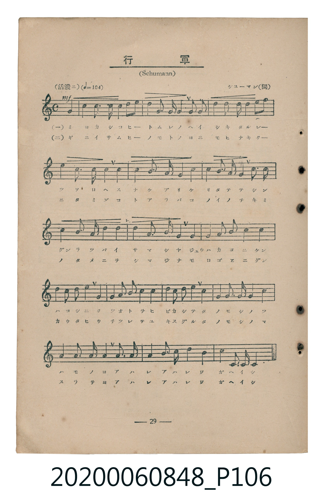
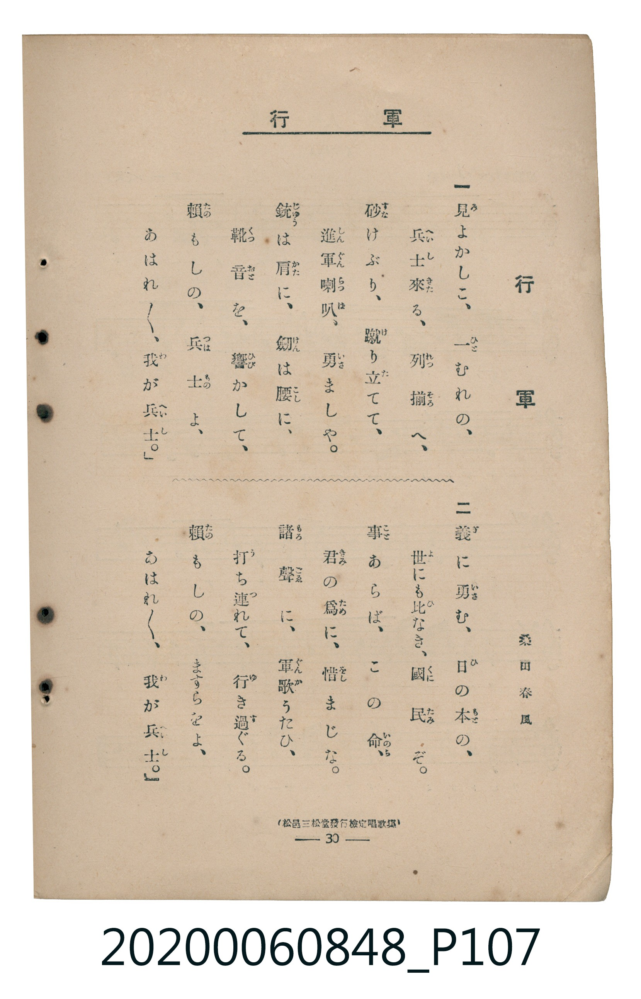

# 行軍

> Re:Shōka 使用 AI 協助辨識與重建樂譜，可能會有錯誤。歡迎回報。

- **鋼琴伴奏版**：<br><audio controls src="kogun.mp3"></audio>

- 詞：桑田春風
- 曲：シューマン（獨）（Schumann）
- 臺灣教育會公認《新定兒童唱歌》高等科男子用（2020.006.0848）

## 說明

原書資訊與歌詞全文（對應 P106.jpg – P107.jpg，書頁 pp. 29–30，高二第三學期第 2 首）：
調性與拍號：ト長調（1 升記號）、4/4 拍（活潑ニ ♩=104）
出處註記：（松邑三松堂發行檢定唱歌集）


## 歌詞

```text
一　見（み）よかしこ、一（ひと）むれの、
兵士（へいし）來（きた）る、列（れつ）揃（そろ）へ、
砂（すな）けぶり、蹴（け）り立（た）てて、
進軍喇叭（しんぐんらつぱ）、勇（いさ）ましや。
銃（じゆう）は肩（かた）に、劍（けん）は腰（こし）に、
靴音（くつおと）を、響（ひび）かして、
賴（たの）もしの、兵士（つはもの）よ、
あはれ／＼、我（わ）が兵士（へいし）。」

二　義（ぎ）に勇（いさ）む、日（ひ）の本（もと）の、
世（よ）にも比（ひ）なき、國民（くにたみ）ぞ。
事（こと）あらば、この命（いのち）、
君（きみ）の爲（ため）に、惜（をし）まじな。
諸聲（もろごゑ）に、軍歌（ぐんか）うたひ、
打（う）ち連（つ）れて、行（ゆ）き過（す）ぐる。
賴（たの）もしの、ますらをよ、
あはれ／＼、我（わ）が兵士（へいし）。」
```

## ABC

<div class="abc-score" data-abc-src="kogun.abc" aria-label="五線譜載入中"></div>

[下載 ABC 原始檔](kogun.abc)

## TMD 檔案連結

- [主旋律 TMD 檔案](kogun.tmd) [[在 TMD Studio 編輯](https://tmdlang.github.io/Tmd-TS/#tmd=s7IKdvYPcrWy4qpTUCpJTLdSSM7PyUlNLsnMz7MqzsjMK0nNjM_KTMmPL87Iz05Ugisry88pzU21ys4vyY9Pyq8sjjcyMDKINzAwizewMLFAqCvOLy1KTrUqTs7Iz8-JL0mtKEnKz89GyBcU5Zel5iXmAdUUFIGsSwErQihILctMSQVJp6ZkluQXZSbmIDkitagY7FCwJfElRYl5xclFmQUg1yNUlWSkAl2am5mTWZJYVIkQBxqWnplnlZuamZWJxWVQ6fLU4pLUorz43NSc_BRM3SWJmcCQAYVOeWJ8bmJmXk5iXooSl5aWwouFPS929ypoaXEp2ioYGphw2dsquHPZmOib2IEMebFy3vs9s54tnPh8yoZnM5a-XLQCbPaz2ZuAwo-btj9uXvq4ec_j5nmPmze_39PxvHfF-z2dQEZwckZpbmJeHpAH1vCifdfzxsXPps580bTp2Zzmp61rXqzqfdzQ9WzahqfrZj1tnfR89dKnUzY-W9vzuKH75eoZz9d2Pl8OtHT707UTnk8BGtoBijk9YMzpgWIObCyXvpaCLbUAl4KCwtO--c9m73ixuf3Fiq4XHe1AxwC9_7R1xbNp7UAHPN3Q-6y9UyHAEOiGrIJ0hUcNk0EccxDn_Z4eoM6XCxoVCgr0FIwsgXLGBkBBoE-e7Op5vmbNkx2dT9fueDZnPpCtYKTwctk0cDjNAln7YtX-Zw3LQRZ2976YOR8UsM0dL6duB4oDrTVUeNoLdNAMsEzn44ZGYNQoAFUCpZ5t2f1s78THzd0Kj2autAVGHlAB2B_tu17MnPpixW6gNqBpIJVz971smgh0BJDxdEHT85l7gPH-bNUiUNiDQ_3l7DaQZpDuJzsaHjc0vFjWDdT3uBHohM7HTUBG9-PG6Y8bJwMdAFQAltr0uBEU24-bGh439TxuXAeUAtveuvXp4tVgFTseN7YAtQEVPdkHNB8o0vu4EeyNpm6g6qcdQKkOsOYlQMFn_c1gNXMfNwF91wnSDjHx-YImsMTMx42rwBITHzdue9zUBZR-sXMLWGoi2NCu56shrgbb0bgMhCBGvGzYBEzmT6e1P-1fC1Yx_XHT5MeNE0BkE1DpkseNGyHB-7QbFNlgh08Fm7IPrLjlcUMT2KAuiCNnPG5qe9wICrTHjetfNK0ECwLDCGLzapBBXaA4Ajm2aTJUWesGsAjQYlCYQJSBDZ275eV8UP553NgPdksXLGgnAVW8nA9KB-DwBqoBaoNEBcxrLzZDgmA-MArAeprA0qDoQIoKoKHrwVIQNR1QzY8bgUJAiZ73e_rf79kDFH3WAQxLYKQAuUCrerDGJjAsHjf0QlLLLmCObXi-DxIAfRBvoYchMIUADZ6-FOINsJp1z-asAdsDtB_sVXj6ebIDmDeAEh3QIGpqerZ-CpLOVaBUBPTbnO5nG8BOBYXZarD_wYm1cR40qp7sgiQGYHBDbGgCR_UGoGaw4LqnE_fCnLnuceNCSPyDk_CE2bDUCjFy3fMOoOXgQG5qhEfds-Y5YJdOgsUnMKnMADkQYv-L1TtegNwM9mQT0Kwpj5vA6RSsGZgcgfkObCg4FTYCHQuUAiYqoEc2QR3yrBOYdIAqIOls4cuGxZDIBAcqMNuA0gAwJ4PtgKjpfQmKBFBmAXOBRgNzGsQ5uNMJ2OUzQaED9At10gZQP-WFMhQoaOlzcfkCay2rgMzEvHyHGoOaapAFCjaGZlp2YBawKgCXsg3A0FDQMFZ4uqH_-foGTXBZOl_hcfMKhcdNq4F4OxBvVqgBikwC1ltAqgOIFwDxGiDuA-IZQAVLQArAStcC8X6gKFBr8xqQBqBLQNbVKFTnptUqGCvogiGIBmEjKB9G1ygYIomAVJggsUFyNQrm8VAmSBjOgZkKNgWc0WBe3NWDxYstQHfuBboR6F6wD3aCvdgFZG0E0tOAeBWYDRIFsUB-aoNgkD-bNyM8ZormB5hLQK4yBTmvRsEMRMEgSBzsbLAkzO01KPpBvoaZAfM9qq92dGL6qmkDyGGPm1cCMdCDzRPhUbMVyJsHdfoSIL0D1AxpWgbk9YPlQTEN8mI3yNMovgO5BAZBLgH5FuY6VHfDRCA6jJD8iCsAUGIe2XdPZ88G-84EJc76wUkR4gmQQ9eDYwcUk8AYAqfLTaBkChadjEi-4DjbDxYFpddFUFEQuwU1FpH9BXMXLHYRKRPmV5AK1JCAqYWJwsxAxDFKOCClXSNcaXcKlrQLDAeQL8A-AGVTEBscjaA8CeVB8ic4hJpALEguBfkc7mN0H6KkWTCF6mfkHAlTj2QKXBeyHoiParm4dO0UQOWRApBW5gIA)]
- [鋼琴伴奏 TMD 檔案](kogun_piano.tmd) [[在 TMD Studio 編輯](https://tmdlang.github.io/Tmd-TS/#tmd=s7IKdvYPcrWy4tLSUnixsOfF7t73ezpedu95PmHLkz1bni7tf97Z8X5Pp4KWFpeirYKhgQmXva2CO5eNib6JHVedgtKLlfPe75n1bOHE51M2PJux9OWiFUog4WezNwGFHzdtf9y89HHznsfN8x43bwaa_Lx3BdA0ICM4OaM0NzEvD8gDa3jRvut54-JnU2e-aNr0bE7z09Y1L1b1Pm7oejZtw9N1s562Tnq-eunTKRufre153ND9cvWM52s7ny8HWrr96doJz6cADe0wMjAy0DMwMNMzsDCxABvL5ZuYmWcVkJmYlx_k4VBjUFPNpQAENoZmWnZglr6WwvM1a57saAD6XEFLHyxWo1Cdm1arYKygC4YgGoSNoHwYXaNgiCQCUmGCxAbJ1SiYx0OZIGE4B2Yq2BQuZHfs6kFxhymalTCNIENMQabVKJiBKBgEiYNtAUvCrKpB0Q9yJMwMmGNRHbGjE8URIA0wCNIAchTMEFTjYSIQHUZITsHlTpTwRHbE09mzMUIC2VKYJlgIISID5hCQClRnwtTCRGFmIMIJxZFI0WWEK7qmoDgS3VEoUQWmUJ2JnG5g6pFMgetC1gNxRC1yyvZBTtkmeBO2YbxCtGGsghGQMo2PBQoYQwRMIBTQcqgMVGENvsQZj6YWbIoJUABkCEHT0FIZTCncVIQQwrVmIEmz-FwkMTxpBpdnkaxAUoLiA6hKVO-jRTa675GCEmQEFt8DY03XTgEUcQpAWpkLAA)]

## 分析

```text
================================================================================
📊 TMD Song Profile: [ 行軍 ]
================================================================================
⏱  Duration:       0:36 (36.9s), 16 measures total
🎼 Key & Tempo:    首調基準 G, != 104.0 BPM, <4/4>
   - 分析範圍：      由實際發聲的音符與和弦推測調性；播放脈絡另行呈現
🎤 人聲音域:    D4 (MIDI 62) – D5 (MIDI 74) [跨度: 12 個半音 / 1.0 個八度, 難度: easy]
   - 最低音:  D4 in [Main #1 @ m.4, 0:08]
   - 最高音: D5 in [Main #1 @ m.4, 0:06]
   - 適合: soprano, mezzo-soprano, contralto, tenor, baritone, bass
🏛  結構:      Main (36.9s)
⚡ 編曲密度:        Peak 1 軌道同時演奏
🗝  調性診斷：       G 大調（純淨自然大調，未偵測到可信轉調）
   - 風格氣質:    純淨自然大調（陽光明朗、易唱易記，無明顯調外色彩）
   - 轉調歷程:    全曲維持單一推測調性（未偵測到可信轉調）
   - 核心骨幹音:  A, G, B, D, C
   - 調性數值:    G 大調 [相關度: 0.79, 穩定度: Moderate, 自然音純度: 100.0%]
   - 候選調性 (K-S): G 大調 (0.79), D 大調 (0.66), B 小調 (0.55)
   - 五度圈歷程:   +1
   - 各段落調性細節:
     • [Main #1]: G 大調 (r: 0.79, 自然音純度: 100.0%)

  [ 五度圈游移軌跡 ]
               C  
         F           [G ]*
      Bb               D  
      Eb               A  
         Ab           E  
            Db       B  
               F# 
     (* = active key center)

  [ 十二半音累積音高分佈 ]
     C  : ██████████                 9.8%
     C# :                            0.0%
     D  : ██████████████            13.3%
     D# :                            0.0%
     E  : ███████                    7.0%
     F  :                            0.0%
     F# : ██████                     5.5%
     G  : █████████████████████     20.7%
     G# :                            0.0%
     A  : ████████████████████████  23.4%
     A# :                            0.0%
     B  : █████████████████████     20.3%
--------------------------------------------------------------------------------
Assignment 軌道音域：
  - Piano         : D4 – D5 (12 個半音 / 1.0 個八度, 84 個音符)
================================================================================
```


## 原書掃描頁






