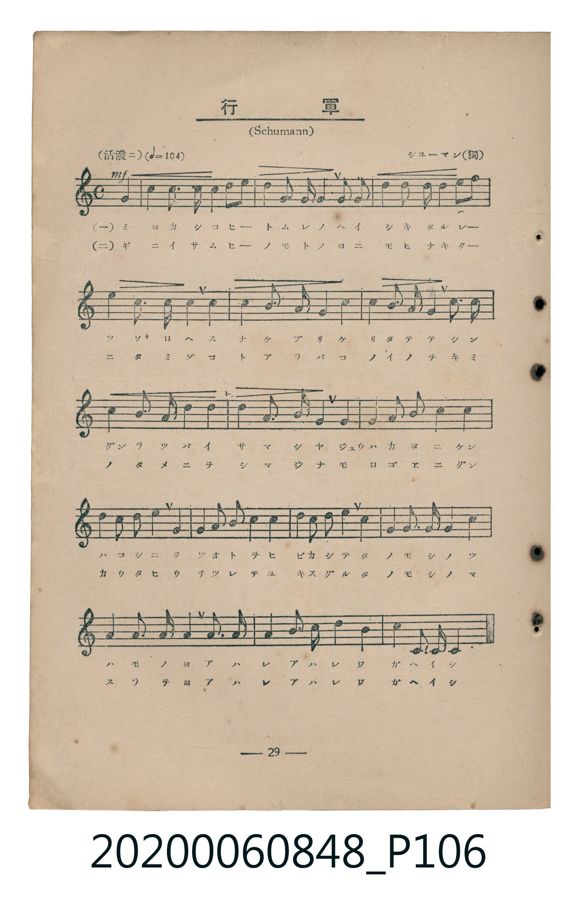
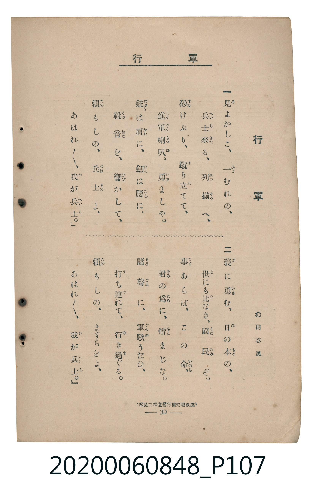

# 行軍

<audio controls src="kogun.mp3"></audio>

- 詞：桑田春風
- 曲：シューマン（獨）（Schumann）
- 臺灣教育會公認《新定兒童唱歌》高等科男子用（2020.006.0848）

## 說明

原書資訊與歌詞全文（對應 P106.jpg – P107.jpg，書頁 pp. 29–30，高二第三學期第 2 首）：
調性與拍號：ト長調（1 升記號）、4/4 拍（活潑ニ ♩=104）
出處註記：（松邑三松堂發行檢定唱歌集）

## 跨冊／重複收錄參照

> 同名異曲（各冊收錄之不同詞曲版本）

- **[同名異曲]** 《新定兒童唱歌》尋常科第四學年用（2020.006.0847.0004）：[**〈行軍〉**](../../grade_4_2020.006.0847.0004/1_06_kogun/index.md)（`G` / `2/4` — [原始 TMD](../../grade_4_2020.006.0847.0004/1_06_kogun/kogun.tmd)）
- 總表：[跨冊重複與同名歌曲總索引](../../../duplicate_songs.md)

## 歌詞

```text
一　見（み）よかしこ、一（ひと）むれの、
兵士（へいし）來（きた）る、列（れつ）揃（そろ）へ、
砂（すな）けぶり、蹴（け）り立（た）てて、
進軍喇叭（しんぐんらつぱ）、勇（いさ）ましや。
銃（じゆう）は肩（かた）に、劍（けん）は腰（こし）に、
靴音（くつおと）を、響（ひび）かして、
賴（たの）もしの、兵士（つはもの）よ、
あはれ／＼、我（わ）が兵士（へいし）。」

二　義（ぎ）に勇（いさ）む、日（ひ）の本（もと）の、
世（よ）にも比（ひ）なき、國民（くにたみ）ぞ。
事（こと）あらば、この命（いのち）、
君（きみ）の爲（ため）に、惜（をし）まじな。
諸聲（もろごゑ）に、軍歌（ぐんか）うたひ、
打（う）ち連（つ）れて、行（ゆ）き過（す）ぐる。
賴（たの）もしの、ますらをよ、
あはれ／＼、我（わ）が兵士（へいし）。」
```

## ABC

```abc
X:1
T:行軍
C:曲：シューマン（獨）（Schumann）
M:4/4
L:1/16
Q:1/4=104
K:G
V:V1 name="Piano" snm="Pia"
[V:V1]
!mf! B4 B2 B2 A4 A4 | G4 A2 B2 c2 A2 B2 G2 | F2 G2 A2 F2 G4 B4 | d4 A6 B2 G2 D2 |
E6 G2 F2 D2 G4 | A6 c2 B2 G2 A2 B2 | c6 A2 d2 c2 B4 | A4 B4 c3 A F2 D2 |
E6 G2 F4 A4 | d2 c2 B4 A4 d4 | G6 B2 A2 c2 B4 | d4 c2 B2 A4 G4 |
E6 F2 G3 A B4 | A4 d4 B2 G2 D3 D | G6 A2 B2 c4 B2 | A4 D3 D G8 |
```

## TMD 檔案連結

- [主旋律 TMD 檔案](kogun.tmd) [[在 TMD Studio 編輯](https://tmdlang.github.io/Tmd-TS/#tmd=s7IKdvYPcrWy4tLSUnixsOfF7l4FLS0uRVsFQwMTLntbBXcuGxN9EzuuOgWlFyvnvd8z69nCic-nbHg2Y-nLRSuUQMLPZm8CCj9u2v64eenj5j2Pm-c9bt78fk_H894V7_d0AhnByRmluYl5eUAeWMOL9l3PGxc_mzrzRdOmZ3Oan7auebGq93FD17NpG56um_W0ddLz1UufTtn4bG3P44bul6tnPF_b-Xw50NLtT9dOeD4FaGiHkYGRgZ6BgZmegYWJBdhYLn0tBVtqAS4FBYWnffOfzd7xYnP7ixVdLzragY4Bev9p64pn09qBDni6ofdZe6dCgCHQDVkF6QqPGiaDOOYgzvs9PUCdLxc0KhQU6CkYWQLljA2AgkCfPNnV83zNmic7Op-u3fFsznwgW8FI4eWyaeBwmgWy9sWq_c8aloMs7O59MXM-KGCbO15O3Q4UB1prqPC0F-igGWCZzscNjcCoUQCqBEo927L72d6Jj5u7FR7NXGkLjDygArA_2ne9mDn1xYrdQG1A00Aq5-572TQR6Agg4-mCpucz9wDj_dmqRaCwB4f6y9ltIM0g3U92NDxuaHixrBuo73Ej0Amdj5uAjO7HjdMfN04GOgCoACy16XEjKLYfNzU8bup53LgOKAW2vXXr08WrwSp2PG5sAWoDKnqyD2g-UKT3cSPYG03dQNVPO4BSHWDNS4CCz_qbwWrmPm4C-q4TpB1i4vMFTWCJmY8bV4ElJj5u3Pa4qQso_WLnFrDURLChXc9XQ1wNtqNxGQhBjHjZsAmYzJ9Oa3_avxasYvrjpsmPGyeAyCag0iWPGzdCgvdpNyiywQ6fCjZlH1hxy-OGJrBBXRBHznjc1Pa4ERRojxvXv2haCRYEhhHE5tUgg7pAcQRybNNkqLLWDWARoMWgMIEoAxs6d8vL-aD887ixH-yWLljQTgKqeDkflA7A4Q1UA9QGiQqY115shgTBfGAUgPU0gaVB0YEUFUBD14OlIGo6oJofNwKFgBI97_f0v9-zByj6rAMYlsBIAXKBVvVgjU1gWDxu6IWkll3AHNvwfB8kAPog3kIPQ2AKARo8fSnEG2A1657NWQO2B2g_2Kvw9PNkBzBvACU6oEHU1PRs_RQknatAqQjotzndzzaAnQoKs9Vg_4MTa-M8aFQ92QVJDMDghtjQBI7qDUDNYMF1TyfuhTlz3ePGhZD4ByfhCbNhqRVi5LrnHUDLwYHc1AiPumfNc8AunQSLT2BSmQFyIMT-F6t3vAC5GezJJqBZUx43gdMpWDMwOQLzHdhQcCpsBDoWKAVMVECPbII65FknMOkAVUDS2cKXDYshkQkOVGC2AaUBYE4G2wFR0_sSFAmgzALmAo0G5jSIc3CnE7DLZ4JCB-gX6qQNoH7KC2UoUNDS5-LyTczMswrITMzLd6gxqFGoBtmgYGNopmUHZgHrAnAx2wAMDgUNY4WnG_qfr2_QBBem8xUeN69QeNy0Goi3A_FmhRqgyCRgxQWkOoB4ARCvAeI-IJ4BVLAEpACsdC0Q7weKArU2rwFpADoFZB3QAblptQrGCrpgCKJB2AjKh9E1CoZIIiAVJkhskFyNgnk8lAkShnNgpoJNAec0mBd39WDxYgvQnXuBbgS6F-yDnWAvdgFZG4H0NCBeBWaDREEskJ_aIBjkz-bNCI-ZovkB5hKQq0xBzqtRMANRMAgSBzsbLAlzew2KfpCvYWbAfI_qqx2dmL5q2gBy2OPmlUAM9GDzRHjUbAXy5kGdvgRI7wC1Q5qWAXn9YHlQTIO82A3yNIrvQC6BQZBLQL6FuQ7V3TARiA4jJD_iCgCUmEf23dPZs8G-M0GJs35wUoR4AuTQ9eDYAcUkMIbA6XITKJmCRScjki84zvaDRUHpdRFUFMRuQY1FZH_B3AWLXUTKhPkVpAI1JGBqYaIwMxBxjBIOSGnXCFfanYIl7QLDAeQLsA9A2RTEBkcjKE9CeZD8CQ6hJhALkktBPof7GN2HKGkWTKH6GTlHwtQjmQLXhawH4qNaLi5dOwVQgaQApJW5uAA)]
- [鋼琴伴奏 TMD 檔案](kogun_piano.tmd) [[在 TMD Studio 編輯](https://tmdlang.github.io/Tmd-TS/#tmd=s7IKdvYPcrWy4tLSUnixsOfF7t73ezpedu95PmHLkz1bni7tf97Z8X5Pp4KWFpeirYKhgQmXva2CO5eNib6JHVedgtKLlfPe75n1bOHE51M2PJux9OWiFUog4WezNwGFHzdtf9y89HHznsfN8x43bwaa_Lx3BdA0ICM4OaM0NzEvD8gDa3jRvut54-JnU2e-aNr0bE7z09Y1L1b1Pm7oejZtw9N1s562Tnq-eunTKRufre153ND9cvWM52s7ny8HWrr96doJz6cADe0wMjAy0DMwMNMzsDCxABvL5ZuYmWcVkJmYlx_k4VBjUKNQzaUABDaGZlp2YJa-lsLzNWue7GgAel1BSx8sBlSVm1arYKygC4YgGoSNoHwYXaNgiCQCUmGCxAbJ1SiYx0OZIGE4B2Yq2BQuZHfs6kFxhymalTCNIENMQabVKJiBKBgEiYNtAUvCrKpB0Q9yJMwMmGNRHbGjE8URIA0wCNIAchTMEFTjYSIQHUZITsHlTpTwRHbE09mzMUIC2VKYJlgIISID5hCQClRnwtTCRGFmIMIJxZFI0WWEK7qmoDgS3VEoUQWmUJ2JnG5g6pFMgetC1gNxRC1y0vZBSdomeFO2YbxCtGGsghGQMo2PBQoYQwRMIBTQdqgMVGENvtQZj6YWbIoJUABkCEHT0JIZTCncVIQQwrVmIEmz-FwkMTyJBpdnkaxAUoLiA6hKVO-jxTa675GCEmQEFt8Do03XTgEUcwpAWpmLCwA)]

## 分析

```text
================================================================================
📊 TMD Song Profile: [ 行軍 ]
================================================================================
⏱  Duration:       0:36 (36.9s), 16 measures total
🎼 Key & Tempo:    首調基準 G, != 104.0 BPM, <4/4>
   - 分析範圍：      由實際發聲的音符與和弦推測調性；播放脈絡另行呈現
🎤 人聲音域:    D4 (MIDI 62) – D5 (MIDI 74) [跨度: 12 個半音 / 1.0 個八度, 難度: easy]
   - 最低音:  D4 in [Main #1 @ m.4, 0:08]
   - 最高音: D5 in [Main #1 @ m.4, 0:06]
   - 適合: soprano, mezzo-soprano, contralto, tenor, baritone, bass
🏛  結構:      Main (36.9s)
⚡ 編曲密度:        Peak 1 軌道同時演奏
🗝  調性診斷：       G 大調（純淨自然大調，未偵測到可信轉調）
   - 風格氣質:    純淨自然大調（陽光明朗、易唱易記，無明顯調外色彩）
   - 轉調歷程:    全曲維持單一推測調性（未偵測到可信轉調）
   - 核心骨幹音:  A, G, B, D, C
   - 調性數值:    G 大調 [相關度: 0.79, 穩定度: Moderate, 自然音純度: 100.0%]
   - 候選調性 (K-S): G 大調 (0.79), D 大調 (0.66), B 小調 (0.55)
   - 五度圈歷程:   +1
   - 各段落調性細節:
     • [Main #1]: G 大調 (r: 0.79, 自然音純度: 100.0%)

  [ 五度圈游移軌跡 ]
               C  
         F           [G ]*
      Bb               D  
      Eb               A  
         Ab           E  
            Db       B  
               F# 
     (* = active key center)

  [ 十二半音累積音高分佈 ]
     C  : ██████████                 9.8%
     C# :                            0.0%
     D  : ██████████████            13.3%
     D# :                            0.0%
     E  : ███████                    7.0%
     F  :                            0.0%
     F# : ██████                     5.5%
     G  : █████████████████████     20.7%
     G# :                            0.0%
     A  : ████████████████████████  23.4%
     A# :                            0.0%
     B  : █████████████████████     20.3%
--------------------------------------------------------------------------------
Assignment 軌道音域：
  - Piano         : D4 – D5 (12 個半音 / 1.0 個八度, 84 個音符)
================================================================================
```


## 原書掃描頁






