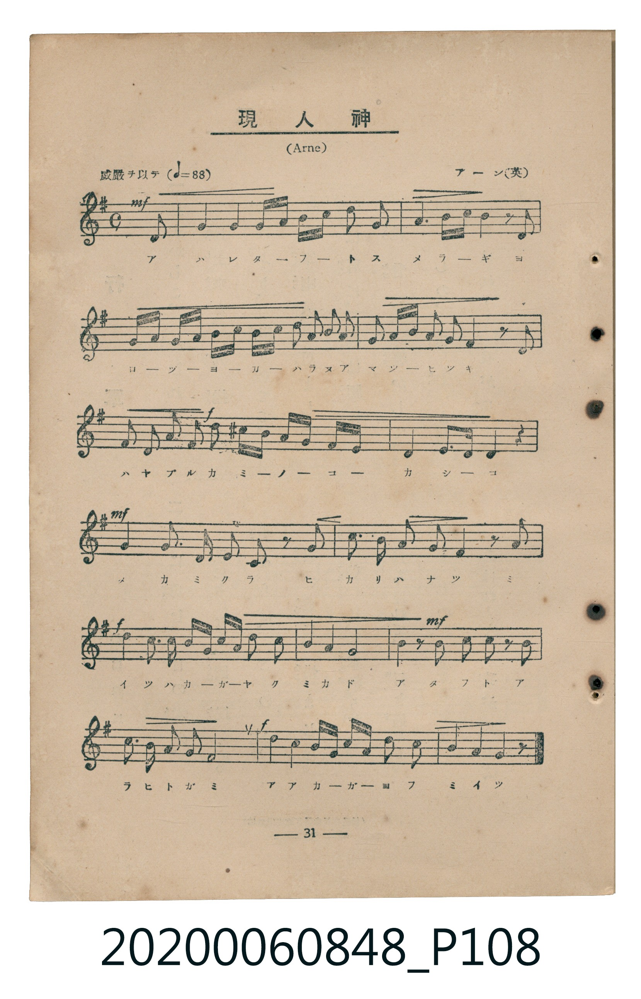
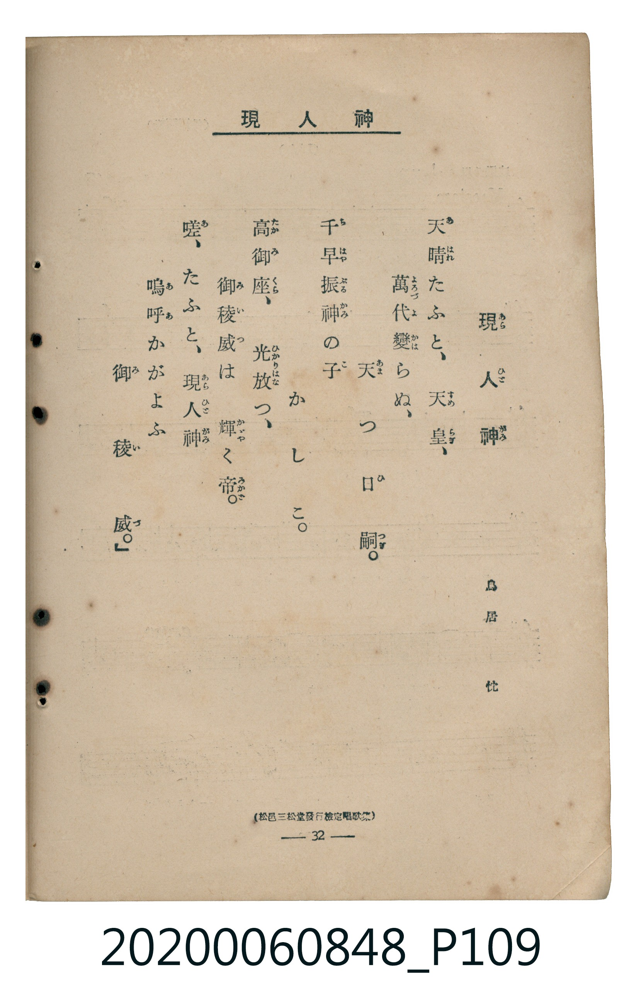

# 現人神

<audio controls src="arahitogami.mp3"></audio>

- 詞：鳥居忱
- 曲：アーン（英）（Arne）
- 臺灣教育會公認《新定兒童唱歌》高等科男子用（2020.006.0848）

## 說明

原書資訊與歌詞全文（對應 P108.jpg – P109.jpg，書頁 pp. 31–32，高二第三學期第 3 首）：
調性與拍號：ト長調（1 升記號）、4/4 拍（威嚴ヲ以テ ♩=88，弱起最後半拍進入）
出處註記：（松邑三松堂發行檢定唱歌集）

## 歌詞

```text
天晴（あはれ）たふと、天皇（すめらぎ）、
萬代（よろづよ）變（かは）らぬ、天（あま）つ日嗣（ひつぎ）。
千早振（ちはやぶる）神（かみ）の子（こ）　かしこ。
高御座（たかみくら）、光放（ひかりはな）つ、
御稜威（みいつ）は輝（かがや）く帝（みかど）。
嗟（あ）、たふと、現人神（あらひとがみ）
嗚呼（ああ）かがよふ　御稜威（みいつ）。」
```

## 原書掃描頁





## 分析

```text
================================================================================
📊 TMD Song Profile: [ 現人神 ]
================================================================================
⏱  Duration:       0:40 (40.9s), 15 measures total
🎼 Key & Tempo:    首調基準 G, != 88.0 BPM, <4/4>
   - 分析範圍：      由實際發聲的音符與和弦推測調性；播放脈絡另行呈現
🎤 人聲音域:    D4 (MIDI 62) – G5 (MIDI 79) [跨度: 17 個半音 / 1.4 個八度, 難度: challenging]
   - 最低音:  D4 in [Main #1 @ m.1, 0:02]
   - 最高音: G5 in [Main #1 @ m.4, 0:09]
   - 適合: soprano, mezzo-soprano, tenor, baritone
🏛  結構:      Main (40.9s)
⚡ 編曲密度:        Peak 1 軌道同時演奏
🗝  調性診斷：       G 大調（純淨自然大調，未偵測到可信轉調）
   - 風格氣質:    純淨自然大調（陽光明朗、易唱易記，無明顯調外色彩）
   - 轉調歷程:    全曲維持單一推測調性（未偵測到可信轉調）
   - 核心骨幹音:  G, D, A, B, C
   - 調性數值:    G 大調 [相關度: 0.94, 穩定度: High, 自然音純度: 99.0%]
   - 候選調性 (K-S): G 大調 (0.94), D 大調 (0.75), G 小調 (0.60)
   - 五度圈歷程:   +1
   - 各段落調性細節:
     • [Main #1]: G 大調 (r: 0.94, 自然音純度: 99.0%, 調外音: C#)

  [ 五度圈游移軌跡 ]
               C  
         F           [G ]*
      Bb               D  
      Eb               A  
         Ab           E  
            Db       B  
               F# 
     (* = active key center)

  [ 十二半音累積音高分佈 ]
     C  : ██████                     7.2%
     C# : █                          1.0%
     D  : ████████████████████      26.0%
     D# :                            0.0%
     E  : ████                       4.8%
     F  :                            0.0%
     F# : ████                       5.3%
     G  : ████████████████████████  31.2%
     G# :                            0.0%
     A  : ███████████               13.9%
     A# :                            0.0%
     B  : ████████                  10.6%
--------------------------------------------------------------------------------
Assignment 軌道音域：
  - Piano         : D4 – G5 (17 個半音 / 1.4 個八度, 93 個音符)
================================================================================
```

## ABC

```abc
X:1
T:現人神
C:曲：アーン（英）（Arne）
M:4/4
L:1/16
Q:1/4=88
K:G
V:V1 name="Piano" snm="Pia"
[V:V1]
!mf! z4 z4 z4 z2 d2 | g4 g4 g a b c d2 g2 | a6 c d b4 z2 d2 | g a b c g a b c d2 g2 f2 e2 |
d2 e f g2 a2 d4 z2 a2 | !f! d2 b2 g2 e2 d2 ^c d e d c b | a4 e3 e d4 z4 | !mf! g4 d3 d g2 d2 z2 g2 |
c3 c b2 g2 a4 z2 a2 | !f! d4 d3 d b d g c b2 a2 | g4 f4 g8 | !mf! d4 z2 d2 c2 b2 z2 c2 |
d3 c b2 a2 g8 | !f! d4 g4 b d g c b2 a2 | g4 f4 g6 z2 |
```

- [主旋律 TMD 檔案](arahitogami.tmd)
- [鋼琴伴奏 TMD 檔案](arahitogami_piano.tmd)
