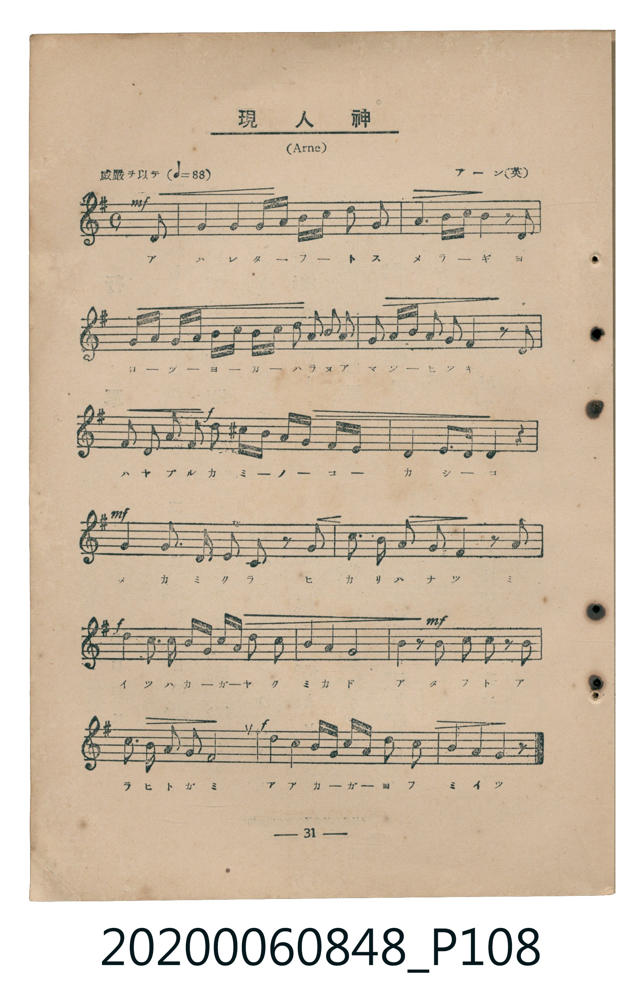
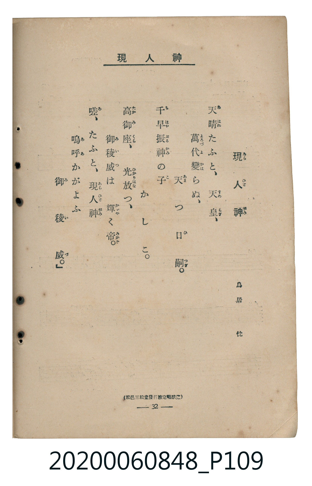

# 現人神

> Re:Shōka 使用 AI 協助辨識與重建樂譜，可能會有錯誤。歡迎回報。

- **鋼琴伴奏版**：<br><audio controls src="arahitogami.mp3"></audio>

- 詞：鳥居忱
- 曲：アーン（英）（Arne）
- 臺灣教育會公認《新定兒童唱歌》高等科男子用（2020.006.0848）

## 說明

原書資訊與歌詞全文（對應 P108.jpg – P109.jpg，書頁 pp. 31–32，高二第三學期第 3 首）：
調性與拍號：ト長調（1 升記號）、4/4 拍（威嚴ヲ以テ ♩=88，弱起最後半拍進入）
出處註記：（松邑三松堂發行檢定唱歌集）


## 歌詞

```text
天晴（あはれ）たふと、天皇（すめらぎ）、
萬代（よろづよ）變（かは）らぬ、天（あま）つ日嗣（ひつぎ）。
千早振（ちはやぶる）神（かみ）の子（こ）　かしこ。
高御座（たかみくら）、光放（ひかりはな）つ、
御稜威（みいつ）は輝（かがや）く帝（みかど）。
嗟（あ）、たふと、現人神（あらひとがみ）
嗚呼（ああ）かがよふ　御稜威（みいつ）。」
```

## ABC

<div class="abc-score" data-abc-src="arahitogami.abc" aria-label="五線譜載入中"></div>

[下載 ABC 原始檔](arahitogami.abc)

## TMD 檔案連結

- [主旋律 TMD 檔案](arahitogami.tmd) [[在 TMD Studio 編輯](https://tmdlang.github.io/Tmd-TS/#tmd=s7IKdvYPcrWy4qpTUCpJTLdSSM7PyUlNLsnMz7MqzsjMK0nNjM_KTMmPL87Iz05Ugisry88pzU21ys4vyY9Pyq8sjjcyMDKINzAwizewMLFAqCvOLy1KTrUqTs7Iz8-JL0mtKEnKz89GyBcU5Zel5iXmAdUUFIGsSwErQihILctMSQVJp6ZkluQXZSbmIDkitagY7FCwJfElRYl5xclFmQUg1yNUlWSkAl2amVuQiqobaFh6Zp5VbmpmViYWl0Gly1OLS1KL8uJzU3PyUyqVuLS0FJ7373uya9fzpfMUtLS4FG0VLCy47G0V3LlsTPRN7ED6X6yc937PrJeblz7d2Pp0_0awmc9mbwKKPW5a9Lh5z-Pmze_3dLzo3vh-TyeQ4ViUlwpkgZW9aN_1vHHxs6kzXzRtejan-Wnrmhereh83dD2btuHpullPWyc9X7306ZSNz9b2PG7ofrl6xvO1nc-XT3w-ZfvTtROeT1kBNA0UEXrAiNADRQTYWC59LQVbagEuBQWFp33zn83e8WJz-4sVXS862oGOAfr4aeuKZ9PagQ54uqH3WXunQoChgYVeVkG6wqOGySCOJYjzfk8PUOfLBY0KBQV6CsaGQDljI6Ag0CdPdvU8X7PmyY7Op2t3PJszH8hWMFZ4uWwaOIxmgax9sWr_s4blIAu7e1_MnA8KzuaOl1O3A8WB1hoqPO0FOmgGWKbzcUMjMDYUgCpBLlrR-HTWlsfNm57sXvq4uU3h0cyVthbAsOl5umfji63bn81peLqv52lvF1D1y4ZNT1uXAg0A-7N914uZU1-s2A00Fmgb0KRnc_e9bJoIdCSQ8XRB0_OZe14s7Hm2ahEobsCx8nJ2G0gzWPeSlc9mbgFqetzY9Lhx_eOmHpC7Guc_btz6uHEF0IFABc9ngULscePMx02Nj5uAsn0Qt4O9O2HNk92LQdJNQNT7uHEpkAGUfrGuC6ynG2goSDVI2xqIcTDL9oFtWvJs-tKn08EmNG4CcmGmN4Fd19v8bPrKZz1AI4DSC8EObHncuO1xUzdQETBxw-wAhi3QrHXA9AUWmQw2ogEsNR3IhRoHjMCn-xY-3bUcrAjoR5DOx439QNdBfPS0tfPZFKC7IG7pftzUBbKycRXEpVAvA414vmIOMLrA6oD6gS5aAlax_sWeuTAX9QBdChbsf7oDIghUCRQHeh_uu-nARAAKC4jlyKEOz73QwAIFH9BFK0Dmgj0L0T_r6cQ9sOAEmwK1GSiyFeh_nC5taHrc0AsygvKsBgUKWvpcXL6JwLIoIDMxL9-hRtewphpkg4KNoZmWHZgFzOGQtPx0Q__z9Q2QkgakESRZo2CgoAuG2Ojq3LRaBdN4IKsGnGxBZoEzYgMwaStoGClAjNQEZ7d-hcfNaxQeN-0HlmJA5lQI1QEU2Qm05nHzQiBeCRZsWgdkrkA4wRBqJYI2AuZvEwVTqFgNkA-RAUGQuDGSI7G4b1cPFvethTioFUKtgLhkNYQHcvtKIO4BCi0Cu3YeELdAJCeBmECJtUC6EdnVEFeiuDYOSJgDsRnY2SAhMyAfLAzyA0gA5m4QHy1YO3EE6xIgngbEq0EuBtLzIQ7rg_hhM4gCuhkk1bQdKoZwJ8hOUHiBHQFyVzUoUkEBqQ6kzIAYyDBGCmQzUICCKXDQIicKFPc-nT0b071N-2FuBNLrocE6Cea85lXQwO6ChClQFdyd4MQGSwJQm4EUSATMA7kBkhpMoOkA7CtoSOIO1V1TwK40RnElKERB9gPdAk0DTWsggQqUAboblARAPgC5uRPs-kWgpA1K19BEjZSFYAEKdjGUNAZiYIhDHAl2FNxv5rBQhQnAICSuUDMf2KOQCAQJgtiokdC6FtN70ECHOBSYJ4FegXkBhFE9vALsKZiHIQGDknhgQQ3yBaaTkT0PTmIgSKrvQV6r4arl4tK1UwAVZwpAWpkLAA)]
- [鋼琴伴奏 TMD 檔案](arahitogami_piano.tmd) [[在 TMD Studio 編輯](https://tmdlang.github.io/Tmd-TS/#tmd=s7IKdvYPcrWy4tLSUnjev-_Jrl3Pl857v6fjZfee5xO2PNmz5enS_uedHe_3dCpoaXEp2ipYWHDZ2yq4c9mY6JvYcdUpKL1YCVQ_6-XmpU83tj7dv1EJJPZs9iag2OOmRY-b9zxu3gw070X3RqAZQIZjUV4qkAVW9qJ91_PGxc-mznzRtOnZnOanrWterOp93ND1bNqGp-tmPW2d9Hz10qdTNj5b2_O4ofvl6hnP13Y-Xz7x-ZTtT9dOeD5lBdA0IwMjAz0DAzM9AwsTC7CxXL6JmXlWAZmJeflBHg41uoY11VwKQGBjaKZlB2bpayk83bPxxdbtTzf0P1_foKClDxauUTBQ0AVDbHR1blqtgmk8kFXDBTPl-Zo1T3Y0vFjYgzDCEKoFQRspGCuYKJhCxWqAfIgMCILEjZEswWL-rh408yHmoZgbByTMgdgMbAFIyAzIBwuDbAMJwGwA8dE80IliAUgxyElg3SADq0H-BrlVHUiZATGQYYzkDzOQm8EU2PXI4YZi0dPZs1EsAgcoLJigWoEUSATMAxkCCTETaFiBnQX1A27_7JqCag3U-WDjoaQxEAP9BzERbALcIeYwP8AEYBASMqipAewqSHCBBEFsVC-3rsUIW5hHQNZi2oHsWnAMgCCpzgW5pYarFjkn-KDkBBPCGQECa_Cl9HiFaMNYBWMIBYwlIMMoPjcWGHtAlmk8UAxfOoZoM4IphZkDF8CTRKF6zUD2mIFsBCZGsOU47EZPeVD9UArichOgHqx2oyUnuAVwf8N0wY3DUIInReDWDHIUuvmgCAFGq66dAihmFYC0MhcA)]

## 分析

```text
================================================================================
📊 TMD Song Profile: [ 現人神 ]
================================================================================
⏱  Duration:       0:38 (38.2s), 14 measures total
🎼 Key & Tempo:    首調基準 G, != 88.0 BPM, <4/4>
   - 分析範圍：      由實際發聲的音符與和弦推測調性；播放脈絡另行呈現
🎤 人聲音域:    D4 (MIDI 62) – G5 (MIDI 79) [跨度: 17 個半音 / 1.4 個八度, 難度: challenging]
   - 最低音:  D4 in [Main #1 @ m.1, 0:02]
   - 最高音: G5 in [Main #1 @ m.4, 0:09]
   - 適合: soprano, mezzo-soprano, tenor, baritone
🏛  結構:      Main (38.2s)
⚡ 編曲密度:        Peak 1 軌道同時演奏
🗝  調性診斷：       G 大調（純淨自然大調，未偵測到可信轉調）
   - 風格氣質:    純淨自然大調（陽光明朗、易唱易記，無明顯調外色彩）
   - 轉調歷程:    全曲維持單一推測調性（未偵測到可信轉調）
   - 核心骨幹音:  G, D, A, B, C
   - 調性數值:    G 大調 [相關度: 0.94, 穩定度: High, 自然音純度: 99.0%]
   - 候選調性 (K-S): G 大調 (0.94), D 大調 (0.75), G 小調 (0.60)
   - 五度圈歷程:   +1
   - 各段落調性細節:
     • [Main #1]: G 大調 (r: 0.93, 自然音純度: 99.0%, 調外音: C#)

  [ 五度圈游移軌跡 ]
               C  
         F           [G ]*
      Bb               D  
      Eb               A  
         Ab           E  
            Db       B  
               F# 
     (* = active key center)

  [ 十二半音累積音高分佈 ]
     C  : ██████                     7.2%
     C# : █                          1.0%
     D  : ████████████████████      26.0%
     D# :                            0.0%
     E  : ████                       4.8%
     F  :                            0.0%
     F# : ████                       5.3%
     G  : ████████████████████████  31.2%
     G# :                            0.0%
     A  : ███████████               13.9%
     A# :                            0.0%
     B  : ████████                  10.6%
--------------------------------------------------------------------------------
Assignment 軌道音域：
  - Piano         : D4 – G5 (17 個半音 / 1.4 個八度, 93 個音符)
================================================================================
```


## 原書掃描頁






