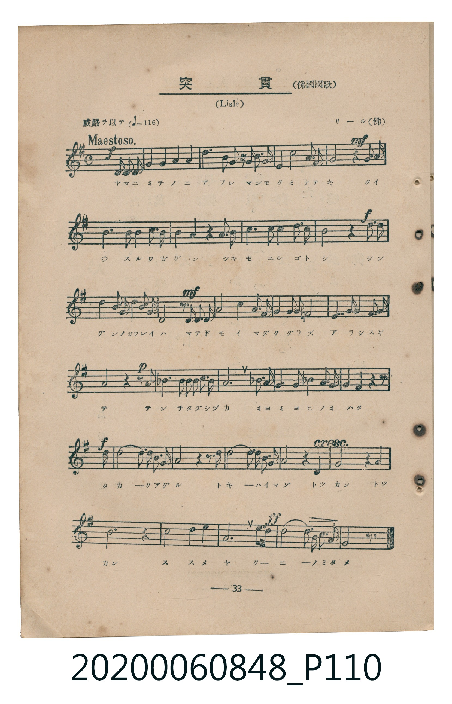
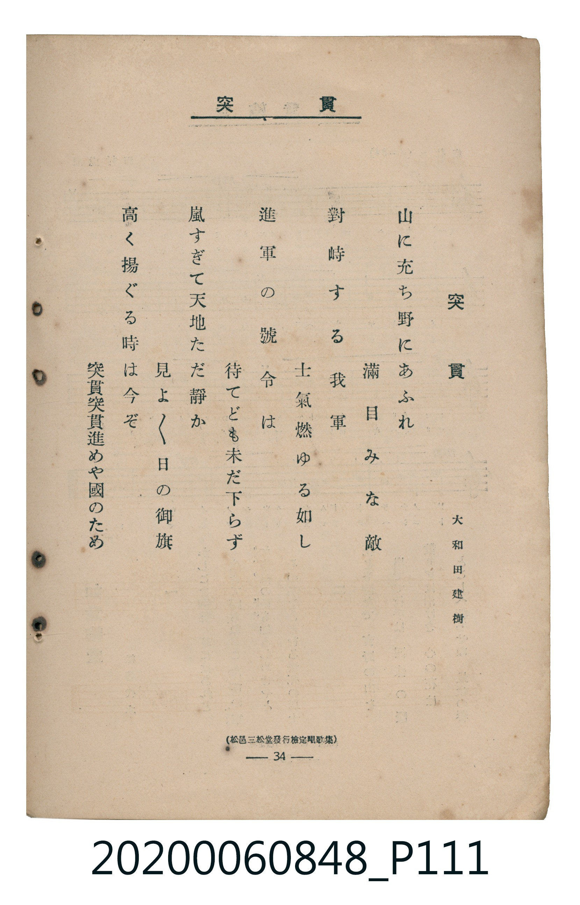

# 突貫

<audio controls src="tokkan.mp3"></audio>

- 詞：大和田建樹
- 曲：リール（佛）（Lisle，佛國國歌）
- 臺灣教育會公認《新定兒童唱歌》高等科男子用（2020.006.0848）

- note

原書資訊與歌詞全文（對應 P110.jpg – P111.jpg，書頁 pp. 33–34，高二第三學期第 4 首）：
調性與拍號：ト長調（1 升記號）、4/4 拍（威嚴ヲ以テ ♩=116 Maestoso.）
出處註記：（松邑三松堂發行檢定唱歌集）

## 歌詞

```text
山に充ち野にあふれ　滿目みな敵
對峙する我軍　士氣燃ゆる如し
進軍の號令は　待てども未だ下らず
嵐すぎて天地ただ靜か　見よ／＼日の御旗
高く揚ぐる時は今ぞ　突貫突貫進めや國のため
```

## 原書掃描頁





## 調性分析

```text
================================================================================
📊 TMD Song Profile: [ 突貫 ]
================================================================================
⏱  Duration:       0:57 (57.9s), 28 measures total
🎼 Key & Tempo:    首調基準 G, != 116.0 BPM, <4/4>
   - 分析範圍：      由實際發聲的音符與和弦推測調性；播放脈絡另行呈現
🎤 人聲音域:    D4 (MIDI 62) – G5 (MIDI 79) [跨度: 17 個半音 / 1.4 個八度, 難度: challenging]
   - 最低音:  D4 in [Main #1 @ m.1, 0:01]
   - 最高音: G5 in [Main #1 @ m.27, 0:53]
   - 適合: soprano, mezzo-soprano, tenor, baritone
🏛  結構:      Main (57.9s)
⚡ 編曲密度:        Peak 1 軌道同時演奏
🗝  調性診斷：       G 大調（流行色彩大調，未偵測到可信轉調）
   - 風格氣質:    流行大調（略帶和弦色彩音與裝飾副屬和弦）
   - 轉調歷程:    全曲維持單一推測調性（未偵測到可信轉調）
   - 核心骨幹音:  G, D, A, B, C
   - 調性數值:    G 大調 [相關度: 0.86, 穩定度: High, 自然音純度: 94.8%]
   - 候選調性 (K-S): G 大調 (0.86), D 大調 (0.68), B 小調 (0.56)
   - 五度圈歷程:   +1
   - 各段落調性細節:
     • [Main #1]: G 大調 (r: 0.86, 自然音純度: 94.8%, 調外音: A#)

  [ 五度圈游移軌跡 ]
               C  
         F           [G ]*
      Bb               D  
      Eb               A  
         Ab           E  
            Db       B  
               F# 
     (* = active key center)

  [ 十二半音累積音高分佈 ]
     C  : ███████████               10.6%
     C# :                            0.0%
     D  : █████████████████████     19.4%
     D# :                            0.0%
     E  : ███                        2.6%
     F  :                            0.0%
     F# : ██                         2.3%
     G  : ████████████████████████  22.5%
     G# :                            0.0%
     A  : ████████████████████      19.1%
     A# : ██████                     5.2%
     B  : ████████████████████      18.3%
--------------------------------------------------------------------------------
Assignment 軌道音域：
  - Piano         : D4 – G5 (17 個半音 / 1.4 個八度, 105 個音符)
================================================================================
```

## ABC

```abc
X:1
T:突貫
C:曲：リール（佛）（Lisle，佛國國歌）
M:4/4
L:1/16
Q:1/4=116
K:G

V:V1 name="Piano" snm="Pia"

[V:V1]
!f! z4 z4 z2 d2 d3 d | g4 g4 a4 a4 | d6 b2 g3 g b3 g | e4 c8 a3 f |
!mf! g8 z4 g3 a | b6 b2 b4 c3 b | b4 a4 z4 a3 b | c6 c2 c4 d3 c |
!f! b8 z4 d3 d | d4 b3 g d4 b3 g | !mf! d8 z d d d g4 | b4 d3 b g2 a2 b2 g2 |
a6 a2 c4 b3 a | !p! g8 z4 z2 g2 | _b6 b2 b2 b2 c2 d2 | a12 _b3 a |
g6 _b2 a3 g b3 a | !f! g4 f4 z4 z2 d2 | d10 b2 g3 a | b8 z4 z2 d2 |
d10 b2 g3 a | a8 z4 d4 | g8 z4 a4 | b12 z4 |
c8 d4 e4 | !ff! a12 f4 | g10 e2 c3 a | g8 z4 z4 |
```

- [主旋律 TMD 檔案](tokkan.tmd)
- [鋼琴伴奏 TMD 檔案](tokkan_piano.tmd)
