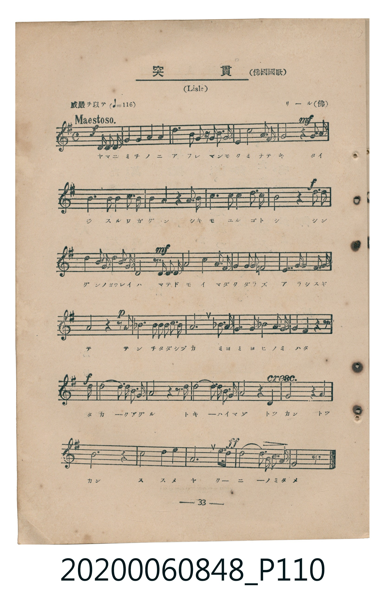
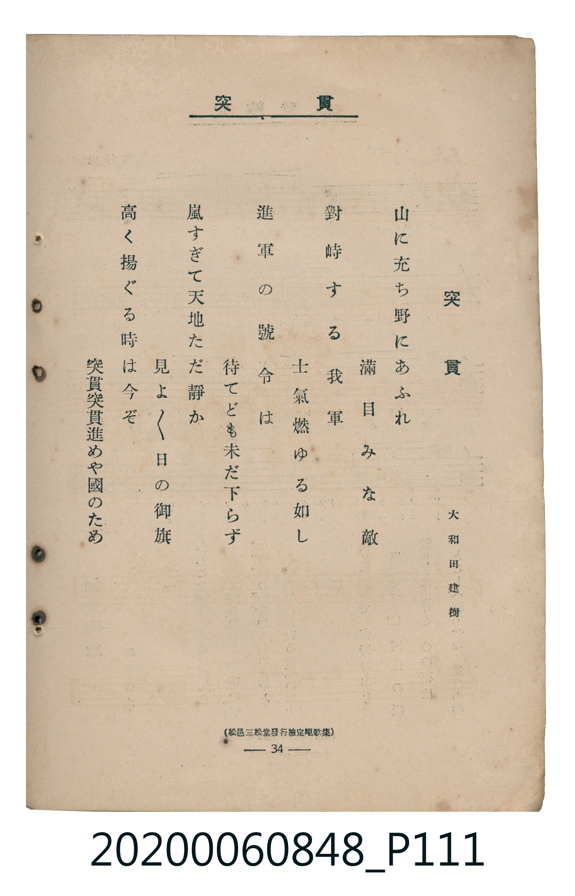

# 突貫

> Re:Shōka 使用 AI 協助辨識與重建樂譜，可能會有錯誤。歡迎回報。

- **鋼琴伴奏版**：<br><audio controls src="tokkan.mp3"></audio>

- 詞：大和田建樹
- 曲：リール（佛）（Lisle，佛國國歌）
- 臺灣教育會公認《新定兒童唱歌》高等科男子用（2020.006.0848）

## 說明

原書資訊與歌詞全文（對應 P110.jpg – P111.jpg，書頁 pp. 33–34，高二第三學期第 4 首）：
調性與拍號：ト長調（1 升記號）、4/4 拍（威嚴ヲ以テ ♩=116 Maestoso.）
出處註記：（松邑三松堂發行檢定唱歌集）


## 歌詞

```text
山に充ち野にあふれ　滿目みな敵
對峙する我軍　士氣燃ゆる如し
進軍の號令は　待てども未だ下らず
嵐すぎて天地ただ靜か　見よ／＼日の御旗
高く揚ぐる時は今ぞ　突貫突貫進めや國のため
```

## ABC

```abc
X:1
T:突貫
C:曲：リール（佛）（Lisle，佛國國歌）
M:4/4
L:1/16
Q:1/4=116
K:G
V:V1 name="Piano" snm="Pia"
[V:V1]
!f! z4 z4 z2 D2 D3 D | G4 G4 A4 A4 | d6 B2 G3 G B3 G | E4 c8 A3 F |
!mf! G8 z4 G3 A | B6 B2 B4 c3 B | B4 A4 z4 A3 B | c6 c2 c4 d3 c |
!f! B8 z4 d3 d | d4 B3 G d4 B3 G | !mf! D8 z D D D G4 | B4 d3 B G2 A2 B2 G2 |
A6 A2 c4 B3 A | !p! G8 z4 z2 G2 | _B6 B2 B2 B2 c2 d2 | A12 _B3 A |
G6 _B2 A3 G B3 A | !f! G4 F4 z4 z2 d2 | d10 B2 G3 A | B8 z4 z2 d2 |
d10 B2 G3 A | A8 z4 D4 | G8 z4 A4 | B12 z4 |
c8 d4 e4 | !ff! A12 f4 | g10 e2 c3 A | G8 z4 z4 |
```

## TMD 檔案連結

- [主旋律 TMD 檔案](tokkan.tmd) [[在 TMD Studio 編輯](https://tmdlang.github.io/Tmd-TS/#tmd=s7IKdvYPcrWy4qpTUCpJTLdSSM7PyUlNLsnMz7MqzsjMK0nNjM_KTMmPL87Iz05Ugisry88pzU21ys4vyY9Pyq8sjjcyMDKINzAwizewMLFAqCvOLy1KTrUqTs7Iz8-JL0mtKEnKz89GyBcU5Zel5iXmAdUUFIGsSwErQihILctMSQVJp6ZkluQXZSbmIDkitagY7FCwJfElRYl5xclFmQUg1yNUlWSkAl2am5mTWZJYVIkQBxqWnplnlZuamZWJxWVQ6fLU4pLUorz43NSc_BSgbi0theerGl9sWq2gpcWlaKtgaGjGZW-r4M5lY6JvYgfS_WLlvPd7Zj1dsvzppJ7nUzY83b3r2YqdYHOfzd4ElHncvOpx857Hzavf7-l4snf2-z2dQIZPZnFO6vs9PUCBp3O6gejZ2h6gDFjbi_ZdzxsXP5s680XTpmdzmp-2rnmxqvdxQ9ezaRuerpv1tHXS89VLn07ZCNTxuKH75eoZz9d2Pl8-8fmU7U_XTng-ZQXQdFDk6AEjRw8UOWBjufS1FGypBbgUFBSe9s1_NnvHi83tL1Z0vehoBzoGGA5PW1c8m9YOdMDTDb3P2jsVAgwNDfSyCtIVHjVMBnEMQRygr4E6Xy5oVCgo0FMwNgbKGZsABYE-ebKr5_maNU92dD5du-PZnPlAtoKJwstl08BhNgtk7YtV-581LAdZ2N37YuZ8cPB2vJy6HSgOtNZQ4Wkv0EEzwDKdjxsagXGkAFQJctGKxqeztjxu3vRk99LHzW0Kj2autAXGpYJvIjDC84vz9YAawP5q3_Vi5tQXK3YDjQGaDtT5bO6-l00TgY4CMp4uaHo-c8-LhT3PVi0CxQU4Fl7ObgNpBuveuPFx4-qnra2PGxe-bO8Dsh83Nj1u3Pq4CRhXDc92738-e93jxv2PG1c9m7oVrGFD79PNMx83znzc1P2sY-KL3cCIbni6ePWzDYuftzc_bmoDij9dBjRiOkj1y4ZNIBWN64AefLJ7yePG9SDV-4C2LXvcuPJxU9OzOaseNy54sqP7cVPn40ZwiD3dOgFkfCPQMcueLln5dM6Gx43zgYpezp3zuLEbqP_FMqDqjvd7-t_v2fNs-lKg6U_3LXw2HWLh6hmPG_uf9c963DgB5MKZQJesf7K763HjPKBOSMaAkECnPW5qfNzUAkzLQCNAdjQ1goygPLlBgYKWPheXbyIwjwZkJublO9QY1ChUg2xQsDE007IDs4Cp_OmejS-2bn-6of_5-gZw8lii8Lh5HhB3gwwAKapRMFDQBUNkujqtVsE0HsgAE2CqBhynIEPBqbIBGO8KGibAOAOZrQk2fD7Q4EYg7gNbUKPwuGkRkDUViNeArH3cvBlIAYWa1oMkwcq7gLgNrHQtEO8H4iUIlxlCXQSjjdDoGgVTKAsEjeEqDcFsEF2jYAbxgC4w7yCUIgwxB3oMbj4MwkKiOhcYDBBJIzT_7-rB9H_TDqDzdwI9tBqI1wPZa8Ae2wDkAT3etB3sSZDHQaGyDKKuaQuQ7gCrA8kDMVAtPAAg3kB4D8aH-MUYSQUsSGBOh_BBKpD9DWLD-JCgM0GzBcX7oEQAVYsW-51YfA_1Jyj2m9Y8bgJ5EBjtwPgEebkfmu7agLgTHAQgL8NSYwM4TYDp5pVA9i544gHxQAEDDNamdYiAgcU7LJ7R-UAVsHiHQXBkGoDEIQgW6Qj_QwwxBsuAwg-WoGrgoQsLWVgYQnSipY2ns2eDQ8cUJW-APA5O6OAwAuYSUGIHexwU561gD4PSDShTrIBnjxVAPAmao0D8frA6UDbZj5lNMOKvAORhmB-MdZCUgDkIAuQfkO9RfYoMobqBXkWxDiwM0QPMdJhqgNkL1U3wwgVkG2qOmoIZak2rgY0FSNoApQZgEgMFDCiYIFlmLVgalLigSQkkuA8s_bi5BRKmkACHCGCkHxQvQoMK4gNcmQJEQ4KKsBnogQkzA542cccdvIhDSVmta7GH0WawV0F5BFT8LASHEjBAmtaDwgfE6YYEFDQZARMPSHAh9oIGm3NQixGwH6C0GVwFrqRTnQaMb3OEj-OwqAGZArEBPYUhuwLuGq5aLi5dO2BzJTNPAUgrc3EBAA)]
- [鋼琴伴奏 TMD 檔案](tokkan_piano.tmd) [[在 TMD Studio 編輯](https://tmdlang.github.io/Tmd-TS/#tmd=s7IKdvYPcrWy4tLSUni-qvHFptXv93S87N7zfMKWJ3u2PF3a_7yz4_2eTgUtLS5FWwVDQzMue1sFdy4bE30TO646BaUXK-e93zPr6ZLlTyf1PJ-y4enuXc9W7FQCyTybvQko87h51ePmPY-bQcY-2TsbaBSQ4ZNZnJP6fk8PUODpnG4gera2BygD1vaifdfzxsXPps580bTp2Zzmp61rXqzqfdzQ9WzahqfrZj1tnfR89dKnUzYCdTxu6H65esbztZ3Pl098PmX707UTnk9ZATTdyMDIQM_AwEzPwMLEAmwsl29iZp5VQGZiXn6Qh0ONQY1CNZcCENgYmmnZgVn6WgpP92x8sXX70w39z9c3KGjpg4VrFAwUdMEQma5Oq1UwjQcywASYquGCGfN8zZonOxpeLOxBmGEI1QujjdDoGgVTKAsEjeEqDcFsEF2jYAaxSlfBBEkpwhBzoBPg5sMgzM3VuUAHQySN0Fy6qwfFpRD7EO6A8SGWGiOpgLkdZgeED1KB7EAQG8aH-NEEzRYUd4LCFaoWLUA7UZwJCy5Y8KDzgSpgwQWD4DAwAIlDECysEK6BGGIMlgH5BhYPNXC_wvwJ8xFEJ1qQPp09G2vkY3i2AOQemBXGOkhKwBwEAbIO5DhUhyBDqG6gS1CsAwtD9ACTEqYaYKJBdRM8cYNsQ00nU7BGAIojoJ6B2IErjkE0xDOEzUD3LswMeOTiDl141kKJmta1OFM7NkNQ0zLYZihtBleBK0qq04DhaI5wZxwWNSBTIDagxxyyK-Cu4apFLsh8UAoyE8LlGATW4Cun4hWiDWMVjICUaXwsKIAgAlBxUCEEZJnF5yKrgUoCKTTD0YoWhDqIWaYgs0BGgBhArXAjiTAarTiAqoO6FsloiE4MeQyb8GVfiCZw0EE4IO_DGTidjRpIcBdhRAFaxkJ3Kqb12PwJKtfAFQBMNdBmFE-hJ3zkgFUwAfJMgKZghA_cfLjJIKVGEH8juwyUMnXtFECJUwFIK3NxAQA)]

## 分析

```text
================================================================================
📊 TMD Song Profile: [ 突貫 ]
================================================================================
⏱  Duration:       0:57 (57.9s), 28 measures total
🎼 Key & Tempo:    首調基準 G, != 116.0 BPM, <4/4>
   - 分析範圍：      由實際發聲的音符與和弦推測調性；播放脈絡另行呈現
🎤 人聲音域:    D4 (MIDI 62) – G5 (MIDI 79) [跨度: 17 個半音 / 1.4 個八度, 難度: challenging]
   - 最低音:  D4 in [Main #1 @ m.1, 0:01]
   - 最高音: G5 in [Main #1 @ m.27, 0:53]
   - 適合: soprano, mezzo-soprano, tenor, baritone
🏛  結構:      Main (57.9s)
⚡ 編曲密度:        Peak 1 軌道同時演奏
🗝  調性診斷：       G 大調（流行色彩大調，未偵測到可信轉調）
   - 風格氣質:    流行大調（略帶和弦色彩音與裝飾副屬和弦）
   - 轉調歷程:    全曲維持單一推測調性（未偵測到可信轉調）
   - 核心骨幹音:  G, D, A, B, C
   - 調性數值:    G 大調 [相關度: 0.86, 穩定度: High, 自然音純度: 94.8%]
   - 候選調性 (K-S): G 大調 (0.86), D 大調 (0.68), B 小調 (0.56)
   - 五度圈歷程:   +1
   - 各段落調性細節:
     • [Main #1]: G 大調 (r: 0.86, 自然音純度: 94.8%, 調外音: A#)

  [ 五度圈游移軌跡 ]
               C  
         F           [G ]*
      Bb               D  
      Eb               A  
         Ab           E  
            Db       B  
               F# 
     (* = active key center)

  [ 十二半音累積音高分佈 ]
     C  : ███████████               10.6%
     C# :                            0.0%
     D  : █████████████████████     19.4%
     D# :                            0.0%
     E  : ███                        2.6%
     F  :                            0.0%
     F# : ██                         2.3%
     G  : ████████████████████████  22.5%
     G# :                            0.0%
     A  : ████████████████████      19.1%
     A# : ██████                     5.2%
     B  : ████████████████████      18.3%
--------------------------------------------------------------------------------
Assignment 軌道音域：
  - Piano         : D4 – G5 (17 個半音 / 1.4 個八度, 105 個音符)
================================================================================
```


## 原書掃描頁






