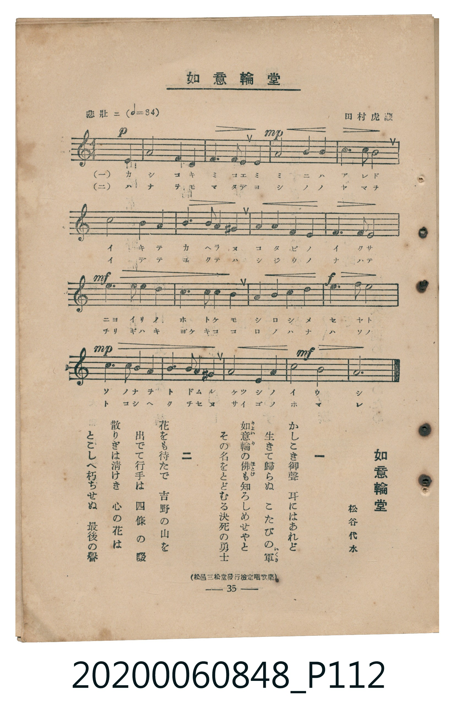

# 如意輪堂

> Re:Shōka 使用 AI 協助辨識與重建樂譜，可能會有錯誤。歡迎回報。

- **鋼琴伴奏版**：<br><audio controls src="nyoirindo.mp3"></audio>

- 詞：松谷代水（杉谷代水）
- 曲：田村虎藏
- 臺灣教育會公認《新定兒童唱歌》高等科男子用（2020.006.0848）

## 說明

原書資訊與歌詞全文（對應 P112.jpg，書頁 p. 35，高二第三學期第 5 首）：
調性與拍號：イ短調（無升降記號）、4/4 拍（悲壯ニ ♩=84，弱起第 4 拍進入）
出處註記：（松邑三松堂發行檢定唱歌集）


## 歌詞

```text
一　かしこき御聲　耳にはあれど
生きて歸らぬ　こたびの軍（いくさ）
如意輪（りよいりん）の佛（ほとけ）も知ろしめせやと
その名をとどむる決死の勇士
（註：五線譜下第 9 小節印作「ニヨイリノ」，下方歌詞欄振假名印作「りよいりんの」。）

二　花をも待たで　吉野の山を
出でて行手は　四條の畷
散りぎは清けき　心の花は
とこしへ朽ちせぬ　最後の譽
```

## ABC

<div class="abc-score" data-abc-src="nyoirindo.abc" aria-label="五線譜載入中"></div>

[下載 ABC 原始檔](nyoirindo.abc)

## TMD 檔案連結

- [主旋律 TMD 檔案](nyoirindo.tmd) [[在 TMD Studio 編輯](https://tmdlang.github.io/Tmd-TS/#tmd=s7IKdvYPcrWy4qpTUCpJTLdSSM7PyUlNLsnMz7MqzsjMK0nNjM_KTMmPL87Iz05Ugisry88pzU21ys4vyY9Pyq8sjjcyMDKINzAwizewMLFAqCvOLy1KTrUqTs7Iz8-JL0mtKEnKz89Gl48vSExPtQowNDRCyBQU5Zel5iXmAXUXFIEckgLWjlCQWpaZkgqSLk5OzIsvSy3KTMtMTUFyYmpRMdgbECtKihLzipOLMgtAfkOoyi8qychPL0osyKi0ysgsLskvykxOzInPTsxD8m1JRirQs0WpOZnpaJqBAnlWuamZWZlIntPSUni6rOlZS_-LPaueLmhS0NLiUrRVsDDhsrdVcObKTq20VXDM5bIx0TexAxn1YuW893tmPZu778WG7U92L362Ycv7PR3P5nYicTvBdj6bvQmo8PmUDc_mTnwxs-_F9H6w8Iv2Xc8bFz-bOvNF06Znc5qftq55sar3cUPXs2kbnq6b9bR10vPVS59O2fhsbc_jhu6Xq2c8X9v5fPnE51O2P1074fmUFUDLQJGnB4w8PVDkgW3j0tdSsKUW4FJQUHjaN__Z7B0vNre_WNH1oqMd6Bigt5-2rng2rR3ogKcbep-1dyqAUoBeVkH6-z09QMUvFzQqFOgpGJsCuUBnP9nV83zNmic7Op-u3fFsznwgW8FU4eWyaUD3AkMFZMeLVfufNSwHmd7d-2LmfKDo46Ylz-evBYoD7XjesvBpb_vLmb0vVswAy3Y-bmgExoECUDUowJs2PV28_nFzt8KjmSttLUyAlj7ds_HF1u0gi8CKXjZsetq6FKgP7J_2XS9mTn2xYjfQNKBF4Bjb97JpItB9QAYw1p_P3PNiYc-zVYtAcQAO_Zez20CaQbqf7Gh43NDwuLH7ceP0x42THzf2Pt238EXjJqDgi4bNjxtXP25c_7ix6XFTz-PGlSANz6fMByp63Ljs2dodj5s6HzeuAesH6gSKAzWse7Eb5InHjS2PG_sfN06FuRKWDEFyTV2Pm8AqQIzJIP83rnuydzZY2-7HjSseN04ECTY1PZ-_9HET0LLpj5saHzfOftwENHQFyLjHjXOBep5O6H3cNAmsYeXjpobHTd3PNu56thZoxLqn3e1PF68GKQWaCgwcYMg82TXl-fZZL9bOebKjGxSUlgpPN_Q_X9_wtHfDk71zHjf0AIP8cfMKYEw9bl71uLnvcQPQIz1Axc-m7YSkkmdrWp71rH_a2A60GKEL1TdAu4EaHzc0wUN4FzC1N7zo2ghyalPT032t4KBaDhR8OqHzZXsfyLUbQbLQ2ATJNS4DRVknMFbWg9TNnv1sEcjDz6duByl6NnUxyLJGoNb1z3YAzZsIihKguv3NoAgAWtW4HhJKwJABuggYs8CEuvdx40JQIIJj7Nmchqf7gHG67sXavSCllOctKFDQ0ufi8qvMzwQWlSn5VgGZiXn5DjW6hjXVIGsUbCy07MAMbNlaAZytGoBeV9CAJHkFQ1B6V9AGpntIZOnAs6YmFv1Au0Fm1ygYKOjCcXVBrYIxkK5RMAOSIGgCxEZgERALxAfJQ9RU5wKVwxSaQ3GNgmEcWABIgfggWAO2ysewRiEeyIPhx02rweofN22HqnvctBlMroWIN8-Hiz5uWgFigUUQMiCRbjDZDzVpEVR0DRB3otpuhGY7TE9zF9ysTWASZAZIfB7U9v1AdjtYBuQGFPc298FJkI4lUNF5ULMgtuOPw1094DgkMdKgYQwJclAU1EAD2xzMM1UHC4GYIAyKOkiUIUciaswA8zI8FkDh_7i5DepbUCyB-DOAeCWY1QOVgcTWfrDYZOSQgJr1uGk9EG_FiAcku6AhC7WreRlCH1gMEbOgMH_ctANMglQhQh0SfyCVED3EhPqOTnJCvTo3DZg_IEEPpMAsIxCBnOjBLEhOAIU9iAUWgiqsRhhhAjUCLSLARSs0HJYAuatQfDsb6tsOoOxGMAuaXiEh1AyOOyh7IVRmN1QPyLQOzNhoboRYAtK4DhrkiEwIc8pGWMIARzs8-iEWQjMCapZ63LwHKkZElAALbnCUmJIaJcAyCLXEwZsdwFEHVwSOUJS8BHYpXCUIgspF5GyyF-q3Pqg_IVkd5GtI0IIKnsfNC8AsWAG38XFzC9Q4WNyg5hRYqoZYjyhhQBBUWiHHFtQacKkIMWsGVNd6qAMaoXGOyKlbkS3aguwAaIKCFFtwBwALUHQH1HJx6dopwKsrBSBHmQsA)]
- [鋼琴伴奏 TMD 檔案](nyoirindo_piano.tmd) [[在 TMD Studio 編輯](https://tmdlang.github.io/Tmd-TS/#tmd=s7IKdvYPcrWy4qpTUCpJTLdSSM7PyUlNLsnMz7MqzsjMK0nNjM_KTMmPL87Iz05Ugisry88pzU21ys4vyY9Pyq8sjjcyMDKINzAwizewMLFAqCvOLy1KTrUqTs7Iz8-JL0mtKEnKz89Gl48vSExPtQowNDRCyBQU5Zel5iXmAXUXFIEckgLWjlCQWpaZkgqSLk5OzIsvSy3KTMtMTUFyYmpRMdgbECtKihLzipOLMgtAfkOoyi8qychPL0osyKi0ysgsLskvykxOzInPTsxD8m1iEVBzempual6JVUFmYl5-fGJycn5uQWJeJkgMobAkA6jIqig1JzMdzRagQJ5VbmpmViZSKGhpKTxd1vSspf_FnlVPFzS939PxsnvP8wlbnuzZ8nRp__POjvd7OhW0tLgUbRUsTLjsbRWcubJTK20VHHO5bEz0TexA5r9YOe_9nlnP5u57sWH7k92Ln23YAjTm2dxOJG4n2CHPZm8CKnw-ZcOzuRNfzOx7Mb0fLPyifdfzxsXPps580bTp2Zzmp61rXqzqfdzQ9WzahqfrZj1tnfR89dKnUzY-W9vzuKH75eoZz9d2Pl8-8fmU7U_XTng-ZQXQMlDU6wGjXg8U9WDbuPwq8zOBkZaSbxUACq4gD4caXcOaai4FILCx0LIDM_S1FGzRgcLzNWue7Gh4sbBHQePpno0vtm5XMFR41t2roK1govB0Q__z9Q06CqCEopdVkK6JRb-WPtjsGgUDBV04ri6oVTAG0jUKZkASBE2A2AgsAmKB-CB5iJrqXKBymEJzKK5RMIwDCwApEB8Ea8BW-RjWKMQDeTD8uGk1WP3jpu1QdY-bNoPJtRDx5vlw0cdNK0AssAhCBiTSDSb7oSYtgoquAeJOVNuN0GyH6Wnugpu1CUyCzACJz4Pavh_IbgfLgNyA4t7mPjgJ0rEEKjoPahbEdvxxuKsHHIckRho0jCFBDoqCGmhgm4N5pupgIRAThEFRB4ky5EhEjZnHTRDXw8L_cXMb1LegWALxZwDxSjCrByoDia39YLHJyCEBNetx03og3ooRD0h2QUMWalfzMoQ-sBgiZkFh_rhpB5gEqUKEOiT-QCoheogJ9R2d5IR6dW4aMH9Agh5IgVlGIAI50YNZkJwACnsQCywEVViNMMIEagRaRDR3Q1IayKdLgNxVKL6dDfVtB1B2I5gFTa-QEGoGxx2UvRAqsxuqB2RaB2ZsNDdCLAFpXAcNckQmhDllIyxhgKMdHv0QC6EZATVLPW7eAxUjIkqezp4NjhJTUqMEWAahljh4swM46uCKwBGKkpfALoWrBEFQuYicTfZC_dYH9Sckq4N8DQlaUMHzuHkBmAUr4DY-bm6BGgeLG9ScAkvVEOsRJQwIgkor5NiCWgMuFSFmzYDqWg91QCM0zhE5dSuyRVuQHQBNUJBiC-4AYAGK7oBajNrKB6W2MoHWVqAaBQKB4RgfrxBtFp8bq2AEZBiBGDUIpjGQYRwPEkKowysGNR8hg2DVwFVhM8EEoQzTdgxTiXUXkp8wLCfbqcjq8FsPDmJQtOjaKcBjJtrHMFYBVcAILKDMBQA)]

## 分析

```text
================================================================================
📊 TMD Song Profile: [ 如意輪堂 ]
================================================================================
⏱  Duration:       0:48 (48.6s), 17 measures total
🎼 Key & Tempo:    首調基準 C, != 84.0 BPM, <4/4>
   - 分析範圍：      由實際發聲的音符與和弦推測調性；播放脈絡另行呈現
🎤 人聲音域:    D4 (MIDI 62) – F5 (MIDI 77) [跨度: 15 個半音 / 1.2 個八度, 難度: moderate]
   - 最低音:  D4 in [Nyoirindo #1 @ m.2, 0:05]
   - 最高音: F5 in [Nyoirindo #1 @ m.13, 0:35]
   - 適合: soprano, mezzo-soprano, contralto, tenor, baritone, bass
🏛  結構:      Nyoirindo (48.6s)
⚡ 編曲密度:        Peak 1 軌道同時演奏
🗝  調性診斷：       A 小調（純淨自然小調，未偵測到可信轉調）
   - 風格氣質:    純淨自然小調（陰鬱抒情、旋律集中，無明顯調外色彩）
   - 轉調歷程:    全曲維持單一推測調性（未偵測到可信轉調）
   - 核心骨幹音:  A, B, E, C, F
   - 調性數值:    A 小調 [相關度: 0.87, 穩定度: High, 自然音純度: 97.1%]
   - 候選調性 (K-S): A 小調 (0.87), A 大調 (0.54), E 大調 (0.52)
   - 五度圈歷程:   +3
   - 各段落調性細節:
     • [Nyoirindo #1]: A 小調 (r: 0.83, 自然音純度: 96.9%, 調外音: G#)

  [ 五度圈游移軌跡 ]
               C  
         F            G  
      Bb               D  
      Eb              [A ]*
         Ab           E  
            Db       B  
               F# 
     (* = active key center)

  [ 十二半音累積音高分佈 ]
     C  : █████████████████         17.6%
     C# :                            0.0%
     D  : ████                       4.4%
     D# :                            0.0%
     E  : ███████████████████       19.9%
     F  : █████████                  9.6%
     F# :                            0.0%
     G  :                            0.0%
     G# : ███                        2.9%
     A  : ████████████████████████  25.0%
     A# :                            0.0%
     B  : ████████████████████      20.6%
--------------------------------------------------------------------------------
Assignment 軌道音域：
  - Piano         : D4 – F5 (15 個半音 / 1.2 個八度, 57 個音符)
================================================================================
```


## 原書掃描頁




