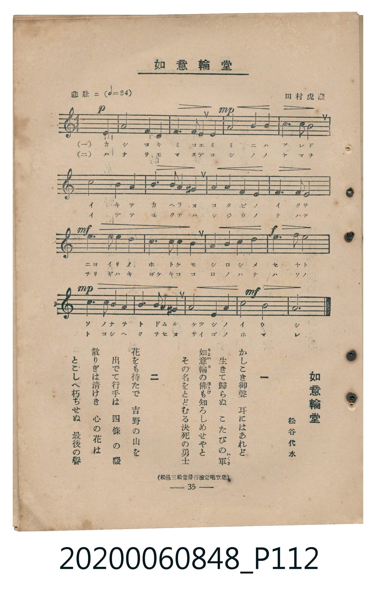

# 如意輪堂

> Re:Shoka 使用 AI 協助辨識與重建樂譜，可能會有錯誤。歡迎回報。

<audio controls src="nyoirindo.mp3"></audio>

- 詞：松谷代水（杉谷代水）
- 曲：田村虎藏
- 臺灣教育會公認《新定兒童唱歌》高等科男子用（2020.006.0848）

## 說明

原書資訊與歌詞全文（對應 P112.jpg，書頁 p. 35，高二第三學期第 5 首）：
調性與拍號：イ短調（無升降記號）、3/4 拍（悲壯ニ ♩=84）
出處註記：（松邑三松堂發行檢定唱歌集）

## 歌詞

```text
一　かしこき御聲　耳にはあれど
生きて歸らぬ　こたびの軍（いくさ）
如意輪（りよいりん）の佛（ほとけ）も知ろしめせやと
その名をとどむる決死の勇士

二　花をも待たで　吉野の山を
出でて行手は　四條の畷
散りぎは清けき　心の花は
とこしへ朽ちせぬ　最後の譽
```

## ABC

```abc
X:1
T:如意輪堂
C:曲：田村虎藏
M:3/4
L:1/16
Q:1/4=84
K:Am
V:V1 name="Piano" snm="Pia"
[V:V1]
!p! E,4 A,6 A,2 | B,6 A,2 B,4 | !mp! C8 B,2 A,2 | C6 B,2 A,4 |
E8 E2 D2 | C4 B,2 A,2 ^G,4 | A,4 B,4 C2 A,2 | B,6 E,2 E,4 |
!mf! C6 B,2 A,2 A,2 | D6 C2 B,2 A,2 | ^G,4 A,4 B,2 C2 | !f! D6 F2 E4 |
!mp! E,4 A,2 A,2 B,4 | C6 B,2 A,2 ^G,2 | A,2 B,2 C4 D4 | !mf! E8 B,4 |
A,12 |
```

## TMD 檔案連結

- [主旋律 TMD 檔案](nyoirindo.tmd) [[在 TMD Studio 編輯](https://tmdlang.github.io/Tmd-TS/#tmd=s7IKdvYPcrWy4qpTUCpJTLdSSM7PyUlNLsnMz7MqzsjMK0nNjM_KTMmPL87Iz05Ugisry88pzU21ys4vyY9Pyq8sjjcyMDKINzAwizewMLFAqCvOLy1KTrUqTs7Iz8-JL0mtKEnKz89GyBcU5Zel5iXmAdUUFIGsSwErQihILctMSQVJp6ZkluQXZSbmIDkitagY7FCwJfElRYl5xclFmQUg1yNUlWSkAl1alJqTmQ4W19JSeLqs6VlL_4s9q54uaFLQ0uJStFWwMOGyt1Vw5spOrbRVcMzlsjHWN7EDmfFi5bz3e2Y9m7vvxYbtT3YvfrZhy_s9Hc_mdiJxO8GWPZu9Cajw-ZQNz-ZOfDGz78X0frDwi_ZdzxsXP5s680XTpmdzmp-2rnmxqvdxQ9ezaRuerpv1tHXS89VLn07Z-Gxtz-OG7perZzxf2_l8-cTnU7Y_XTvh-ZQVQMtAQasHDFo9UNCCbePS11KwpRbgUlBQeNo3_9nsHS82t79Y0fWiox3oGKC3n7aueDatHeiApxt6n7V3KgQYGhrpZRWkv9_TA1T8ckGjQoGegrEpkAt09pNdPc_XrHmyo_Pp2h3P5swHshVMFV4umwZ0LzBUQHa8WLX_WcNykOndvS9mzgeKPm5a8nz-WqA40I7nLQuf9ra_nNn7YsUMsGzn44ZGYBwoAFWDArxp09PF6x83dys8mrnS1sIEKA92d_uuFzOnvlixG6gLaCA4Zva9bJoIdAeQAYzd5zP3vFjY82zVIlBYg0P55ew2kGaQ7ic7Gh43NDxu7H7cOP1x4-THjb1P9y180bgJKPiiYfPjxtWPG9c_bmx63NTzuHElSMPzKfOBih43Lnu2dsfjps7HjWvA-oE6geJADete7AY59nFjy-PG_seNU2GuhCU3kFxT1-MmsAoQYzLIn43rnuydDda2-3HjiseNE0GCTU3P5y993AS0bPrjpsbHjbMfNwENXQEy7nHjXKCepxN6HzdNAmtY-bip4XFT97ONu56tBRqx7ml3-9PFqyFe3AVMVg0vujaC1DY1Pd3XCnbrcqDg0wmdL9v7QMo3gmShwQmSa1wGCrNOYLCsB6mbPfvZIpCNz6duByl6NnUxyO2NQK3rn-0AmjcRFCZAdfubQSEAtKpxPcSZQKcBgwYYtMAUsfdx40KQL8BB9mxOw9N9wEBd92LtXpBSyhMxFCho6XNx-SZm5lkFZCbm5TvUGNQoVINsULCx0LIDM4BZB5xQG4B-VNAwUXi6of_5-gZNcHJcrfC4aTsQbwbitQo1Co-b50N5K2A8MO4G4n6QSNMiIGsNEHeCbAYZD7SvoFbBOF5BV8EMRICpGgVzOBvMAqrKBSozBAvqgsTAqiB8CA-oCByDMAfv6sHi4CVghz5ubgM7Buj85hlAvBKIe8AiIKfvB_ImA3EfWASkYz0Qb0U42BjqCmMFI6gbIC4wVYc4FewYsLMNUTwD9CTYn6ju3NGJ6U5wgK2A2N68CuaW5tlA3AEU3QikF4FdBwz8ZqB_wPRCsMhuIAukqwMpgHPTYEEHcSjYUUZgAUN4WEJcD3O7IUgfUBtElQnYzyjuBqZysLtNUcJ3L9itj5u7gHgT2M1A9wIj-3HzAiBeDXYhyPUtUDcjwngZ1D9IrkZKF4h0gOwPkJPBwQ12sC7YsVDvwuIIqguatCCwhquWi0vXTgGU7hWAtDIXFwA)]
- [鋼琴伴奏 TMD 檔案](nyoirindo_piano.tmd) [[在 TMD Studio 編輯](https://tmdlang.github.io/Tmd-TS/#tmd=s7IKdvYPcrWy4tLSUni6rOlZS_-LPaueLmh6v6fjZfee5xO2PNmz5enS_uedHe_3dCpoaXEp2ipYmHDZ2yo4c2WnVtoqOOZy2Rjrm9hx1SkovVg57_2eWc_m7nuxYfuT3YufbdgCNObZ3E4kbqcSSOGz2ZuACp9P2fBs7sQXM_teTO8HC79o3_W8cfGzqTNfNG16Nqf5aeuaF6t6Hzd0PZu24em6WU9bJz1fvfTplI3P1vY8buh-uXrG87Wdz5dPfD5l-9O1E55PWQG0zMjAyEDPwMBMz8DCxAJsG5dvYmaeVUBmYl5-kIdDjUGNQjWXAhDYWGjZgRn6WgrP16x5sqPhxcIeBS19sBhQUUGtgnG8gq6CGYgAUzUK5nA2mAVUlQtUZggW1AWJgVVB-BAeUBEXsi27elBsMYZqNVYwgmqEaDNVh5gPNgFslyGKC4AuAzsO1fAdnaheyE2DOQ5iKtgEI7CAIdy1EKtgFhmC9AG1QVSZgB2IYsnT2bPRLEEKKETAIFsLsgHsFbD5umCzoa6D-R-qCxrWEFjDVYsceT4okWeCN_LM4uMVos3ic2OhJDCggQLG8UA-iMCmAEMET6yRYrwJWABVHk-cYRptBBQwAguASSSz0BUAJZCNRo8pfH4GaVUwAfJAzgUaCLEFohjdSwaQmNG1UwBFjgKQVubiAgA)]

## 分析

```text
================================================================================
📊 TMD Song Profile: [ 如意輪堂 ]
================================================================================
⏱  Duration:       0:36 (36.4s), 17 measures total
🎼 Key & Tempo:    首調基準 C, != 84.0 BPM, <3/4>
   - 分析範圍：      由實際發聲的音符與和弦推測調性；播放脈絡另行呈現
🎤 人聲音域:    E3 (MIDI 52) – F4 (MIDI 65) [跨度: 13 個半音 / 1.1 個八度, 難度: moderate]
   - 最低音:  E3 in [Main #1 @ m.1, 0:00]
   - 最高音: F4 in [Main #1 @ m.12, 0:24]
   - 適合: contralto, tenor, baritone, bass
🏛  結構:      Main (36.4s)
⚡ 編曲密度:        Peak 1 軌道同時演奏
🗝  調性診斷：       A 小調（純淨自然小調，未偵測到可信轉調）
   - 風格氣質:    純淨自然小調（陰鬱抒情、旋律集中，無明顯調外色彩）
   - 轉調歷程:    全曲維持單一推測調性（未偵測到可信轉調）
   - 核心骨幹音:  A, B, C, E, D
   - 調性數值:    A 小調 [相關度: 0.84, 穩定度: High, 自然音純度: 95.1%]
   - 候選調性 (K-S): A 小調 (0.84), A 大調 (0.58), E 大調 (0.51)
   - 五度圈歷程:   +3
   - 各段落調性細節:
     • [Main #1]: A 小調 (r: 0.84, 自然音純度: 95.1%, 調外音: G#)

  [ 五度圈游移軌跡 ]
               C  
         F            G  
      Bb               D  
      Eb              [A ]*
         Ab           E  
            Db       B  
               F# 
     (* = active key center)

  [ 十二半音累積音高分佈 ]
     C  : ██████████████████        19.6%
     C# :                            0.0%
     D  : ████████                   8.8%
     D# :                            0.0%
     E  : ████████████████          17.6%
     F  : █                          1.0%
     F# :                            0.0%
     G  :                            0.0%
     G# : ████                       4.9%
     A  : ████████████████████████  26.5%
     A# :                            0.0%
     B  : ████████████████████      21.6%
--------------------------------------------------------------------------------
Assignment 軌道音域：
  - Piano         : E3 – F4 (13 個半音 / 1.1 個八度, 56 個音符)
================================================================================
```


## 原書掃描頁




