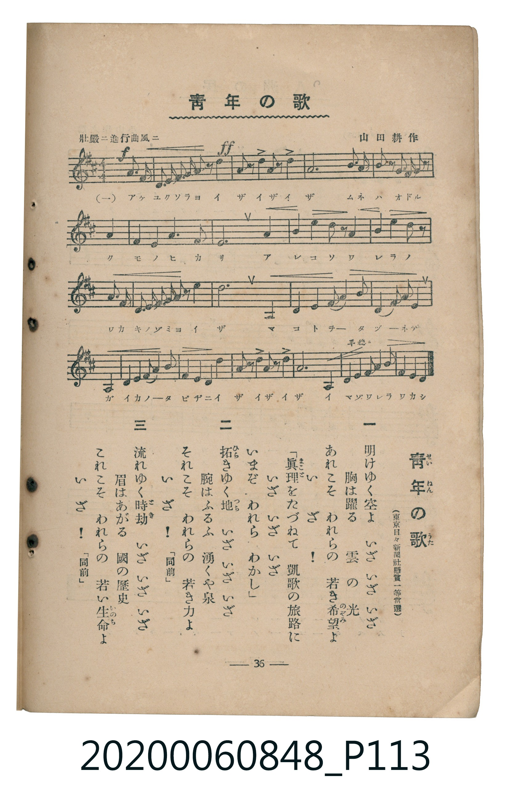

# 青年の歌

<audio controls src="seinen_no_uta.mp3"></audio>

- 曲：山田耕作
- （東京日々新聞社懸賞一等當選）
- 臺灣教育會公認《新定兒童唱歌》高等科男子用（2020.006.0848）

## 說明

原書資訊與歌詞全文（對應 P113.jpg，書頁 p. 36，高二第三學期第 6 首）：
調性與拍號：ニ長調（2 升記號）、4/4 拍（壯嚴ニ進行曲風ニ）

## 歌詞

```text
一　明けゆく空よ　いざ　いざ　いざ
胸は躍る　雲の光
あれこそ　われらの　若き希望（のぞみ）よ
いざ！
「眞理（まこと）をたづねて　凱歌の旅路に
いざ　いざ　いざ
いまぞ　われら　わかし」

二　拓（ひら）きゆく地（つち）　いざ　いざ　いざ
腕はふるふ　湧くや泉
それこそ　われらの　若き力よ
いざ！　「同前」

三　流れゆく時劫（とき）　いざ　いざ　いざ
眉はあがる　國の歷史
これこそ　われらの　若い生命（いのち）よ
いざ！　「同前」
```

## ABC

```abc
X:1
T:青年の歌
C:曲：山田耕作
M:4/4
L:1/16
Q:1/4=108
K:D
V:V1 name="Piano" snm="Pia"
[V:V1]
!f! D2 D2 E2 F2 G2 A2 B2 z2 | !ff! d4 A2 z2 B2 F2 z2 A2 | D12 F3 G | A4 d2 z2 B2 z2 G2 z2 |
F4 D4 E4 F4 | G4 E8 A4 | B4 c4 d2 z2 A4 | B6 A2 F6 z2 |
G4 F2 E2 D2 E2 F2 G2 | A4 d8 A,4 | B,4 C4 D4 E4 | F4 D2 E2 F4 A4 |
A,2 B,2 C2 D2 E2 F2 G2 A2 | d4 A2 z2 B2 F2 z2 A2 | !mf! d8 A,4 D2 E2 | F2 G2 A4 B2 c2 d4 |
```

## TMD 檔案連結

- [主旋律 TMD 檔案](seinen_no_uta.tmd)
- [鋼琴伴奏 TMD 檔案](seinen_no_uta_piano.tmd)

## 分析

```text
================================================================================
📊 TMD Song Profile: [ 青年の歌 ]
================================================================================
⏱  Duration:       0:35 (35.6s), 16 measures total
🎼 Key & Tempo:    首調基準 D, != 108.0 BPM, <4/4>
   - 分析範圍：      由實際發聲的音符與和弦推測調性；播放脈絡另行呈現
🎤 人聲音域:    A2 (MIDI 45) – D4 (MIDI 62) [跨度: 17 個半音 / 1.4 個八度, 難度: challenging]
   - 最低音:  A2 in [Main #1 @ m.10, 0:21]
   - 最高音: D4 in [Main #1 @ m.2, 0:02]
   - 適合: tenor, baritone, bass
🏛  結構:      Main (35.6s)
⚡ 編曲密度:        Peak 1 軌道同時演奏
🗝  調性診斷：       D 大調（純淨自然大調，未偵測到可信轉調）
   - 風格氣質:    純淨自然大調（陽光明朗、易唱易記，無明顯調外色彩）
   - 轉調歷程:    全曲維持單一推測調性（未偵測到可信轉調）
   - 核心骨幹音:  D, A, F#, E, B
   - 調性數值:    D 大調 [相關度: 0.98, 穩定度: High, 自然音純度: 100.0%]
   - 候選調性 (K-S): D 大調 (0.98), A 大調 (0.69), B 小調 (0.68)
   - 五度圈歷程:   +2
   - 各段落調性細節:
     • [Main #1]: D 大調 (r: 0.98, 自然音純度: 100.0%)

  [ 五度圈游移軌跡 ]
               C  
         F            G  
      Bb              [D ]*
      Eb               A  
         Ab           E  
            Db       B  
               F# 
     (* = active key center)

  [ 十二半音累積音高分佈 ]
     C  :                            0.0%
     C# : █████                      5.1%
     D  : ████████████████████████  27.1%
     D# :                            0.0%
     E  : ███████████               11.9%
     F  :                            0.0%
     F# : ███████████████           16.5%
     G  : ███████                    8.1%
     G# :                            0.0%
     A  : ██████████████████        20.3%
     A# :                            0.0%
     B  : ██████████                11.0%
--------------------------------------------------------------------------------
Assignment 軌道音域：
  - Piano         : A2 – D4 (17 個半音 / 1.4 個八度, 75 個音符)
================================================================================
```


## 原書掃描頁




