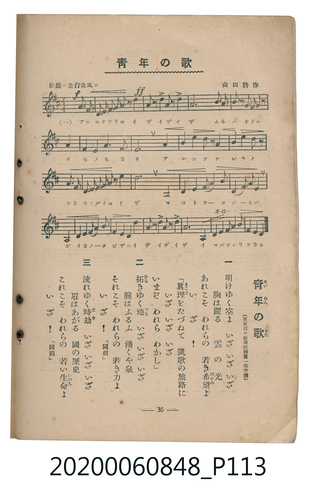

# 青年の歌

> Re:Shōka 使用 AI 協助辨識與重建樂譜，可能會有錯誤。歡迎回報。

- **鋼琴伴奏版**：<br><audio controls src="seinen_no_uta.mp3"></audio>
- **NEUTRINO 歌聲合成版**：<br><audio controls src="seinen_no_uta_neutrino.mp3"></audio>

- 曲：山田耕作
- （東京日々新聞社懸賞一等當選）
- 臺灣教育會公認《新定兒童唱歌》高等科男子用（2020.006.0848）

## 說明

原書資訊與歌詞全文（對應 P113.jpg，書頁 p. 36，高二第三學期第 6 首）：
調性與拍號：ニ長調（2 升記號）、4/4 拍（壯嚴ニ進行曲風ニ，弱起第 4 拍進入）


## 歌詞

```text
一　明けゆく空よ　いざ　いざ　いざ
胸は躍る　雲の光
あれこそ　われらの　若き希望（のぞみ）よ
いざ！
「眞理（まこと）をたづねて　凱歌の旅路に
いざ　いざ　いざ
いまぞ　われら　わかし」

二　拓（ひら）きゆく地（つち）　いざ　いざ　いざ
腕はふるふ　湧くや泉
それこそ　われらの　若き力よ
いざ！　「同前」

三　流れゆく時劫（とき）　いざ　いざ　いざ
眉はあがる　國の歷史
これこそ　われらの　若い生命（いのち）よ
いざ！　「同前」
```

## ABC

<div class="abc-score" data-abc-src="seinen_no_uta.abc" aria-label="五線譜載入中"></div>

[下載 ABC 原始檔](seinen_no_uta.abc)

## TMD 檔案連結

- [主旋律 TMD 檔案](seinen_no_uta.tmd) [[在 TMD Studio 編輯](https://tmdlang.github.io/Tmd-TS/#tmd=s7IKdvYPcrWy4qpTUCpJTLdSSM7PyUlNLsnMz7MqzsjMK0nNjM_KTMmPL87Iz05Ugisry88pzU21ys4vyY9Pyq8sjjcyMDKINzAwizewMLFAqCvOLy1KTrUqTs7Iz8-JL0mtKEnKz89Gl48vSExPtQowNDRGyBQU5Zel5iXmAXUXFIEckgLWjlCQWpaZkgqSLk5OzIsvSy3KTMtMTUFyYmpRMdgbECtKihLzipOLMgtAfkOoyi8qychPL0osyKi0ysgsLskvykxOzInPTsxD8m1JRirQs1BP5GSmpaJLJefn5pbmZZZUIhucmZ6ZZ1WSmAkMOlDwlSfG5yZm5uUk5gEdqaWl8HLupKc7tzxuXPdsbY-ClhaXoq2CoYEFl72tgguXjYm-iR3IqGezN73fM-vpxo3Pp2x40TD1yd45YBve7-l4Nnfjk11rnk1f-rih9dm0DS8a5z1fsu9Z-44Xm-c92dHwfG3n86nbXjbueL-nE6zjRfuu542Ln02d-aJp07M5zU9b17xY1fu4oQuo9em6WU9bJz1fvfTplI1Atzxu6H65egbIgOUTn0_Z_nTthOdTVgAtBMWwHjCG9UAxDDaWS19LwZZagEtBQeFp3_xns4E-aH-xoutFRzvQMS9WznvauuLZtHagA55u6H3W3qkASiZ6WQXp7_f0ABW_XNCoUKCnYGwG5AKd_WRXz_M1a57s6Hy6dsezOfOBbAUzhZfLpgHdCwxHkB0vVu1_1rAcZHp374uZ84Gij5u7X07dDhQHeVLhaS_Q9hlgmc7HDY3AiFAAqgRZv3j901lbQIobNr1YCLR708tFK4BcoMVP92x8sXU7yDKwYqCCp61Lgfq5QBYCY-NxQ8OzGX2PGyc-bmp73Nj_fOWux00dQMHHjS2PG6dhMsDubN7xuHH9i129j5u6gRIvZ28CJpWnrZ0guceNTY-beh43Tn7cOBekqakfxG3qBKoAcl90L33c2Pt0R8-zObOB7gYJNs573Aj0XifQWoh-kC3v9zSCOQ09z-fMez6hDax2H9hUYHwD1U563Dj_cSPQsLWPG5cBDX7aDk4fwBQ7vfXF9vWPG1cjDMPuCTALaOQ8FFdC2I3djxunP27ohQTSLmC6a3jWPRnsiE1AVSAXNAI9Dwqwp3M2gMWXPG5cCI4W_CHXOhUYco8bt4JCDkgCzd25HGjK46aWZ5uh4TeXcPh1zUYPLZDShp6nE3qedgKzDtThO0DOeba1EWwCyLHPZjY97VoNdu8KoDmE3ft8DtBioHubHjcCjQBF9tM5QIcDy4XtT_s3QVwwmZB7W55Pmf904l6wtUCDgVEODikCPgDKUZ5zoUBBS5-LKzg1My81zy8_tCTRKiAzMS_foUbXsKYaZJGCjaGZlh2Yha3cUADn2wZgzlLQgOQnBUNQZlLQBmaqpxv6n69v0IHnfU0s-oHWg8yuUTBQ0AVDdLo6rVbBFMwyBqoyBNJGYDZIxAQsA1JZnQZUZhgH1VMDF4cLYQhA1GCDZlANNWAWSJMJ1FYQDeLDdNaA3e5jWKMQDxVBpx83LYLSG4HmPW5eBmavB5N7ITLNK4F4BVTP46YlcPc9btqGIYpNDKYSG3zcvABK94Lt74frXgUW7QSTq-GiIJch-cwIj8-aJ4GcDnHUWnTPNbdAFTUC8R5aea4JZCPIlnZUzzVPhXsLwoaIonnOGJ_nuh43rYEy12B4rgPubRp6rnkelF6GFnOgFAVxHfaYw59Zd_WAMyuJuROS3yC5AASR8w5IrgYugw7heQWar4BmwLIgOC-i5CeCaoBlADzPPW6G5C1QOPTBWZOQ7H7cBAofkEpQascaytD8CVEFiXGQ6GY4C5RL0ZIPskpoFoC5AVklyHZEPkLE0ONmRJqAsSDirVDT5-N0LaTMoLFrgRkD2EJCUQlhwcyBqF8LMb1pO07XwtxFK9cSqJY6yUnpuGoYeIoEKoEx0aEprPyAGAOCsGwBMg6WzEGJHKECJgPPWnBDECkdHNaQUHjctA8aJvPx1htYYwRapkBUweMBWp6BWJvAJKhMg_BBLJDa_XARUBoF1SYgsg0mCi0rkesNmJsbwfKgfAiJ0UHrZlCqB7sISkLTPaQKG3xuxpv2n86eDU77ZqSnfRDEnWjR6wGYDio1vQhkIJhp-N0Cazki5x9EiQtJifDchIgDcNiDyp_JcBVNcBa8NKR6EwZJFTzVwPI4cskIKRchZSJILVwc4SN4SYxWgoBz44gOAXjeHokhUMvFpWungNTHUwBylbkA)]
- [鋼琴伴奏 TMD 檔案](seinen_no_uta_piano.tmd) [[在 TMD Studio 編輯](https://tmdlang.github.io/Tmd-TS/#tmd=s7IKdvYPcrWy4qpTUCpJTLdSSM7PyUlNLsnMz7MqzsjMK0nNjM_KTMmPL87Iz05Ugisry88pzU21ys4vyY9Pyq8sjjcyMDKINzAwizewMLFAqCvOLy1KTrUqTs7Iz8-JL0mtKEnKz89Gl48vSExPtQowNDRGyBQU5Zel5iXmAXUXFIEckgLWjlCQWpaZkgqSLk5OzIsvSy3KTMtMTUFyYmpRMdgbECtKihLzipOLMgtAfkOoyi8qychPL0osyKi0ysgsLskvykxOzInPTsxD8m1iEVBzempual6JVUFmYl5-fGJycn5uQWJeJkgMobAkA6gI5tuczLRUdCmgrtzSvMySSmQXZKZn5lmVJGYCwxgUzuWJ8bmJmXk5iXlA32hpKbycO-npzi2PG9c9W9vzfk_Hy-49zydsebJny9Ol_c87O97v6VTQ0uJStFUwNLDgsrdVcOGyMdE3sQOZ_2z2pvd7Zj3duPH5lA0vGqY-2TsHbC3QkGdzNz7ZtebZ9KWPG1qfTdvwonHe8yX7nrXveLF53pMdDc_Xdj6fuu1l4w6g4WAdL9p3PW9c_GzqzBdNm57NaX7auubFqt7HDV1ArU_XzXraOun56qVPp2wEOvBxQ_fL1TNABiyf-HzK9qdrJzyfsgJoISh96AHThx4ofYCN5QpOzcxLzfPLDy1JtAoAhWqQh0ONrmFNNZcCENgYmmnZgVn6Wgq26EDh-Zo1QIe-WNijoPF0z8YXW7crGCo86-5V0FYwUXi6of_5-gYdBVCC0ssqSNfEol9LH2x2jYKBgi4YotPVabUKpmCWMVCVIZA2ArNBIiZgGZDK6jSgMsM4qJ4auDhcCEMAogYbNINqqAGzQJpMoLaCaBAfprMG7HYfwxqFeKgIOv24aRGU3gg073HzMjB7PZjcC5FpXgnEK6B6HjctgbvvcdM2DFFsYjCV2ODj5gVQuhdsfz9c9yqwaCeYXA0XBbkMyWdGeHzWPAnkdIij1qJ7rrkFqqgRiPfQynNNIBtBtrSjeq55KtxbEDZEFM1zxvg81_W4aQ2UuQbDcx1wb9PQc83zoPQytJgDpSiI67DHHP7MuqsHnFlJzJ2Q_AbJBSCInHdAcjVwGXQIzyvQfAU0A5YFwXkRJT8RVAMsA-B57nEzJG-BwqEPzpqEZPfjJlD4gFSCUjvWUIbmT4gqSIyDRDfDWaBcipZ8kFVCswDMDcgqQbYj8hEihh43I9IEjAURb4WaPh-nayFlBo1dC8wYj5u7UVRCWDBzIOrXQkxv2o7TtTB30cq1BKqlTnJSOq4aBp4igUpgTHRoCis_IMaAICxbgIyDJXNQIkeogMnAsxbcEERKB4c1JBQeN-2Dhsl8vPUG1hiBlikQVfB4gJZnINYmMAkq0yB8EAukdj9cBJRGQbUJiGyDiULLSuR6A-bmRrA8KB9CYnTQuhmU6sEugpLQdA-pwgafm_Gm_aezZ4PTvhnpaR8EcSda9HoApoNKTS8CGQhmGn63wFqOyPkHUeJCUiI8NyHiABz2oPJnMlxFE5wFLw2p3oRBUgVPNbA8jlwyQspFSJkIUgsXR_gIXhKjlSDg3DiiQwCet0diCNRi6eL5oHTxTKA9PFAvDAKB-S9eIdowFkYR5psAGSbxscAsDGSYAhmQoMdUCFcAYoBsgunEMAomgGoQwgIko_G4mKCDCPExHIxbA1AWFNy6dgpIIR7tA5REFzLCFDIGCylzAQA)]

## 分析

```text
================================================================================
📊 TMD Song Profile: [ 青年の歌 ]
================================================================================
⏱  Duration:       0:40 (40.0s), 18 measures total
🎼 Key & Tempo:    首調基準 D, != 108.0 BPM, <4/4>
   - 分析範圍：      由實際發聲的音符與和弦推測調性；播放脈絡另行呈現
🎤 人聲音域:    A3 (MIDI 57) – E5 (MIDI 76) [跨度: 19 個半音 / 1.6 個八度, 難度: challenging]
   - 最低音:  A3 in [SeinenNoUta #1 @ m.11, 0:23]
   - 最高音: E5 in [SeinenNoUta #1 @ m.8, 0:16]
   - 適合: soprano, mezzo-soprano, contralto, tenor, baritone, bass
🏛  結構:      SeinenNoUta (40.0s)
⚡ 編曲密度:        Peak 1 軌道同時演奏
🗝  調性診斷：       A 調性不明確（純淨自然大調，未偵測到可信轉調）
   - 風格氣質:    純淨自然大調（陽光明朗、易唱易記，無明顯調外色彩）
   - 轉調歷程:    全曲維持單一推測調性（未偵測到可信轉調）
   - 核心骨幹音:  A, D, E, F#, B
   - 調性數值:    A 調性不明確 [相關度: 0.85, 穩定度: Ambiguous, 自然音純度: 97.8%]
   - 候選調性 (K-S): A 大調 (0.85), D 大調 (0.83), A 小調 (0.56)
   - 五度圈歷程:   +3
   - 各段落調性細節:
     • [SeinenNoUta #1]: A 調性不明確 (r: 0.85, 自然音純度: 97.7%, 調外音: G)

  [ 五度圈游移軌跡 ]
               C  
         F            G  
      Bb               D  
      Eb              [A ]*
         Ab           E  
            Db       B  
               F# 
     (* = active key center)

  [ 十二半音累積音高分佈 ]
     C  :                            0.0%
     C# :                            0.0%
     D  : ███████████████████       25.4%
     D# :                            0.0%
     E  : ████████████████          21.6%
     F  :                            0.0%
     F# : █████████                 11.9%
     G  : ██                         2.2%
     G# :                            0.0%
     A  : ████████████████████████  31.7%
     A# :                            0.0%
     B  : █████                      7.1%
--------------------------------------------------------------------------------
Assignment 軌道音域：
  - Piano         : A3 – E5 (19 個半音 / 1.6 個八度, 76 個音符)
================================================================================
```


## 原書掃描頁




