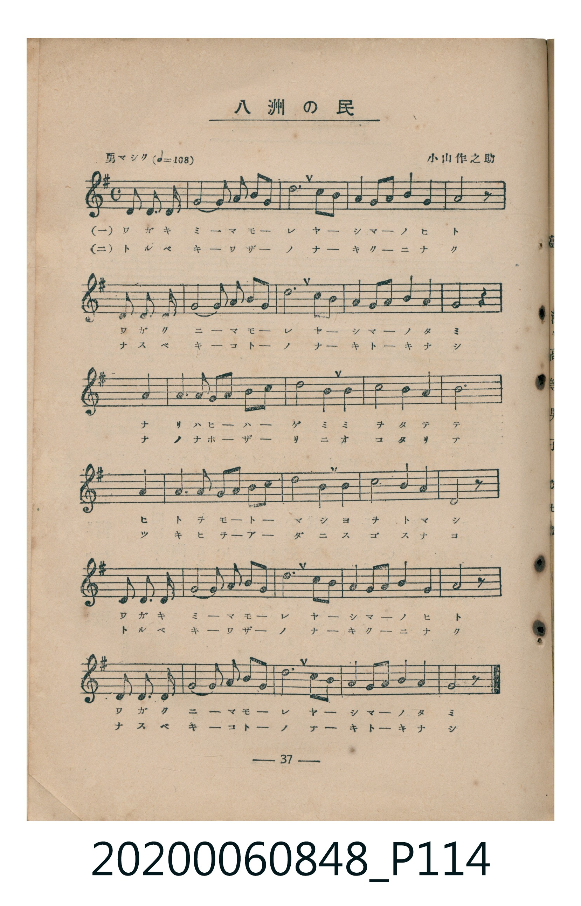
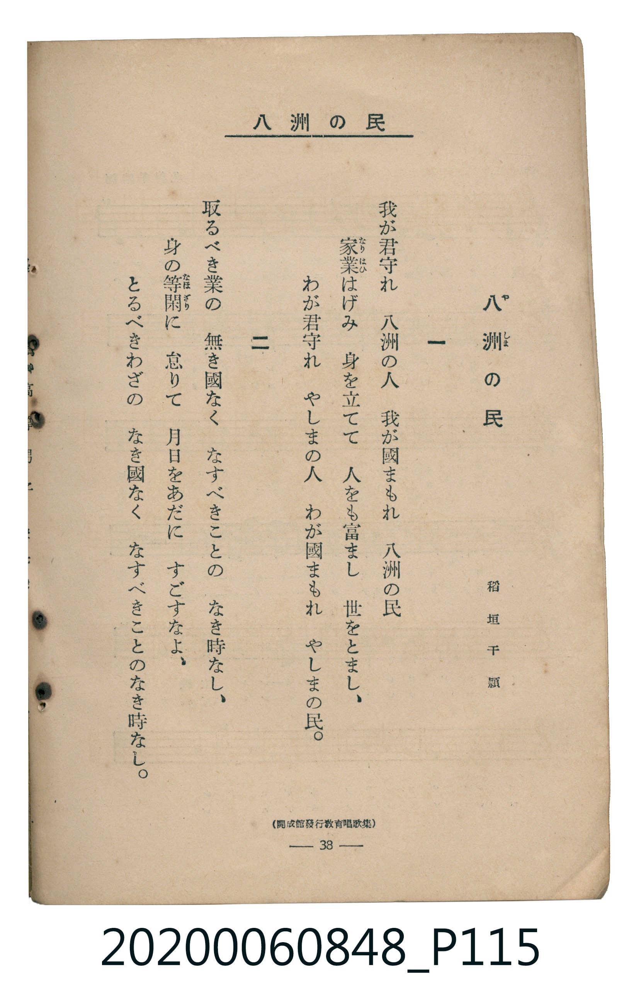

# 八洲の民

<audio controls src="yashima_no_tami.mp3"></audio>

- 詞：稻垣千頴
- 曲：小山作之助
- 臺灣教育會公認《新定兒童唱歌》高等科男子用（2020.006.0848）

## 說明

原書資訊與歌詞全文（對應 P114.jpg – P115.jpg，書頁 pp. 37–38，高二第三學期第 7 首）：
調性與拍號：ト長調（1 升記號）、4/4 拍（勇マシク ♩=108，弱起三個八分音符進入）
出處註記：（開成館發行教育唱歌集）

## 歌詞

```text
一　我が君守れ　八洲（やしま）の人　我が國まもれ　八洲の民
家業（なりはひ）はげみ　身を立てて　人をも富まし　世をとまし、
わが君守れ　やしまの人　わが國まもれ　やしまの民。

二　取るべき業の　無き國なく　なすべきことの　なき時なし、
身の等閑（なほざり）に　怠りて　月日をあだに　すごすなよ、
とるべきわざの　なき國なく　なすべきことのなき時なし。
```

## ABC

```abc
X:1
T:八洲の民
C:曲：小山作之助
M:4/4
L:1/16
Q:1/4=108
K:G
V:V1 name="Piano" snm="Pia"
[V:V1]
!mf! z4 z4 z2 D2 D2 D2 | G8 A2 B2 c2 B2 | d12 B2 G2 | A4 A2 B2 c4 A4 |
B8 z2 D2 D2 D2 | G8 A2 B2 c2 B2 | d12 B2 G2 | A4 G2 A2 B4 A4 |
G8 z4 A4 | A6 B2 c2 d2 c2 B2 | A4 d8 A4 | d8 c4 B4 |
A12 A4 | A6 B2 c2 d2 c2 B2 | A4 d8 c4 | B8 A4 G4 |
!f! D8 z2 D2 D2 D2 | G8 A2 B2 c2 B2 | d12 B2 G2 | A4 A2 B2 c4 A4 |
B8 z2 D2 D2 D2 | G8 A2 B2 c2 B2 | d12 B2 G2 | A4 G2 A2 B4 A4 |
G8 z4 z4 |
```

## TMD 檔案連結

- [主旋律 TMD 檔案](yashima_no_tami.tmd)
- [鋼琴伴奏 TMD 檔案](yashima_no_tami_piano.tmd)

## 分析

```text
================================================================================
📊 TMD Song Profile: [ 八洲の民 ]
================================================================================
⏱  Duration:       0:55 (55.6s), 25 measures total
🎼 Key & Tempo:    首調基準 G, != 108.0 BPM, <4/4>
   - 分析範圍：      由實際發聲的音符與和弦推測調性；播放脈絡另行呈現
🎤 人聲音域:    D4 (MIDI 62) – D5 (MIDI 74) [跨度: 12 個半音 / 1.0 個八度, 難度: easy]
   - 最低音:  D4 in [Main #1 @ m.1, 0:01]
   - 最高音: D5 in [Main #1 @ m.3, 0:04]
   - 適合: soprano, mezzo-soprano, contralto, tenor, baritone, bass
🏛  結構:      Main (55.6s)
⚡ 編曲密度:        Peak 1 軌道同時演奏
🗝  調性診斷：       D 大調（流行色彩大調，未偵測到可信轉調）
   - 風格氣質:    流行大調（略帶和弦色彩音與裝飾副屬和弦）
   - 轉調歷程:    全曲維持單一推測調性（未偵測到可信轉調）
   - 核心骨幹音:  D, A, B, G, C
   - 調性數值:    D 大調 [相關度: 0.79, 穩定度: Moderate, 自然音純度: 91.4%]
   - 候選調性 (K-S): D 大調 (0.79), G 大調 (0.74), B 小調 (0.57)
   - 五度圈歷程:   +2
   - 各段落調性細節:
     • [Main #1]: D 大調 (r: 0.79, 自然音純度: 91.4%, 調外音: C)

  [ 五度圈游移軌跡 ]
               C  
         F            G  
      Bb              [D ]*
      Eb               A  
         Ab           E  
            Db       B  
               F# 
     (* = active key center)

  [ 十二半音累積音高分佈 ]
     C  : ███████                    8.6%
     C# :                            0.0%
     D  : ████████████████████████  29.0%
     D# :                            0.0%
     E  :                            0.0%
     F  :                            0.0%
     F# :                            0.0%
     G  : ██████████████            17.2%
     G# :                            0.0%
     A  : █████████████████████     25.8%
     A# :                            0.0%
     B  : ████████████████          19.4%
--------------------------------------------------------------------------------
Assignment 軌道音域：
  - Piano         : D4 – D5 (12 個半音 / 1.0 個八度, 96 個音符)
================================================================================
```


## 原書掃描頁






