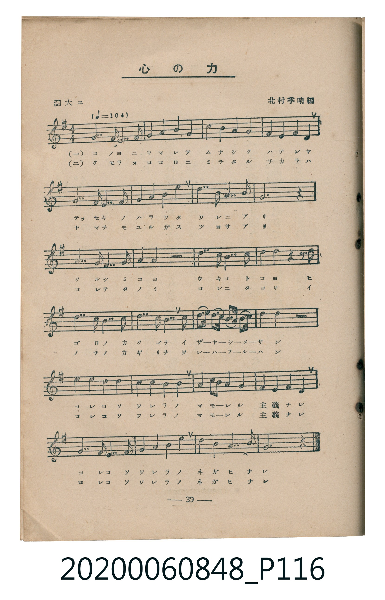
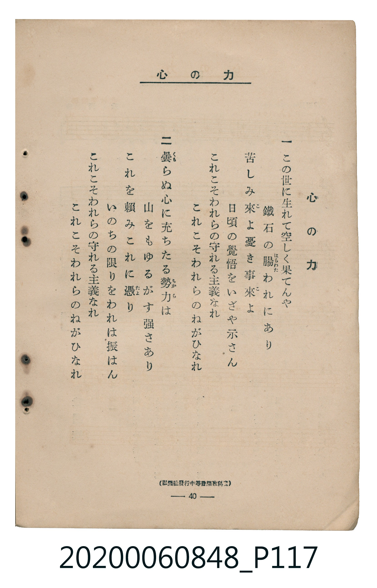

# 心の力

> Re:Shōka 使用 AI 協助辨識與重建樂譜，可能會有錯誤。歡迎回報。

- **鋼琴伴奏版**：<br><audio controls src="kokoro_no_chikara.mp3"></audio>
- **NEUTRINO 歌聲合成版**：<br><audio controls src="kokoro_no_chikara_neutrino.mp3"></audio>

- 編：北村季晴
- 臺灣教育會公認《新定兒童唱歌》高等科男子用（2020.006.0848）

## 說明

原書資訊與歌詞全文（對應 P116.jpg – P117.jpg，書頁 pp. 39–40，高二第三學期第 8 首）：
調性與拍號：ト長調（1 升記號）、4/4 拍（濶大ニ ♩=104）
出處註記：（弘樂社發行中等音樂教科書）


## 歌詞

```text
一　この世に生れて空しく果てんや
鐵石の腸（はらわた）われにあり
苦しみ來（こ）よ憂き事來（こ）よ
日頃の覺悟をいざや示さん
これこそわれらの守れる主義なれ
これこそわれらのねがひなれ

二　曇（くも）らぬ心に充ちたる勢力（ちから）は
山をもゆるがす强さあり
これを賴みこれに憑（たよ）り
いのちの限りをわれは振はん
これこそわれらの守れる主義なれ
これこそわれらのねがひなれ
```

## ABC

<div class="abc-score" data-abc-src="kokoro_no_chikara.abc" aria-label="五線譜載入中"></div>

[下載 ABC 原始檔](kokoro_no_chikara.abc)

## TMD 檔案連結

- [主旋律 TMD 檔案](kokoro_no_chikara.tmd) [[在 TMD Studio 編輯](https://tmdlang.github.io/Tmd-TS/#tmd=s7IKdvYPcrWy4qpTUCpJTLdSSM7PyUlNLsnMz7MqzsjMK0nNjM_KTMmPL87Iz05Ugisry88pzU21ys4vyY9Pyq8sjjcyMDKINzAwizewMLFAqCvOLy1KTrUqTs7Iz8-JL0mtKEnKz89Gl48vSExPtQowNDTDKWOOkCkoyi9LzUvMA5pbUARyYgrYYISC1LLMlFSQdHFyYl58WWpRZlpmagqS41OLisEehFhRUpSYV5xclFkA8jVCVX5RSUZ-elFiQUalVUZmcUl-UWZyYk58dmIeUjiUZKQCgyE1Nx9db2Z6Zp5VSWImMNxAYVeeGJ-bmJmXk5gHdIeWlsLT_c2PG9c97ZqtoKXFpWirYGhgwmVvq-DOZWOib2IHMuf59hXv98x62jP92dyJT9cufjZzC9j4F-27njcufjZ15oumTc_mND9tXfNiVe_jhq5n0zY8XTfraeuk56uXPp2y8dnanscN3S9Xz3i-tvP58onPp2x_unbC8ylAIztAMaUHjCk9UEy939OpxMWlr6VgSy3ApaCg8LRv_rPZO15sbn-xoutFRzvQMS9WznvauuLZtHagA55u6H3W3qkAim69rIJ0hUcNk0EccxDn_Z4eoM6XCxoVCgr0FIwtgXImBkBBoE-e7Op5vmbNkx2dT9fueDZnPpCtYKHwctk0oBeAAQWy9sWq_c8aloMs7O59MXM-UPRxc8fLqduB4kBrDRWe9gIdNAMs0_m4oREY0gpAlUCpZ_u3PV2y_HFzt8KjmSttgXEBVAD2R_uuFzOnvlixG6gNaBrI7XtmPFvR9HzJvucz97xY2PNkx1pgAL-cvxkoCIwTYEgDXQ_SDNL9ZEfD44aGx42TgTH9ZMe0x42rn0-Z_7ip53Hjsucrdz1unP64sf_ZvDlA7uOmyY-bWkB6Xk7Y-nz-ZqCGF61AczoeN65_3NT5uKn_cSPY0UAGSP_qx41Nj5u6wH7uXgY2af-TfW1gDZPB6jqetTU9bux9sqsbTRyk59n0pS8XgNLfi2W7njUBnTTpcWPL48ZpQDc8XwJ02FSge0DqQE4HWQf0wFyo1UDHAJPtug4wu_vJjt3P96183LgKyMWn4XHj2seNQPFNUKXg0NkFTKENz2aDUgQwIB43NYEdCFS-Bpw5Vj9tbX3cuBDocaBFT7sXAfMKWCVQpBuoDKS4cT04kjZuBPmgCRgibUClYItmPt0D9gc8mKAua5r0YvMWYGDBHLr6WdtEsKlASzrA9kNVA4MD6GqgXetezpwAFAXbAAn89c961oPjhbZhBFRKeWaEAgUtfS4u7_zs_KJ8v3znjMzsxKJEq4DMxLx8hxqDmmqQXQo2hmZadmAWttJAAZz1GoBJXkHDROHphv7n6xt04FlYE4sGoJUgw2oUDBV0kaBZvIJpPIqIeTySIiMobQylYeI1CiZoMjCVCBVAg-B2wI2GMOBW1oAd5WNYo_C4aTOKMx439wHxCjSxbqC5j5uWwfnz4Kw1cFYb3AWPmxfARbtgrKbtcNZ6JJX9GPofN8Nc9Lh5Cap7jUCugOmGqVkExCvRxHrA7oWbg2A1r0XyE8IV8-GijXA9--Fiq5FUIuRhogjbEb6pAedt3EloVw_dk5AZ3BOmKJqM4SphfHSLENAA7j148mlue9zcjKLocdNuIF6LKgZMVaixjQgzWHwiQhykEj2W1yDFGEz9IrDKVTgci5bWQWkHnp5gps4D4k1oYhBTEWkdHs9N8LTetBPJpS1o-lcA5beS6VICBU8nOakGNXoNEaUBTAChBEbD4hke32hpxgSeqmB8hAoYjWqGKUqRgx65q5GKB5jYfNQsDC-SYK6HBxpSwQRVC0x8mMVaB1HmPW6ehFLYoJsCSoZoCQaYbEGR24fkctwuxWYeerKGmAdzHyLZoLm0aQmhBPN09mxyEgzxcU1IhRmUBpYx6lAGRCnhBINaR21BDSJgKY4IcFiwrQYHMFrSAurEjDBgwAHJbVCz9sDLBTAbmhAh4gvhbJAOWK5G1FAYUYxU1qC5D1hz4HLzOjSVq7CUSuvBiQJSAkHcBilLIeypSGxIeQV1M1KJi9vNBOqqKeQkIlh1A6PRYxvRkkFv0cBoRLEEUgESpV5bB6ndgtRK2As3F6lWQmrhIOosWDyCVCLaQovA5B40XUith6btj5uXwq2DRTtSIwmuDVsZNAQcjb84al07CFo96A1nmChJrR5s5Ti6GDBmSIuTXrhOhMpJaPZ0IRUDmBBLMTToXVrLxaVrp4DWK4v2MYxVwCZsBBZW5gIA)]
- [鋼琴伴奏 TMD 檔案](kokoro_no_chikara_piano.tmd) [[在 TMD Studio 編輯](https://tmdlang.github.io/Tmd-TS/#tmd=s7IKdvYPcrWy4qpTUCpJTLdSSM7PyUlNLsnMz7MqzsjMK0nNjM_KTMmPL87Iz05Ugisry88pzU21ys4vyY9Pyq8sjjcyMDKINzAwizewMLFAqCvOLy1KTrUqTs7Iz8-JL0mtKEnKz89Gl48vSExPtQowNDTDKWOOkCkoyi9LzUvMA5pbUARyYgrYYISC1LLMlFSQdHFyYl58WWpRZlpmagqS41OLisEehFhRUpSYV5xclFkA8jVCVX5RSUZ-elFiQUalVUZmcUl-UWZyYk58dmIeUjgkFgE1p6fmpuaVWBVkJublxycmJ-fnFiTmZYLEEApLMoCKrFJz89EtyUzPzLMqScwEBjAokMsT43MTM_NyEvOADtbSUni6v_lx47qnXbPf7-l42b3n-YQtT_Zsebq0_3lnx_s9nQpaWlyKtgqGBiZc9rYK7lw2JvomdiDDn29f8X7PrKc905_Nnfh07eJnM7eA7XzRvut54-JnU2e-aNr0bE7z09Y1L1b1Pm7oejZtw9N1s562Tnq-eunTKRufre153ND9cvWM52s7ny-f-HzK9qdrJzyfAjSyAxTPesB41gPFM9AFSlxc3vnZ-UX5fvnOGZnZiUWJVgGgcAjycKgxqKnmUgACG0MzLTswS19LwRYdKDxfs-bJjoYXC3sUNEwUnm7of76-QUcBlBj0sgrSNbFo0NIHG1ajYKigiwTN4hVM41FEzOORFBlBaWMoDROvUTBBk4GpRKgAGgS3A240hAG3sgbsKB_DGoXHTZtRnPG4uQ-IV6CJdQPNfdy0DM6fB2etgbPa4C543LwALtoFYzVth7PWI6nsx9D_uBnmosfNS1DdawRyBUw3TM0iIF6JJtYDdi_cHASreS2SnxCumA8XbYTr2Q8XW42kEiEPE0XYjvBNDRf-JLSrh-5JyAzuCVMUTcZwlTA-ukUIaAD3Hjz5NLc9bm5GUfS4aTcQr0UVA6Yq1NhGhBksPhEhDlKJHstrkGIMpn4RWOUqHI5FS-ugtANPTzBT5wHxJjQxiKmItA6P5yZ4Wm_aieTSFjT9K4DyW8l0KYGCp5OcVIMavYaI0gAmgFACo2HxDI9vtDRjAk9VMD5CBYxGNcMUpchBj9zVSMUDTGw-ahaGF0kw18MDDalggqoFJj7MYq2DKPMeN09CKWzQTQElQ7QEA0y2oMjtQ3I5bpdiMw89WUPMg7kPkWzQXNq0hFCCeTp7NjkJhvi4JqTCDEoDyxh1KAOilHCCQa2jtqAGEbAURwQ4LNhWgwMYLWkBdWJGGDDggOQ2qFl74OUCmA1NiBDxhXA2SAcsVyNqKIwoRipr0NwHrDlwuXkdmspVWEql9eBEASmBIG6DlKUQ9lQkNqS8groZqcTF7WYCddUUchIRrLqB0eixjWjJoLdoYDSiWAKpAIlSr62D1G5BaiXshZuLVCshtXAQdRYsHkEqEW2hRWByD5oupNZD0_bHzUvh1sGiHamRBNeGrQwaAo7GXxy1rh0ErR70hjNMlKRWD7ZyHF0MGDOkxUkvXCdC5SQ0e7qQigFMiKUYGvQurcXRKfNB7pSZQPtkwEiKV4g2jAWmASBtGh-LEIFSwHIFyDABysAF4GoRmggZZgYSMYvPhWvHZaUB3CwstiCYBiCFCC6m08AK0E3CVIYqAmQZASkjLHZBjcIdFnARiAlAn9I-vCAuA0a4rp0CWpxH-wDlsQkbgYWVuQA)]

## 分析

```text
================================================================================
📊 TMD Song Profile: [ 心の力 ]
================================================================================
⏱  Duration:       1:50 (110.8s), 48 measures total
🎼 Key & Tempo:    首調基準 G, != 104.0 BPM, <4/4>
   - 分析範圍：      由實際發聲的音符與和弦推測調性；播放脈絡另行呈現
🎤 人聲音域:    D4 (MIDI 62) – E5 (MIDI 76) [跨度: 14 個半音 / 1.2 個八度, 難度: moderate]
   - 最低音:  D4 in [KokoroNoChikara[L1] #1 @ m.1, 0:01]
   - 最高音: E5 in [KokoroNoChikara[L1] #1 @ m.6, 0:13]
   - 適合: soprano, mezzo-soprano, contralto, tenor, baritone, bass
🏛  結構:      KokoroNoChikara[L1] (55.4s) -> KokoroNoChikara[L2] (55.4s)
⚡ 編曲密度:        Peak 1 軌道同時演奏
🗝  調性診斷：       G 調性不明確（純淨自然大調，未偵測到可信轉調）
   - 風格氣質:    純淨自然大調（陽光明朗、易唱易記，無明顯調外色彩）
   - 轉調歷程:    全曲維持單一推測調性（未偵測到可信轉調）
   - 核心骨幹音:  D, G, B, A, E
   - 調性數值:    G 調性不明確 [相關度: 0.89, 穩定度: Ambiguous, 自然音純度: 99.2%]
   - 候選調性 (K-S): G 大調 (0.89), D 大調 (0.87), B 小調 (0.72)
   - 五度圈歷程:   +1 -> +1
   - 各段落調性細節:
     • [KokoroNoChikara[L1] #1]: G 調性不明確 (r: 0.89, 自然音純度: 99.2%, 調外音: A#)
     • [KokoroNoChikara[L2] #1]: G 調性不明確 (r: 0.89, 自然音純度: 99.2%, 調外音: A#)

  [ 五度圈游移軌跡 ]
               C  
         F           [G ]*
      Bb               D  
      Eb               A  
         Ab           E  
            Db       B  
               F# 
     (* = active key center)

  [ 十二半音累積音高分佈 ]
     C  : █████                      5.9%
     C# :                            0.0%
     D  : ████████████████████████  26.1%
     D# :                            0.0%
     E  : ███████                    7.9%
     F  :                            0.0%
     F# : ███████                    7.4%
     G  : ███████████████████       20.1%
     G# :                            0.0%
     A  : ██████████████            15.0%
     A# : █                          0.8%
     B  : ███████████████           16.7%
--------------------------------------------------------------------------------
Assignment 軌道音域：
  - Piano         : D4 – E5 (14 個半音 / 1.2 個八度, 180 個音符)
================================================================================
```


## 原書掃描頁






