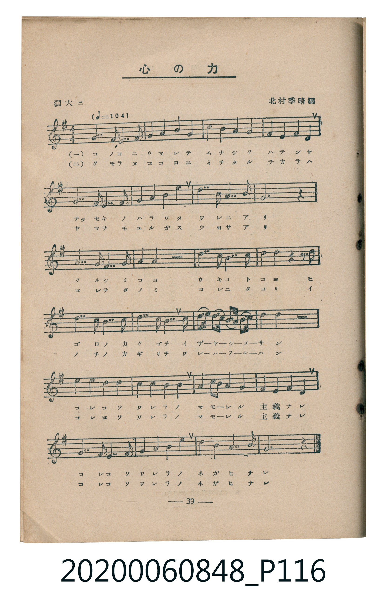
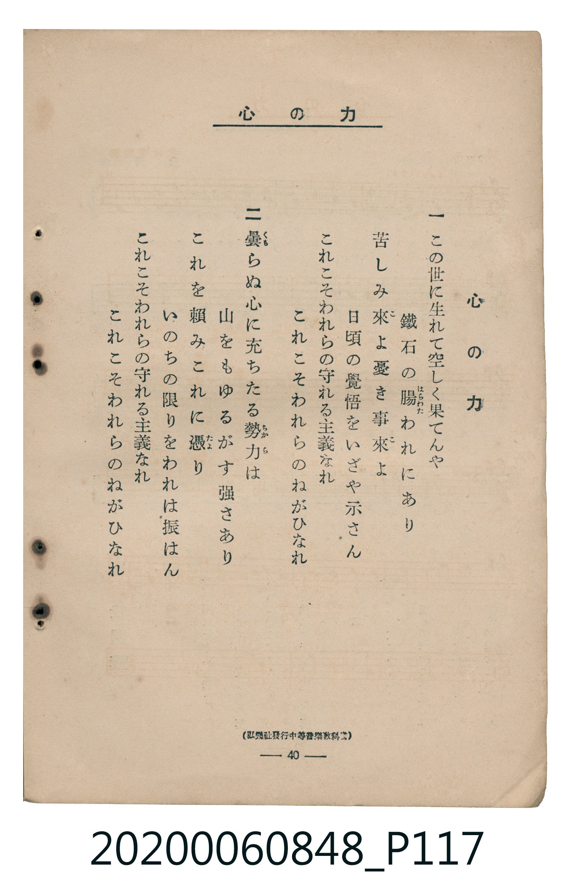

# 心の力

<audio controls src="kokoro_no_chikara.mp3"></audio>

- 編：北村季晴
- 臺灣教育會公認《新定兒童唱歌》高等科男子用（2020.006.0848）

## 說明

原書資訊與歌詞全文（對應 P116.jpg – P117.jpg，書頁 pp. 39–40，高二第三學期第 8 首）：
調性與拍號：ト長調（1 升記號）、4/4 拍（濶大ニ ♩=104）
出處註記：（弘樂社發行中等音樂教科書）

## 歌詞

```text
一　この世に生れて空しく果てんや
鐵石の腸（はらわた）われにあり
苦しみ來（こ）よ憂き事來（こ）よ
日頃の覺悟をいざや示さん
これこそわれらの守れる主義なれ
これこそわれらのねがひなれ

二　曇（くも）らぬ心に充ちたる勢力（ちから）は
山をもゆるがす强さあり
これを賴みこれに憑（たよ）り
いのちの限りをわれは振はん
これこそわれらの守れる主義なれ
これこそわれらのねがひなれ
```

## ABC

```abc
X:1
T:心の力
C:TMD (Chen, Chih-Han / aguai)
M:4/4
L:1/16
Q:1/4=104
K:G
V:V1 name="Piano" snm="Pia"
[V:V1]
!mf! G3 E D8 G4 | G4 B4 A4 G4 | e4 d4 B4 G4 | A4 A4 B4 A4 |
G3 E D8 G4 | G4 B4 A4 G4 | e3 d B8 A4 | G12 z4 |
B3 G E8 A4 | B4 e4 z8 | f3 d B8 d4 | e4 f4 z4 d3 e |
f3 d B8 d4 | e3 d B8 B3 ^c | d3 e f3 d B3 ^c d3 e | d4 d4 z8 |
!f! d4 B4 c4 d4 | B4 G4 A4 B4 | c4 A3 B c4 d4 | e4 d4 c4 B4 |
G3 E D8 G4 | G4 B4 A4 G4 | e8 B3 d A4 | G12 z4 |
```

## TMD 檔案連結

- [主旋律 TMD 檔案](kokoro_no_chikara.tmd) [[在 TMD Studio 編輯](https://tmdlang.github.io/Tmd-TS/#tmd=s7IKdvYPcrWy4tLSUni6v_lx47qnXbMVtLS4FG0VDA1MuOxtFdy5bEz0Tey46hSUnm9f8X7PrKc905_Nnfh07eJnM7cogYRftO963rj42dSZL5o2PZvT_LR1zYtVvY8bup5N2_B03aynrZOer176dMrGZ2t7Hjd0v1w94_nazufLJz6fsv3p2gnPpwCN7DAyMDLQMzAw0zOwMLF4v6dTiYtLX0vBllqAS0FB4Wnf_Gezd7zY3P5iRdeLjnagY16snPe0dcWzae1ABzzd0PusvVMhwNDQTC-rIF3hUcNkEMccxHm_pweo8-WCRoWCAj0FY0ugnIkBUBDokye7ep6vWfNkR-fTtTuezZkPZCtYKLxcNg3oBWBAgax9sWr_s4blIAu7e1_MnA8Ufdzc8XLqdqA40FpDhae9QAfNAMt0Pm5oBIa0AlAlUOrZ_m1Plyx_3Nyt8GjmSltgXAAVgP3RvuvFzKkvVuwGagOaBnL7nhnPVjQ9X7Lv-cw9Lxb2PNmxFhjAL-dvBgoC4wQY0kDXgzSDdD_Z0fC4oeFx42RgTD_ZMe1x4-rnU-Y_bup53Ljs-cpdjxunP27sfzZvDpD7uGny46YWkJ6XE7Y-n78ZqOFFK9CcjseN6x83dT5u6n_cCHY0kAHSv_pxY9Pjpi6wn7uXgU3a_2RfG1jDZLC6jmdtTY8be5_s6kYTB-l5Nn3pywWg9Pdi2a5nTUAnTXrc2PK4cRrQDc-XAB02FegekDqQ00HWAT0wF2o10DHAZLuuA8zufrJj9_N9Kx83rgJy8Wl43Lj2cSNQfBNUKTh0dgFTaMOz2aAUAQyIx01NYAcCla8BZ47VT1tbHzcuBHocaNHT7kXAvAJWCRTpBioDKW5cD46kjRtBPmgChkgbUCnYoplP94D9AQ8mqMuaJr3YvAUYWDCHrn7WNhFsKtCSDrD9UNXA4AC6GmjXupczJwBFwTZAAn_9s5714HihbRgBlVKeGaFAQUufi8s3MTPPKiAzMS_focagRqEaZIOCjaGZlh2YBSwDwNmrAZisFTRMFJ5u6H--vkETlImaNis8bu4D4hVA3K1Qo_C4aRmQNQ-I1wBxG0ikeQEQdwFltgPxerBIP1jucTNI9xKQE0DWAC3OTatVMFTQBUKzeAXTeDALASEyukCFMJYxlDbCUGEGZZmiqUSogOmB0ehm1YDTIszzu3owPd_c9ri5Gein3UC8FhwOML-tBOL1QNH9YBEgCxwa3UCRRWCRVQg_U9O7pnAVMAj3DFwtOjTA6t0dnVjiGuSP1ZB4bJ4PjmtQ_K2AxTooDMAiHUhyj5snIfwKcZ0hyLe4nAnzACz-YM6DwRoFcxxehcU0Iu4hKhFmQFSYoXr16ezZWLy6BehwSJQ-bloN9g4oOkGim4D0ErDItsfNe0DpF0w1bYfwFoIokOxWcPKGe51YV2OqgPBN1IFKYB5ANQwoBfcZ3DwYjRF-qKl6Co4sDUyuILppL0oCBiVrSCIHZfBFEB-DJEBBBCzNFIDFGSSvA0URuRqYqdGzoQmG99EzKHq2rIHrgcgYYzEDPdPDVMDNQIn41rVker4XKAcSmQT2K0gEybfULb5gEKLSlKT8XMvFpWunACrbFYC0MhcXAA)]
- [鋼琴伴奏 TMD 檔案](kokoro_no_chikara_piano.tmd) [[在 TMD Studio 編輯](https://tmdlang.github.io/Tmd-TS/#tmd=s7IKdvYPcrWy4tLSUni6v_lx47qnXbPf7-l42b3n-YQtT_Zsebq0_3lnx_s9nQpaWlyKtgqGBiZc9rYK7lw2Jvomdlx1CkrPt694v2fW057pz-ZOfLp28bOZW5RAwi_adz1vXPxs6swXTZuezWl-2rrmxarexw1dz6ZteLpu1tPWSc9XL306ZeOztT2PG7pfrp7xfG3n8-UTn0_Z_nTthOdTgEZ2GBkYGegZGJjpGViYWABdoMTF5ZuYmWcVkJmYlx_k4VBjUKNQzaUABDaGZlp2YJa-lsLzNWue7Gh4sbBHQUsfLAZUlZtWq2CooAuEZvEKpvFgFgJCZHSBCmEsYyhthKHCDMoyRVOJUAHTA6PRzarhQnbprh4Ul1LTkaZwFTAIdwJcLTo0wOrIHZ0ojoQYawhyJi7zYTbDggtmLgzWKJjjcCMsYBFBDVGJMAOiwgzVjU9nz0ZxI7HGY6qA8E3UgUpgNqEaBpSCOwFuHozG8ChqbE9BTZfAZImekEwwHIqexNATVg1cD0TGGIsZ6MkWpgJuBkpYtq6lWaJEQIhKU5ISZS1yEeCDUgSY4C0BDOMVog1jgR6A0HABIxjfBMgwiY-FiQOzMZBhChQAawExavBlW2KNh5kKVwGkDFCNRstsZiAzzeJzY5FYwDQBYxqAtIO5xiAunIHwAFgFnpyCTS92S0EmGkE9AaKBqR8WOOiWoKd0pPBA8T4ixGBSCCWwMIOrwZdEyY4AiMuBCUvXTgGUthSAtDIXFwA)]

## 分析

```text
================================================================================
📊 TMD Song Profile: [ 心の力 ]
================================================================================
⏱  Duration:       0:55 (55.4s), 24 measures total
🎼 Key & Tempo:    首調基準 G, != 104.0 BPM, <4/4>
   - 分析範圍：      由實際發聲的音符與和弦推測調性；播放脈絡另行呈現
🎤 人聲音域:    D4 (MIDI 62) – F#5 (MIDI 78) [跨度: 16 個半音 / 1.3 個八度, 難度: moderate]
   - 最低音:  D4 in [Main #1 @ m.1, 0:00]
   - 最高音: F#5 in [Main #1 @ m.11, 0:23]
   - 適合: soprano, mezzo-soprano, tenor, baritone
🏛  結構:      Main (55.4s)
⚡ 編曲密度:        Peak 1 軌道同時演奏
🗝  調性診斷：       G 大調（純淨自然大調，未偵測到可信轉調）
   - 風格氣質:    純淨自然大調（陽光明朗、易唱易記，無明顯調外色彩）
   - 轉調歷程:    全曲維持單一推測調性（未偵測到可信轉調）
   - 核心骨幹音:  B, G, D, E, A
   - 調性數值:    G 大調 [相關度: 0.89, 穩定度: High, 自然音純度: 99.4%]
   - 候選調性 (K-S): G 大調 (0.89), B 小調 (0.76), D 大調 (0.70)
   - 五度圈歷程:   +1
   - 各段落調性細節:
     • [Main #1]: G 大調 (r: 0.89, 自然音純度: 99.4%, 調外音: C#)

  [ 五度圈游移軌跡 ]
               C  
         F           [G ]*
      Bb               D  
      Eb               A  
         Ab           E  
            Db       B  
               F# 
     (* = active key center)

  [ 十二半音累積音高分佈 ]
     C  : █████                      4.5%
     C# : █                          0.6%
     D  : █████████████████████     21.1%
     D# :                            0.0%
     E  : ████████████              12.4%
     F  :                            0.0%
     F# : ████                       3.7%
     G  : ██████████████████████    21.9%
     G# :                            0.0%
     A  : ████████████              12.1%
     A# :                            0.0%
     B  : ████████████████████████  23.9%
--------------------------------------------------------------------------------
Assignment 軌道音域：
  - Piano         : D4 – F#5 (16 個半音 / 1.3 個八度, 92 個音符)
================================================================================
```


## 原書掃描頁






