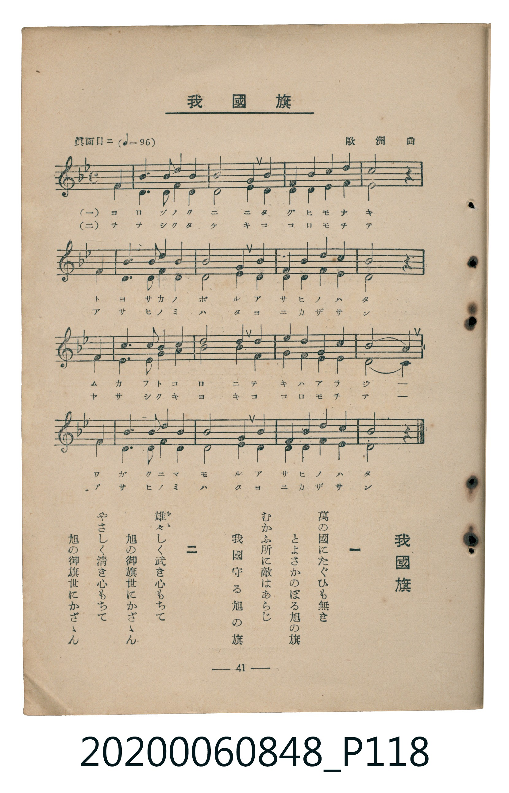

# 我國旗

> Re:Shōka 使用 AI 協助辨識與重建樂譜，可能會有錯誤。歡迎回報。

- **鋼琴伴奏版**：<br><audio controls src="waga_kokki.mp3"></audio>

- 曲：歐洲曲
- 臺灣教育會公認《新定兒童唱歌》高等科男子用（2020.006.0848）

## 說明

原書資訊與歌詞全文（對應 P118.jpg，書頁 p. 41，高二重音第 1 首）：
調性與拍號：變ロ長調（2 降記號）、4/4 拍（眞面目ニ ♩=96，二部重音合唱，弱起第 4 拍進入）


## 歌詞

```text
一　萬の國にたぐひも無き
とよさかのぼる旭の旗
むかふ所に敵はあらじ
我國守る旭の旗

二　雄々（をゝ）しく武き心もちて
旭の御旗世にかざゝん
やさしく清き心もちて
旭の御旗世にかざゝん
```

## ABC

<div class="abc-score" data-abc-src="waga_kokki.abc" aria-label="五線譜載入中"></div>

[下載 ABC 原始檔](waga_kokki.abc)

## TMD 檔案連結

- [主旋律 TMD 檔案](waga_kokki.tmd) [[在 TMD Studio 編輯](https://tmdlang.github.io/Tmd-TS/#tmd=s7IKdvYPcrWy4qpTUCpJTLdSSM7PyUlNLsnMz7MqzsjMK0nNjM_KTMmPL87Iz05Ugisry88pzU21ys4vyY9Pyq8sjjcyMDKINzAwizewMLFAqCvOLy1KTrUqTs7Iz8-JL0mtKEnKz89GyBcU5Zel5iXmAdUUFIGsSwErQihILctMSQVJp6ZkluQXZSbmIDkitagY7FCwJfElRYl5xclFmQUg1yNUlWSkAl2amVuQiqobaFh6Zp5VeWpxSWpRXnxuak5-SqUSl5aWwrOOiU_ndD-bPl1BS4tL0VbB0ozL3lbBSYfLxkTfxA5kwLPZm97vmfVs7YRnWzYB2WBDX7Tvet64-NnUmS-aNj2b0_y0dc2LVb2PG7qeTdvwdN2sp62Tnq9e-nTKxmdrex43dL9cPeP52s7nyyc-n7L96doJz6eseL-nAxSGesAw1AOF4fs9nUpcXPpaCrbUAlwKCgpP--Y_m73jxeb2Fyu6XnS0Ax3zYuW8p60rnk1rBzrg6YbeZ-2dCgGGhhZ6WQXp7_f0ABW_XNCoUKCnYGII5AKd_WRXz8v23pfzNz9fs0bBUOHlsmlAlwIDA2T6i1X7nzUsB5nb3fti5nyg6It1XY-b176cuh0oBfKhwsuZvS9WzABLdj5uaAQGqAJQMVDq-Zx5L-cuej573ePmboVHM1faWpoBLQTZ1rwCYuHTCR3A8AMKPt2z8cXW7SD7wZpfNmx62roUaB4XyA1PdjQ8bmh4MWHN48Z1wFh83Lj6ceP8x40THjduetzU9Lxl4ePGXpC6x40rHjd1PG6c-rgRqGjd48Y9j5uAcb4WyAbGPFhFUwNYbuuzTiBj9bOpWx83rn_c2PS4qfNx4wyQCkhCebquA0Ur2BW7gLHc8HJ2y-OGVqDnHjdNetw0F-TlxumPG_ufrV0GdMXT_c1AFz1uBLpoGdg0sAlP9y0EGvJkxzSwy4HWTwPqfNw0GeKiFrCDwWbsaCXLDMrTERQoaOlzcfkmArNQQGJRiaFDjUFNNcgCBRsLLTswA5h4IVH1dEP_8_UNwOTwuHmFgr7C4-ZNIM0gJTUKBgq6cFydm1arYBoPZNWAQxFkAjCagVH6YmGPgoaJAsQgTbBJa4HmtAJxHzBY1gMNAqUbMG7aD-I1bQDyJgHxIiDuAousVdB43NwBckDTIk2ECwyB9ukCSSMgaQyyG5isQCIQHkgUogYmjxABQZC7sTh5Vw8WJ68A2rwViFeDnQ1y8hwgBvKaFoEdCJQDOxnopeZ-sMh-kJMXgMNsCa2dvKMT08lgp04F4g6gYzaDnQwKd1BIt0HDFORUkAceN68Ei-x43LwH5Or1GAENcgXILSAXgdwCE4G4EeSDGrhrQfIQn8HUgF2M6eyns2djcfYacKKAOHQe2NkgB-IPaSqGLgjXcNUi5Q8jwvmDnDwB12IMUgF0TjxyOCmYQUQhwWmOJAZmIwlCtRNIzuTahlAEVUnIOkhShFsHVgFWiGwIVBRiHSIOwBYjrEVSZ4Q3BdHGc_CUoGunAEoMCkBamQsA)]
- [鋼琴伴奏 TMD 檔案](waga_kokki_piano.tmd) [[在 TMD Studio 編輯](https://tmdlang.github.io/Tmd-TS/#tmd=s7IKdvYPcrWy4tLSUnjWMfHpnO5n06e_39PxsnvP8wlbnuzZ8nRp__POjvd7OhW0tLgUbRUszbjsbRWcdLhsTPRN7LjqFJSezd70fs-sZ2snPNuyCchWAom9aN_1vHHxs6kzXzRtejan-Wnrmhereh83dD2btuHpullPWyc9X7306ZSNz9b2PG7ofrl6xvO1nc-XT3w-ZfvTtROeT1kBdICRgZGBnoGBmZ6BhYkF0HolLi7fxMw8q4DMxLz8IA-HGoOaai4FILCx0LIDM_S1FJ7u2fhi6_anG_qfr29Q0NIHC9coGCjownF1blqtgmk8kFXDBdP1fM2aJzsaXizsQWgxBCrQBZJGQNIYpFjBBCwC4YFEIWpg8ggREARZhMWOXT20t2NHJ4odID0gnSD9IJ0wEYiJIPtq4GaD5CHugKkBm49pydPZs6nsERCu4apFjmIfWkexMUgF0EHxyN5UMIOIQkLDHEkMzEYShGonNrJJtA2hCKqSkHVo8Q5WAVaIbAhUFGIdIhbAFiOsRVJnRFwCoKrn4GlB104BlBwUgLQyFwA)]

## 分析

```text
================================================================================
📊 TMD Song Profile: [ 我國旗 ]
================================================================================
⏱  Duration:       0:42 (42.5s), 17 measures total
🎼 Key & Tempo:    首調基準 B,, != 96.0 BPM, <4/4>
   - 分析範圍：      由實際發聲的音符與和弦推測調性；播放脈絡另行呈現
🎤 人聲音域:    F4 (MIDI 65) – D#5 (MIDI 75) [跨度: 10 個半音 / 0.8 個八度, 難度: easy]
   - 最低音:  F4 in [Main #1 @ m.1, 0:01]
   - 最高音: D#5 in [Main #1 @ m.3, 0:05]
   - 適合: soprano, mezzo-soprano, contralto, tenor, baritone, bass
🏛  結構:      Main (42.5s)
⚡ 編曲密度:        Peak 2 軌道同時演奏
🗝  調性診斷：       A# 調性不明確（純淨自然大調，未偵測到可信轉調）
   - 風格氣質:    純淨自然大調（陽光明朗、易唱易記，無明顯調外色彩）
   - 轉調歷程:    全曲維持單一推測調性（未偵測到可信轉調）
   - 核心骨幹音:  F, D, A#, C, G
   - 調性數值:    A# 調性不明確 [相關度: 0.86, 穩定度: Ambiguous, 自然音純度: 100.0%]
   - 候選調性 (K-S): A# 大調 (0.86), F 大調 (0.83), D 小調 (0.73)
   - 五度圈歷程:   -2
   - 各段落調性細節:
     • [Main #1]: A# 調性不明確 (r: 0.86, 自然音純度: 100.0%)

  [ 五度圈游移軌跡 ]
               C  
         F            G  
     [Bb]*              D  
      Eb               A  
         Ab           E  
            Db       B  
               F# 
     (* = active key center)

  [ 十二半音累積音高分佈 ]
     C  : █████████████████         17.2%
     C# :                            0.0%
     D  : ████████████████████      20.5%
     D# : ██████                     5.7%
     E  :                            0.0%
     F  : ████████████████████████  24.6%
     F# :                            0.0%
     G  : ████████                   8.2%
     G# :                            0.0%
     A  : █████                      4.9%
     A# : ██████████████████        18.9%
     B  :                            0.0%
--------------------------------------------------------------------------------
Assignment 軌道音域：
  - Part1         : F4 – D#5 (10 個半音 / 0.8 個八度, 53 個音符)
  - Part2         : C4 – C5 (12 個半音 / 1.0 個八度, 53 個音符)
================================================================================
```


## 原書掃描頁




