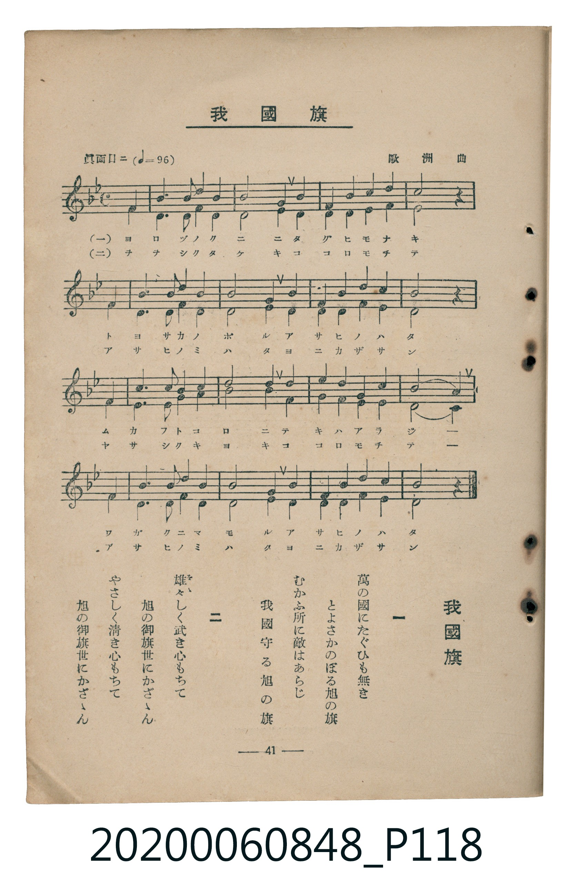

# 我が國旗

> Re:Shōka 使用 AI 協助辨識與重建樂譜，可能會有錯誤。歡迎回報。

- **鋼琴伴奏版**：<br><audio controls src="waga_kokki.mp3"></audio>
- **NEUTRINO 歌聲合成版**：<br><audio controls src="waga_kokki_neutrino.mp3"></audio>

- 詞：不詳
- 曲：歐洲曲
- 臺灣教育會公認《新定兒童唱歌》高等科男子用（2020.006.0848）

## 說明

原書資訊與歌詞全文（對應 P118.jpg，書頁 p. 41，高二重音第 1 首）：
調性與拍號：變ロ長調（2 降記號）、4/4 拍（眞面目ニ ♩=96，二部重音合唱，弱起第 4 拍進入）
出處註記：（重音唱歌集）


## 歌詞

```text
一　萬（よろづ）の國（くに）に、たぐひもなき、
豐榮昇（とよさかのぼ）る、朝日（あさひ）の旗（はた）。
向（むか）ふところに、敵（てき）はあらじ、
我が日の本の、國の御旗（みはた）。」

二　治（をさ）まる御代（みよ）の、天足（あまた）る日に、
あふぐもうれし、朝日の旗。
やまと心（ごころ）を、よそに示（しめ）し、
あな尊（たふと）しと、いざかざさん。」
```

## ABC

<div class="abc-score" data-abc-src="waga_kokki.abc" aria-label="五線譜載入中"></div>

[下載 ABC 原始檔](waga_kokki.abc)

## TMD 檔案連結

- [主旋律 TMD 檔案](waga_kokki.tmd) [[在 TMD Studio 編輯](https://tmdlang.github.io/Tmd-TS/#tmd=s7IKdvYPcrWy4qpTUCpJTLdSSM7PyUlNLsnMz7MqzsjMK0nNjM_KTMmPL87Iz05Ugisry88pzU21ys4vyY9Pyq8sjjcyMDKINzAwizewMLFAqCvOLy1KTrUqTs7Iz8-JL0mtKEnKz89Gl48vSExPtQowNETSWVCUX5aal5gH1F1QBHJIClg7QkFqWWZKKki6ODkxL74stSgzLTM1BcmJqUXFYG9ArCgpSswrTi7KLAD5DaEqv6gkIz-9KLEgo9IqI7O4JL8oMzkxJz47MQ_JtyUZqUDPFiSWFGXml2QW5yJrz0zPzLMqTy0uSS3Ki89NzclPqcSQLknMBIYfKAzLE-NzEzPzchLzgC7V0lJ41jHxcWPP0zndz6ZPV9DS4lK0VbA047K3VXDS4bIx0TexAxn1YuW893tmPdnR-2LlZrDZz2ZvAgo8Wzvh2ZZNQDZY7EX7rueNi59NnfmiadOzOc1PW9e8WNX7uKHr2bQNT9fNeto66fnqpU-nbHy2tudxQ_fL1TOer-18vnzi8ynbn66d8HzKivd7OkBRqAeMQj1QFL7f06nExaWvpWBLLcCloKDwtG_-s9k7Xmxuf7Gi60VHO9AxQL89bV3xbFo70AFPN_Q-a-9UAKUDvayC9Pd7eoCKXy5oVCjQUzAxBHKBzn6yq-dle-_L-Zufr1mjYKjwctk0oEuBgQEy_cWq_c8aloPM7e59MXM-UPTFuq7HzWtfTt0OlAL5UOHlzN4XK2aAJTsfNzQCQ1gBqBgo9XzOvJdzFz2fve5xc7fCo5krbS3NgBaCbGteAbHw6YQOYPgBBZ_u2fhi63aQ_WDNLxs2PW1dCjQP7MH2XS9mTn2xYjfQFqD9QIOhmsEh_3J2G0gdSOGTHQ2PGxpeTFgDVPK4CYh6HzeCDHncuA6YGkCCjf2PG1eDRVYDXfq4cf7jxgmPGzc9bmp63LjqcSMwbhvBnt444dmydc9mgALwceMKkFmNUx83dgMNety4B6S_qRuo9Nmcuc-mAy0AygL1AxUAUxDIMmC6AwuuB1oADpMmsDcmTAS7qwFoEFjdVpDRjZPBzgQ559nUrWBty4AOASsA6m963ARkzIC6C5KygXaCLJmzBuSchkag10Ae3LcQZu1-ZJsfN_RCwmYXMI02PNu0G-yGSUDngq3YB_QJUOuT3YuhWps6IH4AGbxk5Yttm2He2wc1sgmYrYD2gxwMMhcsB_TJBHAYtj1u6nncOB0eNpDAgAbA46YWsDErnu5vBps6BeJ7sKmTQPEBCue5QLOfL9kFVjD9cVMj2DkgE-G2rXq6oQssDYw9UBhCVQADExSlQDumgaMKSE593DQZGgZAzZRnNyhQ0NLn4gpPTE_0zs_OzrQKyEzMyzd0qNE1rKkG2aNgY6FlB2YAszokYT_d0P98fQNIH0i4RsFAQReOTeOBRA1YwsewRgHEg2FggCDkjNDlJoHlYBYB8w4w_b9Y2KOgYaIAsU8TmFuAWVXhcXMrEPcBtawH2g3KjGDctB_Ea9oA5E0C4kVA3AUWWaug8bi5Q0EfyFykiXC0IdA-XSBpDCaBdkNFdBXMQA6CCIF9A2IaATFIZQ2YBYJYPAuMfbAUMJ8C8Towqx-sCZgKoNogLGBsQ8UngHmbwEHQBGavgspAzIIGT-MKlKADJgaoafuA-rrBrP0QfeBAhshBXAAyFaRjH9xemA6Qrchug9gEVo8SEbt6sETECqAxW4F4NTgyQBExB4iBvKZFYGcA5cARAYyo5n6wyH5QRCwARUTzErIjAqQKFAUIVVgjAhIIoGAC5h54YIA8uwcWPNBAgAUPKEChEQENuPVQGVCQwYOnqQEtIrZCbZoAj8A2aET0wCNiOlk2tWBExI5OzIgARwDQm8Ak_rhpMzgiQHkElCvaoOkfFAGgaHncvBIssgPI2gOKjPUYuQKSuo3gab4GHOAgCKIhOcAEygJHD2pcmIOE0CMDHAEgbwKTBDgdAwtKaBDB0jgsVyyDBgRIHBIskGAD1htQmRkwHUAfgMTB-QspOkCpHJJfgCUydrvARQ20MALKz0WyHxxRTY1QGRAPyS7MnPF09mwsEbIGKeWD8wIoatAKLJDcfKScQdXcAMLI4Q9JiKAkB01w4IQKkgHFBnJZgVxawcRA5Qr2JIoUz-CwB5VckDIGki2gpRZySELjH5y0gfQ0MA-SESFsUOYABQko1lDtqcWopYwGTy0Ft8UYpA4YMfEQO8BcuKiuggm6IJgAi0LcBGHjLNcgiXh4VjCUhSFYKVgKSemIqxvgYQhNRkAKXG6AC2ZEKQGioekNLI0IPPQQNBqRJTqNkuKwLZh17RTgZXO0j2GsAqqAEVhAmQsA)]
- [鋼琴伴奏 TMD 檔案](waga_kokki_piano.tmd) [[在 TMD Studio 編輯](https://tmdlang.github.io/Tmd-TS/#tmd=s7IKdvYPcrWy4qpTUCpJTLdSSM7PyUlNLsnMz7MqzsjMK0nNjM_KTMmPL87Iz05Ugisry88pzU21ys4vyY9Pyq8sjjcyMDKINzAwizewMLFAqCvOLy1KTrUqTs7Iz8-JL0mtKEnKz89Gl48vSExPtQowNETSWVCUX5aal5gH1F1QBHJIClg7QkFqWWZKKki6ODkxL74stSgzLTM1BcmJqUXFYG9ArCgpSswrTi7KLAD5DaEqv6gkIz-9KLEgo9IqI7O4JL8oMzkxJz47MQ_Jt4lFQM3pqbmpeSVWBZmJefnxicnJ-bkFiXmZIDGEwpIMoCKrgsSSosz8ksziXGR7MtMz86xyUzOzMrGEA1S6PLW4JLUoLz43NSc_pVKJS0tL4VnHxMeNPU_ndD-bPv39no6X3XueT9jyZM-Wp0v7n3d2vN_TqaClxaVoq2BpxmVvq-Ckw2Vjom9iBzL4xcp57_fMerKj98XKzWCbns3eBBR4tnbCsy2bgGyw2Iv2Xc8bFz-bOvNF06Znc5qftq55sar3cUPXs2kbnq6b9bR10vPVS59O2fhsbc_jhu6Xq2c8X9v5fPnE51O2P1074fmUFUAXgWJeDxjzeqCYB7pHiYsrPDE90Ts_OzvTKgAUWoYONbqGNdVcCkBgY6FlB2boayk83bPxxdbtTzf0P1_foKClDxauUTBQ0IVj03ggUQOW8DGsUQDxYPhxUwdCzghdbhJYDmbR8zVrnuxoeLGwB2GLIVCBLpA0BpNAxVARXQUzkAkQIbD1IKYREINU1oBZIIjFdY-besFSjxuXAvE6MKsfrOlx42qoNgjrceN8qPgEMG8T2M1NYPYqqAzELKh_Gleg-PVx41SoafuA-rrBrP0QfeBQgchBXAAyFaRjH9xemA6Qrchug9gEVo8Scrt6KAg5kCpQmCFUYQ05iKtB_nrcCHEdyPUg1-2B-Qfqaph_QCEADTmoT9dDZUB-hPunqQEt5LZCbZoAD_E2aMj1wENuOlk2tWCE3I5OlJCDpB0jeIqqAYcOCIJoSPoygbLAYYkacOYgIfSQA4cWyE1boankceNkqH9gKQiW5pZBXQ0Sh_gB4sfHTZ1QmRkwHc2gUH_cBE69SGEHSkOQ1Pi4cQp2u8A5D5o3gfJzkewHh2pTI1QGxEOyCzPdPZ09m-rpDoSRAw8S5aDIhUYtOEmAZEBBiZyNkDMyTAyU5bAnBqRIAgccKFNDsh8kAUIzNHIwQCMPnIiA9DQwD5LkIWxQMgQFNSjIUe2pxShxjQZhiWsMUgeMmHiIHWAuXFRXwQRdEEyARSFugrBxliCQFDjMy16ywhCsFCyFpHTklsLQZASkwOUGuFRFlBIgGprewNKIwEMPQaORXRxTNymOlILZxwO5ZDaBlsygIhgETePjoa4DJsh4YAhpAwMMzkASMwEqNInXBqZQNEEjqEqQSRA2paYiTEISRDUUqgQYrwgWdqsQNiDbhbACxKKJcw0gsaFrpwCPkGgfw1gFVAEjsIAyFwA)]

## 分析

```text
================================================================================
📊 TMD Song Profile: [ 我が國旗 ]
================================================================================
⏱  Duration:       1:20 (80.0s), 32 measures total
🎼 Key & Tempo:    首調基準 B,, != 96.0 BPM, <4/4>
   - 分析範圍：      由實際發聲的音符與和弦推測調性；播放脈絡另行呈現
🎤 人聲音域:    F4 (MIDI 65) – D#5 (MIDI 75) [跨度: 10 個半音 / 0.8 個八度, 難度: easy]
   - 最低音:  F4 in [WagaKokki[L1] #1 @ m.1, 0:01]
   - 最高音: D#5 in [WagaKokki[L1] #1 @ m.12, 0:27]
   - 適合: soprano, mezzo-soprano, contralto, tenor, baritone, bass
🏛  結構:      WagaKokki[L1] (40.0s) -> WagaKokki[L2] (40.0s)
⚡ 編曲密度:        Peak 2 軌道同時演奏
🗝  調性診斷：       A# 大調（純淨自然大調，未偵測到可信轉調）
   - 風格氣質:    純淨自然大調（陽光明朗、易唱易記，無明顯調外色彩）
   - 轉調歷程:    全曲維持單一推測調性（未偵測到可信轉調）
   - 核心骨幹音:  D, A#, F, D#, C
   - 調性數值:    A# 大調 [相關度: 0.83, 穩定度: Moderate, 自然音純度: 100.0%]
   - 候選調性 (K-S): A# 大調 (0.83), D 小調 (0.72), G 小調 (0.57)
   - 五度圈歷程:   -2 -> -2
   - 各段落調性細節:
     • [WagaKokki[L1] #1]: A# 大調 (r: 0.84, 自然音純度: 100.0%)
     • [WagaKokki[L2] #1]: A# 大調 (r: 0.83, 自然音純度: 100.0%)

  [ 五度圈游移軌跡 ]
               C  
         F            G  
     [Bb]*              D  
      Eb               A  
         Ab           E  
            Db       B  
               F# 
     (* = active key center)

  [ 十二半音累積音高分佈 ]
     C  : ██████                     8.2%
     C# :                            0.0%
     D  : ████████████████████████  33.6%
     D# : ████████                  10.7%
     E  :                            0.0%
     F  : ███████████               15.6%
     F# :                            0.0%
     G  : ████                       4.9%
     G# :                            0.0%
     A  : █                          1.6%
     A# : ██████████████████        25.4%
     B  :                            0.0%
--------------------------------------------------------------------------------
Assignment 軌道音域：
  - Piano1        : F4 – D#5 (10 個半音 / 0.8 個八度, 106 個音符)
  - Piano2        : C4 – A#4 (10 個半音 / 0.8 個八度, 106 個音符)
================================================================================
```


## 原書掃描頁




