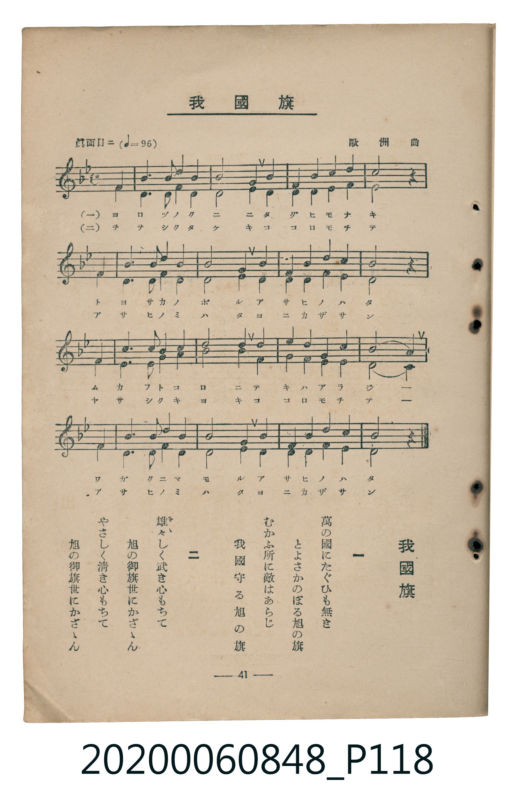

# 我國旗

<audio controls src="waga_kokki.mp3"></audio>

- 曲：歐洲曲
- 臺灣教育會公認《新定兒童唱歌》高等科男子用（2020.006.0848）

## 說明

原書資訊與歌詞全文（對應 P118.jpg，書頁 p. 41，高二重音第 1 首）：
調性與拍號：變ロ長調（2 降記號）、4/4 拍（眞面目ニ ♩=96，二部重音合唱，弱起第 4 拍進入）

## 歌詞

```text
一　萬の國にたぐひも無き
とよさかのぼる旭の旗
むかふ所に敵はあらじ
我國守る旭の旗

二　雄々（をゝ）しく武き心もちて
旭の御旗世にかざゝん
やさしく清き心もちて
旭の御旗世にかざゝん
```

## 原書掃描頁



## 分析

```text
================================================================================
📊 TMD Song Profile: [ 我國旗 ]
================================================================================
⏱  Duration:       0:42 (42.5s), 17 measures total
🎼 Key & Tempo:    首調基準 B,, != 96.0 BPM, <4/4>
   - 分析範圍：      由實際發聲的音符與和弦推測調性；播放脈絡另行呈現
🎤 人聲音域:    F4 (MIDI 65) – D#5 (MIDI 75) [跨度: 10 個半音 / 0.8 個八度, 難度: easy]
   - 最低音:  F4 in [Main #1 @ m.1, 0:01]
   - 最高音: D#5 in [Main #1 @ m.3, 0:05]
   - 適合: soprano, mezzo-soprano, contralto, tenor, baritone, bass
🏛  結構:      Main (42.5s)
⚡ 編曲密度:        Peak 2 軌道同時演奏
🗝  調性診斷：       A# 調性不明確（純淨自然大調，未偵測到可信轉調）
   - 風格氣質:    純淨自然大調（陽光明朗、易唱易記，無明顯調外色彩）
   - 轉調歷程:    全曲維持單一推測調性（未偵測到可信轉調）
   - 核心骨幹音:  F, D, A#, C, G
   - 調性數值:    A# 調性不明確 [相關度: 0.86, 穩定度: Ambiguous, 自然音純度: 100.0%]
   - 候選調性 (K-S): A# 大調 (0.86), F 大調 (0.83), D 小調 (0.73)
   - 五度圈歷程:   -2
   - 各段落調性細節:
     • [Main #1]: A# 調性不明確 (r: 0.86, 自然音純度: 100.0%)

  [ 五度圈游移軌跡 ]
               C  
         F            G  
     [Bb]*              D  
      Eb               A  
         Ab           E  
            Db       B  
               F# 
     (* = active key center)

  [ 十二半音累積音高分佈 ]
     C  : █████████████████         17.2%
     C# :                            0.0%
     D  : ████████████████████      20.5%
     D# : ██████                     5.7%
     E  :                            0.0%
     F  : ████████████████████████  24.6%
     F# :                            0.0%
     G  : ████████                   8.2%
     G# :                            0.0%
     A  : █████                      4.9%
     A# : ██████████████████        18.9%
     B  :                            0.0%
--------------------------------------------------------------------------------
Assignment 軌道音域：
  - Part1         : F4 – D#5 (10 個半音 / 0.8 個八度, 53 個音符)
  - Part2         : C4 – C5 (12 個半音 / 1.0 個八度, 53 個音符)
================================================================================
```

## ABC

```abc
X:1
T:我國旗
C:曲：歐洲曲
M:4/4
L:1/16
Q:1/4=96
K:Bb
V:V1 name="Part1" snm="Par"
V:V2 name="Part2" snm="Par"
[V:V1]
!mf! z4 z4 z4 f4 | b6 b2 c4 d4 | e8 d4 c4 | b4 c4 d4 c4 |
b8 z4 f4 | b6 b2 c4 d4 | e8 d4 c4 | b4 c4 d4 c4 |
b8 z4 f4 | c6 c2 d4 b4 | c8 d4 e4 | d4 c4 b4 d4 |
c8 f4 f4 | b6 b2 c4 d4 | e8 d4 c4 | b4 c4 d4 c4 |
b8 z4 z4 |
[V:V2]
!mf! z4 z4 z4 f4 | d6 d2 f4 f4 | g8 b4 a4 | g4 a4 b4 a4 |
d8 z4 f4 | d6 d2 f4 f4 | g8 b4 a4 | g4 f4 f4 f4 |
d8 z4 f4 | f6 f2 f4 f4 | f8 b4 c4 | b4 a4 g4 f4 |
f8 c4 f4 | d6 d2 f4 f4 | g8 b4 a4 | g4 f4 f4 f4 |
d8 z4 z4 |
```

- [主旋律 TMD 檔案](waga_kokki.tmd)
- [鋼琴伴奏 TMD 檔案](waga_kokki_piano.tmd)
