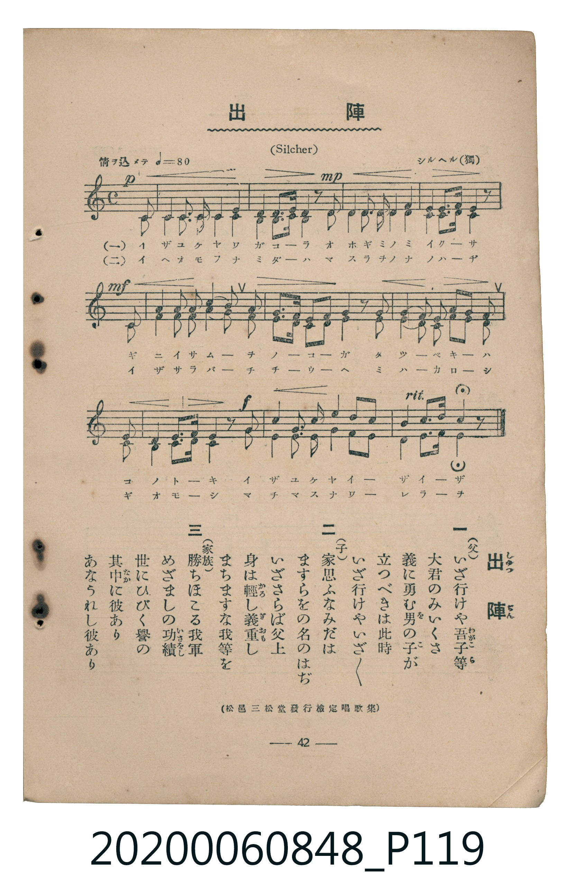

# 出陣

> Re:Shōka 使用 AI 協助辨識與重建樂譜，可能會有錯誤。歡迎回報。

- **鋼琴伴奏版**：<br><audio controls src="shutsujin.mp3"></audio>

- 詞：旗野十一郎
- 曲：ジルヘル（獨）（Friedrich Silcher）
- 臺灣教育會公認《新定兒童唱歌》高等科男子用（2020.006.0848）

## 說明

原書資訊與歌詞全文（對應 P119.jpg，書頁 p. 42，高二重音第 2 首）：
調性與拍號：ヘ長調（1 降記號）、4/4 拍（C 拍號，情ヲ込メテ ♩=80，二部重音合唱，弱起後半拍進入）
出處註記：（重音唱歌集）


## 歌詞

```text
一　いざ行（ゆ）けや、わが子（こ）らよ、
大君（おほぎみ）の、御軍（みいくさ）に。
勇（いさ）むをのこの、門出（かどで）は今（いま）ぞ、
いざ行けや、いざ、いざ。」

二　いさぎよく、打（う）ち立たば、
生（い）き死（し）には、事（こと）ならず。
皇國（みくに）の爲（ため）に、盡（つく）すはこの時（とき）、
いざ行けや、いざ、いざ。」
```

## ABC

<div class="abc-score" data-abc-src="shutsujin.abc" aria-label="五線譜載入中"></div>

[下載 ABC 原始檔](shutsujin.abc)

## TMD 檔案連結

- [主旋律 TMD 檔案](shutsujin.tmd) [[在 TMD Studio 編輯](https://tmdlang.github.io/Tmd-TS/#tmd=s7IKdvYPcrWy4qpTUCpJTLdSSM7PyUlNLsnMz7MqzsjMK0nNjM_KTMmPL87Iz05Ugisry88pzU21ys4vyY9Pyq8sjjcyMDKINzAwizewMLFAqCvOLy1KTrUqTs7Iz8-JL0mtKEnKz89Gl48vSExPtQowNLREyBQU5Zel5iXmAXUXFIEckgLWjlCQWpaZkgqSLk5OzIsvSy3KTMtMTUFyYmpRMdgbECtKihLzipOLMgtAfkOoyi8qychPL0osyKi0ysgsLskvykxOzInPTsxD8m1JRirQs7mZOZkliUWVyJoz0zPzrHJTM7MysXgOKl2eWlySWpQXn5uak58C1K2lpfC0fdfLmYsVtLS4FG0VLAy47G0V3LhsTPRN7ECaX6yc937PrGfTp79s73va2_hkR8PL5j6wsc9mbwLKPG7a8bh59ePmGUDy_Z6O570r3u_pBDLcioABAHR_hkJwZk5yRmoRUBis7UX7rueNi59NnfmiadOzOc1PW9e8WNX7uKHr2bQNT9fNeto66fnqpU-nbHy2tudxQ_fL1TOer-18vnzi8ynbn66d8HwK0PQOUPTqAaNXDxS9YGO59LUUbKkFuBQUFJ72zX82e8eLze0vVnS96GgHOgYYDk9bVzyb1g50wNMNvc_aOxVAaUQvqyD9_Z4eoOKXCxoVCvQUTIyAXKCzn-zqedne-3L-5udr1igYKbxcNg0cLrNApr9Ytf9Zw3KQud29L2bOB4Vi84yXU7cDxYGmGyq8nNn7YsUMsEzn44ZGYFQoAFUCpZxBNFi851lz6-PmTS_27XncvPBxc5vCo5krbS0MgBIgi5tXQOx-OqEDGJRAwad7Nr7Yuv3pvp6nvV1AI142bHrauhRoOtiv7btezJz6YsVuoJ1ApwCtgWoGR8LL2W0gdSCFwLh_3NDwuLHlceO0Fwt7gAofN4EkHzdOfNzUAnTo46b-x409wHgCSTVOBkk1AVEHUAps0ZLlTyfMBst1PW7c_bix73Ej0MNA_euAKp7uW_hiN8iTQEGwHUCzpoJlVz9uaALr7wYFPlgOLNHU8LhpEkhz42SIES-nNQA9A1bT_bhx5ePG5WD965_s7oJp3AcWmQd1EdwvCC-ARZAYTY8beiG-3wVMkBDfTwU5HegtoBMbGp91Aj0KZENCYuHz1UCr5z9u3AC14vkUYGyB7AZL9z5buxvMnQ71WeN6oLonu7ohIfa4EZR7HjeuAoVb4yyov5_Pan86B6ICGDLAYAFmNFCgPe8AZkCg4PzHTY2wgGp8PnshWHAJUCVYcCbIDnAIPZvZBJZaAXQHJGWREgZApZTnLShQ0NLn4grOKC0pLs0CFkoBmYl5-YYONbqGNdUgexRsDM207MAsYMaGpt0N_c_XN4A0goRrFAwUdMEQG11dUKtgGg9k1IAV-xjWKIB4IIiNBnoTodaIOLUwxwFzNzBbAENPQcNEAeJGTYQjwY4AQSjDLB4hZAilaxTMYUJQhiFCBOybXKB3QKpr4HogtCGcbwQ3CyYCNcEILgAxKQ0jYIARDFUBzMwQunEikA3yJkS0H244MHPDRBsnQ-jmPUAVnSgB1AVVuxuutg9K7wfidXDR_Ujmwm1rhNgGNrdxKoq5qxHuBkYSQhZuflMHXD9IFOIbiPkL4aLzkcyHsGHmb8BwSy-Ung61HcJbj2QuJBRAoiug9CqM8JgFdjdygtnVA04wxpgJxhiqE0SDsCmUbwLl10CjGppEQJELi3tQBIPYMCUQWbAykE6QIFwAOfoR3gUFKLBQBZOTYKLAgALJgaIN4WFI8IHEYPLdKF5eCVW9HM0UUNBBbISJ7AOT8xBuAkctLGlAohMS-EhJB6oXFH1A1U2NSG4Cq4TKL0FxE8gkkNkzsboJ5C9kv0IiFC2fd-KKNmC-hhiKIwcDsx0kamDxC4kiY5zxC-GBxGE6YOUb9qiD5GFIboSle4i3J0IDCaEWwgLpQTcBEgA4TYaXFDC_IUdZL7r5GDogLgOpBbkJrAbqKpAepHIIKYGglE84TYa4pRajSjEaYVUKnFGjYIJHGZGVCjxR47d0tGKBiA7uigU5kkEYuSCCJANoiQWLWnDso5RikJoDIQZWAVYLr1cQQqM1DLqbKKthCOZneBWDnp1xxjRMCWobEZwAR-sY3HWMrp0CvJqJ9jGMVUAVMAILKHMBAA)]
- [鋼琴伴奏 TMD 檔案](shutsujin_piano.tmd) [[在 TMD Studio 編輯](https://tmdlang.github.io/Tmd-TS/#tmd=s7IKdvYPcrWy4qpTUCpJTLdSSM7PyUlNLsnMz7MqzsjMK0nNjM_KTMmPL87Iz05Ugisry88pzU21ys4vyY9Pyq8sjjcyMDKINzAwizewMLFAqCvOLy1KTrUqTs7Iz8-JL0mtKEnKz89Gl48vSExPtQowNLREyBQU5Zel5iXmAXUXFIEckgLWjlCQWpaZkgqSLk5OzIsvSy3KTMtMTUFyYmpRMdgbECtKihLzipOLMgtAfkOoyi8qychPL0osyKi0ysgsLskvykxOzInPTsxD8m1iEVBzempual6JVUFmYl5-fGJycn5uQWJeJkgMobAkA6jIKjczJ7MksagS2ZbM9Mw8q9zUzKxMLKEAlS5PLS5JLcqLz03NyU8B6tbSUnjavuvlzMXv93S87N7zfMKWJ3u2PF3a_7yz4_2eTgUtLS5FWwULAy57WwU3LhsTfRM7kIkvVs57v2fWs-nTX7b3Pe1tfLKj4WVzH9iuZ7M3AWUeN-143Lz6cfMMIAk0-HnvCqBhQIZbETD4gL7PUAjOzEnOSC0CCoO1vWjf9bxx8bOpM180bXo2p_lp65oXq3ofN3Q9m7bh6bpZT1snPV-99OmUjc_W9jxu6H65esbztZ3Pl098PmX707UTnk8Bmt4BShx6wMShB0ocYGO5gjNKS4pLs4C-DgAFqKFDja5hTTWXAhDYGJpp2YFZ-sAA2LPxxdbtTzf0P1_foKClDxauUTBQ0AVDbHR1Qa2CaTyQUQNW7GNYowDigSA2-nFjC0KtEXFqYY57vmYNMHhfLOxBuAxsMwhCGWbxCCFDKF2jYA4TgjIMESJgL-QC_QBSXQPXA6EN4XwjuFkwEagJRnABiElpGKHxuHEaVMXjpjYI3TgRyAb5DSLaDzf8cWMPTLRxMoRu3gNU0YkSKl1Qtbvhavug9H4gXgcX3Y9kLty2RohtYHMbp6KYuxrhbmDMIGTh5jd1wPWDRCG-gZi_EC46H8l8CBtm_gYMt_RC6elQ2yG89UjmQkIBJLoCSq_CCI9ZYHcjp5JdPSipxBiqHESDsCmUbwLl10DjF5ouQDEKi3BQrILYMCUQWbAykE6QIFwAOc4RfgSF4uOmBjA5CSYKDB2QHCiuEL6EhBlIDCbfjeLPlVDVy9FMAYUXxEaYyD4wOQ_hJnB8wtIDJA4hIY6UXqB6QXEGVN3UiOQmsEqo_BIUN4FMApk9E6ubQP5C9iskFtFydCdKXAFzMMQkHHkVmMEg8QGLVEi8GOOMVAgPJA7TASu-sMcXJLdC8h0shUP8OhEaMgi1EBZID7oJEF_jNBleJsD8hhxPvejmY-iAuAykFuQmsBqoq0B6kEocpFSBUhLhNBnillqMGsNoJNQYcEaNggkeZUTWGfCUjN_S0XoDIjoI6w3kmAVh5CIHEvfQsgkWn-AoRymvIBUDQgysAqwWXm0ghEYrEHQ3kVGBEMy58BoEPePijF6YEtTGHjipjVYhRFchPh7IdYgFtAqB1BUIDKkd4qG-AUYSOK-gEqACFZJpECRQJ7hIBupEV24CVgAVhqgGM0FawOUuObaBdaGIIemA1zWYNsIsJMIqqBZoaOraKcADNNrHMFYBVcAILKDMBQA)]

## 分析

```text
================================================================================
📊 TMD Song Profile: [ 出陣 ]
================================================================================
⏱  Duration:       1:00 (60.0s), 20 measures total
🎼 Key & Tempo:    首調基準 F, != 80.0 BPM, <4/4>
   - 分析範圍：      由實際發聲的音符與和弦推測調性；播放脈絡另行呈現
🎤 人聲音域:    C4 (MIDI 60) – C5 (MIDI 72) [跨度: 12 個半音 / 1.0 個八度, 難度: easy]
   - 最低音:  C4 in [Shutsujin[L1] #1 @ m.1, 0:02]
   - 最高音: C5 in [Shutsujin[L1] #1 @ m.6, 0:16]
   - 適合: soprano, mezzo-soprano, contralto, tenor, baritone, bass
🏛  結構:      Shutsujin[L1] (30.0s) -> Shutsujin[L2] (30.0s)
⚡ 編曲密度:        Peak 2 軌道同時演奏
🗝  調性診斷：       F 大調（純淨自然大調，未偵測到可信轉調）
   - 風格氣質:    純淨自然大調（陽光明朗、易唱易記，無明顯調外色彩）
   - 轉調歷程:    全曲維持單一推測調性（未偵測到可信轉調）
   - 核心骨幹音:  F, C, E, G, A
   - 調性數值:    F 大調 [相關度: 0.87, 穩定度: Moderate, 自然音純度: 100.0%]
   - 候選調性 (K-S): F 大調 (0.87), C 大調 (0.84), A 小調 (0.66)
   - 五度圈歷程:   -1 -> -1
   - 各段落調性細節:
     • [Shutsujin[L1] #1]: F 調性不明確 (r: 0.86, 自然音純度: 100.0%)
     • [Shutsujin[L2] #1]: F 大調 (r: 0.87, 自然音純度: 100.0%)

  [ 五度圈游移軌跡 ]
               C  
        [F ]*          G  
      Bb               D  
      Eb               A  
         Ab           E  
            Db       B  
               F# 
     (* = active key center)

  [ 十二半音累積音高分佈 ]
     C  : ██████████████████████    24.3%
     C# :                            0.0%
     D  : ██████                     6.7%
     D# :                            0.0%
     E  : ██████████████            15.3%
     F  : ████████████████████████  26.0%
     F# :                            0.0%
     G  : ███████████               12.0%
     G# :                            0.0%
     A  : ██████████                11.3%
     A# : ████                       4.3%
     B  :                            0.0%
--------------------------------------------------------------------------------
Assignment 軌道音域：
  - Piano1        : C4 – C5 (12 個半音 / 1.0 個八度, 110 個音符)
  - Piano2        : A#3 – A4 (11 個半音 / 0.9 個八度, 110 個音符)
================================================================================
```


## 原書掃描頁




