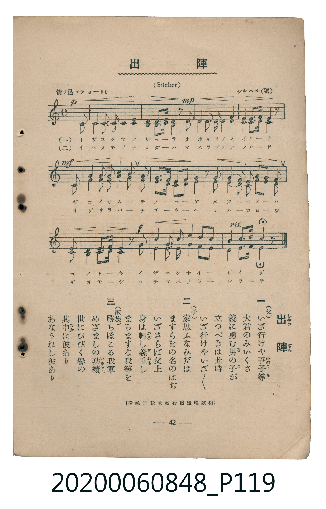

# 出陣

<audio controls src="shutsujin.mp3"></audio>

- 曲：シルヘル（獨）（Silcher）
- 臺灣教育會公認《新定兒童唱歌》高等科男子用（2020.006.0848）

## 說明

原書資訊與歌詞全文（對應 P119.jpg，書頁 p. 42，高二重音第 2 首）：
調性與拍號：ヘ長調（1 降記號）、3/4 拍（原譜拍號誤植為 C，實為 Silcher 原曲之 3/4 拍；情ヲ込メテ ♩=80，二部重音合唱）
出處註記：（松邑三松堂發行檢定唱歌集）

## 歌詞

```text
一　（父）いざ行けや吾子等（わごこら）
大君のみいくさ
義に勇む男（を）の子（こ）が
立つべきは此時
いざ行けやいざ／＼

二　（子）家思ふなみだは
ますらをの名のはぢ
いざさらば父上
身は輕（かろ）し義重（ぎおも）し
まちますな我等を

三　（家族）勝ちほこる我軍
めざましの功績（いさをし）
世にひびく譽の
其中（なか）に彼あり
あなうれし彼あり
```

## ABC

```abc
X:1
T:出陣
C:曲：シルヘル（獨）（Silcher）
M:3/4
L:1/16
Q:1/4=80
K:F
V:V1 name="Part1" snm="Par"
V:V2 name="Part2" snm="Par"
[V:V1]
!p! z4 z4 z2 C2 | F2 G2 A2 B2 c4 | !mp! d3 c B2 A2 z2 c2 | c2 B2 A2 G2 F4 |
!mf! A2 G3 A G2 z2 C2 | G2 G2 A2 B2 B2 A2 | A3 G G2 c2 z2 c2 | B2 G2 F2 E2 F2 B2 |
!f! A2 G3 G F2 z2 C2 | A2 B2 c2 d2 c2 B2 | A2 G3 A F2 z4 |
[V:V2]
!p! z4 z4 z2 C2 | F2 E2 F2 G2 A4 | !mp! B3 A G2 F2 z2 A2 | A2 G2 F2 E2 F4 |
!mf! F2 E3 F E2 z2 C2 | E2 E2 F2 G2 G2 F2 | F3 E E2 A2 z2 A2 | G2 E2 D2 C2 D2 G2 |
!f! F2 E3 E F2 z2 C2 | F2 G2 A2 B2 A2 G2 | F2 E3 F F2 z4 |
```

## TMD 檔案連結

- [主旋律 TMD 檔案](shutsujin.tmd) [[在 TMD Studio 編輯](https://tmdlang.github.io/Tmd-TS/#tmd=s7IKdvYPcrWy4qpTUCpJTLdSSM7PyUlNLsnMz7MqzsjMK0nNjM_KTMmPL87Iz05Ugisry88pzU21ys4vyY9Pyq8sjjcyMDKINzAwizewMLFAqCvOLy1KTrUqTs7Iz8-JL0mtKEnKz89GyBcU5Zel5iXmAdUUFIGsSwErQihILctMSQVJp6ZkluQXZSbmIDkitagY7FCwJfElRYl5xclFmQUg1yNUlWSkAl2am5mTWZJYVKnEpaWl8LR918uZixW0tLgUbRUsDLjsbRXcuGyM9U3sQLqezd70fs-sx03bHzevftw8A0i-39PxvHfF-z2dQEZwZk5yRmoRkAO24kX7rueNi59NnfmiadOzOc1PW9e8WNX7uKHr2bQNT9fNeto66fnqpU-nbHy2tudxQ_fL1TOer-18vnzi8ynbn66d8HwK0MwOUMjpAUNODxRyYGO59LUUbKkFuBQUFJ72zX82e8eLze0vVnS96GgHOubFynlPW1c8m9YOdMDTDb3P2jsVAgwNLfWyCtLf7-kBKn65oFGhQE_BxAjIBTr7ya6el-29L-dvfr5mjYKRwstl08ChMQtk-otV-581LAeZ2937YuZ8UNg1z3g5dTtQHGi6ocLLmb0vVswAy3Q-bmgEBrMCUCXI4r75L9bOgeh6sWrJsyW9z5t2KTgDbXy6fhmICQ1riPs3PdnZrQDXPPtZc-vj5k0v9u153LzwcXObwqOZK20tDIB6QU5tXgFx7dMJHcDAB9oLDoX2XS9mTn2xYjfQNUBHAh3wbO6-l00Tn-zoBDKeLmh6PnPPi4U9z1YtAsUcOM5ezm4DaQbpfrKj4XFDAygldGwDeaSx5XHjNKDyx40THze1PJ2wDxSha0Ep5HFT_-PGKY8bJz9uAnIhVi9Z_nTC7MeN6x437gfrBKqYCpJ4vm_l48bVT7vbHzc1ABMFWPcksPHrgOaBuI2TwdwesOrV3Y8blzxu3Pm4sfdx4_pna5c8m9kEkkBzDYT7fk__-z17II7fBUx-IMeDDe18um7bs4a5jxu3Pm5cBXbRAqBpEHP2PW6cCXQ30BUgJ0wAWgN08_rHjYsQ1gCdDlLRuAEYEk92dIGTwK7VQFUv9kwFu7j7cRMwhoAqpgO9B4wIsGDf48aux01NEHG4XQuhNjauetYxERh8QHuhoQ1MKmAHA506HeiPzqfdQAcDle8GB2w3UPmL3b1gc5oawY4CmjMd5Oau-c937ANbCXQs0KVAj0yHRsOTHUB1QJduety4GRgHL9buBWoAx08r0CdrwZqAAdINduTqp3v3PG5setwE9iGIBZJre9wEDOTpKHKUZ1IoUNDS5-LyTczMswpILCoxdKgxqFGoBtmgYGNopmUHZgHLhqd7Nr7Yuv3phv7n64FBBCyploA0giRrFAwUdMEQma4uqFUwjQcyasBhCzICmI2BCRqYYBQ0TBQgJmmCjdqm8Lh5GTBMNwLpJUC8Hmjm46Y1QLz5cfMeoMBKIHMVSLB5NpC1DkjPB-I-MA1SCtTUtB6stGmrggZQhSbCcYZANxgBsTEQmwCxKdSRNQpmYNoULAqSBTs7F-RusDSIhEmBDAAZBNEIEwHJgWiIxjSsHt7VA_awMbKHm7uhbt4K9MECiBc3gb3XB_EExNvgENgPFm-BKJoJFFgLYfYjfAhyArIPYY6GOBQkB5IFeQfkUIjnQGpgnjIHuRrEAAmiRVcnpuubNkPDvgPiyrWgEF-iCY4ItJhsWgJSApWAcEBMuMsRAWkEdgA4IOHhiBJloMiCxQhqDMA0guOGqxYpMRsRk5gpSMYoaQweirCogKQVkHth6QTuRVAiQ8QQRjxAdMKFQIJgBuF0BncRWD2Kk2C2QAwGS4LlYSkf4h6QKrCwGYgA2wNmgcSxJQ3MIABTWCITPR_CfI7mUYzY1LVTAEWoApBW5uICAA)]
- [鋼琴伴奏 TMD 檔案](shutsujin_piano.tmd) [[在 TMD Studio 編輯](https://tmdlang.github.io/Tmd-TS/#tmd=s7IKdvYPcrWy4tLSUnjavuvlzMXv93S87N7zfMKWJ3u2PF3a_7yz4_2eTgUtLS5FWwULAy57WwU3LhtjfRM7rjoFpWezN73fM-tx0_bHzasfN88AkkDtz3tXALUAGcGZOckZqUVAjhJI8Yv2Xc8bFz-bOvNF06Znc5qftq55sar3cUPXs2kbnq6b9bR10vPVS59O2fhsbc_jhu6Xq2c8X9v5fPnE51O2P1074fkUoJkdRgZGBnoGBmZ6BhYmFmBjuXwTM_OsAjIT8_KDPBxqDGoUqrkUgMDG0EzLDszSB3psz8YXW7c_3dD_fH2DgpY-WLhGwUBBFwyR6eqCWgXTeCCjhgum-fmaNU92NLxY2IPQaQhUYATExkBsAsSmUBNqFMzAtClYFCQLNjMXZChYGkTCpEAGgAyCaISJgORANERjGlbX7OpBcQ1IObJrYBZADAXJgWRBVoMMhTgEpAbmAHOQDSAGSBDN350oNiEcaQTWAHYk3I0owQEKCJhvUX0H0wj2N1ctcgz60DUG4f6GBR4kJkAuhsUC3JOgKESEKUbIQXTChUCCYAYJsQhWj-IkmC0Qg8GSYHlYuoK4B6QKLGwGIsD2gFkgcbyRieRaIIUlOtFTOcznaB7FiE9dOwVQlCoAaWUuLgA)]

## 分析

```text
================================================================================
📊 TMD Song Profile: [ 出陣 ]
================================================================================
⏱  Duration:       0:24 (24.8s), 11 measures total
🎼 Key & Tempo:    首調基準 F, != 80.0 BPM, <3/4>
   - 分析範圍：      由實際發聲的音符與和弦推測調性；播放脈絡另行呈現
🎤 人聲音域:    C4 (MIDI 60) – D5 (MIDI 74) [跨度: 14 個半音 / 1.2 個八度, 難度: moderate]
   - 最低音:  C4 in [Main #1 @ m.1, 0:01]
   - 最高音: D5 in [Main #1 @ m.3, 0:04]
   - 適合: soprano, mezzo-soprano, contralto, tenor, baritone, bass
🏛  結構:      Main (24.8s)
⚡ 編曲密度:        Peak 2 軌道同時演奏
🗝  調性診斷：       F 大調（純淨自然大調，未偵測到可信轉調）
   - 風格氣質:    純淨自然大調（陽光明朗、易唱易記，無明顯調外色彩）
   - 轉調歷程:    全曲維持單一推測調性（未偵測到可信轉調）
   - 核心骨幹音:  F, G, A, C, E
   - 調性數值:    F 大調 [相關度: 0.81, 穩定度: Moderate, 自然音純度: 100.0%]
   - 候選調性 (K-S): F 大調 (0.81), C 大調 (0.71), A 小調 (0.62)
   - 五度圈歷程:   -1
   - 各段落調性細節:
     • [Main #1]: F 大調 (r: 0.81, 自然音純度: 100.0%)

  [ 五度圈游移軌跡 ]
               C  
        [F ]*          G  
      Bb               D  
      Eb               A  
         Ab           E  
            Db       B  
               F# 
     (* = active key center)

  [ 十二半音累積音高分佈 ]
     C  : ████████████████          14.1%
     C# :                            0.0%
     D  : █████                      4.1%
     D# :                            0.0%
     E  : ██████████████            12.3%
     F  : ████████████████████████  21.4%
     F# :                            0.0%
     G  : ██████████████████████    19.5%
     G# :                            0.0%
     A  : ████████████████████      18.2%
     A# : ████████████              10.5%
     B  :                            0.0%
--------------------------------------------------------------------------------
Assignment 軌道音域：
  - Part1         : C4 – D5 (14 個半音 / 1.2 個八度, 53 個音符)
  - Part2         : C4 – A#4 (10 個半音 / 0.8 個八度, 53 個音符)
================================================================================
```


## 原書掃描頁




