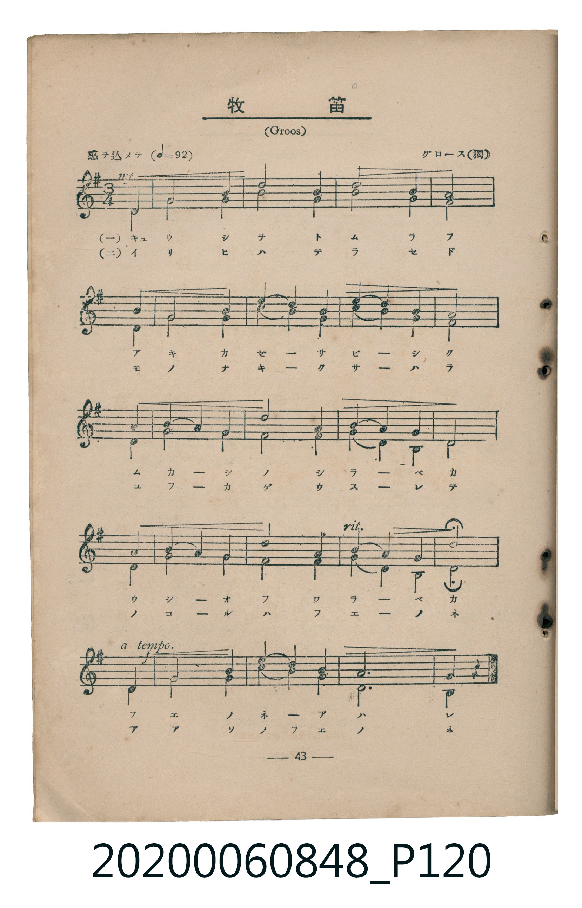
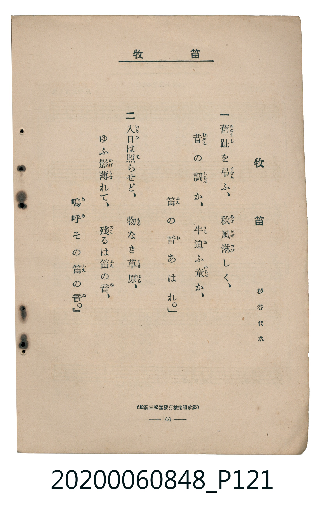

# 牧笛

> Re:Shōka 使用 AI 協助辨識與重建樂譜，可能會有錯誤。歡迎回報。

- **鋼琴伴奏版**：<br><audio controls src="bokuteki.mp3"></audio>

- 詞：杉谷代水
- 曲：グロース（獨）（Groos）
- 臺灣教育會公認《新定兒童唱歌》高等科男子用（2020.006.0848）

## 說明

原書資訊與歌詞全文（對應 P120.jpg – P121.jpg，書頁 pp. 43–44，高二重音第 3 首）：
調性與拍號：ト長調（1 升記號）、3/4 拍（感ヲ込メテ ♩=92，二部重音合唱，弱起第 3 拍進入）
出處註記：（松邑三松堂發行檢定唱歌集）


## 歌詞

```text
一　舊趾（きゆうし）を弔（とむら）ふ、秋風淋（あきかぜさび）しく、
昔（むかし）の調（しらべ）か、牛追（うしお）ふ童（わらべ）か、
笛（ふえ）の音（ね）あはれ。」

二　入日（いりひ）は照（て）らせど、物（もの）なき草原（くさはら）、
ゆふ影薄（かげうす）れて、殘（のこ）るは笛（ふえ）の音（ね）、
嗚呼（ああ）その笛（ふえ）の音（ね）。」
```

## ABC

<div class="abc-score" data-abc-src="bokuteki.abc" aria-label="五線譜載入中"></div>

[下載 ABC 原始檔](bokuteki.abc)

## TMD 檔案連結

- [主旋律 TMD 檔案](bokuteki.tmd) [[在 TMD Studio 編輯](https://tmdlang.github.io/Tmd-TS/#tmd=s7IKdvYPcrWy4qpTUCpJTLdSSM7PyUlNLsnMz7MqzsjMK0nNjM_KTMmPL87Iz05Ugisry88pzU21ys4vyY9Pyq8sjjcyMDKINzAwizewMLFAqCvOLy1KTrUqTs7Iz8-JL0mtKEnKz89Gl48vSExPtQowBBoBJAwR0gVF-WWpeYl5QCMKikCuSQGbgVCQWpaZkgqSLk5OzIsvSy3KTMtMTUFyZ2pRMdgvEHtKihLzipOLMgtAHkSoyi8qychPL0osyKi0ysgsLskvykxOzInPTsxD8nJJRirQx7mlxZnJyDoz0zPzrHJTM7MysXgPKl2eWlySWpQXn5uak59SqcSlpaXwvHP58zWzFbS0uBRtFSyNuOxtFdy5bIz1TexAml-snPd-z6xncztfbNj-ZPfiZxu2gM18NnsTUPhx04bHzWsfN-953LTz_Z6O570r3u_pBDLci_Lzi4FMsNIX7bueNy5-NnXmi6ZNz-Y0P21d82JV7-OGrmfTNjxdN-tp66Tnq5c-nbLx2dqexw3dL1fPeL628_nyic-nbH-6dsLzKUATO0AxqgeMUT1QjIKN5dLXUrClFuBSUFB42jf_2ewdLza3v1jR9aKjHegYoMeftq54Nq0d6ICnG3qftXcqgJKFXlZBusKjhskgjiGI835PD1DnywWNCgUFegomxkA5ExOgINAnT3b1vGzvfTl_8_M1axSMFV4umwYOnlkgC1-s2v-sYTnIqu7eFzPngwKzuePl1O1AcaCFhgpPe4FOmQGW6Xzc0AiMDgWgSqDUs5b5j5s3vdi353HzwsfNbQqPZq60tTQCWgiyrXkFxMKnEzqAQQoUfLpn44ut2yH2A_W_bNj0tHUp0Eiwn9t3vZg59cWK3UCLgPaDzJ6772XTxCc7OoGMpwuans_c82Jhz7NVi0DxBI6hl7PbQJpBup_saHjc0PCio-vFtn1ArY8bex83tT1uBKLpICc3TXq6ZwpYfMXjpobHTUB_dz5u3Ar0yvPl3S8XrXi2vRss2wTS2Nj9uHHO48apjxs3g5VNf9zYD1QJsubZDLApQCNAisBGN66DBBJIXROQC0x6QLIbZHTn7Bf794KlQO543NgFsRWYwsCG9KOpB1kATPtgDVsfN3ZATAeGH1hkLZgLdOD6x03AtNn0uKEX4vNdQF4DMByfTQcb29jyuKnrcSMwQwCVr3_euhwsuAwcCkCR2Y8bV4LdthLsBqB568AqVwF9_qK3E5jywOr7wf4HWgUOKYjbwCG69enejS-mtYAVAYNgEthvM8Gm9wCtASp9tg4Yf0DZdY8bJ4PFgcrWE_AXxIKn02c9nbgHFhFNYHVzgUoJaQaHBVA_5ZkPChS09Lm4nPKzS0tSszOtAjIT8_INHWp0DWuqQdYo2Jho2YEZwHwPSdJPN_Q_X98A0gYSrlEwAMLq3LRaBdN4hRqwmI9hjUI8EIJTZitM0Agm2AIUgRkJzB_A5AxM6woaJgoQkzXBxdsyYBRsB5oOzHFA3AFmLQDilWDWVAWNx02LFPSBzEWaCKcYKugCc1uNgikabQSh4Y4DRiRQBJhOQYY1TQKzV4DZDSB2UyeI3bgVLN6E5H5gagOLbQLLrwezl4H1dYLZs8HiK8FmgPQh-3JXDxZfrgUqXA02YA_QK0DctBXsv8lQHjgEmtYDfQv0PMi3y7D41gRIGoF9C2JBfAvkI_m2F-y6brDr5kCMbpwK5m2G8sAh0dgPdnkDso8b14H1rgLL90JV94N5U6G89YgQaGpDj9tOLL5ejey75j44ayVEvHkm2MDVoDheBvZ1H5KvQX41hMYtyNdwfjyGt7tRPAfxCCTKO6EyO8Ey3WAZkNMR3t4KVQEJNEgSAaoAkjOhru8B85aBZdahevvp7NlYvL0dqhEclsAk_LgZHHJYvA2UBHq7CTlp4_Q2kF-NnvlA3oQ4vwuRkpvAsYbV68BEh-R1WOKDeB2SysHJsrEDqhfoXSC5Fp4_UNL5FCxeXwGOZ5BnoUkImHlBPLCTmtfgTtOgtKwLFTdA8WEHLODBLoG4C-gWqItBekBRpAsscZD91gTWNReaIMDRDDQJljzAusD-AumqRS8XjQaiXEQJGlCMG6PR5qCEjxb9A1W8YTgWlEiBDkSkV2yuHejiCcPVYEeCnW2oYBavYARigcsXNIdDcg95xQvCy-QVLsQ7GmvxADKYvMIBpJqSogF3GgG7FpQHjUGMAcjuunYKsByvAGQrcwEA)]
- [鋼琴伴奏 TMD 檔案](bokuteki_piano.tmd) [[在 TMD Studio 編輯](https://tmdlang.github.io/Tmd-TS/#tmd=s7IKdvYPcrWy4qpTUCpJTLdSSM7PyUlNLsnMz7MqzsjMK0nNjM_KTMmPL87Iz05Ugisry88pzU21ys4vyY9Pyq8sjjcyMDKINzAwizewMLFAqCvOLy1KTrUqTs7Iz8-JL0mtKEnKz89Gl48vSExPtQowBBoBJAwR0gVF-WWpeYl5QCMKikCuSQGbgVCQWpaZkgqSLk5OzIsvSy3KTMtMTUFyZ2pRMdgvEHtKihLzipOLMgtAHkSoyi8qychPL0osyKi0ysgsLskvykxOzInPTsxD8nJiEVBzempual6JVUFmYl5-fGJycn5uQWJeJkgMobAkA6jIKre0ODMZ2YrM9Mw8q9zUzKxMLOEAlS5PLS5JLcqLz03NyU-pVOLS0lJ43rn8-ZrZ7_d0vOze83zClid7tjxd2v-8s-P9nk4FLS0uRVsFSyMue1sFdy4bY30TO5CJL1bOe79n1rO5nS82bH-ye_GzDVvAFj2bvQko_Lhpw-PmtY-b9zxu2gk09XnvCqBJQIZ7UX5-MZAJVvqifdfzxsXPps580bTp2Zzmp61rXqzqfdzQ9WzahqfrZj1tnfR89dKnUzY-W9vzuKH75eoZz9d2Pl8-8fmU7U_XTng-BWhiByg96AHTgx4oPYCN5XLKzy4tSc3OtAoAhZ6hQ42uYU01lwIQ2Jho2YEZ-loKT_dsfLF1-9MN_c_XNyho6YOFaxQMgLA6N61WwTReoQYs5mNYoxAPhI8bex83tcIEjWCCLUARmJHP16x5sqPhxcIehHmGCroKxkDaFI02gtBwGx43tgFFHjdOB8o9bpoEZq8AsxtA7KZOELtxK1i8CckRj5u6wGKbwPLrwexlYH2dYPZssPhKsBkgfchO3dWD1akmQNII7FQQC-JUIB_Jqb1go7vBRs9RAEYxkJ4K5m2G8sDeaOwHW9uA7NzGdWC9q8DyvVDV_WDeVChvPcL5TW3ooduJ4mSQQw2hoQpyMpwfj-HmbhSXQVwBCexOqMxOsEw3WAZkL8LNW6EqID6GRA5QBZCcCZFp6gHzloFl1qG6-ens2cS5GcivRk94IDdC7O5CJIAmcHhhdfdWFHdPhroO4m5I4gCqAJIdUL1AtwLJtfBkhZI8puBNHqBkoQsVN0BxcgcsGMBGQywCGg51AkgPKMB0gdkH2bFNYF1zodEDDnSgSbDIAusCOxSkqxY9kxsNeCYHRaExGm0OSoZo8TkosjnIcaBUB3QgIgFic-2gyekwV4MdCXa2oYJZvIIRiAXO7WgOh2QH8jI7wssUZnWCjsaa30EGk5fbQaqpltdR0gjYtaA8aAxiDHh29_HAlt9RMjbMNqBn4oGu1gb6AMjAzwPpMgJzcetHU0MdE4ApApooKNYOS1TEasdiHCSCgYGua6cAC_doH8NYBRS-EZivzAUA)]

## 分析

```text
================================================================================
📊 TMD Song Profile: [ 牧笛 ]
================================================================================
⏱  Duration:       0:39 (39.1s), 20 measures total
🎼 Key & Tempo:    首調基準 G, != 92.0 BPM, <3/4>
   - 分析範圍：      由實際發聲的音符與和弦推測調性；播放脈絡另行呈現
🎤 人聲音域:    D4 (MIDI 62) – D5 (MIDI 74) [跨度: 12 個半音 / 1.0 個八度, 難度: easy]
   - 最低音:  D4 in [Bokuteki #1 @ m.1, 0:01]
   - 最高音: D5 in [Bokuteki #1 @ m.3, 0:03]
   - 適合: soprano, mezzo-soprano, contralto, tenor, baritone, bass
🏛  結構:      Bokuteki (39.1s)
⚡ 編曲密度:        Peak 2 軌道同時演奏
🗝  調性診斷：       G 大調（純淨自然大調，未偵測到可信轉調）
   - 風格氣質:    純淨自然大調（陽光明朗、易唱易記，無明顯調外色彩）
   - 轉調歷程:    全曲維持單一推測調性（未偵測到可信轉調）
   - 核心骨幹音:  G, D, A, B, F#
   - 調性數值:    G 大調 [相關度: 0.86, 穩定度: Moderate, 自然音純度: 100.0%]
   - 候選調性 (K-S): G 大調 (0.86), D 大調 (0.81), B 小調 (0.65)
   - 五度圈歷程:   +1
   - 各段落調性細節:
     • [Bokuteki #1]: G 調性不明確 (r: 0.85, 自然音純度: 100.0%)

  [ 五度圈游移軌跡 ]
               C  
         F           [G ]*
      Bb               D  
      Eb               A  
         Ab           E  
            Db       B  
               F# 
     (* = active key center)

  [ 十二半音累積音高分佈 ]
     C  : ██                         2.5%
     C# :                            0.0%
     D  : ███████████████████       22.5%
     D# :                            0.0%
     E  : █                          1.7%
     F  :                            0.0%
     F# : ████████                  10.0%
     G  : ████████████████████████  28.3%
     G# :                            0.0%
     A  : ████████████████          18.3%
     A# :                            0.0%
     B  : ██████████████            16.7%
--------------------------------------------------------------------------------
Assignment 軌道音域：
  - Piano1        : D4 – D5 (12 個半音 / 1.0 個八度, 46 個音符)
  - Piano2        : A3 – B4 (14 個半音 / 1.2 個八度, 44 個音符)
================================================================================
```


## 原書掃描頁






