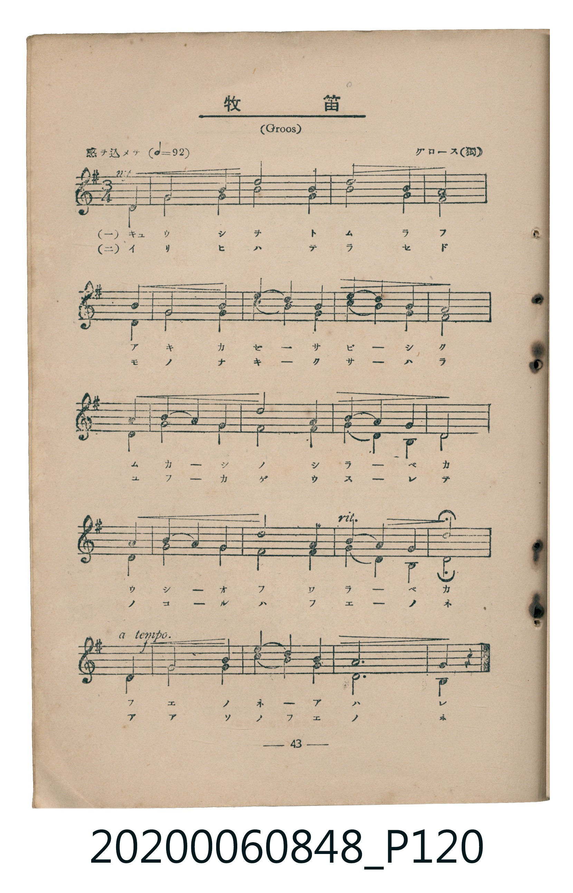
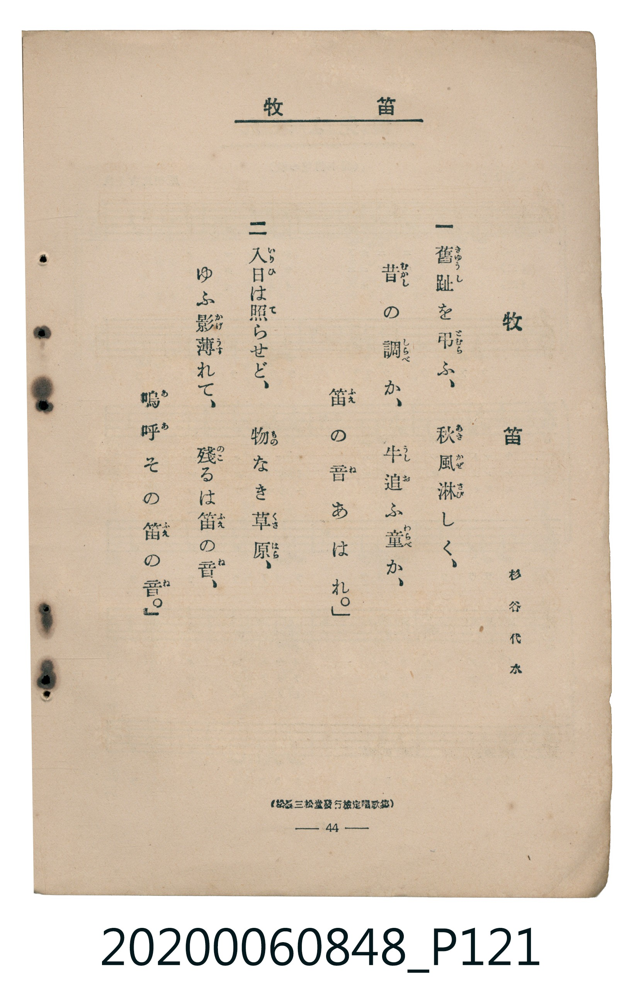

# 牧笛

<audio controls src="bokuteki.mp3"></audio>

- 詞：杉谷代水
- 曲：グロース（獨）（Groos）
- 臺灣教育會公認《新定兒童唱歌》高等科男子用（2020.006.0848）

## 說明

原書資訊與歌詞全文（對應 P120.jpg – P121.jpg，書頁 pp. 43–44，高二重音第 3 首）：
調性與拍號：ト長調（1 升記號）、3/4 拍（感ヲ込メテ ♩=92，二部重音合唱，弱起第 3 拍進入）
出處註記：（松邑三松堂發行檢定唱歌集）

## 歌詞

```text
一　舊趾（きゆうし）を弔（とむら）ふ、秋風淋（あきかぜさび）しく、
昔（むかし）の調（しらべ）か、牛追（うしお）ふ童（わらべ）か、
笛（ふえ）の音（ね）あはれ。」

二　入日（いりひ）は照（て）らせど、物（もの）なき草原（くさはら）、
ゆふ影薄（かげうす）れて、殘（のこ）るは笛（ふえ）の音（ね）、
嗚呼（ああ）その笛（ふえ）の音（ね）。」
```

## ABC

```abc
X:1
T:牧笛
C:曲：グロース（獨）（Groos）
M:3/4
L:1/16
Q:1/4=92
K:G
V:V1 name="Part1" snm="Par"
V:V2 name="Part2" snm="Par"
[V:V1]
!mf! z4 z4 D4 | G8 B4 | d8 B4 | d8 B4 |
A8 D4 | G8 B4 | c4 B4 A4 | d4 c4 B4 |
A8 D4 | B4 A4 G4 | d8 B4 | A4 G4 F4 |
G8 D4 | B4 A4 G4 | d8 B4 | A4 G4 F4 |
!f! d8 D4 | G8 B4 | c4 B4 A4 | A12 |
G8 z4 |
[V:V2]
!mf! z4 z4 D4 | G8 G4 | B8 G4 | A8 G4 |
D8 D4 | G8 G4 | A4 G4 F4 | B4 A4 G4 |
D8 D4 | G4 F4 E4 | G8 G4 | F4 E4 A,4 |
G8 D4 | G4 F4 E4 | G8 G4 | F4 E4 A,4 |
!f! D8 D4 | G8 G4 | A4 G4 F4 | D12 |
B,,8 z4 |
```

## TMD 檔案連結

- [主旋律 TMD 檔案](bokuteki.tmd) [[在 TMD Studio 編輯](https://tmdlang.github.io/Tmd-TS/#tmd=s7IKdvYPcrWy4tLSUnjeufz5mtkKWlpcirYKlkZc9rYK7lw2xvomdlx1CkovVs57v2fWs7mdLzZsf7J78bMNW5RAws9mbwIKP27a8Lh57ePmPY-bdr7f0_G8d8X7PZ1AhntRfn4xkAlW-qJ91_PGxc-mznzRtOnZnOanrWterOp93ND1bNqGp-tmPW2d9Hz10qdTNj5b2_O4ofvl6hnP13Y-Xz7x-ZTtT9dOeD4FaGKHkYGRgZ6BgZmegYWJBdhYLn0tBVtqAS4FBYWnffOfzd7xYnP7ixVdLzragY4Bevxp64pn09qBDni6ofdZe6dCgCHQHVkF6QqPGiaDOIYgzvs9PUCdLxc0KhQU6CmYGAPlTEyAgkCfPNnV87K99-X8zc_XrFEwVni5bBo4eGaBLHyxav-zhuUgq7p7X8ycDwrM5o6XU7cDxYEWGio87QU6ZQZYpvNxQyMwOhSAKoFSz1rmP27e9GLfnsfNCx83tyk8mrnS1tIIaCHItuYVEAufTugABilQ8OmejS-2bofYD9T_smHT09alQCPBfm7f9WLm1BcrdgMtAtoPMnvuvpdNE5_s6AQyni5oej5zz4uFPc9WLQLFEziGXs5uA2kG6X6yo-FxQ8OLjq4X2_YBtT5u7H3c1Pa4EYimg5zcNOnpnilg8RWPmxoeNwH93fm4cSvQK8-Xd79ctOLZ9m6wbBNIY2P348Y5jxunPm7cDFY2_XFjP1AlyJpnM8CmAI0AKQIb3bgOEkggdU1ALjDpAclukNGds1_s3wuWArnjcWMXxFZgCgMb0o-mHmQBMO2DNWx93NgBMR0YfmCRtWAu0IHrHzcB02bT44ZeiM93AXkNwHB8Nh1sbGPL46aux43ADAFUvv5563Kw4DJwKABFZj9uXAl220qwG4DmrQOrXAX0-YveTmDKA6vvB_sfaBU4pCBuA4fo1qd7N76Y1gJWBAyCSWC_zQSb3gO0Bqj02Tpg_AFl1z1unAwWBypbT8BfEAueTp_1dOIeWEQ0gdXNBSolpBkcFkD9lGc-KFDQ0ufi8k3MzLMKSCwqMXSoMahRqAbZoGBjomUHZgCzPCQ1P93Q_3x9A7j4AZY9SxX0geG0BGQASFWNggEQVuem1SqYxivUgCMMpBWYBYApFpicFTRMFCAmaIKNWAbUvR2oDZipgLgDzFoAxCvBrKkKGo-bFmkiTDdU0AVmpRoFUzTaCEhjWLirB4uFa4EWrgYZ3gTMwnuA1FawTZMhHLBTmtYDrW1egMVaEyBpBLYWxMJh7Y5OLNauRjK_uQ_OWgkWbp4JtnY1yLfLkKwFWWaI4ktDBXOgdWD3oNv7dPZsLPZuh9i7Chqcj5vXY7e3eSox9oIEqrHF7a4pWOxeAfYqyLpeiCsWgTn9YHIN7tAFhaouVNwAaFEtUto0IiJtEp8YUZwA8rExlAY5ARwC8bgTFoZmeDDBww-rbkj6QNIN1GMGi1WQNgjfiEBEE2cA2Al4ogy3J8A6QdFgHA9iQSNC104BFBcKQFqZiwsA)]
- [鋼琴伴奏 TMD 檔案](bokuteki_piano.tmd) [[在 TMD Studio 編輯](https://tmdlang.github.io/Tmd-TS/#tmd=s7IKdvYPcrWy4tLSUnjeufz5mtnv93S87N7zfMKWJ3u2PF3a_7yz4_2eTgUtLS5FWwVLIy57WwV3LhtjfRM7rjoFpRcr573fM-vZ3M4XG7Y_2b342YYtSiDhZ7M3AYUfN2143Lz2cfOex007gaY-710BNAnIcC_Kzy8GMsFKX7Tvet64-NnUmS-aNj2b0_y0dc2LVb2PG7qeTdvwdN2sp62Tnq9e-nTKxmdrex43dL9cPeP52s7nyyc-n7L96doJz6cATewwMjAy0DMwMNMzsDCxABvL5ZuYmWcVkJmYlx_k4VBjUKNQzaUABDYmWnZghr6WwtM9G19s3f50Q__z9Q0KWvpg4RoFAyCszk2rVTCNV6jhgql9vmbNkx0NLxb2IBQaKugqGANpUzTaCEhj6N3Vg1WvCZA0AusFsXDo3dGJohekwxDFPkMFc6AesKHomp_Onk2cZpBANTZf75qC1-UgF-tCxQ2AWmuRg96HhkEP8oUxlAY5AuyreCLDHqIJ6nV4mGDVjRb6YD1msOAGaYPwjYiNAbwGgJ1AbDSgeAKsExQRxvEgFjQqdO0UQLGhAKSVubgA)]

## 分析

```text
================================================================================
📊 TMD Song Profile: [ 牧笛 ]
================================================================================
⏱  Duration:       0:41 (41.1s), 21 measures total
🎼 Key & Tempo:    首調基準 G, != 92.0 BPM, <3/4>
   - 分析範圍：      由實際發聲的音符與和弦推測調性；播放脈絡另行呈現
🎤 人聲音域:    D4 (MIDI 62) – D5 (MIDI 74) [跨度: 12 個半音 / 1.0 個八度, 難度: easy]
   - 最低音:  D4 in [Main #1 @ m.1, 0:01]
   - 最高音: D5 in [Main #1 @ m.3, 0:03]
   - 適合: soprano, mezzo-soprano, contralto, tenor, baritone, bass
🏛  結構:      Main (41.1s)
⚡ 編曲密度:        Peak 2 軌道同時演奏
🗝  調性診斷：       G 大調（純淨自然大調，未偵測到可信轉調）
   - 風格氣質:    純淨自然大調（陽光明朗、易唱易記，無明顯調外色彩）
   - 轉調歷程:    全曲維持單一推測調性（未偵測到可信轉調）
   - 核心骨幹音:  G, D, A, B, F#
   - 調性數值:    G 大調 [相關度: 0.90, 穩定度: High, 自然音純度: 100.0%]
   - 候選調性 (K-S): G 大調 (0.90), D 大調 (0.78), B 小調 (0.58)
   - 五度圈歷程:   +1
   - 各段落調性細節:
     • [Main #1]: G 大調 (r: 0.90, 自然音純度: 100.0%)

  [ 五度圈游移軌跡 ]
               C  
         F           [G ]*
      Bb               D  
      Eb               A  
         Ab           E  
            Db       B  
               F# 
     (* = active key center)

  [ 十二半音累積音高分佈 ]
     C  : ██                         2.5%
     C# :                            0.0%
     D  : ███████████████████       25.0%
     D# :                            0.0%
     E  : ███                        3.3%
     F  :                            0.0%
     F# : █████                      6.7%
     G  : ████████████████████████  31.7%
     G# :                            0.0%
     A  : █████████████             16.7%
     A# :                            0.0%
     B  : ███████████               14.2%
--------------------------------------------------------------------------------
Assignment 軌道音域：
  - Part1         : D4 – D5 (12 個半音 / 1.0 個八度, 46 個音符)
  - Part2         : B2 – B4 (24 個半音 / 2.0 個八度, 46 個音符)
================================================================================
```


## 原書掃描頁






